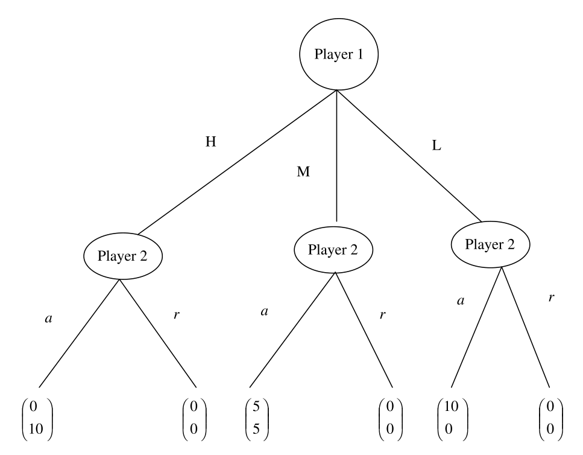

# Practice plan — Lecture 1 (Static games of complete information I: dominance and IESDS)

24 existing book exercises in one sequence of rising complexity, each reproduced verbatim under
its tier table (transcribed from the PDF page images on 2026-10-20). Sources: Tadelis (2013), the book the slides follow; Muñoz-Garcia & Toro-Gonzalez
(2019), worked answers after every exercise; Gibbons (1992); MWG (1995). Lecture slides:
`Aula/Lecture01.pdf`. Class plan: [[Map/study-guide|study guide]]; book map:
[[Map/books-index|books-index]]. Worked solutions: `Listas/pratica-lecture-01-solutions.pdf`.
Exam-style list for the same lecture: `Listas/lista-lecture-01.tex`.

**Answers in the books.** Muñoz-Garcia: a worked answer follows each exercise. MWG 8.B.1–8.B.7:
in the MWG solutions manual (`Livros/`). Gibbons 1.2: in an unofficial, unfinished manual
(`D:/Livros/Mercado/Economia/`, not copied). Tadelis: none in the book; the preface (p. xiii)
says about half are solved on Princeton UP's website (not checked).

**Verification.** Pages come from the book map built on 2026-10-13 (`Map/books-index.md`,
offsets in `Livros/book-registry.json`). Spot-checked in the PDFs on the same day: Tadelis
exercises 3.1–3.7 on p. 58 and 4.1–4.10 on pp. 76–78; Muñoz-Garcia Ex. 12 on p. 23.

**Not here on purpose.** The in-class mini case (pharmacies on a 7-block avenue, slides 31–33)
is graded in-class work; item 18 is the book's closest analogue. Tadelis 4.8–4.9 (beauty
contest, rationalizability), 5.2–5.3 and 6.2–6.3 (dominance by mixed strategies) belong to
Lecture 2.

## Weighting

| Block | Subtopic | Items | Weight | Why |
|---|---|---|---|---|
| B1 | Representing a game: normal form, strategies, trees to matrices | 6 | 25% | every later step starts from a correct matrix; the slides spend a third of the lecture here |
| B2 | Dominance, dominant-strategy equilibrium, Pareto optimality | 5 | 21% | the lecture's first solution concept and its two lessons |
| B3 | IESDS and common knowledge of rationality | 9 | 37% | the lecture's main tool, and the one the in-class case applies; densest in the books (all four have exercises) |
| B4 | Applications: auctions and spatial competition | 4 | 17% | the second-price auction and location examples from the slides |

| Level | Items | Count |
|---|---|---|
| Foundations (build a matrix, apply a definition, run IESDS on a small game) | 1–8 | 8 |
| Exam (proofs of the basic propositions, continuous strategies, multi-step modelling) | 9–18 | 10 |
| Advanced (MWG, order of elimination, Cournot with $n$ firms, auctions) | 19–24 | 6 |

---

## Tier 1 — Foundations

| # | Block | Source | Ch./Sec. | Exercise | Page | What it trains |
|---|---|---|---|---|---|---|
| 1 | B1 | Tadelis | Ch. 3, Exercises | 3.2 | 58 | Turning a verbal two-player story into a payoff matrix (a zero-sum case) |
| 2 | B1 | Tadelis | Ch. 3, Exercises | 3.4 | 58 | The same for a stag-hunt story; which payoff orderings make it one |
| 3 | B1 | Muñoz-Garcia | Ch. 1 | Ex. 2 | 4 | Reading strategy sets off a game tree and writing the matrix |
| 4 | B1 | Muñoz-Garcia | Ch. 1 | Ex. 5 | 8 | The prisoner's dilemma as a tree and as a matrix |
| 5 | B2 | Muñoz-Garcia | Ch. 1 | Ex. 13 | 26 | Finding dominant and dominated strategies, then eliminating |
| 6 | B3 | Tadelis | Ch. 4, Exercises | 4.5 | 77 | IESDS round by round on a 3×3 matrix |
| 7 | B3 | Gibbons | §1.1, Problems | 1.2 | 48 | IESDS on a 3×3 matrix (the pure Nash part previews Lecture 2) |
| 8 | B3 | Muñoz-Garcia | Ch. 1 | Ex. 9 | 17 | Games where IESDS removes nothing, and what that says about its bite |

### Statements

#### 1. Tadelis 3.2

<!-- id: Tadelis 3.2 -->
**Source.** Tadelis (2013), *Game Theory: An Introduction*, Exercise 3.2 "Penalty Kicks", p. 58. Reproduced verbatim.

> **Penalty Kicks:** Imagine a kicker and a goalie who confront each other in a penalty kick that will determine the outcome of a soccer game. The kicker can kick the ball left or right, while the goalie can choose to jump left or right. Because of the speed of the kick, the decisions need to be made simultaneously. If the goalie jumps in the same direction as the kick, then the goalie wins and the kicker loses. If the goalie jumps in the opposite direction of the kick, then the kicker wins and the goalie loses. Model this as a normal-form game and write down the matrix that represents the game you modeled.

#### 2. Tadelis 3.4

<!-- id: Tadelis 3.4 -->
**Source.** Tadelis (2013), *Game Theory: An Introduction*, Exercise 3.4 "Hunting", p. 58. Reproduced verbatim.

> **Hunting:** Two hunters, players 1 and 2, can each choose to hunt a stag, which provides a rather large and tasty meal, or hunt a hare—also tasty, but much less filling. Hunting stags is challenging and requires mutual cooperation. If either hunts a stag alone, then the stag will get away, while hunting the stag together guarantees that the stag will be caught. Hunting hares is an individualistic enterprise that is not done in pairs, and whoever chooses to hunt a hare will catch one. The payoff from hunting a hare is 1, while the payoff to each from hunting a stag together is 3. The payoff from an unsuccessful stag hunt is 0. Represent this game as a matrix.

#### 3. Muñoz-Garcia Ex. 2

<!-- id: Muñoz-Garcia Ex. 2 -->
**Source.** Muñoz-Garcia & Toro-Gonzalez (2019), *Strategy and Game Theory: Practice Exercises with Answers*, Ch. 1, Exercise 2 "From Extensive Form to Normal Form Representation-II", p. 4. Reproduced verbatim (statement only; the book's worked answer follows it).

> Consider the extensive form game in Fig. 1.3.
>
> 
>
> *Fig. 1.3* Extensive-form game
>
> **Part (a)** Describe player 1's strategy space.
>
> **Part (b)** Describe player 2's strategy space.
>
> **Part (c)** Take your results from parts (*a*) and (*b*) and construct a matrix representing the normal form game of this game tree.

#### 4. Muñoz-Garcia Ex. 5

<!-- id: Muñoz-Garcia Ex. 5 -->
**Source.** Muñoz-Garcia & Toro-Gonzalez (2019), *Strategy and Game Theory: Practice Exercises with Answers*, Ch. 1, Exercise 5 "Prisoners' Dilemma Game", p. 8. Reproduced verbatim (statement only; the book's worked answer follows it).

> Two individuals have been detained for a minor offense and confined in separate cells. The investigators suspect that these individuals are involved in a major crime, and separately offer each prisoner the following deal, as depicted in Fig. 1.8: if you confess while your partner doesn't, you will leave today without serving any time in jail; if you confess and your partner also confesses, you will have to serve 5 years in jail (since prosecutors probably can accumulate more evidence against each prisoner when they both confess); if you don't confess and your partner does, you will have to serve 15 years in jail (since you did not cooperate with the prosecution but your partner's confession provides the police with enough evidence against you); finally, if neither of you confess, you will have to serve one year in jail.
>
> | Prisoner 1 \ Prisoner 2 | *Confess* | *Not confess* |
> |---|---|---|
> | *Confess* | -5, -5 | 0, -15 |
> | *Not confess* | -15, 0 | -1, -1 |
>
> *Fig. 1.8* Normal-form of Prisoners' dilemma game
>
> **Part (a)** Draw the prisoners' dilemma game in its extensive form representation.
>
> **Part (b)** Mark its initial node, its terminal nodes, and its information set. Why do we represent this information set in the prisoners' dilemma game in its extensive form?
>
> **Part (c)** How many strategies player 1 has? What about player 2?

#### 5. Muñoz-Garcia Ex. 13

<!-- id: Muñoz-Garcia Ex. 13 -->
**Source.** Muñoz-Garcia & Toro-Gonzalez (2019), *Strategy and Game Theory: Practice Exercises with Answers*, Ch. 1, Exercise 13 "Iterated Deletion of Strictly Dominated Strategies (IDSDS)", p. 26. Reproduced verbatim (statement only; the book's worked answer follows it).

> Consider the following normal form game (Fig. 1.33)
>
> | Player 1 \ Player 2 | *Left* | *Right* |
> |---|---|---|
> | *Up* | -10, 10 | 0, 12 |
> | *Middle* | -12, 0 | 2, 2 |
> | *Down* | -9, 0 | 1, 0 |
>
> *Fig. 1.33* Normal-form game
>
> (a) Find strictly dominant strategies (if any) for player 1 and for player 2.
>
> (b) Find strictly dominated strategies (if any) for player 1 and for player 2.
>
> (c) If you apply iterative deletion of strictly dominated strategies (IDSDS), what is the surviving strategy pair (or pairs)? Explain the steps you use in IDSDS, and why you use them.

#### 6. Tadelis 4.5

<!-- id: Tadelis 4.5 -->
**Source.** Tadelis (2013), *Game Theory: An Introduction*, Exercise 4.5 "Iterated Elimination", p. 77. Reproduced verbatim.

> **Iterated Elimination:** In the following normal-form game, which strategy profiles survive iterated elimination of strictly dominated strategies?
> 
> | Player 1 \ Player 2 | $L$ | $C$ | $R$ |
> |:---:|:---:|:---:|:---:|
> | $U$ | 6, 8 | 2, 6 | 8, 2 |
> | $M$ | 8, 2 | 4, 4 | 9, 5 |
> | $D$ | 8, 10 | 4, 6 | 6, 7 |

#### 7. Gibbons 1.2

<!-- id: Gibbons 1.2 -->
**Source.** Gibbons (1992), *Game Theory for Applied Economists*, §1.1 Problems, Problem 1.2, p. 48. Reproduced verbatim.

> 1.2. In the following normal-form game, what strategies survive iterated elimination of strictly dominated strategies? What are the pure-strategy Nash equilibria?
>
> |   | $L$ | $C$ | $R$ |
> |---|---|---|---|
> | $T$ | 2, 0 | 1, 1 | 4, 2 |
> | $M$ | 3, 4 | 1, 2 | 2, 3 |
> | $B$ | 1, 3 | 0, 2 | 3, 0 |

#### 8. Muñoz-Garcia Ex. 9

<!-- id: Muñoz-Garcia Ex. 9 -->
**Source.** Muñoz-Garcia & Toro-Gonzalez (2019), *Strategy and Game Theory: Practice Exercises with Answers*, Ch. 1, Exercise 9 "Applying IDSDS in the Battle of the Sexes Game", p. 17. Reproduced verbatim (statement only; the book's worked answer follows it).

> A husband and a wife are leaving work, and do not remember which event they are attending to tonight. Both of them, however, remember that last night's argument was about attending either the football game (the most preferred event for the husband) or the opera (the most preferred event for the wife). To make matters worse, their cell phones broke, so they cannot call each other to confirm which event they are attending to. As a consequence, they must simultaneously and independently decide whether to attend to the football game or the opera.
>
> | *Husband* \ *Wife* | *Football* | *Opera* |
> |---|---|---|
> | *Football* | 3, 1 | 0, 0 |
> | *Opera* | 0, 0 | 1, 3 |
>
> *Fig. 1.22* Normal-form representation of the Battle of the Sexes game
>
> The payoff matrix in Fig. 1.22, describes the preference of the husband (wife) for the football game (opera, respectively). Payoffs also indicate that both players prefer to be together rather than being alone (even if they are alone at their most preferred event). Apply IDSDS. What is the most precise prediction about how this game will be played when you apply IDSDS?

## Tier 2 — Exam level

| # | Block | Source | Ch./Sec. | Exercise | Page | What it trains |
|---|---|---|---|---|---|---|
| 9 | B1 | Tadelis | Ch. 3, Exercises | 3.6 | 58 | Normal form with continuous strategies and piecewise payoffs |
| 10 | B1 | Tadelis | Ch. 3, Exercises | 3.7 | 58 | Normal form of a three-player threshold game |
| 11 | B2 | Tadelis | Ch. 4, Exercises | 4.1 | 76 | Proving that a strict dominant-strategy equilibrium is unique |
| 12 | B2 | Tadelis | Ch. 4, Exercises | 4.2 | 76 | Counterexamples on existence and uniqueness of weak dominant-strategy equilibrium |
| 13 | B2 | MWG | §8.B, Exercises | 8.B.1 | 262 | When each of $n$ firms has a strictly dominant level of a costly action |
| 14 | B3 | Muñoz-Garcia | Ch. 1 | Ex. 12 | 23 | What rationality alone removes vs. what common knowledge of rationality removes |
| 15 | B3 | Tadelis | Ch. 4, Exercises | 4.6 | 77 | IESDS with continuous strategies, by bounding best replies |
| 16 | B3 | Tadelis | Ch. 4, Exercises | 4.7 | 77–78 | Building a three-strategy game from win probabilities, then eliminating |
| 17 | B4 | Tadelis | Ch. 4, Exercises | 4.3 | 76 | A discrete first-price auction as a matrix; dominated bids and IESDS |
| 18 | B4 | Tadelis | Ch. 4, Exercises | 4.10 | 78 | A discrete location game: dominated locations and the surviving set (closest analogue of the pharmacy case) |

### Statements

#### 9. Tadelis 3.6

<!-- id: Tadelis 3.6 -->
**Source.** Tadelis (2013), *Game Theory: An Introduction*, Exercise 3.6 "Price Competition", p. 58. Reproduced verbatim.

> **Price Competition:** Imagine a market with demand $p(q) = 100 - q$. There are two firms, 1 and 2, and each firm $i$ has to simultaneously choose its price $p_i$. If $p_i < p_j$, then firm $i$ gets all of the market while no one demands the good of firm $j$. If the prices are the same then both firms split the market demand equally. Imagine that there are no costs to produce any quantity of the good. (These are two large dairy farms, and the product is manure.) Write down the normal form of this game.

#### 10. Tadelis 3.7

<!-- id: Tadelis 3.7 -->
**Source.** Tadelis (2013), *Game Theory: An Introduction*, Exercise 3.7 "Public Good Contribution", p. 58. Reproduced verbatim.

> **Public Good Contribution:** Three players live in a town, and each can choose to contribute to fund a streetlamp. The value of having the streetlamp is 3 for each player, and the value of not having it is 0. The mayor asks each player to contribute either 1 or nothing. If at least two players contribute then the lamp will be erected. If one player or no players contribute then the lamp will not be erected, in which case any person who contributed will not get his money back. Write down the normal form of this game.

#### 11. Tadelis 4.1

<!-- id: Tadelis 4.1 -->
**Source.** Tadelis (2013), *Game Theory: An Introduction*, Exercise 4.1, p. 76. Reproduced verbatim.

> **Prove Proposition 4.1:** If the game $\Gamma = \langle N, \{S_i\}_{i=1}^{n}, \{v_i\}_{i=1}^{n} \rangle$ has a strictly dominant strategy equilibrium $s^D$, then $s^D$ is the unique dominant strategy equilibrium.

#### 12. Tadelis 4.2

<!-- id: Tadelis 4.2 -->
**Source.** Tadelis (2013), *Game Theory: An Introduction*, Exercise 4.2 "Weak Dominance", p. 76. Reproduced verbatim.

> **Weak Dominance:** We call the strategy profile $s^W \in S$ a **weakly dominant strategy equilibrium** if $s_i^W \in S_i$ is a weakly dominant strategy for all $i \in N$, that is, if $v_i(s_i, s_{-i}) \ge v_i(s_i', s_{-i})$ for all $s_i' \in S_i$ and for all $s_{-i} \in S_{-i}$.
> 
> a. Provide an example of a game in which there is no weakly dominant strategy equilibrium.
> 
> b. Provide an example of a game in which there is more than one weakly dominant strategy equilibrium.

#### 13. MWG 8.B.1

<!-- id: MWG 8.B.1 -->
**Source.** Mas-Colell, Whinston & Green (1995), *Microeconomic Theory*, Ch. 8 Exercises, Exercise 8.B.1^A, p. 262. Reproduced verbatim.

> There are $I$ firms in an industry. Each can try to convince Congress to give the industry a subsidy. Let $h_i$ denote the number of hours of effort put in by firm $i$, and let $c_i(h_i) = w_i(h_i)^2$, where $w_i$ is a positive constant, be the cost of this effort to firm $i$. When the effort levels of the firms are $(h_1, \ldots, h_I)$, the value of the subsidy that gets approved is $\alpha \sum_i h_i + \beta(\prod_i h_i)$, where $\alpha$ and $\beta$ are constants.
>
> Consider a game in which the firms decide simultaneously and independently how many hours they will each devote to this effort. Show that each firm has a strictly dominant strategy if and only if $\beta = 0$. What is firm $i$'s strictly dominant strategy when this is so?

#### 14. Muñoz-Garcia Ex. 12

<!-- id: Muñoz-Garcia Ex. 12 -->
**Source.** Muñoz-Garcia & Toro-Gonzalez (2019), *Strategy and Game Theory: Practice Exercises with Answers*, Ch. 1, Exercise 12 "IDSDS and Rationality", p. 23. Reproduced verbatim (statement only; the book's worked answer follows it).

> Consider the following $3 \times 3$ matrix (Fig. 1.30):
>
> | Player 1 \ Player 2 | $F$ | $C$ | $B$ |
> |---|---|---|---|
> | $F$ | 0, 5 | 2, 4 | 2, 3 |
> | $C$ | 2, 3 | 0, 5 | 3, 2 |
> | $B$ | 5, 0 | 2, 4 | 2, 3 |
>
> *Fig. 1.30* Normal-form representation of a three-players game
>
> a. Does any player have a strictly dominant strategy?
>
> b. Does any player have a strictly dominated strategy?
>
> c. Use your results from part (b) to delete players' strictly dominated strategies assuming rationality, but not assuming common knowledge of rationality. [Hint: This means that every player can delete the strategies he finds to be strictly dominated but cannot put himself in the shoes of his opponent to delete the strategies his opponent finds to be strictly dominated.]
>
> d. Use your results from part (b) to delete players' strictly dominated strategies assuming common knowledge of rationality. [Hint: This means that players can put themselves in the shoes of their opponents to delete strategies each other finds to be strictly dominated, as in the standard approach of IDSDS.]

#### 15. Tadelis 4.6

<!-- id: Tadelis 4.6 -->
**Source.** Tadelis (2013), *Game Theory: An Introduction*, Exercise 4.6 "Roommates", p. 77. Reproduced verbatim.

> **Roommates:** Two roommates each need to choose to clean their apartment, and each can choose an amount of time $t_i \ge 0$ to clean. If their choices are $t_i$ and $t_j$, then player $i$'s payoff is given by $(10 - t_j)t_i - t_i^2$. (This payoff function implies that the more one roommate cleans, the less valuable is cleaning for the other roommate.)
> 
> a. What is the best response correspondence of each player $i$?
> 
> b. Which choices survive one round of IESDS?
> 
> c. Which choices survive IESDS?

#### 16. Tadelis 4.7

<!-- id: Tadelis 4.7 -->
**Source.** Tadelis (2013), *Game Theory: An Introduction*, Exercise 4.7 "Campaigning", pp. 77–78. Reproduced verbatim.

> **Campaigning:** Two candidates, 1 and 2, are running for office. Each has one of three choices in running his campaign: focus on the positive aspects of one's own platform (call this a positive campaign [$P$]), focus on the positive aspects of one's own platform while attacking one's opponent's campaign (call this a balanced campaign [$B$]), or finally focus only on attacking one's opponent (call this a negative campaign [$N$]). All a candidate cares about is the probability of winning, so assume that if a candidate expects to win with probability $\pi \in [0, 1]$, then his payoff is $\pi$. The probability that a candidate wins depends on his choice of campaign and his opponent's choice. The probabilities of winning are given as follows:
> 
> If both choose the same campaign then each wins with probability 0.5.
> 
> If candidate $i$ uses a positive campaign while $j \neq i$ uses a balanced one then $i$ loses for sure.
> 
> If candidate $i$ uses a positive campaign while $j \neq i$ uses a negative one then $i$ wins with probability 0.3.
> 
> If candidate $i$ uses a negative campaign while $j \neq i$ uses a balanced one then $i$ wins with probability 0.6.
> 
> a. Model this story as a normal-form game. (It suffices to be specific about the payoff function of one player and to explain how the other player's payoff function is different and why.)
> 
> b. Write down the game in matrix form.
> 
> c. What happens at each stage of elimination of strictly dominated strategies? Will this procedure lead to a clear prediction?

#### 17. Tadelis 4.3

<!-- id: Tadelis 4.3 -->
**Source.** Tadelis (2013), *Game Theory: An Introduction*, Exercise 4.3 "Discrete First-Price Auction", p. 76. Reproduced verbatim.

> **Discrete First-Price Auction:** An item is up for auction. Player 1 values the item at 3 while player 2 values the item at 5. Each player can bid either 0, 1, or 2. If player $i$ bids more than player $j$ then $i$ wins the good and pays his bid, while the loser does not pay. If both players bid the same amount then a coin is tossed to determine who the winner is, and the winner gets the good and pays his bid while the loser pays nothing.
> 
> a. Write down the game in matrix form.
> 
> b. Does any player have a strictly dominated strategy?
> 
> c. Which strategies survive IESDS?

#### 18. Tadelis 4.10

<!-- id: Tadelis 4.10 -->
**Source.** Tadelis (2013), *Game Theory: An Introduction*, Exercise 4.10 "Popsicle Stands", p. 78. Reproduced verbatim.

> **Popsicle Stands:** Five lifeguard towers are lined up along a beach; the leftmost tower is number 1 and the rightmost tower is number 5. Two vendors, players 1 and 2, each have a popsicle stand that can be located next to one of five towers. There are 25 people located next to each tower, and each person will purchase a popsicle from the stand that is closest to him or her. That is, if player 1 locates his stand at tower 2 and player 2 at tower 3, then 50 people (at towers 1 and 2) will purchase from player 1, while 75 (from towers 3, 4, and 5) will purchase from vendor 2. Each purchase yields a profit of \$1.
> 
> a. Specify the strategy set for each player. Are there any strictly dominated strategies?
> 
> b. Find the set of strategies that survive rationalizability.

## Tier 3 — Advanced

| # | Block | Source | Ch./Sec. | Exercise | Page | What it trains |
|---|---|---|---|---|---|---|
| 19 | B3 | Muñoz-Garcia | Ch. 1 | Ex. 16 | 31 | Strict vs. weak iterated deletion, and how the order of deletion matters for weak |
| 20 | B3 | MWG | §8.B, Exercises | 8.B.4 | 262 | Proving that the order of deletion does not matter under strict dominance |
| 21 | B3 | MWG | §8.B, Exercises | 8.B.5 | 262 | Linear Cournot: IESDS pins down the outcome with two firms but not with three |
| 22 | B2 | MWG | §8.B, Exercises | 8.B.7 | 262 | Why a strictly dominant strategy must be pure (first contact with mixed strategies) |
| 23 | B4 | MWG | §8.B, Exercises | 8.B.3 | 262 | Truthful bidding in a second-price auction: weakly dominant, and the only such bid |
| 24 | B4 | Tadelis | Ch. 4, Exercises | 4.4 | 76–77 | Weak dominance of bidding one's value under proxy bidding |

### Statements

#### 19. Muñoz-Garcia Ex. 16

<!-- id: Muñoz-Garcia Ex. 16 -->
**Source.** Muñoz-Garcia & Toro-Gonzalez (2019), *Strategy and Game Theory: Practice Exercises with Answers*, Ch. 1, Exercise 16 "Equilibrium Predictions from IDSDS Versus IDWDS", p. 31. Reproduced verbatim (statement only; the book's worked answer follows it).

> In previous exercises applying IDSDS we sometimes started finding strictly dominated strategies for the row player, while in other exercises we began identifying strictly dominated strategies for the column player (or the matrix player in games with three players). While the order of deletion does not affect the equilibrium outcome when applying IDSDS, it *can* affect the set of equilibrium outcomes when we delete weakly (rather than strictly) dominated strategies.
>
> Use the game in Fig. 1.37 to show that the order in which weakly dominated strategies are eliminated can affect equilibrium outcomes.
>
> | Player 1 \ Player 2 | $L$ | $M$ | $R$ |
> |---|---|---|---|
> | $U$ | 2, 1 | 1, 1 | 0, 0 |
> | $C$ | 1, 2 | 3, 1 | 2, 1 |
> | $D$ | 2, -2 | 1, -1 | -1, -1 |
>
> *Fig. 1.37* Normal-form game

#### 20. MWG 8.B.4

<!-- id: MWG 8.B.4 -->
**Source.** Mas-Colell, Whinston & Green (1995), *Microeconomic Theory*, Ch. 8 Exercises, Exercise 8.B.4^C, p. 262. Reproduced verbatim.

> Show that the order of deletion does not matter for the set of strategies surviving a process of iterated deletion of strictly dominated strategies.

#### 21. MWG 8.B.5

<!-- id: MWG 8.B.5 -->
**Source.** Mas-Colell, Whinston & Green (1995), *Microeconomic Theory*, Ch. 8 Exercises, Exercise 8.B.5^C, p. 262. Reproduced verbatim.

> Consider the Cournot duopoly model (discussed extensively in Chapter 12) in which two firms, 1 and 2, simultaneously choose the quantities they will sell on the market, $q_1$ and $q_2$. The price each receives for each unit given these quantities is $P(q_1, q_2) = a - b(q_1 + q_2)$. Their costs are $c$ per unit sold.
>
> **(a)** Argue that successive elimination of strictly dominated strategies yields a unique prediction in this game.
>
> **(b)** Would this be true if there were three firms instead of two?

#### 22. MWG 8.B.7

<!-- id: MWG 8.B.7 -->
**Source.** Mas-Colell, Whinston & Green (1995), *Microeconomic Theory*, Ch. 8 Exercises, Exercise 8.B.7^B, p. 262. Reproduced verbatim.

> Show that any strictly dominant strategy in game $[I, \{\Delta(S_i)\}, \{u_i(\cdot)\}]$ must be a pure strategy.

#### 23. MWG 8.B.3

<!-- id: MWG 8.B.3 -->
**Source.** Mas-Colell, Whinston & Green (1995), *Microeconomic Theory*, Ch. 8 Exercises, Exercise 8.B.3^B, p. 262. Reproduced verbatim.

> Consider the following auction (known as a *second-price*, or *Vickrey*, auction). An object is auctioned off to $I$ bidders. Bidder $i$'s valuation of the object (in monetary terms) is $v_i$. The auction rules are that each player submit a bid (a nonnegative number) in a sealed envelope. The envelopes are then opened, and the bidder who has submitted the highest bid gets the object but pays the auctioneer the amount of the *second-highest* bid. If more than one bidder submits the highest bid, each gets the object with equal probability. Show that submitting a bid of $v_i$ with certainty is a weakly dominant strategy for bidder $i$. Also argue that this is bidder $i$'s unique weakly dominant strategy.

#### 24. Tadelis 4.4

<!-- id: Tadelis 4.4 -->
**Source.** Tadelis (2013), *Game Theory: An Introduction*, Exercise 4.4 "eBay's Recommendation", pp. 76–77. Reproduced verbatim.

> **eBay's Recommendation:** It is hard to imagine that anyone is not familiar with eBay, the most popular auction web site by far. In a typical eBay auction a good is placed for sale, and each bidder places a "proxy bid," which eBay keeps in memory. If you enter a proxy bid that is lower than the current highest bid, then your bid is ignored. If, however, it is higher, then the current bid increases up to one increment (say, \$0.01) above the *second highest* proxy bid. For example, imagine that three people have placed bids on a used laptop of \$55, \$98, and \$112. The current price will be at \$98.01, and if the auction ended the player who bid \$112 would win at a price of \$98.01. If you were to place a bid of \$103.45 then the player who bid \$112 would still win, but at a price of \$103.46, while if your bid was \$123.12 then you would win at a price of \$112.01.
> 
> Now consider eBay's historical recommendation that you think hard about the value you impute to the good and that you enter your true value as your bid—no more, no less. Assume that the value of the good for each potential bidder is independent of how much other bidders value it.
> 
> a. Argue that bidding more than your valuation is weakly dominated by actually bidding your valuation.
> 
> b. Argue that bidding less than your valuation is weakly dominated by actually bidding your valuation.
> 
> c. Use your analysis to make sense of eBay's recommendation. Would you follow it?

**Optional extras.**
- Muñoz-Garcia Ch. 1 Ex. 6–8 (pp. 11–14) and Ex. 11 (p. 20, three players): more IESDS drill, all with answers.
- Muñoz-Garcia Ch. 1 Ex. 17 (p. 33): a second weak-deletion order example, after item 19.
- Tadelis 3.1, 3.3, 3.5 (p. 58): the other verbal-to-matrix stories, if items 1–2 felt slow.

---

## Suggested study order

1. **Representation.** Read Tadelis Ch. 3 (pp. 43–58), then do items **1–4**, then **9, 10**.
2. **Dominance.** Read Tadelis §4.1 (pp. 59–63), then do **5, 11, 12, 13**.
3. **IESDS.** Read Tadelis §4.2 (pp. 63–69) and Gibbons §1.1.A–B (pp. 2–7), then do **6, 7, 8, 14**, then **15, 16**.
4. **Applications.** Do **17, 18**, then compare 18 with your in-class answer to the pharmacy case.
5. **Advanced.** Read MWG §8.A–8.B (pp. 235–241). Do **19** before **20**, then **21**, and **22–24** last.

---

## Consolidated Reading by Book

### Tadelis — Tadelis (2013)
| Topic | Chapter / Section | Pages | Priority |
|---|---|---|---|
| Common knowledge; normal-form games; the prisoner's dilemma | Ch. 3, §3.1–3.2 | p. 43–52 | Foundations |
| Solution concepts; existence, uniqueness, invariance; Pareto optimality | Ch. 3, §3.3 | p. 52–58 | Foundations |
| Exercises 3.2, 3.4, 3.6, 3.7 | Ch. 3, Exercises | p. 58 | Exam |
| Dominance; dominant-strategy equilibrium; evaluation | Ch. 4, §4.1 | p. 59–63 | Foundations |
| IESDS; common knowledge of rationality; Cournot by IESDS; evaluation | Ch. 4, §4.2 | p. 63–69 | Exam |
| Exercises 4.1–4.7, 4.10 | Ch. 4, Exercises | p. 76–78 | Exam |

### Gibbons — Gibbons (1992)
| Topic | Chapter / Section | Pages | Priority |
|---|---|---|---|
| Normal-form representation; IESDS | §1.1.A–B | p. 2–7 | Foundations |
| Problem 1.2 | §1.1, Problems | p. 48 | Foundations |

### MWG — Mas-Colell, Whinston & Green (1995)
| Topic | Chapter / Section | Pages | Priority |
|---|---|---|---|
| Normal form | §7.D | p. 228–231 | Advanced |
| Simultaneous-move games; dominant and dominated strategies | §8.A–8.B | p. 235–241 | Advanced |
| Exercises 8.B.1, 8.B.3, 8.B.4, 8.B.5, 8.B.7 | Ch. 8, Exercises | p. 262 | Advanced |

### Muñoz-Garcia — Muñoz-Garcia & Toro-Gonzalez (2019)
| Topic | Chapter / Section | Pages | Priority |
|---|---|---|---|
| Dominance solvable games: exercises with worked answers | Ch. 1 | p. 1–36 | Foundations |

## Consolidated Exercises

| # | Exercise | Book | Page | Topic | Level |
|---|---|---|---|---|---|
| 1 | 3.2 | Tadelis | p. 58 | Story to matrix (zero-sum) | Foundations |
| 2 | 3.4 | Tadelis | p. 58 | Story to matrix (stag hunt) | Foundations |
| 3 | 3.6 | Tadelis | p. 58 | Continuous strategies | Exam |
| 4 | 3.7 | Tadelis | p. 58 | Three-player normal form | Exam |
| 5 | 4.1 | Tadelis | p. 76 | Uniqueness of strict dominant-strategy equilibrium | Exam |
| 6 | 4.2 | Tadelis | p. 76 | Weak dominant-strategy equilibrium | Exam |
| 7 | 4.3 | Tadelis | p. 76 | First-price auction by IESDS | Exam |
| 8 | 4.4 | Tadelis | p. 76–77 | Proxy bidding | Advanced |
| 9 | 4.5 | Tadelis | p. 77 | IESDS on a 3×3 matrix | Foundations |
| 10 | 4.6 | Tadelis | p. 77 | IESDS with continuous strategies | Exam |
| 11 | 4.7 | Tadelis | p. 77–78 | Modelling then eliminating | Exam |
| 12 | 4.10 | Tadelis | p. 78 | Discrete location game | Exam |
| 13 | 1.2 | Gibbons | p. 48 | IESDS on a 3×3 matrix | Foundations |
| 14 | 8.B.1 | MWG | p. 262 | Dominant strategies with $n$ firms | Exam |
| 15 | 8.B.3 | MWG | p. 262 | Second-price auction | Advanced |
| 16 | 8.B.4 | MWG | p. 262 | Order independence of IESDS | Advanced |
| 17 | 8.B.5 | MWG | p. 262 | Cournot with two and three firms | Advanced |
| 18 | 8.B.7 | MWG | p. 262 | Strictly dominant strategies are pure | Advanced |
| 19 | Ex. 2 | Muñoz-Garcia | p. 4 | Tree to matrix | Foundations |
| 20 | Ex. 5 | Muñoz-Garcia | p. 8 | Prisoner's dilemma | Foundations |
| 21 | Ex. 9 | Muñoz-Garcia | p. 17 | IESDS without bite | Foundations |
| 22 | Ex. 12 | Muñoz-Garcia | p. 23 | Rationality vs. common knowledge | Exam |
| 23 | Ex. 13 | Muñoz-Garcia | p. 26 | Dominance, then IESDS | Foundations |
| 24 | Ex. 16 | Muñoz-Garcia | p. 31 | Strict vs. weak deletion | Advanced |

## Study roadmap

| Priority | Topic | Reading | Exercises | Suggested time |
|:---:|---|---|---|:---:|
| 1 | Representing a game | Tadelis Ch. 3 p. 43–58 | Tadelis 3.2, 3.4, 3.6, 3.7; Muñoz-Garcia Ex. 2, 5 | 1.5–2 h |
| 2 | Dominance and Pareto | Tadelis §4.1 p. 59–63 | Tadelis 4.1, 4.2; MWG 8.B.1; Muñoz-Garcia Ex. 13 | 1.5 h |
| 3 | IESDS and common knowledge | Tadelis §4.2 p. 63–69; Gibbons §1.1.B p. 4–7 | Tadelis 4.5, 4.6, 4.7; Gibbons 1.2; Muñoz-Garcia Ex. 9, 12 | 2–2.5 h |
| 4 | Auctions and location | Tadelis §4.2 (Cournot example p. 65) | Tadelis 4.3, 4.10 | 1 h |
| 5 | Advanced | MWG §8.A–8.B p. 235–241 | Muñoz-Garcia Ex. 16; MWG 8.B.3, 8.B.4, 8.B.5, 8.B.7; Tadelis 4.4 | 2.5–3 h |
