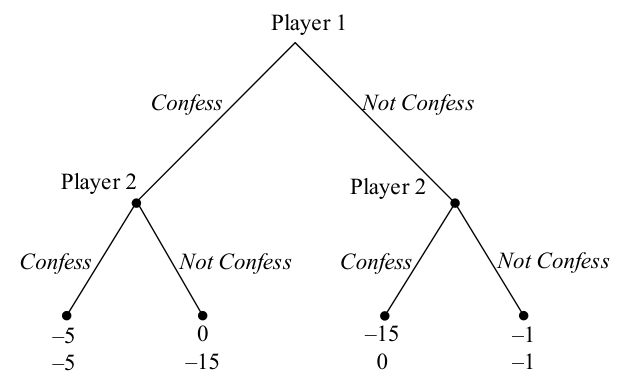
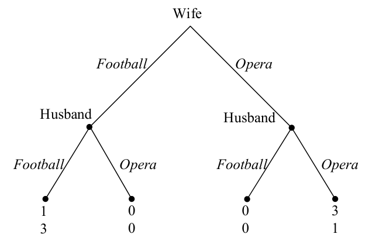
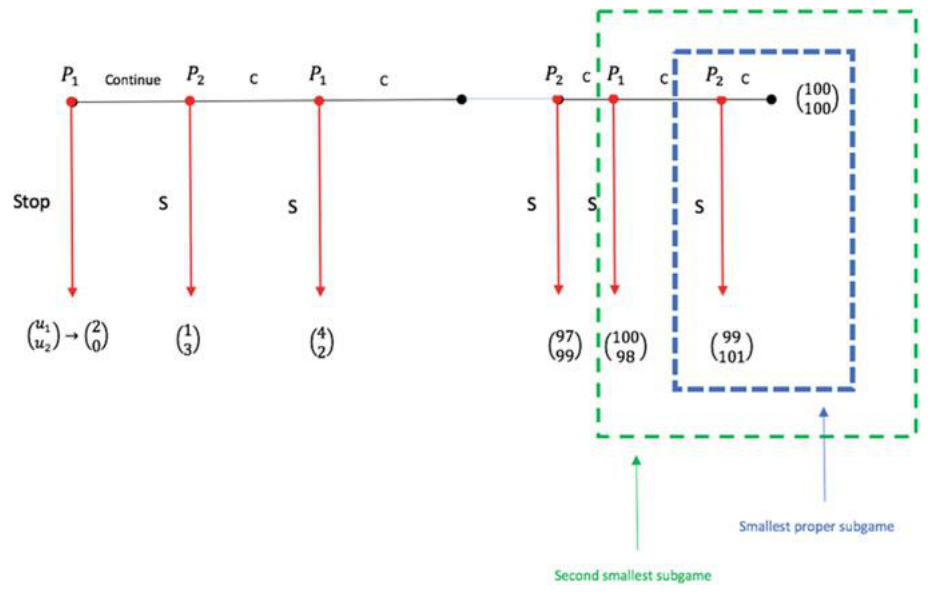
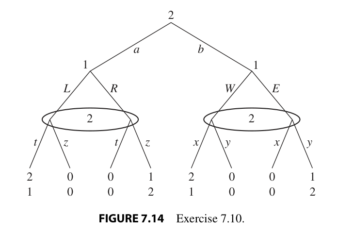

# Practice plan — Lecture 3 (Dynamic games: backward induction and subgame perfection)

25 existing book exercises in one sequence of rising complexity, each reproduced verbatim under
its tier table (transcribed from the PDF text layer and checked against the rendered page images on
2026-10-25). **Estimated unit:** built before the lecture; there are no Lecture 3 slides yet, so the
plan follows the study guide's Lecture 3 block and the estimated notes `Notas/L03/`, and cites
Tadelis and Gibbons where a slide would normally be cited. Reconcile when `Aula/Lecture03.pdf`
arrives. Sources: Tadelis (2013), Ch. 7–8, the book the slides follow; Muñoz-Garcia &
Toro-Gonzalez (2019), Ch. 4, worked answers after every exercise; Gibbons (1992), Ch. 2; MWG
(1995), §9.B. Class plan: [[Map/study-guide|study guide]]; book map:
[[Map/books-index|books-index]]; notes: [[Notas/L03/L03-00-map|Lecture 3 notes]].

**Answers in the books.** Muñoz-Garcia: a worked answer follows each exercise. MWG 9.B.4 and
9.B.5: in the MWG solutions manual (`Livros/`). Gibbons 2.1: in an unofficial, unfinished manual
(`D:/Livros/Mercado/Economia/`, not copied). Tadelis: none in the book; the preface (p. xiii)
says about half are solved on Princeton UP's website (not checked). No worked-solutions file for
this list yet.

**Verification.** Pages come from the book map (`Map/books-index.md`, offsets in
`Livros/book-registry.json`) and were checked on 2026-10-25 against the folio of each rendered
page: Tadelis exercises 7.1–7.2 on p. 147, 7.4 and 7.6 on pp. 148–149, 7.9 on pp. 149–150, 7.10
and Fig. 7.14 on p. 150; 8.4–8.6 on pp. 170–171, 8.7 on p. 171, 8.8 on pp. 171–172, 8.10–8.11 on
pp. 172–173, 8.12 on p. 173, 8.13 on pp. 173–174, 8.15–8.16 on p. 174 (PDF index = printed page +
18). Muñoz-Garcia Ch. 4 Ex. 3 on p. 160, Ex. 4 on p. 163, Ex. 9 on pp. 176–177, Ex. 11 on p. 180,
Ex. 12 on pp. 185–186 (offset 11). Gibbons Problem 2.1 on p. 130 (offset 6). MWG 9.B.4–9.B.5 on
p. 302 (2-up scan: PDF page index 161, left half). Game trees are cropped from the
book pages into `Listas/figures/`.

**Not here on purpose.** Muñoz-Garcia Ch. 4 Ex. 1 and 16–18 (ultimatum, alternating-offer and
wage bargaining) belong to Lecture 4 (study guide, Lecture 4 "After class"); Ex. 21 (moral hazard)
is out of the course's scope. MWG 9.B.12–9.B.13 (bargaining) belong to Lecture 4 and 9.B.9 (a
twice-played game) to Lectures 4–5. Gibbons 2.3 (Rubinstein with two discount factors) is
Lecture 4. Tadelis 8.1–8.2 (mixed-strategy SPE of the voluntary Battle of the Sexes and of mutually
assured destruction) refer to the book's Figures 8.2 and 8.11 rather than stating the game; they
are listed under optional extras with the pages to read first. Gibbons 2.6 is the same problem as
Tadelis 8.4 (item 23).

## Weighting

| Block | Subtopic | Items | Weight | Why |
|---|---|---|---|---|
| B1 | Describing a dynamic game: trees, information sets, Nature, strategies, normal form and Nash equilibria of a tree | 6 | 24% | Tadelis Ch. 7 is half the lecture's reading; every later step needs the strategy sets right |
| B2 | Backward induction and subgame perfection: proper subgames, SPE, branching on subgame equilibria | 8 | 32% | the lecture's solution concept; densest in all four books |
| B3 | Credibility and commitment: entry deterrence, non-credible threats, the value of a commitment | 5 | 20% | the economics of the refinement (Cabral §7.2 and the organizational applications) |
| B4 | Stackelberg competition: leader, follower, first-mover advantage, Nash equilibria that are not SPE | 4 | 16% | the lecture's continuous-strategy application |
| B5 | Time inconsistency: a game against one's future self | 2 | 8% | the last example of Tadelis Ch. 8 (§8.3.4) |

| Level | Items | Count |
|---|---|---|
| Foundations (draw a tree, count strategies, solve a small game by backward induction) | 1–8 | 8 |
| Exam (Nature and imperfect information, subgames with simultaneous stages, multi-step modelling, Stackelberg variants) | 9–18 | 10 |
| Advanced (proofs, continuous action spaces, legal-system and agenda games, commitment value) | 19–25 | 7 |

---

## Tier 1 — Foundations

| # | Block | Source | Ch./Sec. | Exercise | Page | What it trains |
|---|---|---|---|---|---|---|
| 1 | B1 | Tadelis | Ch. 7, Exercises | 7.1 | 147 | Counting pure strategies: the product over information sets |
| 2 | B1 | Tadelis | Ch. 7, Exercises | 7.2 | 147 | From a verbal story to a tree; terminal nodes, information sets, strategies, and an "unappealing" Nash equilibrium |
| 3 | B2 | Muñoz-Garcia | Ch. 4 | Ex. 3 | 160 | Backward induction in the sequential prisoner's dilemma, and comparison with the simultaneous game |
| 4 | B2 | Muñoz-Garcia | Ch. 4 | Ex. 4 | 163 | Backward induction in the sequential Battle of the Sexes: the first-mover advantage |
| 5 | B1 | Tadelis | Ch. 7, Exercises | 7.6 | 148–149 | Choosing payoffs that represent preferences, then every Nash equilibrium of the entry game |
| 6 | B3 | Tadelis | Ch. 8, Exercises | 8.8 | 171–172 | The entry game with numbers: the price-war threat is not credible |
| 7 | B2 | Muñoz-Garcia | Ch. 4 | Ex. 9 | 176–177 | The 100-stage centipede solved from the last stage back |
| 8 | B4 | Muñoz-Garcia | Ch. 4 | Ex. 11 | 180 | Stackelberg with asymmetric costs; comparison with monopoly, Cournot and Bertrand |

### Statements

#### 1. Tadelis 7.1

<!-- id: Tadelis 7.1 -->
**Source.** Tadelis (2013), *Game Theory: An Introduction*, Exercise 7.1 "Strategies", p. 147. Reproduced verbatim.

> **Strategies:** Imagine an extensive-form game in which player $i$ has $K$ information sets.
>
> a. If the player has an identical number of $m$ possible actions in each information set, how many pure strategies does he have?
>
> b. If the player has $m_k$ actions in information set $k \in \{1, 2, \ldots, K\}$, how many pure strategies does the player have?

#### 2. Tadelis 7.2

<!-- id: Tadelis 7.2 -->
**Source.** Tadelis (2013), *Game Theory: An Introduction*, Exercise 7.2 "Strategies and Equilibrium", p. 147. Reproduced verbatim.

> **Strategies and Equilibrium:** Consider a two-player game in which player 1 can choose $A$ or $B$. The game ends if he chooses $A$ while it continues to player 2 if he chooses $B$. Player 2 can then choose $C$ or $D$, with the game ending after $C$ and continuing again with player 1 after $D$. Player 1 can then choose $E$ or $F$, and the game ends after each of these choices.
>
> a. Model this as an extensive-form game tree. Is it a game of perfect or imperfect information?
>
> b. How many terminal nodes does the game have? How many information sets?
>
> c. How many pure strategies does each player have?
>
> d. Imagine that the payoffs following choice $A$ by player 1 are $(2, 0)$, those following $C$ by player 2 are $(3, 1)$, those following $E$ by player 1 are $(0, 0)$, and those following $F$ by player 1 are $(1, 2)$. What are the Nash equilibria of this game? Does one strike you as more "appealing" than the other? If so, explain why.

#### 3. Muñoz-Garcia Ex. 3

<!-- id: Muñoz-Garcia Ch. 4 Ex. 3 -->
**Source.** Muñoz-Garcia & Toro-Gonzalez (2019), *Strategy and Game Theory: Practice Exercises with Answers*, Ch. 4, Exercise 3 "Sequential Version of the Prisoner's Dilemma Game", p. 160. Reproduced verbatim (statement only; the book's worked answer follows it).

> Consider the game tree in Fig. 4.9, representing the sequential-move version of the Prisoner's dilemma game, where player 1 acts first, and observing its move player 2 responds.
>
> 
>
> *Fig. 4.9* Prisoner's dilemma sequential-move game
>
> (a) Find the best responses of the second mover, for each of the first mover's actions.
>
> (b) Find the first mover's equilibrium action and describe the subgame perfect Nash equilibrium of the game.
>
> (c) Does the equilibrium behavior in the sequential-move game differ from its simultaneous-move version?

#### 4. Muñoz-Garcia Ex. 4

<!-- id: Muñoz-Garcia Ch. 4 Ex. 4 -->
**Source.** Muñoz-Garcia & Toro-Gonzalez (2019), *Strategy and Game Theory: Practice Exercises with Answers*, Ch. 4, Exercise 4 "Sequential Version of the Battle of the Sexes Game", p. 163. Reproduced verbatim (statement only; the book's worked answer follows it). *Note (not in the book):* part (a) as printed swaps the roles; the wife moves first, so read it as the husband's best responses to each of the wife's actions, which is what the book's answer computes.

> Consider the game tree in Fig. 4.13, representing the sequential-move version of the Battle of the Sexes game, where wife acts first, and observing its move husband responds.
>
> 
>
> *Fig. 4.13* Battle of the sexes sequential-move game
>
> (a) Find the best responses of the wife, for each of the husband's actions.
>
> (b) Find the husband's equilibrium action and describe the subgame perfect Nash equilibrium of the game.
>
> (c) Does the equilibrium behavior in the sequential-move game differ from its simultaneous-move version?

#### 5. Tadelis 7.6

<!-- id: Tadelis 7.6 -->
**Source.** Tadelis (2013), *Game Theory: An Introduction*, Exercise 7.6 "Entering an Industry", pp. 148–149. Reproduced verbatim.

> **Entering an Industry:** A firm (player 1) is considering entering an established industry with one incumbent firm (player 2). Player 1 must choose whether or not to enter the industry. If player 1 enters the industry then player 2 can either accommodate the entry or fight the entry by waging a price war. Player 1's most-preferred outcome is entering with player 2 not fighting, and its least-preferred outcome is entering with player 2 fighting. Player 2's most-preferred outcome is player 1 not entering, and its least-preferred outcome is player 1 entering with player 2 fighting.
>
> a. Model this as an extensive-form game tree (choose payoffs that represent the preferences).
>
> b. How many pure strategies does each player have?
>
> c. Find all the Nash equilibria of this game.

#### 6. Tadelis 8.8

<!-- id: Tadelis 8.8 -->
**Source.** Tadelis (2013), *Game Theory: An Introduction*, Exercise 8.8 "Entry Deterrence 1", pp. 171–172. Reproduced verbatim.

> **Entry Deterrence 1:** NSG Corporation is considering entry into the local phone market in the San Francisco Bay Area. The incumbent, S&P Corporation, predicts that a price war will result if NSG enters. If NSG stays out, S&P earns monopoly profits valued at \$10 million (net present value of profits) while NSG earns zero. If NSG enters, it must incur irreversible entry costs of \$2 million. If there is a price war, each firm earns \$1 million. S&P always has the option of accommodating entry (i.e., not starting a price war). In such a case both firms earn \$4 million (net present value). Suppose that the timing is such that NSG first has to choose whether or not to enter the market. Then S&P decides whether to "accommodate entry" or "engage in a price war." What is the subgame-perfect equilibrium outcome to this sequential game? Set up a game tree.

#### 7. Muñoz-Garcia Ex. 9

<!-- id: Muñoz-Garcia Ch. 4 Ex. 9 -->
**Source.** Muñoz-Garcia & Toro-Gonzalez (2019), *Strategy and Game Theory: Practice Exercises with Answers*, Ch. 4, Exercise 9 "Centipede Game", pp. 176–177. Reproduced verbatim (statement only; the book's worked answer follows it). The figure is printed with the book's subgame boxes already drawn. *Note (not in the book):* the text says depositor 1 moves at the 100th stage, but Fig. 4.31 and the book's answer have depositor 2 as the last mover, choosing between $(99, 101)$ and $(100, 100)$; follow the figure.

> Consider the game tree in Fig. 4.31, representing the so-called "centipede game" between depositor 1 and 2. In the first stage, depositor 1 chooses whether to take the money in the saving account, which yields a payoff of \$2 for him and \$0 for the other depositor, or keep the money in the account. If depositor 1 keeps the money in the account, the game continues to stage 2 where depositor 2 can take the money or keep it in the account for one more period. If he takes the money, he receives a payoff of \$3 while depositor 1 receives only \$1. If depositor 2 keeps the money in the account, then it's depositor 1's turn to choose whether to take the money or keep it for one more period. The game continues with depositors alternatively choosing whether to take the money until the 100th stage, when it is depositor 1's turn to move. Since the game tree has 100 branches pointing down, it is often called the "centipede" game since the game tree looks like an insect with 100 legs.
>
> a. Find the best response of the last mover.
>
> b. Anticipating equilibrium behavior in the 100th stage, find the best response of the previous-to-last mover (the depositor acting in stage 99).
>
> 
>
> *Fig. 4.31* Centipede sequential-form game
>
> c. Using your results in parts (a) and (b), find the subgame perfect Nash equilibrium of the game.

#### 8. Muñoz-Garcia Ex. 11

<!-- id: Muñoz-Garcia Ch. 4 Ex. 11 -->
**Source.** Muñoz-Garcia & Toro-Gonzalez (2019), *Strategy and Game Theory: Practice Exercises with Answers*, Ch. 4, Exercise 11 "Stackelberg with Two Firms", p. 180. Reproduced verbatim (statement only; the book's worked answer follows it).

> Consider a leader and a follower in a Stackelberg game of quantity competition. Firms face an inverse demand curve $p(Q) = 1 - Q$, where $Q = q_L + q_F$ denotes aggregate output. The leader faces a constant marginal cost $c_L > 0$ while the follower's constant marginal cost is $c_F > 0$, where $1 > c_F \geq c_L$, indicating that the leader has access to a more efficient technology than the follower.
>
> **Part (a)** Find the follower's best response function, $BRF_F$, i.e., $q_F(q_L)$.
>
> **Part (b)** Determine each firm's output strategy in the subgame perfect equilibrium (SPNE) of this sequential-move game.
>
> **Part (c)** Under which conditions on $c_L$ can you guarantee that both firms produce strictly positive output levels?
>
> **Part (d)** Assuming cost symmetry, i.e., $c_L = c_F = c$, determine the aggregate equilibrium output level in the Stackelberg game, and its associated equilibrium price. Then compare them with those arising in (1) a monopoly; in (2) the Cournot game of quantity competition; and (3) in the Bertrand game of price competition (which, under cost symmetry, is analogous to a perfectly competitive industry) [*Hint*: For a more direct and visual comparison, depict the inverse demand curve $p(Q) = 1 - Q$, and locate each of these four aggregate output levels in the horizontal axis (with its associated prices in the vertical axis).].

---

## Tier 2 — Exam level

| # | Block | Source | Ch./Sec. | Exercise | Page | What it trains |
|---|---|---|---|---|---|---|
| 9 | B1 | Tadelis | Ch. 7, Exercises | 7.4 | 148 | A four-move centipede with a growing pot: strategies, Nash equilibria, and how many outcomes they support |
| 10 | B1 | Tadelis | Ch. 7, Exercises | 7.9 | 149–150 | A move of Nature and an information set: tree, normal form and Nash equilibria |
| 11 | B1 | Tadelis | Ch. 7, Exercises | 7.10 | 150 | Mixed vs behavioral strategies, and what breaks without perfect recall (Kuhn) |
| 12 | B2 | Tadelis | Ch. 8, Exercises | 8.5 | 170 | A simultaneous game, then the same game behind an adoption decision: proper subgames and SPE |
| 13 | B2 | Tadelis | Ch. 8, Exercises | 8.10 | 172 | A safe option before a simultaneous stage: subgames, normal form, Nash vs SPE |
| 14 | B2 | Tadelis | Ch. 8, Exercises | 8.11 | 172–173 | Sequential vetoes: SPE, Nash equilibria that are not SPE, and the value of removing an option |
| 15 | B3 | Tadelis | Ch. 8, Exercises | 8.13 | 173–174 | Hold-up after a sunk trip, and a posted price as a commitment |
| 16 | B4 | Tadelis | Ch. 8, Exercises | 8.6 | 170–171 | Investment before Cournot: the threshold cost $F^*$ and a Nash equilibrium that is not SPE |
| 17 | B4 | Muñoz-Garcia | Ch. 4 | Ex. 12 | 185–186 | Stackelberg with two and with three sequential firms |
| 18 | B5 | Tadelis | Ch. 8, Exercises | 8.15 | 174 | A naive present-biased planner, and how the period-2 self revises the plan |

### Statements

#### 9. Tadelis 7.4

<!-- id: Tadelis 7.4 -->
**Source.** Tadelis (2013), *Game Theory: An Introduction*, Exercise 7.4 "Centipedes", p. 148. Reproduced verbatim.

> **Centipedes:** Imagine a two-player game that proceeds as follows. A pot of money is created with \$6 in it initially. Player 1 moves first, then player 2, then player 1 again, and finally player 2 again. At each player's turn to move, he has two possible actions: grab ($G$) or share ($S$). If he grabs he gets $\frac{2}{3}$ of the current pot of money, the other player gets $\frac{1}{3}$ of the pot, and the game ends. If he shares then the size of the current pot is multiplied by $\frac{3}{2}$ and the next player gets to move. At the last stage at which player 2 moves, if he chooses $S$ then the pot is still multiplied by $\frac{3}{2}$, player 2 gets $\frac{1}{3}$ of the pot, and player 1 gets $\frac{2}{3}$ of the pot.
>
> a. Model this as an extensive-form game tree. Is it a game of perfect or imperfect information?
>
> b. How many terminal nodes does the game have? How many information sets?
>
> c. How many pure strategies does each player have?
>
> d. Find the Nash equilibria of this game. How many outcomes can be supported in equilibrium?
>
> e. Now imagine that at the last stage at which player 2 moves, if he chooses to share then the pot is equally split among the players. Does your answer to part (d) change?

#### 10. Tadelis 7.9

<!-- id: Tadelis 7.9 -->
**Source.** Tadelis (2013), *Game Theory: An Introduction*, Exercise 7.9 "The Dean's Dilemma", pp. 149–150. Reproduced verbatim.

> **The Dean's Dilemma:** A student stole the DVD player from the student lounge. The dean of students (player 1) suspects the student (player 2) and begins collecting evidence. However, evidence collection is a random process, and concrete evidence will be available to the dean only with probability $\frac{1}{2}$. The student knows that the evidence-gathering process is under way but does not know whether the dean has collected evidence or not. The game proceeds as follows: The dean realizes whether or not he has evidence and can then choose his action, whether to accuse the student ($A$) or bounce the case ($B$) and forget it. Once accused, the student has two options: he can either confess ($C$) or deny ($D$). Payoffs are realized as follows: If the dean bounces the case then both players get 0. If the dean accuses the student and the student confesses, the dean gains 2 and the student loses 2. If the dean accuses the student and the student denies, then payoffs depend on the evidence: If the dean has no evidence then he loses face, which gives him a loss of 4, while the student gains glory, which gives him a payoff of 4. If, however, the dean has evidence then he is triumphant and gains 4, while the student is put on probation and loses 4.
>
> a. Draw the game tree that represents the extensive form of this game.
>
> b. Write down the matrix that represents the normal form of the extensive form you drew in (a).
>
> c. Solve for the Nash equilibria of the game.

#### 11. Tadelis 7.10

<!-- id: Tadelis 7.10 -->
**Source.** Tadelis (2013), *Game Theory: An Introduction*, Exercise 7.10 "Perfect and Imperfect Recall", p. 150. Reproduced verbatim.

> **Perfect and Imperfect Recall:** Consider the game depicted in Figure 7.14.
>
> 
>
> a. What are the pure-strategy sets for each player?
>
> b. Show that for any behavioral strategy for player 1 there is a mixed strategy that leads to the same distribution over the terminal nodes regardless of the strategy chosen by player 2.
>
> c. Show that for any behavioral strategy for player 2 there is a mixed strategy that leads to the same distribution over the terminal nodes regardless of the strategy chosen by player 1.
>
> d. Now imagine that the game does not have perfect recall so that player 2's bottom two information sets are now one large information set. Can you find an example showing that the claim in (c) is no longer true?

#### 12. Tadelis 8.5

<!-- id: Tadelis 8.5 -->
**Source.** Tadelis (2013), *Game Theory: An Introduction*, Exercise 8.5 "Technology Adoption", p. 170. Reproduced verbatim.

> **Technology Adoption:** During the adoption of a new technology a CEO (player 1) can design a new task for a division manager. The new task can be either high level ($H$) or low level ($L$). The manager simultaneously chooses to invest in good training ($G$) or bad training ($B$). The payoffs from this interaction are given by the following matrix:
>
> | Player 1 \ Player 2 | $G$ | $B$ |
> |:---:|:---:|:---:|
> | $H$ | 5, 4 | −5, 2 |
> | $L$ | 2, −2 | 0, 0 |
>
> a. Present the game in extensive form (a game tree) and solve for all the Nash equilibria and subgame-perfect equilibria.
>
> b. Now assume that before the game is played the CEO can choose not to adopt this new technology, in which case the payoffs are (1, 1), or to adopt it, in which case the game is played. Present the *entire* game in extensive form. How many proper subgames does it have?
>
> c. Solve for all the Nash equilibria and subgame-perfect equilibria of the game described in (b).

#### 13. Tadelis 8.10

<!-- id: Tadelis 8.10 -->
**Source.** Tadelis (2013), *Game Theory: An Introduction*, Exercise 8.10 "Playing It Safe", p. 172. Reproduced verbatim.

> **Playing It Safe:** Consider the following dynamic game: Player 1 can choose to play it safe (denote this choice by $S$), in which case both he and player 2 get a payoff of 3 each, or he can risk playing a game with player 2 (denote this choice by $R$). If he chooses $R$ then they play the following simultaneous-move game:
>
> | Player 1 \ Player 2 | $A$ | $B$ |
> |:---:|:---:|:---:|
> | $C$ | 8, 0 | 0, 2 |
> | $D$ | 6, 6 | 2, 2 |
>
> a. Draw a game tree that represents this game. How many proper subgames does it have?
>
> b. Are there other game trees that would work? Explain briefly.
>
> c. Construct the matrix representation of the normal form of this dynamic game.
>
> d. Find all the Nash and subgame-perfect equilibria of the dynamic game.

#### 14. Tadelis 8.11

<!-- id: Tadelis 8.11 -->
**Source.** Tadelis (2013), *Game Theory: An Introduction*, Exercise 8.11 "Resident Assistant Selection with a Twist", pp. 172–173. Reproduced verbatim.

> **Resident Assistant Selection with a Twist:** Two staff managers in the ΠΒΦ sorority, the house manager (player 1) and kitchen manager (player 2), must select a resident assistant from a pool of three candidates: $\{a, b, c\}$. Player 1 prefers $a$ to $b$, and $b$ to $c$. Player 2 prefers $b$ to $a$, and $a$ to $c$. The process that is imposed on them is as follows: First, the house manager vetoes one of the candidates and announces the veto to the central office for staff selection and to the kitchen manager. Next the kitchen manager vetoes one of the remaining two candidates and announces it to the central office. Finally the director of the central office assigns the remaining candidate to be a resident assistant at ΠΒΦ.
>
> a. Model this as an extensive-form game (using a game tree) in which a player's most-preferred candidate gives a payoff of 2, the second most-preferred candidate gives a payoff of 1, and the last candidate gives 0.
>
> b. Find the subgame-perfect equilibrium for this game. Is it unique?
>
> c. Are there Nash equilibria that are not subgame-perfect equilibria?
>
> d. Now assume that before the two players play the game, player 2 can send an alienating e-mail to one of the candidates, which would result in that candidate withdrawing her application. Would player 2 choose to do this, and if so, with which candidate?

#### 15. Tadelis 8.13

<!-- id: Tadelis 8.13 -->
**Source.** Tadelis (2013), *Game Theory: An Introduction*, Exercise 8.13 "Junk Mail Advertising", pp. 173–174. Reproduced verbatim.

> **Junk Mail Advertising:** Suppose a single good is owned by a single seller who values it at $c > 0$ (he can consume the good and get a payoff of $c$). There is a single buyer who has a small transportation cost $k > 0$ to get to and back from the seller's store, and he values the good at $v > c + k$. The buyer first decides whether to make the commute or stay at home, not buy the good, and receive a payoff of 0. If the buyer commutes to the store, the seller can then make the buyer a take-it-or-leave-it price offer $p \geq 0$. The buyer can then accept the offer, pay $p$, and get the good, or he can walk out and not buy the good. Assume that $c$, $v$, and $k$ are common knowledge.
>
> a. As best you can, draw the extensive form of this game. What is the best response of the buyer at the node at which he decides whether to accept or reject the seller's offer?
>
> b. Find the subgame-perfect equilibrium of the game and show that it is unique. Is it Pareto optimal?
>
> c. Are there Nash equilibria that yield a higher payoff to both players as compared to the subgame-perfect equilibrium you found in (b)?
>
> d. Now assume that before the game is played the seller can, at a small cost $\varepsilon < (v - c - k)$, send the buyer a postcard that commits the seller to a certain price at which the buyer can buy the good (e.g., "bring this coupon and get the good at a price $p$"). Would the seller choose to do so? Justify your answer with an equilibrium analysis.

#### 16. Tadelis 8.6

<!-- id: Tadelis 8.6 -->
**Source.** Tadelis (2013), *Game Theory: An Introduction*, Exercise 8.6 "Investment in the Future", pp. 170–171. Reproduced verbatim.

> **Investment in the Future:** Consider two firms that play a Cournot competition game with demand $p = 100 - q$ and costs for each firm given by $c_i(q_i) = 10q_i$. Imagine that before the two firms play the Cournot game firm 1 can invest in cost reduction. If it invests the costs of firm 1 will drop to $c_1(q_1) = 5q_1$. The cost of investment is $F > 0$. Firm 2 does not have this investment opportunity.
>
> a. Find the value $F^*$ for which the unique subgame-perfect equilibrium involves firm 1 investing.
>
> b. Assume that $F > F^*$. Find a Nash equilibrium of the game that is not subgame perfect.

#### 17. Muñoz-Garcia Ex. 12

<!-- id: Muñoz-Garcia Ch. 4 Ex. 12 -->
**Source.** Muñoz-Garcia & Toro-Gonzalez (2019), *Strategy and Game Theory: Practice Exercises with Answers*, Ch. 4, Exercise 12 "Stackelberg Competition with 2, or 3 Firms", pp. 185–186. Reproduced verbatim (statement only; the book's worked answer follows it).

> Consider a Stackelberg model of output competition where firm 1 is the industry leader and firm 2 is the follower. Firms face a linear inverse demand curve $p(Q) = 10 - Q$, where $Q = q_1 + q_2$ denotes the aggregate output sold by both firms. In addition, consider that firms are cost symmetric, facing a common marginal cost of $MC_i = 2$ for every firm $i = \{1, 2\}$ and no fixed costs.
>
> (a) Find the equilibrium in this Stackelberg game.
>
> (b) Assume now that a new firm (firm 3) joins the industry, acting last (after firm 2 chooses its output). Find the equilibrium in this Stackelberg game. Compare your results with those in part (a). How is the output of firm 1 and 2 affected by firm 3's entry?

#### 18. Tadelis 8.15

<!-- id: Tadelis 8.15 -->
**Source.** Tadelis (2013), *Game Theory: An Introduction*, Exercise 8.15 "Time Inconsistency", p. 174. Reproduced verbatim. *Note (not in the book):* the example of Section 8.3.4 is on pp. 166–169; its printed first-period choice $x_1 = \frac{2}{3}K$ (p. 169) does not follow from the objective printed there (the maximum is at $\frac{K}{2}$); see `Notas/L03/L03-08-time-inconsistency.md` §2.2.

> **Time Inconsistency:** Consider the three-period example of a player with hyperbolic discounting described in Section 8.3.4 with utility $\ln(x)$ in each of the three periods, with initial budget $K$ and with discount factors $\delta = 1$ and $\beta = \frac{1}{2}$.
>
> a. Solve the optimal plan of action of a naive player 1 who does not take into account how his future self, player 2, will alter the plan. What is player 1's optimal plan $x_1^*$, $x_2^*$, and $x_3^*$ as a function of $K$?
>
> b. Let $K_2$ be the amount left from the solution to (a) after player 1 consumes his planned choice of $x_1^*$. Given $K_2$, what is the optimal plan of player 2? In what way does it differ from the optimal plan set out by player 1?

---

## Tier 3 — Advanced

| # | Block | Source | Ch./Sec. | Exercise | Page | What it trains |
|---|---|---|---|---|---|---|
| 19 | B2 | MWG | §9.B, Exercises | 9.B.4 | 302 | Proving that SPE payoffs are unique in finite zero-sum games of perfect information |
| 20 | B2 | MWG | §9.B, Exercises | 9.B.5 | 302 | Strategy counts with and without observation; when SPE is multiple; when moving first guarantees the simultaneous-game payoff |
| 21 | B3 | Tadelis | Ch. 8, Exercises | 8.7 | 171 | Credibility of suing: how the cost and design of a legal system change the SPE of a lending game |
| 22 | B3 | Tadelis | Ch. 8, Exercises | 8.12 | 173 | Agenda setting with a continuum of proposals: SPE vs a continuum of Nash equilibria |
| 23 | B4 | Tadelis | Ch. 8, Exercises | 8.4 | 170 | A leader and two simultaneous followers: subgames, the unique SPE, a Nash equilibrium that is not SPE (also Gibbons 2.6, p. 133) |
| 24 | B3 | Gibbons | §2.1, Problems | 2.1 | 130 | Backward induction with continuous actions: the Rotten Kid theorem |
| 25 | B5 | Tadelis | Ch. 8, Exercises | 8.16 | 174 | The value of commitment for a sophisticated present-biased planner |

### Statements

#### 19. MWG 9.B.4

<!-- id: MWG 9.B.4 -->
**Source.** Mas-Colell, Whinston & Green (1995), *Microeconomic Theory*, Ch. 9 Exercises, Exercise 9.B.4^B, p. 302. Reproduced verbatim.

> Prove that in a finite *zero-sum* game of perfect information, there are unique subgame perfect Nash equilibrium payoffs.

#### 20. MWG 9.B.5

<!-- id: MWG 9.B.5 -->
**Source.** Mas-Colell, Whinston & Green (1995), *Microeconomic Theory*, Ch. 9 Exercises, Exercise 9.B.5^B (E. Maskin), p. 302. Reproduced verbatim.

> (E. Maskin) Consider a game with two players, player 1 and player 2, in which each player $i$ can choose an action from a finite set $M_i$ that contains $m_i$ actions. Player $i$'s payoff if the action choices are $(m_1, m_2)$ is $\phi_i(m_1, m_2)$.
>
> (a) Suppose, first, that the two players move simultaneously. How many strategies does each player have?
>
> (b) Now suppose that player 1 moves first and that player 2 observes player 1's move before choosing her move. How many strategies does each player have?
>
> (c) Suppose that the game in (b) has multiple SPNEs. Show that if this is the case, then there exist two pairs of moves $(m_1, m_2)$ and $(m_1', m_2')$ (where either $m_1 \neq m_1'$ or $m_2 \neq m_2'$) such that either
>
> $$\text{(i)}\quad \phi_1(m_1, m_2) = \phi_1(m_1', m_2')$$
>
> or
>
> $$\text{(ii)}\quad \phi_2(m_1, m_2) = \phi_2(m_1', m_2').$$
>
> (d) Suppose that for any two pairs of moves $(m_1, m_2)$ and $(m_1', m_2')$ such that $m_1 \neq m_1'$ or $m_2 \neq m_2'$, condition (ii) is violated (i.e., player 2 is never indifferent between pairs of moves). Suppose also that there exists a pure strategy Nash equilibrium in the game in (a) in which $\pi_1$ is player 1's payoff. Show that in any SPNE of the game in (b), player 1's payoff is at least $\pi_1$. Would this conclusion necessarily hold for any *Nash* equilibrium of the game in (b)?
>
> (e) Show by example that the conclusion in (d) may fail either if condition (ii) holds for some strategy pairs $(m_1, m_2)$, $(m_1', m_2')$ with $m_1 \neq m_1'$ or $m_2 \neq m_2'$ or if we replace the phrase *pure strategy Nash equilibrium* with the phrase *mixed strategy Nash equilibrium*.

#### 21. Tadelis 8.7

<!-- id: Tadelis 8.7 -->
**Source.** Tadelis (2013), *Game Theory: An Introduction*, Exercise 8.7 "Debt and Repayment", p. 171. Reproduced verbatim.

> **Debt and Repayment:** A project costing \$100 yields a gross return of \$110. A lender (player 1) is approached by a debtor (player 2) requesting a standard loan contract to complete the project. If the lender chooses *not to offer* a loan, then both parties earn nothing. If the lender chooses to *offer* a loan of \$100, the debtor can realize the project's gains and is obliged by contract to repay \$105. For simplicity assume that money is continuous and that the debtor can choose to return any amount of money $x \leq 110$. Ignore the time value of money. Assume first that no legal system is in place that can compel the debtor to repay, so that default on the loan (less than full repayment) carries no repercussions for the debtor.
>
> a. Model this as an extensive-form game tree as best you can and find a subgame-perfect equilibrium of this game. Is it unique?
>
> b. Now assume that there is a legal system in place that allows the lender to *voluntarily* choose whether or not to sue when the debtor defaults and repays an amount $x < 105$. Furthermore assume that it is *costless* to use the legal system (it is supplied by the state), and if the lender sues a debtor that defaulted, the lender will get the \$105 repaid in full. After paying the lender, the borrower will pay a fine of \$5 to the court, above and beyond the repayment. Model this as an extensive-form game tree as best you can and find a subgame-perfect equilibrium of this game. Is it unique?
>
> c. Are there Nash equilibria in the game described in (b) that are not subgame-perfect equilibria?
>
> d. Now assume that using the legal system is *costly:* if the lender sues, he pays lawyers a *legal fee* of \$105 (this is the lawyers' price; it is unrelated to the contract). The rest of the game proceeds as before. (If the lender sues a debtor that defaulted, the lender will get repaid in full; after paying the lender, the borrower will pay a fine of \$5 above and beyond the repayment.) Model this as an extensive-form game tree as best you can and find a subgame-perfect equilibrium of this game. Is it unique?
>
> e. Are there Nash equilibria in the game described in (d) that are not subgame-perfect equilibria?
>
> f. Now assume that a change in the law is proposed: upon default, if a debtor is sued he has to first repay the lender \$105 and then pay the legal fees of \$105 above and beyond repayment of the loan, and no extra fine is imposed. Should the lender be willing to pay to have this change in the law enacted? If so, how much?
>
> g. If you were a social planner, would you implement the suggested law?

#### 22. Tadelis 8.12

<!-- id: Tadelis 8.12 -->
**Source.** Tadelis (2013), *Game Theory: An Introduction*, Exercise 8.12 "Agenda Setting", p. 173. Reproduced verbatim.

> **Agenda Setting:** An agenda-setting game is described as follows. The "issue space" (set of possible policies) is an interval $X = [0, 5]$. An agenda setter (player 1) proposes an alternative $x \in X$ against the status quo $q = 4$. After player 1 proposes $x$, the legislator (player 2) observes the proposal and selects between the proposal $x$ and the status quo $q$. Player 1's most-preferred policy is 1, and for any final policy $y \in X$ his payoff is given by
>
> $$v_1(y) = 10 - |y - 1|,$$
>
> where $|y - 1|$ denotes the absolute value of $(y - 1)$. Player 2's most preferred policy is 3, and for any final policy $y \in X$ his payoff is given by
>
> $$v_2(y) = 10 - |y - 3|.$$
>
> That is, each player prefers policies that are closer to his most-preferred policy.
>
> a. Write the game down as a normal-form game. Is this a game of perfect or imperfect information?
>
> b. Find a subgame-perfect equilibrium for this game. Is it unique?
>
> c. Find a Nash equilibrium that is not subgame perfect. Is it unique? If yes, explain. If not, show all the Nash equilibria for this game.

#### 23. Tadelis 8.4

<!-- id: Tadelis 8.4 -->
**Source.** Tadelis (2013), *Game Theory: An Introduction*, Exercise 8.4 "Industry Leader", p. 170. Reproduced verbatim. (Gibbons Problem 2.6, p. 133, poses the same game and asks only for the subgame-perfect outcome.)

> **Industry Leader:** Three oligopolists operate in a market with inverse demand given by $P(Q) = a - Q$, where $Q = q_1 + q_2 + q_3$, and $q_i$ is the quantity produced by firm $i$. Each firm has a constant marginal cost of production, $c$, and no fixed cost. The firms choose their quantities dynamically as follows: Firm 1, which is the industry leader, chooses $q_1 \geq 0$. Firms 2 and 3 observe $q_1$ and then simultaneously choose $q_2$ and $q_3$, respectively.
>
> a. How many proper subgames does this dynamic game have? Explain briefly.
>
> b. Is it a game of perfect or imperfect information? Explain briefly.
>
> c. What is the subgame-perfect equilibrium of this game? Show that it is unique.
>
> d. Find a Nash equilibrium that is not a subgame-perfect equilibrium.

#### 24. Gibbons 2.1

<!-- id: Gibbons 2.1 -->
**Source.** Gibbons (1992), *Game Theory for Applied Economists*, §2.6 Problems (Section 2.1), Problem 2.1, p. 130. Reproduced verbatim.

> 2.1. Suppose a parent and child play the following game, first analyzed by Becker (1974). First, the child takes an action, $A$, that produces income for the child, $I_C(A)$, and income for the parent, $I_P(A)$. (Think of $I_C(A)$ as the child's income net of any costs of the action $A$.) Second, the parent observes the incomes $I_C$ and $I_P$ and then chooses a bequest, $B$, to leave to the child. The child's payoff is $U(I_C + B)$; the parent's is $V(I_P - B) + kU(I_C + B)$, where $k > 0$ reflects the parent's concern for the child's well-being. Assume that: the action is a nonnegative number, $A \geq 0$; the income functions $I_C(A)$ and $I_P(A)$ are strictly concave and are maximized at $A_C > 0$ and $A_P > 0$, respectively; the bequest $B$ can be positive or negative; and the utility functions $U$ and $V$ are increasing and strictly concave. Prove the "Rotten Kid" Theorem: in the backwards-induction outcome, the child chooses the action that maximizes the family's aggregate income, $I_C(A) + I_P(A)$, even though only the parent's payoff exhibits altruism.

#### 25. Tadelis 8.16

<!-- id: Tadelis 8.16 -->
**Source.** Tadelis (2013), *Game Theory: An Introduction*, Exercise 8.16 "The Value of Commitment", p. 174. Reproduced verbatim. *Note (not in the book):* "We solved the optimal consumption plan" refers to pp. 168–169, whose printed $x_1 = \frac{2}{3}K$ is a slip; with the objective as printed the sophisticated plan is $(\frac{1}{2}, \frac{1}{3}, \frac{1}{6})K$ (`Notas/L03/L03-08-time-inconsistency.md` §2.2). Use the corrected plan as the no-commitment benchmark in (b).

> **The Value of Commitment:** Consider the three-period example of a player with hyperbolic discounting described in Section 8.3.4 with utility $\ln(x)$ in each of the three periods and with discount factors $\delta = 1$ and $\beta = \frac{1}{2}$. We solved the optimal consumption plan of a sophisticated player 1.
>
> a. Imagine that an external entity can enforce any plan of action that player 1 chooses in $t = 1$ and will prevent player 2 from modifying it. What is the plan that player 1 would choose to enforce?
>
> b. Assume that $K = 90$. Up to how much of his initial budget $K$ will player 1 be willing to pay the external entity in order to enforce the plan you found in (a)?

**Optional extras.**
- Tadelis 7.5 (veto power, p. 148), 7.7 (roommates voting, p. 149) and 7.8 with 8.3 (Brothers, pp. 149, 170): more trees, strategy sets and SPE; 7.8/8.3 is a two-stage game and previews Lecture 4.
- Tadelis 7.3 (tic-tac-toe, pp. 147–148): counting information sets in a large tree; needs a spreadsheet.
- Tadelis 8.1 and 8.2 (p. 170): mixed-strategy SPE of the voluntary Battle of the Sexes (read Fig. 8.2, p. 154) and of mutually assured destruction (read §8.3.3, pp. 163–166, Fig. 8.11).
- Tadelis 8.9 (entry deterrence with a fixed cost, p. 172) and 8.14 (hyperbolic discounting with general $\delta$, $\beta$, p. 174): harder versions of items 16 and 18.
- Muñoz-Garcia Ch. 4 Ex. 2 (entry-predation, p. 156), Ex. 5–6 (sequential Pareto coordination and chicken, pp. 166, 169), Ex. 10 (trust and reciprocity, p. 177), Ex. 13–15 (Stackelberg variants, pp. 189, 192, 195), Ex. 19–20 (backward induction drills, pp. 202, 204): all with worked answers.
- Gibbons 2.2 (Samaritan's dilemma, pp. 130–131) and 2.4 (two-period contribution game, pp. 131–132): continuous-action backward induction after item 24.

---

## Suggested study order

1. **Describing a dynamic game.** Read Tadelis Ch. 7 (pp. 129–146), then do items **1, 2, 5**, then **9, 10, 11**.
2. **Backward induction.** Read Tadelis §8.1 (pp. 151–153) and Gibbons §2.1.A (pp. 57–61), then do **3, 4, 7**.
3. **Subgame perfection.** Read Tadelis §8.2 (pp. 153–159) and Gibbons §2.4.B (pp. 122–129), then do **12, 13, 14**, then **19, 20**.
4. **Credibility and commitment.** Read Cabral §7.2 (pp. 167–171), then do **6, 15**, then **21, 22, 24**.
5. **Stackelberg.** Read Tadelis §8.3.2 (pp. 160–163) and Gibbons §2.1.B (pp. 61–64), then do **8, 16, 17**, then **23**.
6. **Time inconsistency.** Read Tadelis §8.3.4 (pp. 166–169) with the correction in `Notas/L03/L03-08-time-inconsistency.md`, then do **18, 25**.

---

## Consolidated Reading by Book

### Tadelis — Tadelis (2013)
| Topic | Chapter / Section | Pages | Priority |
|---|---|---|---|
| Extensive form: game trees, information sets, perfect vs imperfect information | Ch. 7, §7.1 | p. 129–137 | Foundations |
| Pure, mixed and behavioral strategies; perfect recall | Ch. 7, §7.2 | p. 137–144 | Foundations |
| Nash equilibrium and paths of play | Ch. 7, §7.3 | p. 144–146 | Foundations |
| Exercises 7.1, 7.2, 7.4, 7.6, 7.9, 7.10 | Ch. 7, Exercises | p. 147–150 | Exam |
| Sequential rationality and backward induction; Zermelo | Ch. 8, §8.1 | p. 151–153 | Foundations |
| Subgame-perfect equilibrium | Ch. 8, §8.2 | p. 153–159 | Exam |
| Centipede, Stackelberg, mutually assured destruction, time inconsistency | Ch. 8, §8.3 | p. 159–169 | Exam |
| Exercises 8.4–8.8, 8.10–8.13, 8.15–8.16 | Ch. 8, Exercises | p. 170–174 | Exam |

### Gibbons — Gibbons (1992)
| Topic | Chapter / Section | Pages | Priority |
|---|---|---|---|
| Backwards induction; Stackelberg | §2.1.A–B | p. 57–64 | Foundations |
| Two-stage games of imperfect information | §2.2.A | p. 71–73 | Exam |
| Extensive form; subgame-perfect Nash equilibrium | §2.4 | p. 115–129 | Exam |
| Problem 2.1 (and 2.6 = Tadelis 8.4) | §2.6, Problems | p. 130, 133 | Advanced |

### MWG — Mas-Colell, Whinston & Green (1995)
| Topic | Chapter / Section | Pages | Priority |
|---|---|---|---|
| Extensive form | §7.C | p. 221–225 | Advanced |
| Sequential rationality, backward induction, subgame perfection | §9.A–9.B | p. 267–281 | Advanced |
| Exercises 9.B.4, 9.B.5 | Ch. 9, Exercises | p. 302 | Advanced |

### Muñoz-Garcia — Muñoz-Garcia & Toro-Gonzalez (2019)
| Topic | Chapter / Section | Pages | Priority |
|---|---|---|---|
| Sequential-move games with complete information: exercises with worked answers | Ch. 4 | p. 153–214 | Foundations |

## Consolidated Exercises

| # | Exercise | Book | Page | Topic | Level |
|---|---|---|---|---|---|
| 1 | 7.1 | Tadelis | p. 147 | Counting strategies | Foundations |
| 2 | 7.2 | Tadelis | p. 147 | Story to tree; Nash equilibria of a tree | Foundations |
| 3 | 7.4 | Tadelis | p. 148 | Four-move centipede | Exam |
| 4 | 7.6 | Tadelis | p. 148–149 | Entry game, Nash equilibria | Foundations |
| 5 | 7.9 | Tadelis | p. 149–150 | Nature and information sets | Exam |
| 6 | 7.10 | Tadelis | p. 150 | Perfect and imperfect recall | Exam |
| 7 | 8.4 | Tadelis | p. 170 | Leader and two followers | Advanced |
| 8 | 8.5 | Tadelis | p. 170 | Technology adoption: subgames | Exam |
| 9 | 8.6 | Tadelis | p. 170–171 | Investment before Cournot | Exam |
| 10 | 8.7 | Tadelis | p. 171 | Debt, repayment and the legal system | Advanced |
| 11 | 8.8 | Tadelis | p. 171–172 | Entry deterrence with numbers | Foundations |
| 12 | 8.10 | Tadelis | p. 172 | Safe option before a simultaneous stage | Exam |
| 13 | 8.11 | Tadelis | p. 172–173 | Sequential vetoes | Exam |
| 14 | 8.12 | Tadelis | p. 173 | Agenda setting | Advanced |
| 15 | 8.13 | Tadelis | p. 173–174 | Hold-up and a posted price | Exam |
| 16 | 8.15 | Tadelis | p. 174 | Naive present bias | Exam |
| 17 | 8.16 | Tadelis | p. 174 | Value of commitment | Advanced |
| 18 | 2.1 | Gibbons | p. 130 | Rotten Kid theorem | Advanced |
| 19 | 9.B.4 | MWG | p. 302 | Zero-sum perfect information | Advanced |
| 20 | 9.B.5 | MWG | p. 302 | Observation, multiplicity, first-mover payoff | Advanced |
| 21 | Ex. 3 | Muñoz-Garcia | p. 160 | Sequential prisoner's dilemma | Foundations |
| 22 | Ex. 4 | Muñoz-Garcia | p. 163 | Sequential Battle of the Sexes | Foundations |
| 23 | Ex. 9 | Muñoz-Garcia | p. 176–177 | 100-stage centipede | Foundations |
| 24 | Ex. 11 | Muñoz-Garcia | p. 180 | Stackelberg, asymmetric costs | Foundations |
| 25 | Ex. 12 | Muñoz-Garcia | p. 185–186 | Stackelberg with two and three firms | Exam |

## Study roadmap

| Priority | Topic | Reading | Exercises | Suggested time |
|:---:|---|---|---|:---:|
| 1 | Describing a dynamic game | Tadelis Ch. 7 p. 129–146 | Tadelis 7.1, 7.2, 7.4, 7.6, 7.9, 7.10 | 2–2.5 h |
| 2 | Backward induction | Tadelis §8.1 p. 151–153; Gibbons §2.1.A p. 57–61 | Muñoz-Garcia Ex. 3, 4, 9 | 1 h |
| 3 | Subgame perfection | Tadelis §8.2 p. 153–159; Gibbons §2.4 p. 115–129 | Tadelis 8.5, 8.10, 8.11; MWG 9.B.4, 9.B.5 | 2.5–3 h |
| 4 | Credibility and commitment | Cabral §7.2 p. 167–171 | Tadelis 8.8, 8.13, 8.7, 8.12; Gibbons 2.1 | 2.5–3 h |
| 5 | Stackelberg | Tadelis §8.3.2 p. 160–163; Gibbons §2.1.B p. 61–64 | Muñoz-Garcia Ex. 11, 12; Tadelis 8.6, 8.4 | 2 h |
| 6 | Time inconsistency | Tadelis §8.3.4 p. 166–169 | Tadelis 8.15, 8.16 | 1 h |
