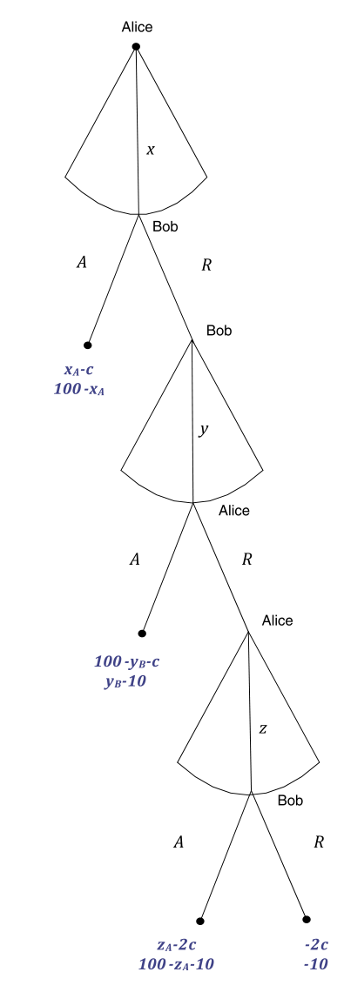
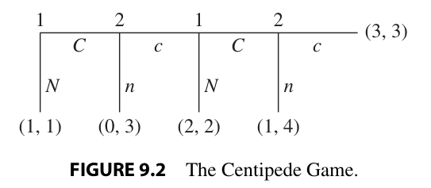

# Practice plan — Lecture 4 (Multistage games and bargaining)

25 existing book exercises in one sequence of rising complexity, each reproduced verbatim under
its tier table (transcribed from the PDF page images on 2026-10-25). Sources: Tadelis (2013),
Ch. 9 and 11, the chapters the lecture is expected to follow; Gibbons (1992), Ch. 2;
Muñoz-Garcia & Toro-Gonzalez (2019), worked answers after every exercise; MWG (1995), Ch. 9.
Class plan: [[Map/study-guide|study guide]]; book map: [[Map/books-index|books-index]]; notes:
[[Notas/L04/L04-00-map|Lecture 4 notes]]. No worked-solutions file for this list.

**Estimated unit.** There are no Lecture 4 slides yet (`Aula/Lecture04.pdf` does not exist on
2026-10-25). The blocks and weights below follow the study guide's Lecture 4 line and the estimated
notes in `Notas/L04/`, which cite Tadelis and Gibbons in place of slides. Re-weight when the slides
arrive.

**Answers in the books.** Muñoz-Garcia: a worked answer follows each exercise. MWG 9.B.7, 9.B.12,
9.B.13: in the MWG solutions manual (`Livros/`). Gibbons: in an unofficial, unfinished manual
(`D:/Livros/Mercado/Economia/`, not copied). Tadelis: none in the book; the preface (p. xiii) says
about half are solved on Princeton UP's website (not checked).

**Verification.** Every exercise was located in the PDF through the offsets in
`Livros/book-registry.json` and checked against the rendered page image on 2026-10-25: Tadelis
pp. 186–189 and 236–237; Gibbons pp. 133, 137–138; Muñoz-Garcia pp. 154, 198–201 and 303; MWG
pp. 302–303 (2-up scan, PDF page 162). Figures were cropped from the same pages
(`Listas/figures/tadelis-9-2.png`, `Listas/figures/munoz-garcia-4-16.png`).

**Overlap with existing lists.** MWG 9.B.12 and 9.B.13 (with 9.B.7) are also items 28–29 of
`Listas/pratica-aula-01-02.md`; they stay here because the study guide assigns them to Lecture 4,
so skip them if already done. `Listas/lista-aulas-01-02.tex` block 3 asks for the three-round and
infinite-horizon alternating-offer shares with $\delta_A \neq \delta_S$: items 16, 18 and 22 train
the same algebra without the investment and Coase layer.

**Not here on purpose.** MWG 9.B.9 is the same $3 \times 3$ matrix played twice as Tadelis 9.1
(item 1). Gibbons 2.3 asks for the Rubinstein split with $\delta_1 \neq \delta_2$, as Tadelis 11.6
and MWG 9.B.12 (items 18, 22) do. Gibbons 2.10–2.17 and Tadelis Ch. 10 are repeated games
(Lectures 5–6).

## Weighting

| Block | Subtopic | Items | Weight | Why |
|---|---|---|---|---|
| B1 | Multistage games: history-contingent strategies, carrot and stick, the discount-factor threshold | 6 | 24% | the first half of the lecture (Tadelis Ch. 9); every exercise in the chapter is of this kind |
| B2 | Two-stage games of complete but imperfect information: bank runs, leaders and followers, unions, tournaments | 4 | 16% | Gibbons §2.2's method and applications; lighter because the method is the same as B1's |
| B3 | Ultimatum and finite alternating offers: backward induction from a deadline, costs of delay, holdup | 9 | 36% | the core of the bargaining half, and the densest in the books (all four have exercises) |
| B4 | Infinite horizon and multilateral bargaining: Rubinstein, asymmetric patience, three players, legislatures | 6 | 24% | the lecture's headline result $\frac{1-\delta_2}{1-\delta_1\delta_2}$ and its extensions |

| Level | Items | Count |
|---|---|---|
| Foundations (a stage game played twice, a short backward induction, an ultimatum or three-round game) | 1–9 | 9 |
| Exam (continuous first stages, holdup, delay costs, asymmetric patience, SPNE vs. outcome) | 10–18 | 9 |
| Advanced (contests and sabotage, verifying Rubinstein strategies, MWG, three players, Baron–Ferejohn) | 19–25 | 7 |

---

## Tier 1 — Foundations

| # | Block | Source | Ch./Sec. | Exercise | Page | What it trains |
|---|---|---|---|---|---|---|
| 1 | B1 | Tadelis | Ch. 9, Exercises | 9.1 | 186–187 | A $3 \times 3$ game played twice: SPE that use a second-stage carrot and stick, and the smallest $\delta$ for each |
| 2 | B1 | Tadelis | Ch. 9, Exercises | 9.3 | 187–188 | Two different stage games in sequence; sustaining $(P, p)$ in stage 1 with the threat of $(N, n)$ in stage 2 |
| 3 | B2 | Gibbons | §2.4, Problems | 2.22 | 138 | The bank-runs game as a tree and as a matrix; its two pure SPNE |
| 4 | B2 | Gibbons | §2.2, Problems | 2.6 | 133 | One leader and two simultaneous followers: solve stage 2 as a Nash equilibrium, then stage 1 |
| 5 | B2 | Muñoz-Garcia | Ch. 4 | Ex. 18 | 200–201 | Backward induction with continuous actions: the firm's best response, then the union's wage |
| 6 | B3 | Tadelis | Ch. 11, Exercises | 11.1 | 236 | Nash equilibrium supports disagreement in any bargaining game; why subgame perfection is needed |
| 7 | B3 | Muñoz-Garcia | Ch. 4 | Ex. 1 | 154 | The ultimatum game when the responder cares about inequity: the SPE offer as a function of $\alpha$ |
| 8 | B3 | Muñoz-Garcia | Ch. 4 | Ex. 16 | 198–199 | Three rounds with costly offers and no discounting: induction from the last round |
| 9 | B3 | Muñoz-Garcia | Ch. 4 | Ex. 17 | 199–200 | Four rounds with a surplus that shrinks by one unit per period instead of discounting |

### Statements

#### 1. Tadelis 9.1

<!-- id: Tadelis 9.1 -->
**Source.** Tadelis (2013), *Game Theory: An Introduction*, Exercise 9.1 "Multistage Practice", pp. 186–187. Reproduced verbatim.

> **Multistage Practice:** Consider the following simultaneous-move game that is played twice (the players observe the first-period outcome prior to the second-period play):
>
> | Player 1 \ Player 2 | $L$ | $C$ | $R$ |
> |:---:|:---:|:---:|:---:|
> | $T$ | 10, 10 | 2, 12 | 0, 13 |
> | $M$ | 12, 2 | 5, 5 | 0, 0 |
> | $B$ | 13, 0 | 0, 0 | 1, 1 |
>
> a. Find all the pure-strategy subgame-perfect equilibria with no discounting ($\delta = 1$). Be precise in defining history-contingent strategies for both players.
>
> b. For each of the equilibria you found in (a), find the smallest discount factor that supports it.

#### 2. Tadelis 9.3

<!-- id: Tadelis 9.3 -->
**Source.** Tadelis (2013), *Game Theory: An Introduction*, Exercise 9.3 "Campaigning Revisited", pp. 187–188. Reproduced verbatim.

> **Campaigning Revisited:** Two political candidates are scheduled to campaign in two states, in one in period $t = 1$ and in the other in $t = 2$. In each state each candidate can choose either a positive campaign that promotes his own agenda ($P$ for player 1, $p$ for player 2) or a negative one that attacks his opponent ($N$ for player 1, $n$ for player 2). Residents of the first-period state do not mind negative campaigns, which are generally effective, and payoffs in this state are given by the following matrix:
>
> | Player 1 \ Player 2 | $p$ | $n$ |
> |:---:|:---:|:---:|
> | $P$ | 2, 2 | 0, 5 |
> | $N$ | 5, 0 | 3, 3 |
>
> In the second-period state, residents dislike negative campaigns despite their effectiveness, and the payoffs are given by the following matrix:
>
> | Player 1 \ Player 2 | $p$ | $n$ |
> |:---:|:---:|:---:|
> | $P$ | 4, 4 | 1, 0 |
> | $N$ | 0, 1 | 2, 2 |
>
> a. What are the Nash equilibria of each stage-game? Find all the pure-strategy subgame-perfect equilibria with extreme discounting ($\delta = 0$). Be precise in defining history-contingent strategies for both players.
>
> b. Now let $\delta = 1$. Find a subgame-perfect equilibrium for the two-stage game in which the players choose $(P, p)$ in the first stage-game.
>
> c. What is the lowest value of $\delta$ for which the subgame-perfect equilibrium you found in (b) survives?
>
> d. Can you find a subgame-perfect equilibrium for this game in which the players play something other than $(P, p)$ or $(N, n)$ in the first stage?

#### 3. Gibbons 2.22

<!-- id: Gibbons 2.22 -->
**Source.** Gibbons (1992), *Game Theory for Applied Economists*, Ch. 2 Problems (Section 2.4), Problem 2.22, p. 138. Reproduced verbatim.

> 2.22. Give the extensive- and normal-form representations of the bank-runs game discussed in Section 2.2.B. What are the pure-strategy subgame-perfect Nash equilibria?

#### 4. Gibbons 2.6

<!-- id: Gibbons 2.6 -->
**Source.** Gibbons (1992), *Game Theory for Applied Economists*, Ch. 2 Problems (Section 2.2), Problem 2.6, p. 133. Reproduced verbatim.

> 2.6. Three oligopolists operate in a market with inverse demand given by $P(Q) = a - Q$, where $Q = q_1 + q_2 + q_3$ and $q_i$ is the quantity produced by firm $i$. Each firm has a constant marginal cost of production, $c$, and no fixed cost. The firms choose their quantities as follows: (1) firm 1 chooses $q_1 \ge 0$; (2) firms 2 and 3 observe $q_1$ and then simultaneously choose $q_2$ and $q_3$, respectively. What is the subgame-perfect outcome?

#### 5. Muñoz-Garcia Ex. 18

<!-- id: Muñoz-Garcia Ch. 4 Ex. 18 -->
**Source.** Muñoz-Garcia & Toro-Gonzalez (2019), *Strategy and Game Theory: Practice Exercises with Answers*, Ch. 4, Exercise 18 "Backward Induction in Wage Negotiations", pp. 200–201. Reproduced verbatim (statement only; the book's worked answer follows it).

> Consider the following bargaining game between a labor union and a firm. In the first stage, the labor union chooses the wage level, $w$, that all workers will receive. In the second stage, the firm responds to the wage $w$ by choosing the number of workers it hires, $h \in [0, 1]$. The labor union's payoff function is $u_L(w, h) = w \cdot h$, thus being increasing in wages and in the number of workers hired. The firm's profit is
>
> $$\pi(w, h) = \left(h - \frac{h^2}{2}\right) - wh$$
>
> Intuitively, revenue is increasing in the number of workers hired, $h$, but at a decreasing rate (i.e., $h - \frac{h^2}{2}$ is concave in $h$), reaching a maximum when the firm hires all workers, i.e., $h = 1$ where revenue becomes 1/2.
>
> **Part (a)** Applying backward induction, analyze the optimal strategy of the last mover (firm). Find the firm's best response function $h(w)$.
>
> **Part (b)** Let us now move on to the first mover in the game (labor union). Anticipating the best response function of the firm that you found in part (a), $h(w)$, determine the labor union's optimal wage, $w^*$.

#### 6. Tadelis 11.1

<!-- id: Tadelis 11.1 -->
**Source.** Tadelis (2013), *Game Theory: An Introduction*, Exercise 11.1 "Disagreement", p. 236. Reproduced verbatim.

> **Disagreement:** Construct a pair of strategies for the ultimatum game ($T = 1$ bargaining game) that constitute a Nash equilibrium and together support the outcome that there is no agreement reached by the two players and the payoffs are zero to each. Show that this disagreement outcome can be supported by a Nash equilibrium regardless of the number of bargaining periods.

#### 7. Muñoz-Garcia Ex. 1

<!-- id: Muñoz-Garcia Ch. 4 Ex. 1 -->
**Source.** Muñoz-Garcia & Toro-Gonzalez (2019), *Strategy and Game Theory: Practice Exercises with Answers*, Ch. 4, Exercise 1 "Ultimatum Bargaining Game", p. 154. Reproduced verbatim (statement only; the book's worked answer follows it).

> In the ultimatum bargaining game, a proposer is given a pie, normalized to a size \$1, and he is asked to make a monetary offer, $x$, to the responder who, upon receiving the offer, only has the option to accept or reject it (as if he received an "ultimatum" from the proposer). If the offer $x$ is accepted, then the responder receives it while the proposer keeps the remainder of the pie $1 - x$. However, if he rejects it, both players receive a zero payoff. Operating by backward induction, the responder should accept any offer $x$ from the proposer (even if it is low) since the alternative (reject the offer) yields an even lower payoff (zero). Anticipating such as a response, the proposer should then offer one cent (or the smallest monetary amount) to the responder, since by doing so the proposer guarantees acceptance and maximizes his own payoff. Therefore, according to the subgame perfect equilibrium prediction in the ultimatum bargaining game, the proposer should make a tiny offer (one cent or, if possible, an amount approaching zero), and the responder should accept it, since his alternative (reject the offer) would give him a zero payoff. However, in experimental tests of the ultimatum bargaining game, subjects who are assigned the role of proposer rarely make offers close to zero to the subject who plays as a responder.
>
> Furthermore, sometimes subjects in the role of the responder reject positive offers, which seems to contradict our equilibrium predictions. In order to explain this dissonance between theory and experiments, many scholars have suggested that players' utility function is not as selfish as that specified in standard models (where players only care about the monetary payoff they receive). Instead, the utility function should also include social preferences, measured by the difference between the payoff a player obtains and that of his opponent, which gives rise to envy (when the monetary amount he receives is lower than that of his opponent) or guilt (when his monetary payoff is higher than his opponent's). In particular, suppose that the responder's utility is given by
>
> $$u_R(x, y) = x + \alpha(x - y),$$
>
> where $x$ is the responder's monetary payoff, $y$ is the proposer's monetary payoff, and $\alpha$ is a positive constant. That is, the responder not only cares about how much money he receives, $x$, but also about the payoff inequality that emerges at the end of the game, $\alpha(x - y)$, which gives rise to either envy, if $x < y$, or guilt, if $x > y$. For simplicity, assume that the proposer is selfish, i.e., his utility function only considers his own monetary payoffs $u_P(x, y) = y$, as in the basic model.
>
> **Part (a)** Use a game tree to represent this game in its extensive form, writing the payoffs in terms of $m$, the monetary offer of the proposer, and parameter $\alpha$.
>
> **Part (b)** Find the subgame perfect equilibrium. Describe how equilibrium payoffs are affected by changes in parameter $\alpha$.
>
> **Part (c)** Depict the equilibrium monetary amount that the proposer keeps, and the payoff that the responder receives, as a function of parameter $\alpha$.

#### 8. Muñoz-Garcia Ex. 16

<!-- id: Muñoz-Garcia Ch. 4 Ex. 16 -->
**Source.** Muñoz-Garcia & Toro-Gonzalez (2019), *Strategy and Game Theory: Practice Exercises with Answers*, Ch. 4, Exercise 16 "Two-Period Bilateral Bargaining Game", pp. 198–199. Reproduced verbatim (statement only; the book's worked answer follows it).

> Alice and Bob are trying to split \$100. As depicted in the game tree of Fig. 4.35, in the first round of bargaining, Alice makes an offer at cost $c$ (to herself), proposing to keep $x_A$ and give the remaining $x_B = 100 - x_A$ to Bob. Bob either accepts her offer (ending the game) or rejects it. In round 2, Bob makes an offer of $(y_A, y_B)$, at a cost of 10 to himself, which Alice accepts or rejects. If Alice accepts the offer, the game ends; but if she rejects it, the game proceeds to the third round, in which Alice makes an offer $(z_A, z_B)$, at a cost $c$ to herself. If Bob accepts her offer in the third round, the game ends and payoffs are accrued to each player; whereas if he rejects it, the money is lost. Assume that players are risk-neutral (utility is equal to money obtained minus any costs), and there is no discounting. If $c = 0$, what is the subgame-perfect equilibrium outcome?
>
> 
>
> *Fig. 4.35* Two-period bilateral bargaining game

#### 9. Muñoz-Garcia Ex. 17

<!-- id: Muñoz-Garcia Ch. 4 Ex. 17 -->
**Source.** Muñoz-Garcia & Toro-Gonzalez (2019), *Strategy and Game Theory: Practice Exercises with Answers*, Ch. 4, Exercise 17 "Alternating Bargaining with a Twist", pp. 199–200. Reproduced verbatim (statement only; the book's worked answer follows it).

> Consider a two-player alternating offer bargaining game with 4 periods, and where player 1 is the first one to make offers. Rather than assuming discounting of future payoffs, let us now assume that the initial surplus shrinks by one unit if players do not reach an agreement in that period, i.e., surplus at period $t$ becomes $S = 6 - t$ for all $t = \{1, 2, 3, 4\}$. As in similar bargaining games, assume that every player accepts an offer when being indifferent between accept and reject. Find the SPNE of the game.

## Tier 2 — Exam level

| # | Block | Source | Ch./Sec. | Exercise | Page | What it trains |
|---|---|---|---|---|---|---|
| 10 | B1 | Tadelis | Ch. 9, Exercises | 9.2 | 187 | A sequential stage game followed by a coordination game: counting strategies, then rewarding cooperation in the centipede |
| 11 | B1 | Tadelis | Ch. 9, Exercises | 9.4 | 188 | Continuous Cournot first stage, discrete access game second: the $\delta$ that sustains the monopoly split |
| 12 | B1 | Tadelis | Ch. 9, Exercises | 9.6 | 189 | The same with costs and a standard-setting game; the best symmetric SPE when $\delta$ is too low |
| 13 | B3 | Tadelis | Ch. 11, Exercises | 11.2 | 236 | Holdup: an investment before an ultimatum is not paid for, and a Nash equilibrium that both prefer |
| 14 | B3 | Tadelis | Ch. 11, Exercises | 11.3 | 236 | The finite alternating-offer game for $T$ even: who has the last word |
| 15 | B3 | Tadelis | Ch. 11, Exercises | 11.4 | 236 | Fixed delay costs $c_i$ instead of discounting: shares that depend on $c_1$ vs. $c_2$ |
| 16 | B3 | Tadelis | Ch. 11, Exercises | 11.5 | 236–237 | Three periods with $\delta_1 \neq \delta_2$: first-mover vs. last-mover advantage |
| 17 | B3 | Gibbons | §2.4, Problems | 2.19 | 137 | The SPNE of the three-period model, as complete strategies, vs. its backward-induction outcome |
| 18 | B4 | Tadelis | Ch. 11, Exercises | 11.6 | 237 | Rubinstein with $\delta_1 \neq \delta_2$, and convergence to $\frac{1}{1+\delta}$ |

### Statements

#### 10. Tadelis 9.2

<!-- id: Tadelis 9.2 -->
**Source.** Tadelis (2013), *Game Theory: An Introduction*, Exercise 9.2 "Centipedes Revisited", p. 187. Reproduced verbatim.

> **Centipedes Revisited:** Two players are playing two consecutive games. First, they play the Centipede Game described in Figure 9.2. After the Centipede Game they play the following coordination game:
>
> 
>
> | Player 1 \ Player 2 | $a$ | $b$ |
> |:---:|:---:|:---:|
> | $A$ | 1, 1 | 0, 0 |
> | $B$ | 0, 0 | 3, 3 |
>
> a. What are the Nash equilibria of each stage-game?
>
> b. How many pure strategies does each player have in the multistage game?
>
> c. Find all the pure-strategy subgame-perfect equilibria with extreme discounting ($\delta = 0$). Be precise in defining history-contingent strategies for both players.
>
> d. Now let $\delta = 1$. Find a subgame-perfect equilibrium for the two-stage game in which the players receive the payoffs (2, 2) in the first stage-game.
>
> e. What is the lowest value of $\delta$ for which the subgame-perfect equilibrium you found in (d) survives?
>
> f. For $\delta$ greater than the value you found in (e), are there other outcomes of the first-stage Centipede Game that can be supported as part of a subgame-perfect equilibrium?

#### 11. Tadelis 9.4

<!-- id: Tadelis 9.4 -->
**Source.** Tadelis (2013), *Game Theory: An Introduction*, Exercise 9.4 "Online Gaming", p. 188. Reproduced verbatim.

> **Online Gaming:** Consider a two-stage game between two firms that produce online games. In the first stage, they play a Cournot competition game (each chooses a quantity $q_i$) with demand function $p = 100 - q$ and zero marginal production costs ($c_i(q_i) = 0$ for $i = 1, 2$). In the second stage, after observing the pair $(q_1, q_2)$ and after profits have been distributed, the players play a simultaneous-move "access" game in which each can open its platform to allow players on the other platform to play online with players on its platform ($O$ for player 1, $o$ for player 2), or choose to keep its platform noncompatible ($N$ for player 1, $n$ for player 2), in which case each platform's players can play only with others on the same platform. If they choose $(N, n)$ then second-stage payoffs are $(0, 0)$. If only one firm chooses to open its platform, it bears a cost of $-10$ with no benefit, since the other firm did not allow open access. Finally if both firms choose $(O, o)$ then each firm gets many more eyeballs for advertising, and payoffs for each are 2500. Both players use the same discount factor $\delta$ to discount future payoffs.
>
> a. Find the unique Nash equilibrium in the first-stage Cournot game and all of the pure-strategy Nash equilibria of the second-stage access game. Find all the pure-strategy subgame-perfect equilibria with extreme discounting ($\delta = 0$). Be precise in defining history-contingent strategies for both players.
>
> b. Now let $\delta = 1$. Find a subgame-perfect equilibrium for the two-stage game in which the players choose the monopoly (total profit–maximizing) quantities and split them equally (a symmetric equilibrium).
>
> c. What is the lowest value of $\delta$ for which the subgame-perfect equilibrium you found in (b) survives?
>
> d. Now let $\delta = 0.4$. Can you support a subgame-perfect equilibrium for the two-stage game in which the players choose the monopoly quantities and split them equally? If not, what are the highest profits that the firms can make in a symmetric equilibrium?

#### 12. Tadelis 9.6

<!-- id: Tadelis 9.6 -->
**Source.** Tadelis (2013), *Game Theory: An Introduction*, Exercise 9.6 "Augmented Competition", p. 189. Reproduced verbatim.

> **Augmented Competition:** Consider two firms playing a two-stage game with discount factor $\delta$. In the first stage they play a Cournot quantity-setting game in which each firm has costs $c_i(q_i) = 10q_i$ for $i \in \{1, 2\}$ and the demand is given by $p(q) = 100 - q$, where $q = q_1 + q_2$. In the second stage, after the results of the Cournot game are observed, the firms play the following standard-setting game:
>
> | Player 1 \ Player 2 | $a$ | $b$ |
> |:---:|:---:|:---:|
> | $A$ | 100, 100 | 0, 0 |
> | $B$ | 0, 0 | 300, 300 |
>
> a. Find the unique Nash equilibrium of the first-stage game and the two pure-strategy Nash equilibria of the second-stage game.
>
> b. As far as the two firms are considered, what are the symmetric Pareto-optimal outcomes of each stage-game?
>
> c. For which values of $\delta$ can the Pareto-optimal outcomes be supported as a subgame-perfect equilibrium?
>
> d. Assume that $\delta = 0.5$. What is the "best" symmetric subgame-perfect equilibrium that the players can support?
>
> e. What happens to the best symmetric subgame-perfect equilibrium that the players can support as $\delta$ drops toward zero?

#### 13. Tadelis 11.2

<!-- id: Tadelis 11.2 -->
**Source.** Tadelis (2013), *Game Theory: An Introduction*, Exercise 11.2 "Holdup", p. 236. Reproduced verbatim.

> **Holdup:** Consider an ultimatum game ($T = 1$ bargaining game) in which before player 1 makes his offer to player 2, player 2 can invest in the size of the pie. If player 2 chooses a low level of investment ($L$) then the size of the pie is small, equal to $v_L$, while if player 2 chooses a high level of investment ($H$) then the size of the pie is large, equal to $v_H$. The cost to player 2 of choosing $L$ is $c_L$, while the cost of choosing $H$ is $c_H$. Assume that $v_H > v_L > 0$, $c_H > c_L > 0$, and $v_H - c_H > v_L - c_L$.
>
> a. What is the unique subgame-perfect equilibrium of this game? Is it Pareto optimal?
>
> b. Can you find a Nash equilibrium of the game that results in an outcome that is better for both players as compared to the unique subgame-perfect equilibrium?

#### 14. Tadelis 11.3

<!-- id: Tadelis 11.3 -->
**Source.** Tadelis (2013), *Game Theory: An Introduction*, Exercise 11.3 "Even/Odd Symmetry", p. 236. Reproduced verbatim.

> **Even/Odd Symmetry:** In Section 11.2 we analyzed the alternating-offer bargaining game for a finite number of periods when $T$ was odd. Repeat the analysis for $T$ even.

#### 15. Tadelis 11.4

<!-- id: Tadelis 11.4 -->
**Source.** Tadelis (2013), *Game Theory: An Introduction*, Exercise 11.4 "Constant Delay Cost", p. 236. Reproduced verbatim.

> **Constant Delay Cost:** Consider a two-player alternating-offer bargaining game in which instead of the pie shrinking by a discount factor $\delta < 1$, the players each pay a cost $c_i > 0$, $i \in \{1, 2\}$, to advance from one period to the next. So if player $i$ receives a share of the pie that gives him a value of $x_i$ in period $t$ then his payoff is $v_i = x_i - (t - 1)c_i$. If the game has $T$ periods then a sequence of rejections results in each player receiving $v_i = -(T - 1)c_i$.
>
> a. Assume that $T = 2$. Find the subgame-perfect equilibrium of the game and show in which way it depends on the values of $c_1$ and $c_2$.
>
> b. Are there Nash equilibria in the two-period game that are not subgame perfect?
>
> c. Assume that $T = 3$. Find the subgame-perfect equilibrium of the game and show in which way it depends on the values of $c_1$ and $c_2$.

#### 16. Tadelis 11.5

<!-- id: Tadelis 11.5 -->
**Source.** Tadelis (2013), *Game Theory: An Introduction*, Exercise 11.5 "Asymmetric Patience 1", pp. 236–237. Reproduced verbatim.

> **Asymmetric Patience 1:** Consider a three-period sequential (alternating-offer) bargaining model in which two players have to split a pie worth 1 (starting with player 1 making the offer). Now the players have different discount factors, $\delta_1$ and $\delta_2$.
>
> a. Compute the outcome of the unique subgame-perfect equilibrium.
>
> b. Show that when $\delta_1 = \delta_2$ player 1 has an advantage.
>
> c. What conditions on $\delta_1$ and $\delta_2$ give player 2 an advantage? Why?

#### 17. Gibbons 2.19

<!-- id: Gibbons 2.19 -->
**Source.** Gibbons (1992), *Game Theory for Applied Economists*, Ch. 2 Problems (Section 2.4), Problem 2.19, p. 137. Reproduced verbatim.

> 2.19. In the three-period version of Rubinstein's bargaining model analyzed in Section 2.1.D, we solved for the backwards-induction outcome. What is the subgame-perfect Nash equilibrium?

#### 18. Tadelis 11.6

<!-- id: Tadelis 11.6 -->
**Source.** Tadelis (2013), *Game Theory: An Introduction*, Exercise 11.6 "Asymmetric Patience 2", p. 237. Reproduced verbatim.

> **Asymmetric Patience 2:** Consider the analysis of the infinite-horizon bargaining model in Section 11.3 and assume that the players have different discount factors $\delta_1$ and $\delta_2$. Find the unique subgame-perfect equilibrium using the same techniques, and show that as $\delta_1$ and $\delta_2$ become closer in value, the solution you found converges to the solution derived in Section 11.3.

## Tier 3 — Advanced

| # | Block | Source | Ch./Sec. | Exercise | Page | What it trains |
|---|---|---|---|---|---|---|
| 19 | B1 | Tadelis | Ch. 9, Exercises | 9.5 | 188–189 | A contest with continuous spending, then a coordination stage: rewards in stage 2 that curb wasteful spending in stage 1 |
| 20 | B2 | Gibbons | §2.2, Problems | 2.8 | 133 | The tournament with sabotage: how the optimal prize spread falls |
| 21 | B4 | Gibbons | §2.4, Problems | 2.20 | 137–138 | Verifying that the stationary Rubinstein strategies are a Nash equilibrium and subgame perfect |
| 22 | B4 | MWG | Ch. 9, Appendix A (Example 9.AA.2) | 9.B.12 | 303 | The unique SPNE of the infinite-horizon game with $\delta_1 \neq \delta_2$, at MWG's level of rigour |
| 23 | B4 | MWG | Ch. 9, Appendix A (Example 9.AA.1) | 9.B.13 (with 9.B.7) | 302–303 | A cost per offer instead of discounting: the finite game, then the infinite horizon, where many SPNE exist |
| 24 | B4 | Muñoz-Garcia | Ch. 6 | Ex. 8 | 303 | Three-player Rubinstein under unanimity with stationary strategies |
| 25 | B4 | Tadelis | Ch. 11, Exercises | 11.7 | 237 | Finite Baron–Ferejohn with a closed rule, compared with two-person bargaining and with the infinite horizon |

### Statements

#### 19. Tadelis 9.5

<!-- id: Tadelis 9.5 -->
**Source.** Tadelis (2013), *Game Theory: An Introduction*, Exercise 9.5 "Campaign Spending", pp. 188–189. Reproduced verbatim.

> **Campaign Spending:** Two political candidates are destined to play the following two-stage game. Assume throughout that there is no discounting ($\delta = 1$). First, they compete in the primaries of their respective parties. Each candidate $i$ can spend $s_i \ge 0$ resources on ads that reach out to voters, which in turn increases the probability that candidate $i$ wins the race. Given a pair of spending choices $(s_1, s_2)$, the probability that candidate $i$ wins is given by $\frac{s_i}{s_1 + s_2}$. If neither spends any resources then each wins with probability $\frac{1}{2}$. Each candidate values winning at a payoff of $16 > 0$, and the cost of spending $s_i$ is equal to $s_i$. After each player observes the resources spent by the other and a winner in the primaries is selected, they can choose how to interact. Each can choose to be pleasant ($P$ for player 1 and $p$ for player 2) or nasty ($N$ and $n$, respectively). At this stage both players prefer that they be nice to each other rather than nasty, but if one player is nasty then the other prefers to be nasty too. The payoffs from this stage are given by the following matrix (where $w > 0$):
>
> | Player 1 \ Player 2 | $p$ | $n$ |
> |:---:|:---:|:---:|
> | $P$ | $w, w$ | $-1, 0$ |
> | $N$ | $0, -1$ | $0, 0$ |
>
> a. Find the unique Nash equilibrium of the first-stage game and the two pure-strategy Nash equilibria of the second-stage game.
>
> b. What are the Pareto-optimal outcomes of each stage-game?
>
> c. For which value of $w$ can the players support the path of Pareto-optimal outcomes as a subgame-perfect equilibrium?
>
> d. Assume that $w = 1$. What is the "best" symmetric subgame-perfect equilibrium that the players can support?
>
> e. What happens to the best symmetric subgame-perfect equilibrium that the players can support as $w$ changes? In what way is this related to the role played by a discount factor?

#### 20. Gibbons 2.8

<!-- id: Gibbons 2.8 -->
**Source.** Gibbons (1992), *Game Theory for Applied Economists*, Ch. 2 Problems (Section 2.2), Problem 2.8, p. 133. Reproduced verbatim.

> 2.8. Modify the tournament model in Section 2.2.D so that worker $i$'s output is $y_i = e_i - (1/2)s_j + \varepsilon_i$, where $s_j \ge 0$ represents sabotage by worker $j$, and worker $i$'s disutility of (productive and destructive) effort is $g(e_i) + g(s_i)$, as in Lazear (1989). Show that the optimal prize $w_H - w_L$ is smaller than when there is no possibility of sabotage (as in the text).

#### 21. Gibbons 2.20

<!-- id: Gibbons 2.20 -->
**Source.** Gibbons (1992), *Game Theory for Applied Economists*, Ch. 2 Problems (Section 2.4), Problem 2.20, pp. 137–138. Reproduced verbatim.

> 2.20. Consider the following strategies in the infinite-horizon version of Rubinstein's bargaining model. (Recall the notational convention that the offer $(s, 1 - s)$ means that Player 1 will get $s$ and Player 2 will get $1 - s$, independent of who made the offer.) Let $s^* = 1/(1 + \delta)$. Player 1 always offers $(s^*, 1 - s^*)$ and accepts an offer $(s, 1 - s)$ only if $s \ge \delta s^*$. Player 2 always offers $(1 - s^*, s^*)$ and accepts an offer $(s, 1 - s)$ only if $1 - s \ge \delta s^*$. Show that these strategies are a Nash equilibrium. Show that this equilibrium is subgame-perfect.

#### 22. MWG 9.B.12

<!-- id: MWG 9.B.12 -->
**Source.** Mas-Colell, Whinston & Green (1995), *Microeconomic Theory*, Ch. 9 Exercises, Exercise 9.B.12^C, p. 303. Reproduced verbatim.

> Consider the infinite horizon bilateral bargaining model of Appendix A (Example 9.AA.2). Suppose the discount factors $\delta_1$ and $\delta_2$ of the two players differ. Now what is the (unique) subgame perfect Nash equilibrium?

#### 23. MWG 9.B.13 (with 9.B.7, which it builds on)

<!-- id: MWG 9.B.7 -->
**Source.** Mas-Colell, Whinston & Green (1995), *Microeconomic Theory*, Ch. 9 Exercises, Exercise 9.B.7^B, p. 302. Reproduced verbatim.

> Consider the finite horizon bilateral bargaining game in Appendix A (Example 9.AA.1); but instead of assuming that players discount future payoffs, assume that it costs $c < v$ to make an offer. (Only the player making an offer incurs this cost, and players who have made offers incur this cost even if no agreement is ultimately reached.) What is the (unique) SPNE of this alternative model? What happens as $T$ approaches $\infty$?

<!-- id: MWG 9.B.13 -->
**Source.** Mas-Colell, Whinston & Green (1995), *Microeconomic Theory*, Ch. 9 Exercises, Exercise 9.B.13^B, p. 303. Reproduced verbatim.

> What are the subgame perfect Nash equilibria of the infinite horizon version of Exercise 9.B.7?

#### 24. Muñoz-Garcia Ch. 6 Ex. 8

<!-- id: Muñoz-Garcia Ch. 6 Ex. 8 -->
**Source.** Muñoz-Garcia & Toro-Gonzalez (2019), *Strategy and Game Theory: Practice Exercises with Answers*, Ch. 6, Exercise 8 "Infinite-Horizon Bargaining Game Between Three Players", p. 303. Reproduced verbatim (statement only; the book's worked answer follows it).

> Consider a three-player variant of Rubinstein's infinite-horizon bargaining game, where players divide a surplus (pie) of size 1, and the set of possible agreements is
>
> $$X = \{(x_1, x_2, x_3) \mid x_i \ge 0 \quad \text{for } i = 1, 2, 3 \ \text{ and } \ x_1 + x_2 + x_3 = 1\}.$$
>
> Players take turns to offer agreements, starting with player 1 in round $t = 0$, and the game ends when *both* responders accept an offer. If agreement $x$ is reached in round $t$, player $i$'s utility is given by $\delta^t x_i$, where $\frac{1}{2} < \delta < 1$. Show that, if each player is restricted to using stationary strategies (in which she makes the same proposal every time she is the proposer, and uses the same acceptance rule whenever she is a responder), there is a unique subgame perfect equilibrium outcome. How much does each player receive in equilibrium?

#### 25. Tadelis 11.7

<!-- id: Tadelis 11.7 -->
**Source.** Tadelis (2013), *Game Theory: An Introduction*, Exercise 11.7 "Legislative Bargaining Revisited", p. 237. Reproduced verbatim.

> **Legislative Bargaining Revisited:** Consider a finite $T$-period version of the Baron and Ferejohn legislative bargaining game with an odd number $N$ of players and with a closed rule as described in Section 11.4.1.
>
> a. Find the unique subgame-perfect equilibrium for $T = 1$. Also find a Nash equilibrium that is not subgame perfect.
>
> b. Find the unique subgame-perfect equilibrium for $T = 2$ with a discount factor $0 < \delta \le 1$. Also find a Nash equilibrium that is not subgame perfect.
>
> c. Compare what the first period's proposer receives in the subgame-perfect equilibrium you found in (b) to what a first-period proposer receives in the two-period, two-person Rubinstein-Ståhl bargaining game. What intuitively accounts for the difference?
>
> d. Compare the subgame-perfect equilibrium you found in (b) to the solution of the infinite-horizon model in Section 11.4.1. What intuitively accounts for the similarity?

**Optional extras.**
- Gibbons 2.3 (p. 131): Rubinstein with $\delta_1 \neq \delta_2$, after item 18 if you want Gibbons's version of the argument.
- Gibbons 2.7 (p. 133): a union facing $n$ oligopolists, after item 5.
- Gibbons 2.9 (pp. 133–134): unions, tariffs and free trade as a two-stage game, after the tariff application in Gibbons §2.2.C.
- Gibbons 2.23 (p. 138): an unobserved investment before a price offer; no pure SPNE, so mixed strategies are needed.

---

## Suggested study order

1. **Multistage games.** Read Tadelis §9.1–9.5 (pp. 175–186), then do items **1, 2**, then **10, 11, 12**, and **19** last.
2. **Two-stage games of imperfect information.** Read Gibbons §2.2 (pp. 71–82), then do **3, 4, 5**, and **20** last.
3. **Ultimatum and finite horizon.** Read Tadelis §11.1–11.2 (pp. 220–227) and Gibbons §2.1.D (pp. 68–70), then do **6, 7, 8, 9**, then **13, 14, 15, 16, 17**.
4. **Infinite horizon.** Read Tadelis §11.3 (pp. 228–229) and Gibbons pp. 70–71, then do **18, 21**.
5. **Advanced.** Read MWG 9.AA (pp. 296–298) before **22, 23**; read Tadelis §11.4 (pp. 229–235) before **24, 25**.

---

## Consolidated Reading by Book

### Tadelis — Tadelis (2013)
| Topic | Chapter / Section | Pages | Priority |
|---|---|---|---|
| Multistage games: definition, payoffs, strategies and subgame perfection | Ch. 9, §9.1–9.3 | p. 175–180 | Foundations |
| Using later play to discipline earlier play: carrot and stick | Ch. 9, §9.4 | p. 180–184 | Foundations |
| The one-stage deviation principle | Ch. 9, §9.5 | p. 184–186 | Exam |
| Exercises 9.1–9.6 | Ch. 9, Exercises | p. 186–189 | Exam |
| The ultimatum game | Ch. 11, §11.1 | p. 220–224 | Foundations |
| Finitely many rounds of alternating offers | Ch. 11, §11.2 | p. 224–227 | Foundations |
| The infinite-horizon game | Ch. 11, §11.3 | p. 228–229 | Exam |
| Legislative bargaining (closed and open rule) | Ch. 11, §11.4 | p. 229–235 | Advanced |
| Exercises 11.1–11.7 | Ch. 11, Exercises | p. 236–237 | Exam |

### Gibbons — Gibbons (1992)
| Topic | Chapter / Section | Pages | Priority |
|---|---|---|---|
| Sequential bargaining (three periods, then infinite) | §2.1.D | p. 68–71 | Foundations |
| Two-stage games of complete but imperfect information: theory, bank runs, tariffs, tournaments | §2.2.A–D | p. 71–82 | Foundations |
| Problems 2.6, 2.8 | Ch. 2, Problems (Section 2.2) | p. 133 | Exam |
| Problems 2.19, 2.20, 2.22 | Ch. 2, Problems (Section 2.4) | p. 137–138 | Exam |

### MWG — Mas-Colell, Whinston & Green (1995)
| Topic | Chapter / Section | Pages | Priority |
|---|---|---|---|
| Finite and infinite horizon bilateral bargaining (Examples 9.AA.1–9.AA.2) | Ch. 9, Appendix A | p. 296–298 | Advanced |
| Exercises 9.B.7, 9.B.12, 9.B.13 | Ch. 9, Exercises | p. 302–303 | Advanced |

### Muñoz-Garcia — Muñoz-Garcia & Toro-Gonzalez (2019)
| Topic | Chapter / Section | Pages | Priority |
|---|---|---|---|
| Sequential-move games: ultimatum, alternating offers, wage negotiation (with worked answers) | Ch. 4, Ex. 1, 16–18 | p. 154, 198–201 | Foundations |
| Three-player infinite-horizon bargaining (with worked answer) | Ch. 6, Ex. 8 | p. 303–304 | Advanced |

## Consolidated Exercises

| # | Exercise | Book | Page | Topic | Level |
|---|---|---|---|---|---|
| 1 | 9.1 | Tadelis | p. 186–187 | A stage game played twice | Foundations |
| 2 | 9.2 | Tadelis | p. 187 | Centipede, then coordination | Exam |
| 3 | 9.3 | Tadelis | p. 187–188 | Two stage games in sequence | Foundations |
| 4 | 9.4 | Tadelis | p. 188 | Cournot, then access game | Exam |
| 5 | 9.5 | Tadelis | p. 188–189 | Contest, then coordination | Advanced |
| 6 | 9.6 | Tadelis | p. 189 | Cournot, then standard setting | Exam |
| 7 | 11.1 | Tadelis | p. 236 | Disagreement as a Nash equilibrium | Foundations |
| 8 | 11.2 | Tadelis | p. 236 | Holdup | Exam |
| 9 | 11.3 | Tadelis | p. 236 | Finite horizon, $T$ even | Exam |
| 10 | 11.4 | Tadelis | p. 236 | Fixed delay costs | Exam |
| 11 | 11.5 | Tadelis | p. 236–237 | Three periods, $\delta_1 \neq \delta_2$ | Exam |
| 12 | 11.6 | Tadelis | p. 237 | Infinite horizon, $\delta_1 \neq \delta_2$ | Exam |
| 13 | 11.7 | Tadelis | p. 237 | Finite legislative bargaining | Advanced |
| 14 | 2.6 | Gibbons | p. 133 | Leader and two followers | Foundations |
| 15 | 2.8 | Gibbons | p. 133 | Tournament with sabotage | Advanced |
| 16 | 2.19 | Gibbons | p. 137 | SPNE of the three-period model | Exam |
| 17 | 2.20 | Gibbons | p. 137–138 | Rubinstein strategies are an SPNE | Advanced |
| 18 | 2.22 | Gibbons | p. 138 | Bank runs | Foundations |
| 19 | 9.B.7 | MWG | p. 302 | Finite horizon with offer costs | Advanced |
| 20 | 9.B.12 | MWG | p. 303 | Infinite horizon, $\delta_1 \neq \delta_2$ | Advanced |
| 21 | 9.B.13 | MWG | p. 303 | Infinite horizon with offer costs | Advanced |
| 22 | Ch. 4 Ex. 1 | Muñoz-Garcia | p. 154 | Ultimatum with inequity aversion | Foundations |
| 23 | Ch. 4 Ex. 16 | Muñoz-Garcia | p. 198–199 | Three rounds, costly offers | Foundations |
| 24 | Ch. 4 Ex. 17 | Muñoz-Garcia | p. 199–200 | Shrinking surplus | Foundations |
| 25 | Ch. 4 Ex. 18 | Muñoz-Garcia | p. 200–201 | Union wage, then hiring | Foundations |
| 26 | Ch. 6 Ex. 8 | Muñoz-Garcia | p. 303 | Three-player Rubinstein | Advanced |

## Study roadmap

| Priority | Topic | Reading | Exercises | Suggested time |
|:---:|---|---|---|:---:|
| 1 | Multistage games and the carrot and stick | Tadelis §9.1–9.5 p. 175–186 | Tadelis 9.1, 9.2, 9.3, 9.4, 9.6 | 2–2.5 h |
| 2 | Two-stage games of imperfect information | Gibbons §2.2 p. 71–82 | Gibbons 2.22, 2.6; Muñoz-Garcia Ch. 4 Ex. 18 | 1–1.5 h |
| 3 | Ultimatum and finite alternating offers | Tadelis §11.1–11.2 p. 220–227; Gibbons §2.1.D p. 68–70 | Tadelis 11.1–11.5; Gibbons 2.19; Muñoz-Garcia Ch. 4 Ex. 1, 16, 17 | 2.5–3 h |
| 4 | Infinite horizon | Tadelis §11.3 p. 228–229; Gibbons p. 70–71 | Tadelis 11.6; Gibbons 2.20 | 1 h |
| 5 | Advanced | MWG 9.AA p. 296–298; Tadelis §11.4 p. 229–235 | Tadelis 9.5, 11.7; Gibbons 2.8; MWG 9.B.12, 9.B.13 (with 9.B.7); Muñoz-Garcia Ch. 6 Ex. 8 | 3–3.5 h |
