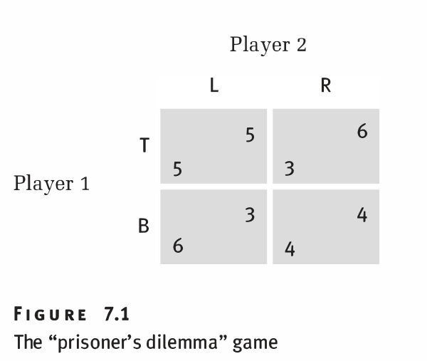
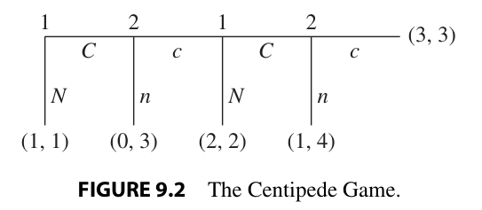

# Practice plan — Lecture 5 (Repeated games)

25 existing book exercises in one sequence of rising complexity, each reproduced verbatim under
its tier table (transcribed from the PDF page images on 2026-10-25 and re-checked against the
printed pages on 2026-11-12). The lecture slides are `Aula/Lecture05.pdf` (35 slides):
finitely repeated prisoner's dilemma and unraveling (slides 5–9), stage games with several
equilibria, carrot and stick, the one-stage deviation principle with and without discounting
(slides 10–16), infinitely repeated games, normalised payoffs $(1-\delta)\sum_t \delta^{t-1}u_i^t$,
continuation strategies and the one-stage deviation principle (slides 17–26), grim trigger
(slides 28–29: SPE iff $\delta \ge 1/4$) and tit-for-tat (slides 30–32: not an SPE for any $\delta$),
and a homework on tacit collusion in a repeated Cournot duopoly (slides 33–34, solved in
`Resolucao/homework-lecture-05.pdf`). Main source: Tadelis (2013), Ch. 9 §9.4–9.5 and Ch. 10
§10.1–10.3 (pp. 180–201); the slides' extra material (tit-for-tat, the homework) follows the same
chapter. Other sources: Gibbons (1992) §2.2–2.3; Muñoz-Garcia & Toro-Gonzalez (2019), worked
answers after every exercise; Cabral (2017) §7.3; MWG (1995) App. A to Ch. 12. Class plan:
[[Map/study-guide|study guide]]; book map: [[Map/books-index|books-index]]; notes:
[[Notas/L05/L05-00-map|Lecture 5 notes]]. Worked solutions:
`Listas/pratica-lecture-05-solutions.pdf` (items 1, 5, 6, 10, 15, 16, 17, 21 reuse the solutions of
`Listas/lista-reais-lectures-01-05-solutions/`; the other 17 are new).

**Re-aligned 2026-11-12.** This list was rebuilt for the real Lecture 5
(`.agent/plans/relist-real-lectures.md`). The estimated-unit note of the 2026-10-25 version is gone:
the slides have arrived and the weighting below follows them. Changes against the old Lecture 5
list: old item 1 (Gibbons 2.12, strategy and subgame in a repeated game) moved to the Lecture 4 list,
where repeated games are defined; nine items were moved in from the old Lecture 4 list (Tadelis 9.1,
9.2, 9.3, 9.4, 9.5, 9.6, Gibbons 2.22, Gibbons 2.8, Muñoz-Garcia Ch. 4 Ex. 18), the two-stage games
that the slides' finitely repeated section is built on. Each item carries a "Moved here from" line
with its old list and number; the items were then renumbered 1–25 by tier and difficulty.

**Answers in the books.** Muñoz-Garcia: a worked answer follows each exercise (items 3, 6, 14, 15);
its Ch. 6 Ex. 7 (p. 299) is the same game as Gibbons 2.11 (item 16) and works it out. MWG
12.AA.1–12.AA.2 (items 20, 25): solved in the MWG solutions manual (`Livros/`); the manual says the
printed statement of 12.AA.1 is incorrect. Gibbons: an unofficial, unfinished manual
(`D:/Livros/Mercado/Economia/`, not copied). Tadelis: none in the book. Cabral: none in the book.

**Verification.** Every page below was re-checked on 2026-11-12: the exercise label was found on the
printed page given, through the offsets in `Livros/book-registry.json` (PDF page = printed page +
offset + 1; in brackets after each source line). Tadelis 9.1–9.6 on pp. 186–189 and 10.2–10.9 on
pp. 215–219; Gibbons 2.8–2.11 on pp. 133–135, 2.16 on p. 136, 2.22 on p. 138; Muñoz-Garcia Ch. 4
Ex. 18 pp. 200–201, Ch. 6 Ex. 1 p. 274, Ex. 6 pp. 292–293, Ex. 9 p. 305; Cabral 7.8 p. 180, 7.12 p. 181,
7.13 p. 182 (its Figure 7.1 on p. 160); MWG 12.AA.1 p. 420, Prop. 12.AA.4 p. 421, 12.AA.2 p. 435.
Figures: `Listas/figures/cabral-7-1.png`, `Listas/figures/tadelis-9-2.png`.

**Not here on purpose.** Gibbons 2.12 (Lecture 4 list). Tacit collusion, reputation and relational
contracts belong to Lecture 6: Tadelis 10.1, 10.4, 10.6 (quality reputation), 10.8, 10.10–10.12;
Gibbons 2.13–2.15 (Bertrand/Cournot collusion) and 2.17 (efficiency wages); Muñoz-Garcia Ch. 6
Ex. 2–5 and 10; MWG 12.D.1–12.D.5 (oligopoly collusion); Cabral 7.15 (a grim-strategy advertising
agreement between firms). The slides' homework (Cournot collusion with grim trigger) is the same
model as item 19 of this list (same demand and cost, Tadelis 9.6); its general-parameter version is in
`Resolucao/homework-lecture-05.pdf`. Muñoz-Garcia Ch. 6 Ex. 8 (three-player bargaining) is
bargaining material (Lecture 6). No exercise here asks for the slides' tit-for-tat check (slides
30–32) as such: Muñoz-Garcia Ch. 6 Ex. 1 (item 6) uses the name for a punishment that lasts $k$ periods,
which is a different strategy.

## Weighting

Weight = share of the 30 content slides (5–34) that teach the block; the slides do not cover B4.

| Block | Subtopic | Slides | Items | Weight | Why |
|---|---|---|---|---|---|
| B1 | Finite repetition: unraveling, stage games with several equilibria, carrot and stick, discounting | 5–13, 15–16 | 10 (1, 2, 8, 11, 12, 13, 16, 17, 19, 22) | 37% | the lecture's first half: Prop. on stage equilibria (slide 10), the $T = 2$ carrot-and-stick example (slides 11–15), unraveling (slide 9) |
| B2 | Backward induction and the one-stage deviation principle in two-stage games | 14, 24–26 | 3 (3, 4, 23) | 13% | the prerequisite of B1 and B3: solve stage 2, then check one deviation at a time; lighter because the method is the same |
| B3 | Infinite repetition: normalised payoffs, grim trigger, the $\delta$ threshold, temporary punishments, both horizons; homework | 17–23, 27–34 | 9 (5, 6, 7, 9, 10, 14, 18, 21, 24) | 50% | the lecture's second half and its headline result (grim trigger, $\delta \ge 1/4$ on the slides' PD); the homework is the same calculation in a Cournot duopoly |
| B4 | Beyond the slides: feasible and individually rational payoffs, Nash reversion theory, harsher punishments | — | 3 (15, 20, 25) | 0% | folk-theorem material that the slides do not reach (Tadelis §10.6, MWG App. A); kept for depth, do last |

| Level | Items | Count |
|---|---|---|
| Foundations (a short backward induction, unraveling, grim trigger on a given matrix, temporary punishments) | 1–8 | 8 |
| Exam (two-stage SPE with carrot and stick, length-$T$ punishments, continuous stage games, feasible sets) | 9–19 | 11 |
| Advanced (both horizons with parameters, tournaments, union–firm, MWG proofs) | 20–25 | 6 |

---

## Tier 1 — Foundations

| # | Block | Source | Ch./Sec. | Exercise | Page | What it trains |
|---|---|---|---|---|---|---|
| 1 | B1 | Cabral | Ch. 7, Exercises | 7.13 | 182 | Unraveling: the finitely repeated PD has a unique SPE |
| 2 | B1 | Cabral | Ch. 7, Exercises | 7.8 | 180 | Why two stage equilibria let a twice-repeated game do new things (in words) |
| 3 | B2 | Muñoz-Garcia | Ch. 4 | Ex. 18 | 200–201 | Backward induction with continuous actions: the firm's best response, then the union's wage |
| 4 | B2 | Gibbons | §2.4, Problems | 2.22 | 138 | The bank-runs game as a tree and as a matrix; its two pure SPNE |
| 5 | B3 | Tadelis | Ch. 10, Exercises | 10.2 | 215 | Grim trigger on a $3\times3$ PD variant; why two cooperative paths need different $\delta$ |
| 6 | B3 | Muñoz-Garcia | Ch. 6 | Ex. 1 | 274 | Temporary (one-, two-, ten-period) punishments vs grim trigger |
| 7 | B3 | Tadelis | Ch. 10, Exercises | 10.9 | 218–219 | Grim trigger with continuous quantities and externalities |
| 8 | B1 | Tadelis | Ch. 9, Exercises | 9.3 | 187–188 | Two different stage games in sequence; what a carrot and stick can and cannot sustain in stage 1 |

### Statements

#### 1. Cabral 7.13

<!-- id: Cabral 7.13 -->
**Source.** Cabral (2017), *Introduction to Industrial Organization*, 2nd ed., Ch. 7 Exercises, Exercise 7.13 "Finitely repeated game", p. 182 [PDF 194]. Answer in the source: none in the book. Reproduced verbatim; Figure 7.1 (p. 160 [PDF 172]), which the exercise refers to, is added below it.
**Moved here from** the Lecture 5 list (old numbering), item 3.

> **7.13. Finitely repeated game.** Suppose that the game depicted in Figure 7.1 is repeated $T$ times, where $T$ is known. Show that the only subgame perfect equilibrium is for players to choose $(B, R)$ in every period.
>
> 
>
> *Figure 7.1* The "prisoner's dilemma" game (p. 160). In each cell, Player 1's payoff is in the lower left corner and Player 2's in the upper right corner.

#### 2. Cabral 7.8

<!-- id: Cabral 7.8 -->
**Source.** Cabral (2017), *Introduction to Industrial Organization*, 2nd ed., Ch. 7 Exercises, Exercise 7.8 "Finitely repeated game", p. 180 [PDF 192]. Answer in the source: none in the book. Reproduced verbatim.
**Moved here from** the Lecture 5 list (old numbering), item 2.

> **7.8. Finitely repeated game.** Consider a one-shot game with two equilibria and suppose this game is repeated twice. Explain in words why there may be equilibria in the two-period game which are different from the equilibria of the one-shot game.

#### 3. Muñoz-Garcia Ex. 18

<!-- id: Muñoz-Garcia Ch. 4 Ex. 18 -->
**Source.** Muñoz-Garcia & Toro-Gonzalez (2019), *Strategy and Game Theory: Practice Exercises with Answers*, Ch. 4, Exercise 18 "Backward Induction in Wage Negotiations", pp. 200–201 [PDF 212–213]. Answer in the source: yes, a worked answer follows the exercise. Reproduced verbatim (statement only; the book's worked answer follows it).
**Moved here from** the Lecture 4 list (old numbering), item 5.

> Consider the following bargaining game between a labor union and a firm. In the first stage, the labor union chooses the wage level, $w$, that all workers will receive. In the second stage, the firm responds to the wage $w$ by choosing the number of workers it hires, $h \in [0, 1]$. The labor union's payoff function is $u_L(w, h) = w \cdot h$, thus being increasing in wages and in the number of workers hired. The firm's profit is
>
> $$\pi(w, h) = \left(h - \frac{h^2}{2}\right) - wh$$
>
> Intuitively, revenue is increasing in the number of workers hired, $h$, but at a decreasing rate (i.e., $h - \frac{h^2}{2}$ is concave in $h$), reaching a maximum when the firm hires all workers, i.e., $h = 1$ where revenue becomes 1/2.
>
> **Part (a)** Applying backward induction, analyze the optimal strategy of the last mover (firm). Find the firm's best response function $h(w)$.
>
> **Part (b)** Let us now move on to the first mover in the game (labor union). Anticipating the best response function of the firm that you found in part (a), $h(w)$, determine the labor union's optimal wage, $w^*$.

#### 4. Gibbons 2.22

<!-- id: Gibbons 2.22 -->
**Source.** Gibbons (1992), *Game Theory for Applied Economists*, Ch. 2 Problems (Section 2.4), Problem 2.22, p. 138 [PDF 145]. Answer in the source: none in the book. Reproduced verbatim.
**Moved here from** the Lecture 4 list (old numbering), item 3.

> 2.22. Give the extensive- and normal-form representations of the bank-runs game discussed in Section 2.2.B. What are the pure-strategy subgame-perfect Nash equilibria?

**Referred to in the statement.** The bank-runs game of Section 2.2.B (Gibbons pp. 73–74 [PDF p. 80–81]) (reproduced from the book):

> Two investors have each deposited $D$ with a bank. The bank has invested these deposits in a long-term project. If the bank is forced to liquidate its investment before the project matures, a total of $2r$ can be recovered, where $D > r > D/2$. If the bank allows the investment to reach maturity, however, the project will pay out a total of $2R$, where $R > D$.
>
> There are two dates at which the investors can make withdrawals from the bank: date 1 is before the bank's investment matures; date 2 is after. For simplicity, assume that there is no discounting. If both investors make withdrawals at date 1 then each receives $r$ and the game ends. If only one investor makes a withdrawal at date 1 then that investor receives $D$, the other receives $2r - D$, and the game ends. Finally, if neither investor makes a withdrawal at date 1 then the project matures and the investors make withdrawal decisions at date 2. If both investors make withdrawals at date 2 then each receives $R$ and the game ends. If only one investor makes a withdrawal at date 2 then that investor receives $2R - D$, the other receives $D$, and the game ends. Finally, if neither investor makes a withdrawal at date 2 then the bank returns $R$ to each investor and the game ends.
>
> In Section 2.4 we will discuss how to represent this game formally. For now, however, we will proceed informally. Let the payoffs to the two investors at dates 1 and 2 (as a function of their withdrawal decisions at these dates) be represented by the following pair of normal-form games. Note well that the normal-form game for date 1 is nonstandard: if both investors choose not to withdraw at date 1 then no payoff is specified; rather, the investors proceed to the normal-form game at date 2.
>
> *Date 1*
>
> |   | withdraw | don't |
> |---|---|---|
> | withdraw | $r, r$ | $D, 2r - D$ |
> | don't | $2r - D, D$ | next stage |
>
> *Date 2*
>
> |   | withdraw | don't |
> |---|---|---|
> | withdraw | $R, R$ | $2R - D, D$ |
> | don't | $D, 2R - D$ | $R, R$ |

#### 5. Tadelis 10.2

<!-- id: Tadelis 10.2 -->
**Source.** Tadelis (2013), *Game Theory: An Introduction*, Exercise 10.2 "Grim Trigger", p. 215 [PDF 234]. Answer in the source: none (the book prints no solutions; the preface says about half are on Princeton UP's website, not checked). Reproduced verbatim.
**Moved here from** the Lecture 5 list (old numbering), item 4.

> **Grim Trigger:** Consider the infinitely repeated game with discount factor $\delta < 1$ of the following variant of the Prisoner's Dilemma:
>
> | Player 1 \ Player 2 | $L$ | $C$ | $R$ |
> |:---:|:---:|:---:|:---:|
> | $T$ | 6, 6 | −1, 7 | −2, 8 |
> | $M$ | 7, −1 | 4, 4 | −1, 5 |
> | $B$ | 8, −2 | 5, −1 | 0, 0 |
>
> a. For which values of the discount factor $\delta$ can the players support the pair of actions $(M, C)$ played in every period?
>
> b. For which values of the discount factor $\delta$ can the players support the pair of actions $(T, L)$ played in every period? Why is your answer different from that for (a)?

#### 6. Muñoz-Garcia Ex. 1

<!-- id: Muñoz-Garcia Ch. 6 Ex. 1 -->
**Source.** Muñoz-Garcia & Toro-Gonzalez (2019), *Strategy and Game Theory: Practice Exercises with Answers*, Ch. 6, Exercise 1 "Infinitely Repeated Prisoner's Dilemma Game", p. 274 [PDF 285]. Answer in the source: yes, a worked answer follows the exercise. Reproduced verbatim (statement only; the book's worked answer follows it).
**Moved here from** the Lecture 5 list (old numbering), item 6.

> Consider the infinitely repeated version of the following prisoner's dilemma game, where C denotes confess and NC represents not confess (Table 6.1):
>
> **Part (a)** Can players support the cooperative outcome (NC, NC) as a SPNE by using tit-for-tat strategies, whereby players punish deviations from NC in a past period by reverting to the stage-game Nash equilibrium where they both confess (C, C) for just one period, and then returning to cooperation?
>
> **Part (b)** Consider now that players play tit-for-tat, but reverting to the stage-game Nash equilibrium where they both confess (C, C) for two periods, and then players return to cooperation. Can the cooperative outcome (NC, NC) be supported as a SPNE?
>
> **Part (c)** Suppose that players use strategies that punish deviation from cooperation by reverting to the stage-game Nash equilibrium for ten periods before returning to cooperation. Compute the threshold discount factor, $\delta$, above which cooperation can be sustained as a SPNE of the infinitely repeated game.
>
> | Player 1 \ Player 2 | C | NC |
> |---|---|---|
> | C | 2, 2 | 6, 0 |
> | NC | 0, 6 | 3, 3 |
>
> *Table 6.1* Prisoner's dilemma game

#### 7. Tadelis 10.9

<!-- id: Tadelis 10.9 -->
**Source.** Tadelis (2013), *Game Theory: An Introduction*, Exercise 10.9 "Negative Externalities", pp. 218–219 [PDF 237–238]. Answer in the source: none (the book prints no solutions; the preface says about half are on Princeton UP's website, not checked). Reproduced verbatim.
**Moved here from** the Lecture 5 list (old numbering), item 5.

> **Negative Externalities:** Two firms are located adjacent to one another, and each imposes an external cost on the other: the detergent that firm 1 uses in its laundry business makes the fish that firm 2 catches in the lake taste funny, and the smoke that firm 2 uses to smoke its caught fish makes the clothes that firm 1 hangs out to dry smell funny. As a consequence each firm's profits are increasing in its own production and decreasing in the production of its neighbor. In particular if $q_1$ and $q_2$ are the firms' production levels then their per-period (stage-game) profits are given by $v_1(q_1, q_2) = (30 - q_2)q_1 - q_1^2$ and $v_2(q_1, q_2) = (30 - q_1)q_2 - q_2^2$.
>
> a. Draw the firms' best-response functions and find the Nash equilibrium of the stage-game. How does this compare to the Pareto-optimal stage-game profit levels?
>
> b. For which levels of discount factors can the firms support the Pareto-optimal level of quantities in an infinitely repeated game?

#### 8. Tadelis 9.3

<!-- id: Tadelis 9.3 -->
**Source.** Tadelis (2013), *Game Theory: An Introduction*, Exercise 9.3 "Campaigning Revisited", pp. 187–188 [PDF 206–207]. Answer in the source: none (the book prints no solutions; the preface says about half are on Princeton UP's website, not checked). Reproduced verbatim.
**Moved here from** the Lecture 4 list (old numbering), item 2.

> **Campaigning Revisited:** Two political candidates are scheduled to campaign in two states, in one in period $t = 1$ and in the other in $t = 2$. In each state each candidate can choose either a positive campaign that promotes his own agenda ($P$ for player 1, $p$ for player 2) or a negative one that attacks his opponent ($N$ for player 1, $n$ for player 2). Residents of the first-period state do not mind negative campaigns, which are generally effective, and payoffs in this state are given by the following matrix:
>
> | Player 1 \ Player 2 | $p$ | $n$ |
> |:---:|:---:|:---:|
> | $P$ | 2, 2 | 0, 5 |
> | $N$ | 5, 0 | 3, 3 |
>
> In the second-period state, residents dislike negative campaigns despite their effectiveness, and the payoffs are given by the following matrix:
>
> | Player 1 \ Player 2 | $p$ | $n$ |
> |:---:|:---:|:---:|
> | $P$ | 4, 4 | 1, 0 |
> | $N$ | 0, 1 | 2, 2 |
>
> a. What are the Nash equilibria of each stage-game? Find all the pure-strategy subgame-perfect equilibria with extreme discounting ($\delta = 0$). Be precise in defining history-contingent strategies for both players.
>
> b. Now let $\delta = 1$. Find a subgame-perfect equilibrium for the two-stage game in which the players choose $(P, p)$ in the first stage-game.
>
> c. What is the lowest value of $\delta$ for which the subgame-perfect equilibrium you found in (b) survives?
>
> d. Can you find a subgame-perfect equilibrium for this game in which the players play something other than $(P, p)$ or $(N, n)$ in the first stage?

**Note (not part of the exercise).** As printed, parts (b)–(d) have no solution with $\delta \le 1$: the best-reply gain from $N$ in stage 1 is 3, while stage 2 can swing a player's payoff by at most $4 - 2 = 2$. The solution proves this and gives the threshold $\delta = 3/2$.

## Tier 2 — Exam level

| # | Block | Source | Ch./Sec. | Exercise | Page | What it trains |
|---|---|---|---|---|---|---|
| 9 | B3 | Cabral | Ch. 7, Exercises | 7.12 | 181 | The best symmetric equilibrium at a given $\delta$, and with front-loaded payoffs |
| 10 | B3 | Tadelis | Ch. 10, Exercises | 10.3 | 215–216 | Length-$T$ punishments: the critical $\delta_T$ and why it falls with $T$ |
| 11 | B1 | Gibbons | §2.3, Problems | 2.10 | 134 | A two-stage SPE with player-specific punishments; solving for the parameter that sustains it |
| 12 | B1 | Tadelis | Ch. 9, Exercises | 9.2 | 187 | Centipede game, then a coordination game: counting strategies, a carrot and stick on a game tree, the smallest $\delta$ |
| 13 | B1 | Tadelis | Ch. 9, Exercises | 9.4 | 188 | Cournot collusion in stage 1 sustained by an access game in stage 2 |
| 14 | B3 | Muñoz-Garcia | Ch. 6 | Ex. 6 | 292–293 | Grim trigger in a continuous public-good game: Nash vs social optimum vs deviation |
| 15 | B4 | Muñoz-Garcia | Ch. 6 | Ex. 9 | 305 | Drawing the feasible set and its individually rational part; $\delta$ for a target path |
| 16 | B1 | Gibbons | §2.3, Problems | 2.11 | 135 | Can a non-Nash first-stage payoff be reached? Building (or ruling out) carrot and stick |
| 17 | B1 | Tadelis | Ch. 9, Exercises | 9.1 | 186–187 | A $3 \times 3$ game played twice: SPE that use a second-stage carrot and stick, and the smallest $\delta$ for each |
| 18 | B3 | Tadelis | Ch. 10, Exercises | 10.5 | 216–217 | Grim trigger with continuous actions; how tightening the action set changes the threshold |
| 19 | B1 | Tadelis | Ch. 9, Exercises | 9.6 | 189 | Cournot, then standard setting: the best symmetric SPE at a given $\delta$ and as $\delta \to 0$ |

### Statements

#### 9. Cabral 7.12

<!-- id: Cabral 7.12 -->
**Source.** Cabral (2017), *Introduction to Industrial Organization*, 2nd ed., Ch. 7 Challenging exercises, Exercise 7.12 "Ad games", p. 181 [PDF 193]. Answer in the source: none in the book. Reproduced verbatim.
**Moved here from** the Lecture 5 list (old numbering), item 10.

> **7.12. Ad games.** Two firms must simultaneously choose their advertising budget; their options are $H$ or $L$. Payoffs are as follows: if both choose $H$, then each gets 5; if both choose $L$, then each gets 4; if firm 1 chooses $H$ and firm 2 chooses $L$, then firm 1 gets 8 and firm 2 gets 1; conversely, if firm 2 chooses $H$ and firm 1 chooses $L$, then firm 2 gets 8 and firm 1 gets 1.
>
> (a) Determine the Nash equilibria of the one-shot game.
>
> (b) Suppose the game is indefinitely repeated and that the relevant discount factor is $\delta = .8$. Determine the optimal symmetric equilibrium.
>
> (c) (challenge question) Now suppose that, for the first 10 periods, firm payoffs are twice the values represented in the above table. What is the optimal symmetric equilibrium?

**Note (not part of the exercise).** With the printed payoffs $(H,H)$ gives 5 each and $(L,L)$ only 4 each, so $H$ is dominant and also efficient. The solution works the exercise as printed.

#### 10. Tadelis 10.3

<!-- id: Tadelis 10.3 -->
**Source.** Tadelis (2013), *Game Theory: An Introduction*, Exercise 10.3 "Not-So-Grim Trigger", pp. 215–216 [PDF 234–235], with its footnote 12 (p. 216). Answer in the source: none (the book prints no solutions; the preface says about half are on Princeton UP's website, not checked). Reproduced verbatim. (Here $T$ is the length of the punishment, not a payoff.)
**Moved here from** the Lecture 5 list (old numbering), item 9.

> **Not-So-Grim Trigger:** Consider the infinitely repeated Prisoner's Dilemma with discount factor $\delta < 1$ described by the following matrix:
>
> | Player 1 \ Player 2 | $m$ | $f$ |
> |:---:|:---:|:---:|
> | $M$ | 4, 4 | −1, 5 |
> | $F$ | 5, −1 | 1, 1 |
>
> Instead of using grim-trigger strategies to support a pair of actions $(a_1, a_2)$ other than $(F, f)$ as a subgame-perfect equilibrium, assume that the players wish to choose a less draconian punishment called a "length-$T$ punishment" strategy. If there is a deviation from $(a_1, a_2)$ then the players will play $(F, f)$ for $T$ periods and then resume playing $(a_1, a_2)$. Let $\delta_T$ be the critical discount factor so that if $\delta > \delta_T$ then the adequately defined strategies will implement the desired path of play with length-$T$ punishment as the threat.
>
> a. Let $T = 1$. What is the critical value $\delta_1$ to support the pair of actions $(M, m)$ played in every period?
>
> b. Let $T = 2$. What is the critical value $\delta_T$ to support the pair of actions $(M, m)$ played in every period?¹²
>
> c. Compare the two critical values in (a) and (b). How do they differ and what is the intuition for this?
>
> ¹² Hint: You should encounter an equation of the form $a\delta^3 - (a + 1)\delta + 1 = 0$, for which it is easy to see that $\delta = 1$ is a root. In this case you know that the equation can be written in the form $(\delta - 1)(a\delta^2 + a\delta - 1) = 0$, and you can solve for the other relevant root of the cubic equation.

#### 11. Gibbons 2.10

<!-- id: Gibbons 2.10 -->
**Source.** Gibbons (1992), *Game Theory for Applied Economists*, §2.3 Problems, Problem 2.10, p. 134 [PDF 141]. Answer in the source: none in the book. Reproduced verbatim.
**Moved here from** the Lecture 5 list (old numbering), item 7.

> 2.10. The accompanying simultaneous-move game is played twice, with the outcome of the first stage observed before the second stage begins. There is no discounting. The variable $x$ is greater than 4, so that $(4,4)$ is not an equilibrium payoff in the one-shot game. For what values of $x$ is the following strategy (played by both players) a subgame-perfect Nash equilibrium?
>
> > Play $Q_i$ in the first stage. If the first-stage outcome is $(Q_1, Q_2)$, play $P_i$ in the second stage. If the first-stage outcome is $(y, Q_2)$ where $y \neq Q_1$, play $R_i$ in the second stage. If the first-stage outcome is $(Q_1, z)$ where $z \neq Q_2$, play $S_i$ in the second stage. If the first-stage outcome is $(y, z)$ where $y \neq Q_1$ and $z \neq Q_2$, play $P_i$ in the second stage.
>
> |   | $P_2$ | $Q_2$ | $R_2$ | $S_2$ |
> |---|---|---|---|---|
> | $P_1$ | 2, 2 | $x$, 0 | −1, 0 | 0, 0 |
> | $Q_1$ | 0, $x$ | 4, 4 | −1, 0 | 0, 0 |
> | $R_1$ | 0, 0 | 0, 0 | 0, 2 | 0, 0 |
> | $S_1$ | 0, −1 | 0, −1 | −1, −1 | 2, 0 |

#### 12. Tadelis 9.2

<!-- id: Tadelis 9.2 -->
**Source.** Tadelis (2013), *Game Theory: An Introduction*, Exercise 9.2 "Centipedes Revisited", p. 187 [PDF 206]. Answer in the source: none (the book prints no solutions; the preface says about half are on Princeton UP's website, not checked). Reproduced verbatim.
**Moved here from** the Lecture 4 list (old numbering), item 10.

> **Centipedes Revisited:** Two players are playing two consecutive games. First, they play the Centipede Game described in Figure 9.2. After the Centipede Game they play the following coordination game:
>
> 
>
> | Player 1 \ Player 2 | $a$ | $b$ |
> |:---:|:---:|:---:|
> | $A$ | 1, 1 | 0, 0 |
> | $B$ | 0, 0 | 3, 3 |
>
> a. What are the Nash equilibria of each stage-game?
>
> b. How many pure strategies does each player have in the multistage game?
>
> c. Find all the pure-strategy subgame-perfect equilibria with extreme discounting ($\delta = 0$). Be precise in defining history-contingent strategies for both players.
>
> d. Now let $\delta = 1$. Find a subgame-perfect equilibrium for the two-stage game in which the players receive the payoffs (2, 2) in the first stage-game.
>
> e. What is the lowest value of $\delta$ for which the subgame-perfect equilibrium you found in (d) survives?
>
> f. For $\delta$ greater than the value you found in (e), are there other outcomes of the first-stage Centipede Game that can be supported as part of a subgame-perfect equilibrium?

#### 13. Tadelis 9.4

<!-- id: Tadelis 9.4 -->
**Source.** Tadelis (2013), *Game Theory: An Introduction*, Exercise 9.4 "Online Gaming", p. 188 [PDF 207]. Answer in the source: none (the book prints no solutions; the preface says about half are on Princeton UP's website, not checked). Reproduced verbatim.
**Moved here from** the Lecture 4 list (old numbering), item 11.

> **Online Gaming:** Consider a two-stage game between two firms that produce online games. In the first stage, they play a Cournot competition game (each chooses a quantity $q_i$) with demand function $p = 100 - q$ and zero marginal production costs ($c_i(q_i) = 0$ for $i = 1, 2$). In the second stage, after observing the pair $(q_1, q_2)$ and after profits have been distributed, the players play a simultaneous-move "access" game in which each can open its platform to allow players on the other platform to play online with players on its platform ($O$ for player 1, $o$ for player 2), or choose to keep its platform noncompatible ($N$ for player 1, $n$ for player 2), in which case each platform's players can play only with others on the same platform. If they choose $(N, n)$ then second-stage payoffs are $(0, 0)$. If only one firm chooses to open its platform, it bears a cost of $-10$ with no benefit, since the other firm did not allow open access. Finally if both firms choose $(O, o)$ then each firm gets many more eyeballs for advertising, and payoffs for each are 2500. Both players use the same discount factor $\delta$ to discount future payoffs.
>
> a. Find the unique Nash equilibrium in the first-stage Cournot game and all of the pure-strategy Nash equilibria of the second-stage access game. Find all the pure-strategy subgame-perfect equilibria with extreme discounting ($\delta = 0$). Be precise in defining history-contingent strategies for both players.
>
> b. Now let $\delta = 1$. Find a subgame-perfect equilibrium for the two-stage game in which the players choose the monopoly (total profit–maximizing) quantities and split them equally (a symmetric equilibrium).
>
> c. What is the lowest value of $\delta$ for which the subgame-perfect equilibrium you found in (b) survives?
>
> d. Now let $\delta = 0.4$. Can you support a subgame-perfect equilibrium for the two-stage game in which the players choose the monopoly quantities and split them equally? If not, what are the highest profits that the firms can make in a symmetric equilibrium?

**Note (not part of the exercise).** With the printed payoffs the threshold in (c) is $1/16$, so the answer to (d) at $\delta = 0.4$ is "yes" and the "if not" branch never arises.

#### 14. Muñoz-Garcia Ex. 6

<!-- id: Muñoz-Garcia Ch. 6 Ex. 6 -->
**Source.** Muñoz-Garcia & Toro-Gonzalez (2019), *Strategy and Game Theory: Practice Exercises with Answers*, Ch. 6, Exercise 6 "Collusion in Donations in an Infinitely Repeated Public Good Game", pp. 292–293 [PDF 303–304]. Answer in the source: yes, a worked answer follows the exercise. Reproduced verbatim (statement only; the book's worked answer follows it; "Grim-Triger" is the book's spelling).
**Moved here from** the Lecture 5 list (old numbering), item 11.

> Consider a public good game between two players, A and B. The utility function of every player $i = \{A, B\}$ is
>
> $$u_i(g_i) = (w - g_i)^{1/2}\left[m\left(g_i + g_j\right)\right]^{1/2}$$
>
> where the first term, $w - g_i$, represents the utility that the player receives from money (i.e., the amount of his wealth, $w$, not contributed to the public good). The second term indicates the utility he obtains from aggregate contributions to the public good, $g_i + g_j$, where $m \geq 0$ denotes the return from aggregate contributions. For simplicity, assume that both players have equal wealth levels $w$.
>
> (a) Find every player $i$'s best response function, $g_i(g_j)$. Interpret.
>
> (b) Find the Nash Equilibrium of this game, $g^*$.
>
> (c) Find the socially optimal contribution level, $g^{SO}$, that is, the donation that each player should contribute to maximize their joint utilities. Compare it with the Nash equilibrium of the game. Which of them yields the highest utility for every player $i$?
>
> (d) Consider the infinitely repeated version of the game. Show under which values of players' discount factor $\delta$ you can sustain cooperation, where cooperation is understood as contributing the socially optimal amount (the one that maximizes joint utilities) you found in part (c). For simplicity, you can consider a "Grim-Triger strategy" where every player starts cooperating (that is, donating $g^{SO}$ to the public good), and continues to do so if both players cooperated in all previous periods. However, if one or both players deviate from $g^{SO}$, he reverts to the Nash equilibrium of the unrepeated game, $g^*$, thereafter.

#### 15. Muñoz-Garcia Ex. 9

<!-- id: Muñoz-Garcia Ch. 6 Ex. 9 -->
**Source.** Muñoz-Garcia & Toro-Gonzalez (2019), *Strategy and Game Theory: Practice Exercises with Answers*, Ch. 6, Exercise 9 "Representing Feasible, Individually Rational Payoffs", p. 305 [PDF 316]. Answer in the source: yes, a worked answer follows the exercise. Reproduced verbatim (statement only; the book's worked answer follows it).
**Moved here from** the Lecture 5 list (old numbering), item 13.

> Consider an infinitely-repeated game where the stage game is depicted Table 6.6. Player 1 chooses rows and player 2 chooses columns. Players discount the future using a common discount factor $\delta$.
>
> **Part (a)** What outcomes in the stage-game are consistent with Nash equilibrium play?
>
> **Part (b)** Let $v_1$ and $v_2$ be the repeated game payoffs to player 1 and player 2 respectively. Draw the set of feasible payoffs from the repeated game, explaining any normalization you use.
>
> **Part (c)** Find the set of individually rational feasible set of payoffs.
>
> **Part (d)** Find a Nash equilibrium in which the players obtain (9, 9) each period. What restrictions on $\delta$ are necessary?
>
> | Player 1 \ Player 2 | $L$ | $R$ |
> |---|---|---|
> | $U$ | 9, 9 | 1, 10 |
> | $D$ | 10, 1 | 7, 7 |
>
> *Table 6.6* Simultaneous-move game

#### 16. Gibbons 2.11

<!-- id: Gibbons 2.11 -->
**Source.** Gibbons (1992), *Game Theory for Applied Economists*, §2.3 Problems, Problem 2.11, p. 135 [PDF 142]. Answer in the source: none in the book (Muñoz-Garcia Ch. 6 Ex. 7, p. 299, works the same game). Reproduced verbatim. (The same game is Muñoz-Garcia & Toro-Gonzalez Ch. 6 Ex. 7, p. 299, with a worked answer.)
**Moved here from** the Lecture 5 list (old numbering), item 8.

> 2.11. The simultaneous-move game (below) is played twice, with the outcome of the first stage observed before the second stage begins. There is no discounting. Can the payoff $(4,4)$ be achieved in the first stage in a pure-strategy subgame-perfect Nash equilibrium? If so, give strategies that do so. If not, prove why not.
>
> |   | $L$ | $C$ | $R$ |
> |---|---|---|---|
> | $T$ | 3, 1 | 0, 0 | 5, 0 |
> | $M$ | 2, 1 | 1, 2 | 3, 1 |
> | $B$ | 1, 2 | 0, 1 | 4, 4 |

#### 17. Tadelis 9.1

<!-- id: Tadelis 9.1 -->
**Source.** Tadelis (2013), *Game Theory: An Introduction*, Exercise 9.1 "Multistage Practice", pp. 186–187 [PDF 205–206]. Answer in the source: none (the book prints no solutions; the preface says about half are on Princeton UP's website, not checked). Reproduced verbatim.
**Moved here from** the Lecture 4 list (old numbering), item 1.

> **Multistage Practice:** Consider the following simultaneous-move game that is played twice (the players observe the first-period outcome prior to the second-period play):
>
> | Player 1 \ Player 2 | $L$ | $C$ | $R$ |
> |:---:|:---:|:---:|:---:|
> | $T$ | 10, 10 | 2, 12 | 0, 13 |
> | $M$ | 12, 2 | 5, 5 | 0, 0 |
> | $B$ | 13, 0 | 0, 0 | 1, 1 |
>
> a. Find all the pure-strategy subgame-perfect equilibria with no discounting ($\delta = 1$). Be precise in defining history-contingent strategies for both players.
>
> b. For each of the equilibria you found in (a), find the smallest discount factor that supports it.

#### 18. Tadelis 10.5

<!-- id: Tadelis 10.5 -->
**Source.** Tadelis (2013), *Game Theory: An Introduction*, Exercise 10.5 "Negative Ad Campaigns Revisited", pp. 216–217 [PDF 235–236]. Answer in the source: none (the book prints no solutions; the preface says about half are on Princeton UP's website, not checked). Reproduced verbatim.
**Moved here from** the Lecture 5 list (old numbering), item 12.

> **Negative Ad Campaigns Revisited:** Recall exercise 5.14 from Chapter 5, in which each one of two political parties can choose to buy time on commercial radio shows to broadcast negative ad campaigns against its rival. These choices are made simultaneously. Government regulations forbid a party from buying more than 2 hours of negative campaign time, so that each party cannot choose an amount of negative campaigning above 2 hours. Given a pair of choices $(a_1, a_2)$, the payoff of party $i$ is given by the following function: $v_i(a_1, a_2) = a_i - 2a_j + a_i a_j - (a_i)^2$.
>
> a. Find the unique pure-strategy Nash equilibrium of the one-shot game.
>
> b. If the parties could sign a binding agreement on how much to campaign, what levels would they choose?
>
> c. Now assume that this game is repeated infinitely often, and the foregoing demonstrates the choices and payoffs per period. For which discount factors $\delta \in (0, 1)$ can the levels you found in (b) be supported as a subgame-perfect equilibrium of the infinitely repeated game?
>
> d. Despite the parties' ability to coordinate, as you have demonstrated in your answer to (c), the government is concerned about the parties' ability to run up to 2 hours a day of negative campaigning, and it is considering limiting negative campaigning to $\frac{1}{2}$ hour a day, so that now $a_i \in [0, \frac{1}{2}]$. Is this a good policy to limit negative campaigns further? Justify your answer with the relevant calculations. What is the intuition for your conclusion?

#### 19. Tadelis 9.6

<!-- id: Tadelis 9.6 -->
**Source.** Tadelis (2013), *Game Theory: An Introduction*, Exercise 9.6 "Augmented Competition", p. 189 [PDF 208]. Answer in the source: none (the book prints no solutions; the preface says about half are on Princeton UP's website, not checked). Reproduced verbatim.
**Moved here from** the Lecture 4 list (old numbering), item 12.

> **Augmented Competition:** Consider two firms playing a two-stage game with discount factor $\delta$. In the first stage they play a Cournot quantity-setting game in which each firm has costs $c_i(q_i) = 10q_i$ for $i \in \{1, 2\}$ and the demand is given by $p(q) = 100 - q$, where $q = q_1 + q_2$. In the second stage, after the results of the Cournot game are observed, the firms play the following standard-setting game:
>
> | Player 1 \ Player 2 | $a$ | $b$ |
> |:---:|:---:|:---:|
> | $A$ | 100, 100 | 0, 0 |
> | $B$ | 0, 0 | 300, 300 |
>
> a. Find the unique Nash equilibrium of the first-stage game and the two pure-strategy Nash equilibria of the second-stage game.
>
> b. As far as the two firms are considered, what are the symmetric Pareto-optimal outcomes of each stage-game?
>
> c. For which values of $\delta$ can the Pareto-optimal outcomes be supported as a subgame-perfect equilibrium?
>
> d. Assume that $\delta = 0.5$. What is the "best" symmetric subgame-perfect equilibrium that the players can support?
>
> e. What happens to the best symmetric subgame-perfect equilibrium that the players can support as $\delta$ drops toward zero?

## Tier 3 — Advanced

| # | Block | Source | Ch./Sec. | Exercise | Page | What it trains |
|---|---|---|---|---|---|---|
| 20 | B4 | MWG | App. A to Ch. 12 | 12.AA.1 | 420 | Why Nash reversion cannot sustain a path below the stage Nash payoff |
| 21 | B3 | Tadelis | Ch. 10, Exercises | 10.7 | 217–218 | One stage game over 10 days and forever: price range and $\delta$ range in parameters |
| 22 | B1 | Tadelis | Ch. 9, Exercises | 9.5 | 188–189 | Contest in stage 1, nice or nasty in stage 2: the stage-2 payoff gap plays the role of $\delta$ |
| 23 | B2 | Gibbons | §2.2, Problems | 2.8 | 133 | A tournament with sabotage solved by backward induction: the optimal prize shrinks |
| 24 | B3 | Gibbons | §2.3, Problems | 2.16 | 136 | Conditions for a Pareto-superior repeated-game outcome under Nash reversion (union–firm) |
| 25 | B4 | MWG | Ch. 12, Exercises | 12.AA.2 | 435 | Punishments harsher than Nash reversion: proving Prop. 12.AA.4 |

### Statements

#### 20. MWG 12.AA.1

<!-- id: MWG 12.AA.1 -->
**Source.** Mas-Colell, Whinston & Green (1995), *Microeconomic Theory*, Appendix A to Ch. 12 "Infinitely Repeated Games and the Folk Theorem", Exercise 12.AA.1^A (in text), p. 420 [PDF 221]. Answer in the source: in the MWG solutions manual (which marks the printed statement as incorrect: first-printing erratum). Reproduced verbatim. (Context, not in the exercise: the stage game is a duopoly in which firm $i$ chooses $q_i$ and earns $\pi_i(q_1, q_2)$; $q^* = (q_1^*, q_2^*)$ is its Nash equilibrium; Nash reversion, Definition 12.AA.1 on p. 418, plays a prescribed outcome path until someone deviates and $q^*$ forever after.)
**Moved here from** the Lecture 5 list (old numbering), item 16.

> **Exercise 12.AA.1:** Argue that no pair of actions $q$ such that $\pi_i(q_1, q_2) < \pi_i(q_1^*, q_2^*)$ for some $i$ can be sustained as a stationary SPNE outcome path using Nash reversion.

**Note (not part of the exercise).** The MWG solutions manual (p. 12-46) says the printed statement is incorrect (first-printing erratum), gives a counterexample, and states the closest correct claim: no $q$ with $\pi_i(q) < \pi_i(q^*)$ for *all* $i$ can be sustained by Nash reversion. The solution works both.

#### 21. Tadelis 10.7

<!-- id: Tadelis 10.7 -->
**Source.** Tadelis (2013), *Game Theory: An Introduction*, Exercise 10.7 "Diluted Happiness", pp. 217–218 [PDF 236–237]. Answer in the source: none (the book prints no solutions; the preface says about half are on Princeton UP's website, not checked). Reproduced verbatim.
**Moved here from** the Lecture 5 list (old numbering), item 14.

> **Diluted Happiness:** Consider a relationship between a bartender and a customer. The bartender serves bourbon to the customer and chooses $x \in [0, 1]$, which is the proportion of bourbon in the drink served, while $1 - x$ is the proportion of water. The cost of supplying such a drink (standard 4-ounce glass) is $cx$, where $c > 0$. The customer, without knowing $x$, decides on whether or not to buy the drink at the market price $p$. If he buys the drink his payoff is $vx - p$, and the bartender's payoff is $p - cx$. Assume that $v > c$ and all payoffs are common knowledge. If the customer does not buy the drink he gets 0 and the bartender gets $-cx$. Because the customer has some experience, once the drink is bought and he tastes it, he learns the value of $x$, but this is only after he pays for the drink.
>
> a. Find all the Nash equilibria of this game.
>
> b. Now assume that the customer is visiting town for 10 days, and this "bar game" will be played on each of the 10 evenings that the customer is in town. Assume that each player tries to maximize the (nondiscounted) sum of his stage payoffs. Find all the subgame-perfect equilibria of this game.
>
> c. Now assume that the customer is a local, and the players perceive the game as repeated infinitely many times. Assume that each player tries to maximize the discounted sum of his stage payoffs, where the discount rate is $\delta \in (0, 1)$. What is the range of prices $p$ (expressed in the parameters of the problem) for which there exists a subgame-perfect equilibrium in which every day the bartender chooses $x = 1$ and the customer buys at the price $p$?
>
> d. For which values of $\delta$ (expressed in the parameters of the problem) can the price range that you found in (c) exist?

#### 22. Tadelis 9.5

<!-- id: Tadelis 9.5 -->
**Source.** Tadelis (2013), *Game Theory: An Introduction*, Exercise 9.5 "Campaign Spending", pp. 188–189 [PDF 207–208]. Answer in the source: none (the book prints no solutions; the preface says about half are on Princeton UP's website, not checked). Reproduced verbatim.
**Moved here from** the Lecture 4 list (old numbering), item 19.

> **Campaign Spending:** Two political candidates are destined to play the following two-stage game. Assume throughout that there is no discounting ($\delta = 1$). First, they compete in the primaries of their respective parties. Each candidate $i$ can spend $s_i \ge 0$ resources on ads that reach out to voters, which in turn increases the probability that candidate $i$ wins the race. Given a pair of spending choices $(s_1, s_2)$, the probability that candidate $i$ wins is given by $\frac{s_i}{s_1 + s_2}$. If neither spends any resources then each wins with probability $\frac{1}{2}$. Each candidate values winning at a payoff of $16 > 0$, and the cost of spending $s_i$ is equal to $s_i$. After each player observes the resources spent by the other and a winner in the primaries is selected, they can choose how to interact. Each can choose to be pleasant ($P$ for player 1 and $p$ for player 2) or nasty ($N$ and $n$, respectively). At this stage both players prefer that they be nice to each other rather than nasty, but if one player is nasty then the other prefers to be nasty too. The payoffs from this stage are given by the following matrix (where $w > 0$):
>
> | Player 1 \ Player 2 | $p$ | $n$ |
> |:---:|:---:|:---:|
> | $P$ | $w, w$ | $-1, 0$ |
> | $N$ | $0, -1$ | $0, 0$ |
>
> a. Find the unique Nash equilibrium of the first-stage game and the two pure-strategy Nash equilibria of the second-stage game.
>
> b. What are the Pareto-optimal outcomes of each stage-game?
>
> c. For which value of $w$ can the players support the path of Pareto-optimal outcomes as a subgame-perfect equilibrium?
>
> d. Assume that $w = 1$. What is the "best" symmetric subgame-perfect equilibrium that the players can support?
>
> e. What happens to the best symmetric subgame-perfect equilibrium that the players can support as $w$ changes? In what way is this related to the role played by a discount factor?

#### 23. Gibbons 2.8

<!-- id: Gibbons 2.8 -->
**Source.** Gibbons (1992), *Game Theory for Applied Economists*, Ch. 2 Problems (Section 2.2), Problem 2.8, p. 133 [PDF 140]. Answer in the source: none in the book. Reproduced verbatim.
**Moved here from** the Lecture 4 list (old numbering), item 20.

> 2.8. Modify the tournament model in Section 2.2.D so that worker $i$'s output is $y_i = e_i - (1/2)s_j + \varepsilon_i$, where $s_j \ge 0$ represents sabotage by worker $j$, and worker $i$'s disutility of (productive and destructive) effort is $g(e_i) + g(s_i)$, as in Lazear (1989). Show that the optimal prize $w_H - w_L$ is smaller than when there is no possibility of sabotage (as in the text).

**Referred to in the statement.** The tournament model of Section 2.2.D and its optimal prize (Gibbons pp. 79–82 [PDF p. 86–89]) (reproduced from the book):

> Consider two workers and their boss. Worker $i$ (where $i = 1$ or 2) produces output $y_i = e_i + \varepsilon_i$, where $e_i$ is effort and $\varepsilon_i$ is noise. Production proceeds as follows. First, the workers simultaneously choose nonnegative effort levels: $e_i \ge 0$. Second, the noise terms $\varepsilon_1$ and $\varepsilon_2$ are independently drawn from a density $f(\varepsilon)$ with zero mean. Third, the workers' outputs are observed but their effort choices are not. The workers' wages therefore can depend on their outputs but not (directly) on their efforts.
>
> Suppose the workers' boss decides to induce effort from the workers by having them compete in a tournament, as first analyzed by Lazear and Rosen (1981). The wage earned by the winner of the tournament (i.e., the worker with the higher output) is $w_H$; the wage earned by the loser is $w_L$. The payoff to a worker from earning wage $w$ and expending effort $e$ is $u(w, e) = w - g(e)$, where the disutility of effort, $g(e)$, is increasing and convex (i.e., $g'(e) > 0$ and $g''(e) > 0$). The payoff to the boss is $y_1 + y_2 - w_H - w_L$.
>
> […] Suppose the boss has chosen the wages $w_H$ and $w_L$. If the effort pair $(e_1^*, e_2^*)$ is to be a Nash equilibrium of the remaining game between the workers then, for each $i$, $e_i^*$ must maximize worker $i$'s expected wage, net of the disutility of effort: $e_i^*$ must solve
>
> $$\begin{aligned} \max_{e_i \ge 0}\; & w_H \operatorname{Prob}\{y_i(e_i) > y_j(e_j^*)\} + w_L \operatorname{Prob}\{y_i(e_i) \le y_j(e_j^*)\} - g(e_i) \\ &= (w_H - w_L)\operatorname{Prob}\{y_i(e_i) > y_j(e_j^*)\} + w_L - g(e_i), \end{aligned} \tag{2.2.4}$$
>
> where $y_i(e_i) = e_i + \varepsilon_i$. The first-order condition for (2.2.4) is
>
> $$(w_H - w_L)\frac{\partial \operatorname{Prob}\{y_i(e_i) > y_j(e_j^*)\}}{\partial e_i} = g'(e_i). \tag{2.2.5}$$
>
> […] By Bayes' rule,
>
> $$\begin{aligned} \operatorname{Prob}\{y_i(e_i) > y_j(e_j^*)\} &= \operatorname{Prob}\{\varepsilon_i > e_j^* + \varepsilon_j - e_i\} \\ &= \int_{\varepsilon_j} \operatorname{Prob}\{\varepsilon_i > e_j^* + \varepsilon_j - e_i \mid \varepsilon_j\} f(\varepsilon_j)\, d\varepsilon_j \\ &= \int_{\varepsilon_j} [1 - F(e_j^* - e_i + \varepsilon_j)] f(\varepsilon_j)\, d\varepsilon_j, \end{aligned}$$
>
> so the first-order condition (2.2.5) becomes
>
> $$(w_H - w_L)\int_{\varepsilon_j} f(e_j^* - e_i + \varepsilon_j) f(\varepsilon_j)\, d\varepsilon_j = g'(e_i).$$
>
> In a symmetric Nash equilibrium (i.e., $e_1^* = e_2^* = e^*$), we have
>
> $$(w_H - w_L)\int_{\varepsilon_j} f(\varepsilon_j)^2\, d\varepsilon_j = g'(e^*). \tag{2.2.6}$$
>
> […] We now work backwards to the first stage of the game. Suppose that if the workers agree to participate in the tournament (rather than accept alternative employment) then they will respond to the wages $w_H$ and $w_L$ by playing the symmetric Nash equilibrium characterized by (2.2.6). (We thus ignore the possibilities of asymmetric equilibria and of an equilibrium in which the workers' effort choices are given by the corner solution $e_1 = e_2 = 0$, rather than by the first-order condition (2.2.5).) Suppose also that the workers' alternative employment opportunity would provide utility $U_a$. Since in the symmetric Nash equilibrium each worker wins the tournament with probability one-half (i.e., $\operatorname{Prob}\{y_i(e^*) > y_j(e^*)\} = 1/2$), if the boss intends to induce the workers to participate in the tournament then she must choose wages that satisfy
>
> $$\tfrac{1}{2}w_H + \tfrac{1}{2}w_L - g(e^*) \ge U_a. \tag{2.2.7}$$
>
> Assuming that $U_a$ is low enough that the boss wants to induce the workers to participate in the tournament, she therefore chooses wages to maximize expected profit, $2e^* - w_H - w_L$, subject to (2.2.7). At the optimum, (2.2.7) holds with equality:
>
> $$w_L = 2U_a + 2g(e^*) - w_H. \tag{2.2.8}$$
>
> Expected profit then becomes $2e^* - 2U_a - 2g(e^*)$, so the boss wishes to choose wages such that the induced effort, $e^*$, maximizes $e^* - g(e^*)$. The optimal induced effort therefore satisfies the first-order condition $g'(e^*) = 1$. Substituting this into (2.2.6) implies that the optimal prize, $w_H - w_L$, solves
>
> $$(w_H - w_L)\int_{\varepsilon_j} f(\varepsilon_j)^2\, d\varepsilon_j = 1,$$
>
> and (2.2.8) then determines $w_H$ and $w_L$ themselves.

#### 24. Gibbons 2.16

<!-- id: Gibbons 2.16 -->
**Source.** Gibbons (1992), *Game Theory for Applied Economists*, §2.3 Problems, Problem 2.16, p. 136 [PDF 143]. Answer in the source: none in the book. Reproduced verbatim. (The one-shot model it builds on is Gibbons §2.1.C, pp. 64–68: the union sets the wage, then the firm sets employment.)
**Moved here from** the Lecture 5 list (old numbering), item 15.

> 2.16. In the model of wages and employment analyzed in Section 2.1.C, the backwards-induction outcome is not socially efficient. In practice, however, a firm and a union negotiate today over the terms of a three-year contract, then negotiate three years from today over the terms of a second contract, and so on. Thus, the relationship may be more accurately characterized as a repeated game, as in Espinosa and Rhee (1989).
>
> This problem derives conditions under which a subgame-perfect Nash equilibrium in the infinitely repeated game is Pareto-superior to the backwards-induction outcome of the one-shot game. Denote the union's utility and the firm's profit in the backwards-induction outcome of the one-shot game by $U^*$ and $\pi^*$, respectively. Consider an alternative utility-profit pair $(U, \pi)$ associated with an alternative wage-employment pair $(w, L)$. Suppose that the parties share the discount factor $\delta$ (per three-year period). Derive conditions on $(w, L)$ such that (1) $(U, \pi)$ Pareto-dominates $(U^*, \pi^*)$ and (2) $(U, \pi)$ is the outcome of a subgame-perfect Nash equilibrium of the infinitely repeated game, where $(U^*, \pi^*)$ is played forever following a deviation.

**Referred to in the statement.** The model of wages and employment of Section 2.1.C (Gibbons pp. 64–66 [PDF p. 71–73]) (reproduced from the book):

> In Leontief's (1946) model of the relationship between a firm and a monopoly union (i.e., a union that is the monopoly seller of labor to the firm), the union has exclusive control over wages, but the firm has exclusive control over employment. (Similar qualitative conclusions emerge in a more realistic model in which the firm and the union bargain over wages but the firm retains exclusive control over employment.) The union's utility function is $U(w, L)$, where $w$ is the wage the union demands from the firm and $L$ is employment. Assume that $U(w, L)$ increases in both $w$ and $L$. The firm's profit function is $\pi(w, L) = R(L) - wL$, where $R(L)$ is the revenue the firm can earn if it employs $L$ workers (and makes the associated production and product-market decisions optimally). Assume that $R(L)$ is increasing and concave.
>
> Suppose the timing of the game is: (1) the union makes a wage demand, $w$; (2) the firm observes (and accepts) $w$ and then chooses employment, $L$; (3) payoffs are $U(w, L)$ and $\pi(w, L)$. […]
>
> First, we can characterize the firm's best response in stage (2), $L^*(w)$, to an arbitrary wage demand by the union in stage (1), $w$. Given $w$, the firm chooses $L^*(w)$ to solve
>
> $$\max_{L \ge 0} \pi(w, L) = \max_{L \ge 0} R(L) - wL,$$
>
> the first-order condition for which is
>
> $$R'(L) - w = 0.$$
>
> […] To guarantee that the first-order condition $R'(L) - w = 0$ has a solution, assume that $R'(0) = \infty$ and that $R'(\infty) = 0$ […]
>
> We turn next to the union's problem at stage (1). Since the union can solve the firm's second-stage problem as well as the firm can solve it, the union should anticipate that the firm's reaction to the wage demand $w$ will be to choose the employment level $L^*(w)$. Thus, the union's problem at the first stage amounts to
>
> $$\max_{w \ge 0} U(w, L^*(w)).$$

#### 25. MWG 12.AA.2

<!-- id: MWG 12.AA.2 -->
**Source.** Mas-Colell, Whinston & Green (1995), *Microeconomic Theory*, Ch. 12 Exercises, Exercise 12.AA.2^C, p. 435 [PDF 228]. Answer in the source: in the MWG solutions manual. Reproduced verbatim. **Added (not in the exercise):** the statement of Proposition 12.AA.4 and the definition of the minimax payoff it uses, both reproduced verbatim from p. 421, so the item can be worked without the book.
**Moved here from** the Lecture 5 list (old numbering), item 17.

> **12.AA.2^C** Prove Proposition 12.AA.4. [*Hint:* Consider a strategy profile of the following form: the players are to play an outcome path involving some pair $(q_1, q_2)$ in period 1 and $(q_1^*, q_2^*)$ in every period thereafter. If either player deviates, this outcome path is restarted.]

**Referred to in the statement.** The model of Appendix A, "Infinitely Repeated Games and the Folk Theorem" (MWG pp. 417–418 [PDF p. 219–220]), and the minimax payoff and Proposition 12.AA.4 (p. 421 [PDF p. 221]) (reproduced from the book; footnote 31 dropped):

> An infinitely repeated game consists of an infinite sequence of repetitions of a one-period simultaneous-move game, known as the *stage game*. For expositional simplicity, we focus here on the case in which there are two players.
>
> In the one-period stage game, each player $i$ has a compact strategy set $S_i$; $q_i \in S_i$ is a particular feasible action for player $i$. Denote $q = (q_1, q_2)$ and $S = S_1 \times S_2$. Player $i$'s payoff function is $\pi_i(q_i, q_j)$. We restrict our attention throughout to pure strategies. It will be convenient to define player $i$'s one-period best-response payoff given that his rival plays $q_j$ by $\hat{\pi}_i(q_j) = \operatorname{Max}_{q \in S_i} \pi_i(q, q_j)$. We assume that the stage game has a unique pure strategy Nash equilibrium $q^* = (q_1^*, q_2^*)$ (the assumption of uniqueness is for expositional simplicity only).
>
> In the infinitely repeated game, actions are taken and payoffs are earned at the beginning of each period. The players discount payoffs with discount factor $\delta < 1$. Players observe each other's action choices in each period and have perfect recall. A pure strategy in this game for player $i$, $s_i$, is a sequence of functions $\{s_{it}(\cdot)\}_{t=1}^{\infty}$ mapping from the history of previous action choices (denoted $H_{t-1}$) to his action choice in period $t$, $s_{it}(H_{t-1}) \in S_i$. The set of all such pure strategies for player $i$ is denoted by $\Sigma_i$, and $s = (s_1, s_2) \in \Sigma_1 \times \Sigma_2$ is a profile of pure strategies for the two players.
>
> Any pure strategy profile $s = (s_1, s_2)$ induces an *outcome path* $Q(s)$, an infinite sequence of actions $\{q_t = (q_{1t}, q_{2t})\}_{t=1}^{\infty}$ that will actually be played when the players follow strategies $s_1$ and $s_2$. Player $i$'s discounted payoff from outcome path $Q$ is given by $v_i(Q) = \sum_{t=0}^{\infty} \delta^t \pi_i(q_{1+t})$. We also define player $i$'s *average payoff* from outcome path $Q$ to be $(1 - \delta)v_i(Q)$: this is the per-period payoff that, if infinitely repeated, would give player $i$ a discounted payoff of $v_i(Q)$. Finally, it is also useful to define the discounted continuation payoff from outcome path $Q$ from some period $t$ onward (discounted to period $t$) by $v_i(Q, t) = \sum_{\tau=0}^{\infty} \delta^\tau \pi_i(q_{t+\tau})$.
>
> […] To consider this issue, it is useful to let $\underline{\pi}_i = \operatorname{Min}_{q_j}\left[\operatorname{Max}_{q_i} \pi_i(q_i, q_j)\right]$ denote player $i$'s *minimax payoff*.
>
> **Proposition 12.AA.4:** Consider an infinitely repeated game with $\delta > 0$ and $S_i \subset \mathbb{R}$ for $i = 1, 2$. Suppose also that $\pi_i(q)$ is differentiable at $q^* = (q_1^*, q_2^*)$, with $\partial \pi_i(q_i^*, q_j^*)/\partial q_j \neq 0$ for $j \neq i$ and $i = 1, 2$, and that $\pi_i(q_1^*, q_2^*) > \underline{\pi}_i$ for $i = 1, 2$. Then there is some SPNE with discounted payoffs to the two players of $(v_1', v_2')$ such that $(1 - \delta)v_i' < \pi_i(q_1^*, q_2^*)$ for $i = 1, 2$.

**Optional extras.**
- Gibbons 2.12 (p. 135): strategy, subgame and SPE in a repeated game; it is item 1 of the Lecture 4 list.
- Muñoz-Garcia Ch. 6 Ex. 7 (p. 299): the game of item 16 with a full worked answer — check item 16 against it.
- Tadelis 10.12 (p. 219): the folk theorem on the trust game, after Lecture 6 introduces that game.
- Cabral 7.15 (p. 182): grim strategies on an advertising agreement, as a bridge to Lecture 6's collusion.

---

## Suggested study order

1. **Warm-up: two-stage games.** Read Gibbons §2.2.A–B (pp. 71–75) and Tadelis §9.4 (pp. 180–184), then do items **3, 4** (solve stage 2 first, then stage 1).
2. **Unraveling and stage games with several equilibria (slides 5–13).** Read Tadelis §10.1 (pp. 190–192) and Gibbons §2.3.A (pp. 82–88), then do **1, 2**, then **8, 11, 16, 17, 12**.
3. **Carrot and stick with a continuous first stage (slides 14–16).** Do **13, 19**, then **22**; finish with **23**, the same backward induction with a tournament.
4. **Infinite repetition and grim trigger (slides 17–29).** Read Tadelis §10.2–10.3 (pp. 192–201) and Gibbons §2.3.B (pp. 88–96), then do **5, 6** (compare the thresholds of 5 with the slides' $\delta \ge 1/4$), then **10, 7**.
5. **Continuous stage games and both horizons (slides 33–34 are the homework).** Do **14, 18, 9**, then **21** (the same stage game over ten days and forever) and **24**.
6. **Beyond the slides: folk theorem.** Read Tadelis §10.6 (pp. 209–214) and Gibbons pp. 96–102, then do **15**. Read MWG App. A to Ch. 12 (pp. 417–422), then do **20**, and **25** last.

---

## Consolidated Reading by Book

### Tadelis — Tadelis (2013)
| Topic | Chapter / Section | Pages | Priority |
|---|---|---|---|
| Multistage games: strategies and subgame perfection; using later play to discipline earlier play (carrot and stick) | Ch. 9, §9.1–9.4 | p. 175–184 | Foundations |
| The one-stage deviation principle | Ch. 9, §9.5 | p. 184–186 | Foundations |
| Finitely repeated games; Prop. 10.1; the two-stage carrot-and-stick example | Ch. 10, §10.1 | p. 190–192 | Foundations |
| Infinitely repeated games: discounting, average payoffs, histories and strategies | Ch. 10, §10.2 | p. 192–196 | Foundations |
| Subgame-perfect equilibria; grim trigger; (10.3); one-stage deviation principle | Ch. 10, §10.3 | p. 196–201 | Exam |
| The folk theorem: feasible payoffs, Theorem 10.1, the alternating path | Ch. 10, §10.6 | p. 209–214 | Advanced |
| Exercises 9.1–9.6 | Ch. 9, Exercises | p. 186–189 | Exam |
| Exercises 10.2, 10.3, 10.5, 10.7, 10.9 | Ch. 10, Exercises | p. 215–219 | Exam |

### Gibbons — Gibbons (1992)
| Topic | Chapter / Section | Pages | Priority |
|---|---|---|---|
| Two-stage games of complete but imperfect information: theory, bank runs, tournaments | §2.2.A–D | p. 71–82 | Foundations |
| The union–firm model of wages and employment (the one-shot model of item 24) | §2.1.C | p. 64–68 | Advanced |
| Two-stage repeated games; carrot and stick; renegotiation | §2.3.A | p. 82–88 | Foundations |
| Infinitely repeated games; trigger strategies; Friedman's theorem | §2.3.B | p. 88–102 | Exam |
| Problems 2.8, 2.10, 2.11, 2.16, 2.22 | Ch. 2, Problems | p. 133–138 | Exam |

### Muñoz-Garcia — Muñoz-Garcia & Toro-Gonzalez (2019)
| Topic | Chapter / Section | Pages | Priority |
|---|---|---|---|
| Backward induction in wage negotiations (with worked answer) | Ch. 4, Ex. 18 | p. 200–202 | Foundations |
| Repeated games: exercises with worked answers | Ch. 6, Ex. 1, 6, 9 | p. 274–278, 292–299, 305–310 | Foundations |

### Cabral — Cabral (2017)
| Topic | Chapter / Section | Pages | Priority |
|---|---|---|---|
| Repeated games: the indefinitely repeated PD | §7.3 | p. 172–174 | Foundations |
| Exercises 7.8, 7.12, 7.13 | Ch. 7, Exercises | p. 180–182 | Foundations |

### MWG — Mas-Colell, Whinston & Green (1995)
| Topic | Chapter / Section | Pages | Priority |
|---|---|---|---|
| Finitely repeated Bertrand (unraveling) | §12.D | p. 400–401 | Advanced |
| Infinitely repeated games and the folk theorem; Nash reversion; minimax payoffs | App. A to Ch. 12 | p. 417–422 | Advanced |
| Exercises 12.AA.1, 12.AA.2 | App. A to Ch. 12; Ch. 12 Exercises | p. 420, 435 | Advanced |

## Consolidated Exercises

| # | Exercise | Book | Page | Topic | Level |
|---|---|---|---|---|---|
| 1 | 7.13 | Cabral | p. 182 | Finitely repeated PD unravels | Foundations |
| 2 | 7.8 | Cabral | p. 180 | Two stage equilibria, two periods (in words) | Foundations |
| 3 | Ch. 4 Ex. 18 | Muñoz-Garcia | p. 200–201 | Union wage, then hiring | Foundations |
| 4 | 2.22 | Gibbons | p. 138 | Bank runs | Foundations |
| 5 | 10.2 | Tadelis | p. 215 | Grim trigger on a $3\times3$ PD variant | Foundations |
| 6 | Ex. 1 | Muñoz-Garcia | p. 274 | Temporary punishments | Foundations |
| 7 | 10.9 | Tadelis | p. 218–219 | Grim trigger with externalities | Foundations |
| 8 | 9.3 | Tadelis | p. 187–188 | Two stage games in sequence | Foundations |
| 9 | 7.12 | Cabral | p. 181 | Best symmetric equilibrium at given $\delta$ | Exam |
| 10 | 10.3 | Tadelis | p. 215–216 | Length-$T$ punishments | Exam |
| 11 | 2.10 | Gibbons | p. 134 | Two-stage SPE, player-specific punishments | Exam |
| 12 | 9.2 | Tadelis | p. 187 | Centipede, then coordination | Exam |
| 13 | 9.4 | Tadelis | p. 188 | Cournot, then access game | Exam |
| 14 | Ex. 6 | Muñoz-Garcia | p. 292–293 | Grim trigger in a public-good game | Exam |
| 15 | Ex. 9 | Muñoz-Garcia | p. 305 | Feasible and individually rational payoffs | Exam |
| 16 | 2.11 | Gibbons | p. 135 | Non-Nash first stage in a two-stage game | Exam |
| 17 | 9.1 | Tadelis | p. 186–187 | A stage game played twice | Exam |
| 18 | 10.5 | Tadelis | p. 216–217 | Grim trigger, continuous actions, regulation | Exam |
| 19 | 9.6 | Tadelis | p. 189 | Cournot, then standard setting | Exam |
| 20 | 12.AA.1 | MWG | p. 420 | Limits of Nash reversion | Advanced |
| 21 | 10.7 | Tadelis | p. 217–218 | Quality: ten days vs forever, in parameters | Advanced |
| 22 | 9.5 | Tadelis | p. 188–189 | Contest, then coordination | Advanced |
| 23 | 2.8 | Gibbons | p. 133 | Tournament with sabotage | Advanced |
| 24 | 2.16 | Gibbons | p. 136 | Pareto-superior repeated outcome, union–firm | Advanced |
| 25 | 12.AA.2 | MWG | p. 435 | Punishments harsher than Nash reversion | Advanced |

## Study roadmap

| Priority | Topic | Reading | Exercises | Suggested time |
|:---:|---|---|---|:---:|
| 1 | Two-stage games and unraveling | Gibbons §2.2.A–B p. 71–75; Tadelis §9.4 p. 180–184, §10.1 p. 190–192 | Muñoz-Garcia Ch. 4 Ex. 18; Gibbons 2.22; Cabral 7.13, 7.8 | 1.5–2 h |
| 2 | Carrot and stick in finite repetition | Gibbons §2.3.A p. 82–88 | Tadelis 9.3, 9.1, 9.2, 9.4, 9.6; Gibbons 2.10, 2.11 | 3 h |
| 3 | Grim trigger and the critical discount factor | Tadelis §10.2–10.3 p. 192–201; Gibbons §2.3.B p. 88–96 | Tadelis 10.2, 10.3, 10.9; Muñoz-Garcia Ex. 1 | 2–2.5 h |
| 4 | Continuous stage games and both horizons | Tadelis §10.3 p. 196–201 | Tadelis 10.5, 10.7; Muñoz-Garcia Ex. 6; Cabral 7.12 | 2–2.5 h |
| 5 | Advanced two-stage games | Gibbons §2.2.D p. 79–82, §2.1.C p. 64–68 | Tadelis 9.5; Gibbons 2.8, 2.16 | 1.5–2 h |
| 6 | Folk theorem (beyond the slides) | Tadelis §10.6 p. 209–214; Gibbons p. 96–102; MWG App. A p. 417–422 | Muñoz-Garcia Ex. 9; MWG 12.AA.1, 12.AA.2 | 2–2.5 h |
