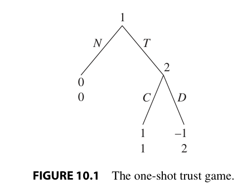
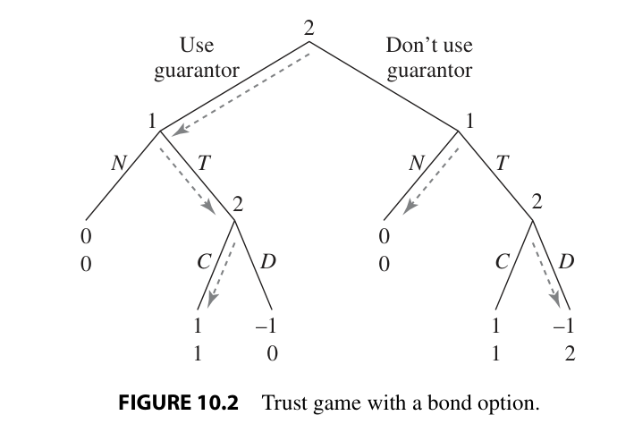

# Practice plan — Lecture 6 (Repeated games II: collusion and relational contracts)

> **Estimated unit.** Built on 2026-10-25, before the lecture (Tue Nov 10, 2026). There are no
> slides yet, so the blocks and weights follow the Lecture 6 block of the
> [[Map/study-guide|study guide]], the estimated notes [[Notas/L06/L06-00-map|Notas/L06]] and the
> books (Tadelis §10.4–10.5, Gibbons §2.3.C–D, Milgrom & Roberts Ch. 8, Cabral Ch. 9). Reconcile
> with `Aula/Lecture06.pdf` when it arrives.

25 existing book exercises in one sequence of rising complexity, each reproduced verbatim under
its tier table (transcribed from the PDF text layer and checked against the rendered page images
on 2026-10-25). Sources: Muñoz-Garcia & Toro-Gonzalez (2019), worked answers after every
exercise; Tadelis (2013), the book the course follows; Gibbons (1992); Cabral (2017); Milgrom &
Roberts (1992). Class plan: [[Map/study-guide|study guide]]; book map:
[[Map/books-index|books-index]]. No worked-solutions file for this list yet.

**Answers in the books.** Muñoz-Garcia: a worked answer follows each exercise. Gibbons 2.13–2.17:
in an unofficial, unfinished manual (`D:/Livros/Mercado/Economia/`, not copied). Tadelis: none in
the book; the preface (p. xiii) says about half are solved on Princeton UP's website (not
checked). Cabral and Milgrom & Roberts: no answers in the book.

**Verification.** Every page below was checked on 2026-10-25 by rendering the PDF page at the
offset in `Livros/book-registry.json` and reading its printed page number: Muñoz-Garcia Ch. 5
pp. 228, 231, 239 and Ch. 6 pp. 278, 282–283, 287, 290–291, 310; Tadelis pp. 215–219 (exercises)
and pp. 205–206 (Figures 10.1–10.2); Gibbons pp. 135–137; Cabral pp. 242, 244–246; Milgrom &
Roberts pp. 284–286. Milgrom & Roberts title their numerical problems "Mathematical Exercises";
the study guide calls item 6 "Quantitative Exercise 4".

**Not here on purpose.** Muñoz-Garcia Ch. 6 Ex. 1 (p. 274), Tadelis 10.2–10.3 (pp. 215–216) and
10.12 (p. 219): grim trigger, length-$T$ punishments in the Prisoner's Dilemma and the folk
theorem belong to Lecture 5. Tadelis 10.5, 10.9 and Muñoz-Garcia Ch. 6 Ex. 6–7: generic
cooperation drills, also Lecture 5. Milgrom & Roberts Mathematical Exercise 6 (p. 286):
reputation as a belief about a type, Lectures 7–8. Moral-hazard items (M&R Mathematical
Exercise 7, p. 286 on) are out of scope (`CLAUDE.md`).

## Weighting

| Block | Subtopic | Items | Weight | Why |
|---|---|---|---|---|
| B1 | Tacit collusion in quantities: the cutoff (10.5), $9/17$, asymmetric and $n$-firm cartels | 6 | 24% | the lecture's core application (Tadelis §10.4, Gibbons §2.3.C); densest in the books |
| B2 | Price collusion and market structure: $1-1/n$, Cabral's (9.5), multimarket contact | 5 | 20% | Cabral §9.1 and §9.3 and MWG §12.D; the antitrust checklist |
| B3 | Punishments and price wars: temporary punishments, imperfect monitoring, demand shocks | 4 | 16% | Gibbons pp. 104–107 and Cabral §9.2; technical, so fewer but harder items |
| B4 | Reputation and institutions: the trust game, finite vs. indefinite horizons, guarantors | 6 | 24% | Tadelis §10.5 and M&R Ch. 8 pp. 259–268; the study guide names M&R Exercise 4 |
| B5 | Efficiency wages and relational employment | 4 | 16% | Gibbons §2.3.D and M&R pp. 250–255 |

| Level | Items | Count |
|---|---|---|
| Foundations (one-shot vs. repeated cartel, the $\frac12$ cutoff, reading Cabral's factors, finite-horizon unravelling, discursive reputation and wage questions) | 1–8 | 8 |
| Exam (asymmetric and $n$-firm cartels, Cournot vs. Bertrand, temporary punishments, trust off the path, quality reputation, efficiency wage with errors) | 9–17 | 9 |
| Advanced (demand growth and shocks, multimarket contact, imperfect monitoring, secret price cuts, institutions, a firm facing short-lived workers, optimal monitoring) | 18–25 | 8 |

---

## Tier 1 — Foundations

| # | Block | Source | Ch./Sec. | Exercise | Page | What it trains |
|---|---|---|---|---|---|---|
| 1 | B1 | Muñoz-Garcia | Ch. 5 | Ex. 4 | 228 | Why the Cournot cartel is not a Nash equilibrium of the one-shot game |
| 2 | B2 | Muñoz-Garcia | Ch. 5 | Ex. 5 | 231 | The same for a Bertrand cartel: zero static profit against the monopoly split |
| 3 | B1 | Muñoz-Garcia | Ch. 6 | Ex. 2 | 278 | Grim trigger in the repeated Cournot duopoly: the $9/17$ cutoff |
| 4 | B2 | Gibbons | §2.3, Problems | 2.13 | 135 | Repeated Bertrand: trigger strategies sustain monopoly iff $\delta\ge1/2$ |
| 5 | B2 | Cabral | Ch. 9, Review and practice | 9.1 | 242 | Reading frequency, growth and continuation into the effective discount factor |
| 6 | B4 | Milgrom & Roberts | Ch. 8, Mathematical Exercises | 4 | 286 | The trust game played a known, finite number of times: unravelling |
| 7 | B4 | Milgrom & Roberts | Ch. 8, Food for Thought | 3 | 284 | Reputation as an asset: why auditors have many clients |
| 8 | B5 | Milgrom & Roberts | Ch. 8, Food for Thought | 4 | 284–285 | Pay of public officials as an efficiency wage |

### Statements

#### 1. Muñoz-Garcia Ch. 5 Ex. 4

<!-- id: Muñoz-Garcia Ch. 5 Ex. 4 -->
**Source.** Muñoz-Garcia & Toro-Gonzalez (2019), *Strategy and Game Theory: Practice Exercises with Answers*, Ch. 5, Exercise 4 "Cartel with Firms Competing a la Cournot—Unsustainable in a One-Shot game", p. 228. Reproduced verbatim (statement only; the book's worked answer follows it).

> Consider two firms competing in output levels (a la Cournot) and facing linear inverse demand $p(Q) = 100 - Q$, where $Q = q_1 + q_2$ denotes aggregate output. For simplicity, assume that firms face a common marginal cost of production $c = 10$.
>
> (a) *Best response function.* Set up each firm's profit-maximization problem and find its best response function. Interpret.
>
> (b) *Cournot competition.* Find the equilibrium output each firm produces when competing a la Cournot (that is, when they simultaneously and independently choose their output levels). In addition, find the profits that each firm earns in equilibrium.
>
> (c) *Collusive agreement.* Assume now that the CEOs from both companies meet for lunch and start talking about how they could increase their profits if they could increase market prices by reducing their production. That is, firms are trying to collude! Set up the maximization problem that firms solve when maximizing their *joint* profits (that is, the sum of profits for both firms). Find the output level that each firm should select to maximize joint profits. In addition, find the profits that each firm obtains in this collusive agreement.
>
> (d) *Profit comparison.* Compare the profits that firms obtain when competing a la Cournot (from part b) against their profits when they successfully collude (from part c).
>
> (e) *Unsustainable cartel.* Let us now show that the collusive agreement from part (c) cannot be sustained as a Nash equilibrium of the one-shot game, that is, when firms interact only once. Using the best response function found in part (a), show that when firm $i$ chooses the collusive output found in part (c) its rival (firm $j$) responds with an output that is different from its collusive output. Interpret.

#### 2. Muñoz-Garcia Ch. 5 Ex. 5

<!-- id: Muñoz-Garcia Ch. 5 Ex. 5 -->
**Source.** Muñoz-Garcia & Toro-Gonzalez (2019), *Strategy and Game Theory: Practice Exercises with Answers*, Ch. 5, Exercise 5 "Cartel with firms competing a la Bertrand—Unsustainable in a one-shot game", p. 231. Reproduced verbatim (statement only; the book's worked answer follows it).

> Consider two firms competing in prices (a la Bertrand), and facing linear inverse demand $p(Q) = 100 - Q$, where $Q = q_1 + q_2$ denotes aggregate output. For simplicity, assume that firms face a common marginal cost of production $c = 10$.
>
> (a) *Bertrand competition.* Find the equilibrium price that each firm sets when competing a la Bertrand (that is, when they simultaneously and independently set their prices). In addition, find the profits that each firm earns in equilibrium.
>
> (b) *Collusive agreement.* Assume now that the CEOs from both companies meet for lunch and start talking about how they could increase their profits if they could coordinate their price setting decisions. Beware, firms are trying to collude! Set up the maximization problem that firms solve when maximizing their *joint* profits (that is, the sum of profits for both firms). Find the price that each firm selects when maximizing joint profits. In addition, find the profits that each firm obtains in this collusive agreement.
>
> (c) *Profit comparison.* Compare the profits that firms obtain when competing a la Bertrand (from part a) against their profits when they successfully collude (from part b).
>
> (d) *Unsustainable cartel.* Show that the collusive agreement from part (b) cannot be sustained as a Nash equilibrium of the one-shot game, that is, when firms interact only once. Interpret.

#### 3. Muñoz-Garcia Ch. 6 Ex. 2

<!-- id: Muñoz-Garcia Ch. 6 Ex. 2 -->
**Source.** Muñoz-Garcia & Toro-Gonzalez (2019), *Strategy and Game Theory: Practice Exercises with Answers*, Ch. 6, Exercise 2 "Collusion When Firms Compete in Quantities", p. 278. Reproduced verbatim (statement only; the book's worked answer follows it).

> Consider two firms competing as Cournot oligopolists in a market with demand:
>
> $$p(q_1, q_2) = a - bq_1 - bq_2$$
>
> Both firms have total costs, $TC(q_i) = cq_i$ where $c > 0$ is the marginal cost of production, and $a > c$.
>
> **Part (a)** Considering that firms only interact once (playing an unrepeated Cournot game), find the equilibrium output, the market price, and the equilibrium profits for every firm.
>
> **Part (b)** Now assume that they could form a cartel. Which is the output that every firm should produce in order to maximize the profits of the cartel? Find the market price, and profits of every firm. Are their profits higher when they form a cartel than when they compete as Cournot oligopolists?
>
> **Part (c)** Can the cartel agreement be supported as the (cooperative) outcome of the infinitely repeated game?

#### 4. Gibbons 2.13

<!-- id: Gibbons 2.13 -->
**Source.** Gibbons (1992), *Game Theory for Applied Economists*, Ch. 2 Problems, Section 2.3, Problem 2.13, p. 135. Reproduced verbatim.

> 2.13. Recall the static Bertrand duopoly model (with homogeneous products) from Problem 1.7: the firms name prices simultaneously; demand for firm $i$'s product is $a - p_i$ if $p_i < p_j$, is 0 if $p_i > p_j$, and is $(a - p_i)/2$ if $p_i = p_j$; marginal costs are $c < a$. Consider the infinitely repeated game based on this stage game. Show that the firms can use trigger strategies (that switch forever to the stage-game Nash equilibrium after any deviation) to sustain the monopoly price level in a subgame-perfect Nash equilibrium if and only if $\delta \ge 1/2$.

#### 5. Cabral 9.1

<!-- id: Cabral 9.1 -->
**Source.** Cabral (2017), *Introduction to Industrial Organization*, 2nd ed., Ch. 9 Review and practice exercises, Exercise 9.1 "Tacit collusion", p. 242. Reproduced verbatim.

> **9.1. Tacit collusion.** Industries A and B can be characterized by a series of parameters: $n$, the number of firms, is 8 in both industries; $r$, the annual interest rate, is 10% in both countries; $f$, the frequency with which firms interact (number of times per year), is 1 in industry A and 12 in industry B; $g$, the industry growth rate, is 10% in industry A and −30% in industry B; finally, $h$, the likelihood that the industry will continue in existence into the next period, is 80% in industry A and 100% in industry B.
>
> In which of the two industries do you think tacit collusion is more likely to take place? Briefly justify your answer.

#### 6. Milgrom & Roberts Mathematical Exercise 4

<!-- id: M&R Math 4 -->
**Source.** Milgrom & Roberts (1992), *Economics, Organization and Management*, Ch. 8 Exercises, Mathematical Exercise 4, p. 286. Reproduced verbatim.

> 4. In the discussion of the game of offering trust in the text, it was shown that if the game is being played only once, then trust will not be offered and, if it should be offered, it will not be honored. Suppose instead the two parties know they will interact exactly twice. Would trust be offered and honored in the second, final interaction? Why or why not? If the parties anticipate this and trust is offered in the first round, will it be honored? Why or why not? [Hint: Will honoring trust affect behavior at the last round?] Will trust then be offered? By this logic, what would happen if the parties knew they would interact exactly three times? Any arbitrary, but finite and known number of times? Do you find this to be a credible prediction about how people actually would behave? Why or why not?

#### 7. Milgrom & Roberts Food for Thought 3

<!-- id: M&R FfT 3 -->
**Source.** Milgrom & Roberts (1992), *Economics, Organization and Management*, Ch. 8 Exercises, Food for Thought 3, p. 284. Reproduced verbatim.

> 3. In many countries, corporations whose shares are publicly traded are required to have their financial statements audited by independent accountants who check whether the financial information being provided by management to investors is accurate and has been prepared following accepted methods and procedures and who then publicly attest to their findings. The auditors are generally chosen by management (perhaps subject to nominal stockholder approval). Audit work provides a major source of income for accounting firms. Generally, each accounting firm has many clients that it audits: Even when it might be technically feasible for a relatively small accounting firm to audit a large corporation's records, there seems to be a reluctance for corporations to use audit firms when a single client would represent too much of the accountant's business. Instead, a handful of extremely large accounting firms typically do almost all the auditing of large corporations, with each having many corporate clients. How do you account for this?

#### 8. Milgrom & Roberts Food for Thought 4

<!-- id: M&R FfT 4 -->
**Source.** Milgrom & Roberts (1992), *Economics, Organization and Management*, Ch. 8 Exercises, Food for Thought 4, pp. 284–285. Reproduced verbatim.

> 4. The proper level of salaries for public officials is often a matter of debate. In many countries, public officials supplement their incomes by performing other duties. In the United States, Congressmen deliver lectures for pay and former bureaucrats cash in on their connections by becoming high-paid lobbyists. Recent U.S. proposals call for tying pay increases to limits on these activities. Discuss the efficacy of such a plan.

## Tier 2 — Exam level

| # | Block | Source | Ch./Sec. | Exercise | Page | What it trains |
|---|---|---|---|---|---|---|
| 9 | B1 | Muñoz-Garcia | Ch. 5 | Ex. 8 | 239 | Cournot and the joint-profit cartel with asymmetric costs (the one-shot side of an asymmetric cartel) |
| 10 | B1 | Tadelis | Ch. 10, Exercises | 10.8 | 218 | Cournot vs. Bertrand collusion in one model, then a two-period Bertrand punishment |
| 11 | B3 | Muñoz-Garcia | Ch. 6 | Ex. 3 | 282–283 | Permanent vs. one-, two- and three-period Cournot punishments |
| 12 | B1 | Muñoz-Garcia | Ch. 6 | Ex. 4 | 287 | The $n$-firm Cournot cutoff and how it moves with $n$ |
| 13 | B1 | Gibbons | §2.3, Problems | 2.15 | 136 | The $n$-firm cutoff, then the most profitable symmetric output below it |
| 14 | B4 | Tadelis | Ch. 10, Exercises | 10.4 | 216 | Why "cooperate as long as I am trusted" is Nash but not subgame-perfect |
| 15 | B4 | Tadelis | Ch. 10, Exercises | 10.6 | 217 | Quality reputation: one shot, twice, and infinitely repeated; the effect of a price cap |
| 16 | B4 | Milgrom & Roberts | Ch. 8, Mathematical Exercises | 5 | 286 | The trust game with a probability of continuation: the threshold on $p$ |
| 17 | B5 | Milgrom & Roberts | Ch. 8, Mathematical Exercises | 3 | 286 | The efficiency wage when honest workers are sometimes wrongly caught |

### Statements

#### 9. Muñoz-Garcia Ch. 5 Ex. 8

<!-- id: Muñoz-Garcia Ch. 5 Ex. 8 -->
**Source.** Muñoz-Garcia & Toro-Gonzalez (2019), *Strategy and Game Theory: Practice Exercises with Answers*, Ch. 5, Exercise 8 "Cartel with Two Asymmetric Firms", p. 239. Reproduced verbatim (statement only; the book's worked answer follows it).

> Consider two firms competing a la Cournot and facing linear inverse demand $p(Q) = 100 - Q$, where $Q = q_1 + q_2$ denotes aggregate output. Firm 1 has more experience in the industry than firm 2, which is reflected in the fact that firm 1's marginal cost of production is $c_1 = 10$ while that of firm 2 is $c_2 = 16$.
>
> (a) *Best response function.* Set up each firm's profit-maximization problem and find its best response function. Interpret.
>
> (b) *Cournot competition.* Find the equilibrium output each firm produces when competing a la Cournot (that is, when they simultaneously and independently choose their output levels). In addition, find the profits that each firm earns in equilibrium. [*Hint*: You cannot invoke symmetry when solving for equilibrium output levels in this exercise since firms are not cost symmetric.]
>
> (c) *Collusive agreement.* Assume now that firms collude to increase their profits. Set up the maximization problem that firms solve when maximizing their *joint* profits (that is, the sum of profits for both firms). Find the output level that each firm should select to maximize joint profits. In addition, find the profits that each firm obtains in this collusive agreement.
>
> (d) *Profit comparison.* Compare the profits that firms obtain when competing a la Cournot (from part b) against their profits when they successfully collude (from part c).

#### 10. Tadelis 10.8

<!-- id: Tadelis 10.8 -->
**Source.** Tadelis (2013), *Game Theory: An Introduction*, Exercise 10.8 "Tacit Collusion", p. 218. Reproduced verbatim.

> **Tacit Collusion:** Two firms, which have zero marginal cost and no fixed cost, produce some good, each producing $q_i \ge 0$, $i \in \{1, 2\}$. The demand for this good is given by $p = 200 - Q$, where $Q = q_1 + q_2$.
>
> a. First consider the case of Cournot competition, in which each form chooses $q_i$ and this game is infinitely repeated with a discount factor $\delta < 1$. Solve for the static stage-game Cournot-Nash equilibrium.
>
> b. For which values of $\delta$ can you support the firms' equally splitting monopoly profits in each period as a subgame-perfect equilibrium that uses grim-trigger strategies (i.e., after one deviates from the proposed split, they resort to the static Cournot-Nash equilibrium thereafter)? (Note: Be careful in defining the strategies of the firms!)
>
> c. Now assume that the firms compete à la Bertrand, each choosing a price $p_i \ge 0$, where the lowest-price firm gets all the demand and in case of a tie they split the market. Solve for the static stage-game Bertrand-Nash equilibrium.
>
> d. For which values of $\delta$ can you support the firms' equally splitting monopoly profits in each period as a subgame-perfect equilibrium that uses grim-trigger strategies (i.e., after one deviates from the proposed split, they resort to the static Bertrand-Nash equilibrium thereafter)? (Note: Be careful in defining the strategies of the firms!)
>
> e. Now instead of using grim-trigger strategies, try to support the firms' equally splitting monopoly profits as a subgame-perfect equilibrium in which after a deviation firms would resort to the static Bertrand competition for only two periods. For which values of $\delta$ will this work? Why is this answer different than your answer in (d)?

#### 11. Muñoz-Garcia Ch. 6 Ex. 3

<!-- id: Muñoz-Garcia Ch. 6 Ex. 3 -->
**Source.** Muñoz-Garcia & Toro-Gonzalez (2019), *Strategy and Game Theory: Practice Exercises with Answers*, Ch. 6, Exercise 3 "Temporary Punishments from Deviation", pp. 282–283. Reproduced verbatim (statement only; the book's worked answer follows it).

> Consider two firms competing a la Cournot, and facing linear inverse demand $p(Q) = 100 - Q$, where $Q = q_1 + q_2$ denotes aggregate output. For simplicity, assume that firms face a common marginal cost of production $c = 10$.
>
> (a) *Unrepeated game.* Find the equilibrium output each firm produces when competing a la Cournot (that is, when they simultaneously and independently choose their output levels) in the unrepeated version of the game (that is, when firms interact only once). In addition, find the profits that each firm earns in equilibrium.
>
> (b) *Repeated game—Collusion.* Assume now that the CEOs from both companies meet to discuss a collusive agreement that would increase their profits. Set up the maximization problem that firms solve when maximizing their *joint* profits (that is, the sum of profits for both firms). Find the output level that each firm should select to maximize joint profits. In addition, find the profits that each firm obtains in this collusive agreement.
>
> (c) *Repeated game—Permanent punishment.* Consider a grim-trigger strategy in which every firm starts colluding in period 1, and it keeps doing so as long as both firms colluded in the past. Otherwise, every firm deviates to the Cournot equilibrium thereafter (that is, every firm produces the Nash equilibrium of the unrepeated game found in part a forever). In words, this says that the punishment of deviating from the collusive agreement is *permanent*, since firms never return to the collusive outcome. For which discount factors this grim-trigger strategy can be sustained as the SPNE of the infinitely-repeated game?
>
> (d) *Repeated game—Temporary punishment.* Consider now a "modified" grim-trigger strategy. Like in the grim-trigger strategy of part (c), every firm starts colluding in period 1, and it keeps doing so as long as both firms colluded in the past. However, if a deviation is detected by either firm, every firm deviates to the Cournot equilibrium during only 1 period, and then every firm returns to cooperation (producing the collusive output). Intuitively, this implies that the punishment of deviating from the collusive agreement is now *temporary* (rather than permanent) since it lasts only one period. For which discount factors this "modified" grim-trigger strategy can be sustained as the SPNE of the infinitely-repeated game?
>
> (e) Consider again the temporary punishment in part (d), but assume now that it lasts for two periods. How are your results from part (d) affected? Interpret.
>
> (f) Consider again the temporary punishment in part (d), but assume now that it lasts for three periods. How are your results from part (d) affected? Interpret.

#### 12. Muñoz-Garcia Ch. 6 Ex. 4

<!-- id: Muñoz-Garcia Ch. 6 Ex. 4 -->
**Source.** Muñoz-Garcia & Toro-Gonzalez (2019), *Strategy and Game Theory: Practice Exercises with Answers*, Ch. 6, Exercise 4 "Collusion When N Firms Compete in Quantities", p. 287. Reproduced verbatim (statement only; the book's worked answer follows it).

> Consider $n$ firms producing homogenous goods and choosing quantities in each period for an infinite number of periods. Demand in the industry is given by $p = 1 - Q$, $Q$ being the sum of individual outputs. All firms in the industry are identical: they have the same constant marginal costs $c < 1$, and the same discount factor $\delta$. Consider the following trigger strategy:
>
> - Each firm sets the output $q^m$ that maximizes joint profits at the beginning of the game, and continues to do so unless one or more firms deviate.
> - After a deviation, each firm sets the quantity $q$, which is the Nash equilibrium of the unrepeated Cournot game.
>
> **Part (a)** Find the condition on the discount factor that allows for collusion to be sustained in this industry.
>
> **Part (b)** Indicate whether a larger number of firms in the industry facilitates or hinders the possibility of reaching a collusive outcome.

#### 13. Gibbons 2.15

<!-- id: Gibbons 2.15 -->
**Source.** Gibbons (1992), *Game Theory for Applied Economists*, Ch. 2 Problems, Section 2.3, Problem 2.15, p. 136. Reproduced verbatim.

> 2.15. Suppose there are $n$ firms in a Cournot oligopoly. Inverse demand is given by $P(Q) = a - Q$, where $Q = q_1 + \cdots + q_n$. Consider the infinitely repeated game based on this stage game. What is the lowest value of $\delta$ such that the firms can use trigger strategies to sustain the monopoly output level in a subgame-perfect Nash equilibrium? How does the answer vary with $n$, and why? If $\delta$ is too small for the firms to use trigger strategies to sustain the monopoly output, what is the most-profitable symmetric subgame-perfect Nash equilibrium that can be sustained using trigger strategies?

#### 14. Tadelis 10.4

<!-- id: Tadelis 10.4 -->
**Source.** Tadelis (2013), *Game Theory: An Introduction*, Exercise 10.4 "Trust Off the Equilibrium Path", p. 216. Reproduced verbatim. Figure 10.1 (p. 205) is not part of the exercise text; it is added because the statement refers to it.

> **Trust Off the Equilibrium Path:** Recall the trust game depicted in Figure 10.1. We argued that for $\delta \ge \frac{1}{2}$ the following pair of strategies is a subgame-perfect equilibrium. For player 1: "In period 1 I will trust player 2, and as long as there were no deviations from the pair $(T, C)$ in any period, then I will continue to trust him. Once such a deviation occurs then I will not trust him forever after." For player 2: "In period 1 I will cooperate, and as long as there were no deviations from the pair $(T, C)$ in any period, then I will continue to do so. Once such a deviation occurs then I will deviate forever after." Show that if instead player 2 uses the strategy "as long as player 1 trusts me I will cooperate" then the path $(T, C)$ played forever is a Nash equilibrium for $\delta \ge \frac{1}{2}$ but is not a subgame-perfect equilibrium for any value of $\delta$.

*Figure 10.1* The one-shot trust game (Tadelis p. 205; added for reference).

#### 15. Tadelis 10.6

<!-- id: Tadelis 10.6 -->
**Source.** Tadelis (2013), *Game Theory: An Introduction*, Exercise 10.6 "Regulating Medications", p. 217. Reproduced verbatim.

> **Regulating Medications:** Consider a firm (player 1) that produces a unique drug that is used by a consumer (player 2). This drug is regulated by the government so that its price is $p = 6$. This price is fixed, but the quality of the drug depends on the manufacturing procedure. The "good" ($G$) manufacturing procedure costs 4 to the firm and yields a value of 9 to the consumer. The "bad" ($B$) manufacturing procedure costs 0 to the firm and yields a value of 4 to the consumer. The consumer can choose whether or not to buy at the price $p$, and this decision must be made before the actual manufacturing procedure is revealed. However, after consumption, the true quality of the drug is revealed to the consumer. The choice of manufacturing procedure, and thus of the cost of production, is made before the firm knows whether the consumer will buy or not.
>
> a. Draw the game tree and the matrix of this game, and find all the Nash equilibria.
>
> b. Now assume that the game is repeated twice. (The consumer learns the quality of the product in each period only if he consumes.) Assume that each player tries to maximize the (nondiscounted) sum of his stage payoffs. Find all the subgame-perfect equilibria of this game.
>
> c. Now assume that the game as repeated infinitely many times. Assume that each player tries to maximize the discounted sum of his or her stage payoffs, where the discount rate is $\delta \in (0, 1)$. What is the range of discount factors for which the good manufacturing procedure will be used as part of a subgame-perfect equilibrium?
>
> d. Consumer advocates are pushing for a lower price for the drug, say 5. The firm wants to approach the Food and Drug Administration and argue that if the regulated price is decreased to 5 then this may have dire consequences for both consumers and the firm. Can you make a formal argument, using the given parameters, to support the firm? What about the consumers?

#### 16. Milgrom & Roberts Mathematical Exercise 5

<!-- id: M&R Math 5 -->
**Source.** Milgrom & Roberts (1992), *Economics, Organization and Management*, Ch. 8 Exercises, Mathematical Exercise 5, p. 286. Reproduced verbatim.

> 5. Suppose instead that each time the parties interact, there is a probability $p > 0$ that they will interact again, and, correspondingly, a probability of $(1 - p)$ that this will be their last interaction. Then at any point, the probability that they will interact twice more is $p^2$, the probability of three more interactions is $p^3$, and so on. Suppose the parties are interested in the expected value of the total payoffs they receive. Thus, each seeks to maximize the sum of the payoff at the current round, plus $p$ times the payoff that accrues if they interact again, plus $p^2$ times the payoff if they should interact a third time, plus $p^3$ times the payoff from a possible fourth interaction, and so on. In summation notation, the objective of each party $i$ is to maximize $\Sigma p^n u_{in}$, where $n$ runs from 0 (the current round) to infinity and $u_{in}$ is the payoff to party $i$ at the corresponding round. Show that so long as the payoff $V$ to each party when trust is offered and honored is strictly larger than the payoff when trust is not offered (which we set equal to zero in the text), then for any values of the gain $G$ to abusing trust and loss $L$ to having trust not be honored there is a value of $p$ that makes it Nash equilibrium behavior to offer trust and honor it at each round. What threats and punishments can be used in achieving this outcome? [Note: for any number $\Delta$, $\sum_{n=1}^{\infty} p^n \Delta = p\Delta/(1 - p)$.]

#### 17. Milgrom & Roberts Mathematical Exercise 3

<!-- id: M&R Math 3 -->
**Source.** Milgrom & Roberts (1992), *Economics, Organization and Management*, Ch. 8 Exercises, Mathematical Exercise 3, p. 286. Reproduced verbatim.

> 3. In the efficiency wage model, suppose there is some probability $q$ that the worker will appear to be cheating, even though he or she has actually worked hard and honestly. Determine the proper efficiency wage in that case.

## Tier 3 — Advanced

| # | Block | Source | Ch./Sec. | Exercise | Page | What it trains |
|---|---|---|---|---|---|---|
| 18 | B2 | Muñoz-Garcia | Ch. 6 | Ex. 5 | 290–291 | $n$-firm Bertrand collusion when demand grows by a known factor $\theta$ |
| 19 | B2 | Cabral | Ch. 9, Review and practice | 9.15 | 244 | Multimarket contact with reversed cost advantages: the minimum $\delta$ |
| 20 | B3 | Muñoz-Garcia | Ch. 6 | Ex. 10 | 310 | Differentiated Cournot and Bertrand collusion; a one-period detection lag |
| 21 | B3 | Gibbons | §2.3, Problems | 2.14 | 135–136 | Observed demand shocks: $\delta^*$ and the highest sustainable boom price (Rotemberg–Saloner) |
| 22 | B3 | Cabral | Ch. 9, Challenging exercises | 9.19 | 245 | Secret price cuts: equilibrium price wars of length $T$ (Green–Porter) |
| 23 | B4 | Tadelis | Ch. 10, Exercises | 10.10 | 219 | Redesigning the guarantor's bond and fee so it works for every $\delta$ |
| 24 | B5 | Gibbons | §2.3, Problems | 2.17 | 136–137 | A long-lived firm and short-lived workers: a relational wage promise |
| 25 | B5 | Milgrom & Roberts | Ch. 8, Mathematical Exercises | 1 | 285 | Optimal monitoring and wage; $w^*(N)$ nonincreasing in the horizon |

### Statements

#### 18. Muñoz-Garcia Ch. 6 Ex. 5

<!-- id: Muñoz-Garcia Ch. 6 Ex. 5 -->
**Source.** Muñoz-Garcia & Toro-Gonzalez (2019), *Strategy and Game Theory: Practice Exercises with Answers*, Ch. 6, Exercise 5 "Collusion When N Firms Compete in Prices", pp. 290–291. Reproduced verbatim (statement only; the book's worked answer follows it).

> Consider a homogenous industry where $n$ firms produce at zero cost and play the Bertrand game of price competition for an infinite number of periods. Assume that:
>
> - When firms choose the same price, they earn a per-period profit $\pi(p) = p\alpha\frac{D(p)}{n}$, where parameter $\alpha$ represents the state of demand.
> - When a firm $i$ charges a price of $p_i$ lower than the price of all of the other firms, it earns a profit $\pi(p_i) = p_i\alpha D(p_i)$, and all of the other firms obtain zero profits.
>
> Imagine that in the current period demand is characterized by $\alpha = 1$, but starting from the following period demand will be characterized by $\alpha = \theta$ in each of the following periods. All the players know exactly the evolution of the demand state at the beginning of the game, and firms have the same common discount factor, $\delta$.
>
> Assume that $\theta > 1$ and consider the following trigger strategies. Each firm plays the monopoly price $p_m$ in the first period of the game, and continues to charge such a price until a profit equal to zero is observed. When this occurs, each firm charges a price equal to zero forever. Under which conditions does this trigger strategy represent a SPNE? [Hint: In particular, show how $\theta$ and $n$ affects such a condition, and give an economic intuition for this result.]

#### 19. Cabral 9.15

<!-- id: Cabral 9.15 -->
**Source.** Cabral (2017), *Introduction to Industrial Organization*, 2nd ed., Ch. 9 Review and practice exercises, Exercise 9.15 "Multimarket contact", p. 244. Reproduced verbatim.

> **9.15. Multimarket contact.** Consider the model of multimarket contact presented in Section 9.3: Firm 1 has cost $\underline{c}$ in Market 1, while Firm 2 has a cost $\overline{c}$. The situation is reversed in Market 2. Demand is the same in both markets: consumers are willing to buy $q$ units for a price of up to $p^M$ (that is, for $p \le p^M$, quantity demanded does not depend on price). It is assumed that $\underline{c} < \overline{c} < p^M$. In each period, firms set prices in both markets simultaneously.
>
> Determine the minimum value of the discount factor such that the optimal collusive solution is stable.

#### 20. Muñoz-Garcia Ch. 6 Ex. 10

<!-- id: Muñoz-Garcia Ch. 6 Ex. 10 -->
**Source.** Muñoz-Garcia & Toro-Gonzalez (2019), *Strategy and Game Theory: Practice Exercises with Answers*, Ch. 6, Exercise 10 "Collusion and Imperfect Monitoring", p. 310. Reproduced verbatim (statement only; the book's worked answer follows it).

> Two firms produce a differentiated product, and every firm $i = \{1, 2\}$ faces the following linear demand:
>
> $$p_i = a - bq_i - dq_j, \quad \text{where } a, b, d > 0 \text{ and } 0 < d < b$$
>
> Intuitively, when $d \to 0$ firm $j$'s output decisions do not affect firm $i$'s sales (i.e., products are heterogeneous), while when $d \to b$, firm $j$'s output decisions have a significant impact on firm $i$'s sales, i.e., products are relatively homogeneous. The firms expect to compete against each other for infinite periods, that is, there is no entry or exit in the industry. [*Hint*: Assume that when a firm detects deviations from collusive behavior, it retaliates by reverting to the non-cooperative Cournot (Bertrand) production level (pricing, respectively), in all subsequent periods. Prior to detection, each firm assumes that its rival follows the collusive outcome.]
>
> **Part (a)** Assume that firms compete as Cournot oligopolists. What is the minimum discount factor necessary in order to sustain the collusive outcome assuming that (i) Deviations are detected immediately, and (ii) Deviations are detected with a lag of one period.
>
> **Part (b)** Repeat part (a) of the exercise under the assumption that firms compete as Bertrand oligopolists. (You can assume immediate detection)

#### 21. Gibbons 2.14

<!-- id: Gibbons 2.14 -->
**Source.** Gibbons (1992), *Game Theory for Applied Economists*, Ch. 2 Problems, Section 2.3, Problem 2.14, pp. 135–136. Reproduced verbatim (the book's spelling "Rotemburg" kept).

> 2.14. Suppose that demand fluctuates randomly in the infinitely repeated Bertrand game described in Problem 2.13: in each period, the demand intercept is $a_H$ with probability $\pi$ and $a_L$ ($< a_H$) with probability $1 - \pi$; demands in different periods are independent. Suppose that each period the level of demand is revealed to both firms before they choose their prices for that period. What are the monopoly price levels ($p_H$ and $p_L$) for the two levels of demand? Solve for $\delta^*$, the lowest value of $\delta$ such that the firms can use trigger strategies to sustain these monopoly price levels (i.e., to play $p_i$ when demand is $a_i$, for $i = H, L$) in a subgame-perfect Nash equilibrium. For each value of $\delta$ between 1/2 and $\delta^*$, find the highest price $p(\delta)$ such that the firms can use trigger strategies to sustain the price $p(\delta)$ when demand is high and the price $p_L$ when demand is low in a subgame-perfect Nash equilibrium. (See Rotemburg and Saloner 1986.)

#### 22. Cabral 9.19

<!-- id: Cabral 9.19 -->
**Source.** Cabral (2017), *Introduction to Industrial Organization*, 2nd ed., Ch. 9 Challenging exercises, Exercise 9.19 "Secret price cuts", p. 245. Reproduced verbatim, with the margin note (s) it cites (the book's "price cups" kept).

> **9.19. Secret price cuts.** This exercise formalizes the model of secret price cups presented in Section 9.2. Suppose that all consumers are willing to pay $u$ for the (homogeneous) product sold by two duopolists. In each period, demand can be high (probability $1 - \alpha$) or low (probability $\alpha$). When demand is high, $h = 1$ units can be sold at price $u$ (or any lower price). When demand is low, only $l = 0 < h$ units can be sold. The probability that demand is high or low in each period is independent of what it was in the previous period. Moreover, *firms are unable to observe the state of market demand*; all they can observe is whether *their own* demand is high or low. Finally, for simplicity, assume that production costs are zero.
>
> Consider the following equilibrium strategies. Firms start by setting $p = u$. If they receive a positive demand (namely, $\frac{1}{2}$), then they continue to set $p = u$, that is, they remain in the "cooperative phase". If however one of the firms (or both) receives zero demand, then both firms enter into a "price war:" they set $p = 0$ during $T$ periods and, after this period, revert to $p = u$ again (the cooperative phase).$^{s}$ Let $V$ be the net present value of a firm in equilibrium (starting in a period where collusion takes place).
>
> (a) Show that:
> $$V = (1 - \alpha)\left(\frac{u}{2} + \delta V\right) + \alpha\,\delta^{T+1} V$$
>
> (b) Show that the best a firm can do by deviating is to get:
> $$V' = (1 - \alpha)\,u + \delta^{T+1} V$$
>
> (c) Show that the condition that the prescribed strategy constitutes an equilibrium is given by:
> $$1 \le 2\,(1 - \alpha)\,\delta + (2\,\alpha - 1)\,\delta^{T+1}$$
>
> (d) What is then the optimal equilibrium?
>
> *s.* Notice that, if a firm receives zero demand, then it is common knowledge that a price war is going to start, that is, it is common knowledge that one of the firms receives zero demand. In fact, either demand is low, in which case both firms receive zero demand, or one of the firms deviates from $p = u$, in which case the deviating firm knows that the rival receives zero demand.

#### 23. Tadelis 10.10

<!-- id: Tadelis 10.10 -->
**Source.** Tadelis (2013), *Game Theory: An Introduction*, Exercise 10.10 "Law Merchants Revisited", p. 219. Reproduced verbatim. Figure 10.2 (p. 206) is not part of the exercise text; it is added because Section 10.5.2, which the statement cites, builds the game on it.

> **Law Merchants Revisited:** Consider the three-person game described in Section 10.5.2. A subgame-perfect equilibrium was constructed with a bond equal to 2, a fee equal to $w = 0.1$ was paid by every player $P_2^t$ to player 3, and it was shown that it is indeed an equilibrium for any discount factor $\delta \ge 0.95$. Show that a similar equilibrium exists in which players $P_1^t$ trust players $P_2^t$ who post bonds, players $P_2^t$ post bonds and cooperate, and player 3 follows the contract in every period, for any discount factor $0 < \delta < 1$.

*Figure 10.2* Trust game with a bond option (Tadelis p. 206; added for reference).

#### 24. Gibbons 2.17

<!-- id: Gibbons 2.17 -->
**Source.** Gibbons (1992), *Game Theory for Applied Economists*, Ch. 2 Problems, Section 2.3, Problem 2.17, pp. 136–137. Reproduced verbatim.

> 2.17. Consider the following infinite-horizon game between a single firm and a sequence of workers, each of whom lives for one period. In each period the worker chooses either to expend effort and so produce output $y$ at effort cost $c$ or to expend no effort, produce no output, and incur no cost. If output is produced, the firm owns it but can share it with the worker by paying a wage, as described next. Assume that at the beginning of the period the worker has an alternative opportunity worth zero (net of effort cost) and that the worker cannot be forced to accept a wage less than zero. Assume also that $y > c$ so that expending effort is efficient.
>
> Within each period, the timing of events is as follows: first the worker chooses an effort level, then output is observed by both the firm and the worker, and finally the firm chooses a wage to pay the worker. Assume that no wage contracts can be enforced: the firm's choice of a wage is completely unconstrained. In a one-period game, therefore, subgame-perfection implies that the firm will offer a wage of zero independent of the worker's output, so the worker will not expend any effort.
>
> Now consider the infinite-horizon problem. Recall that each worker lives for only one period. Assume, however, that at the beginning of period $t$, the history of the game through period $t-1$ is observed by the worker who will work in period $t$. (Think of this knowledge as being passed down through the generations of workers.) Suppose the firm discounts the future according to the discount factor $\delta$ per period. Describe strategies for the firm and each worker in a subgame-perfect equilibrium in the infinite-horizon game in which in equilibrium each worker expends effort and so produces output $y$, provided the discount factor is high enough. Give a necessary and sufficient condition for your equilibrium to exist.

#### 25. Milgrom & Roberts Mathematical Exercise 1

<!-- id: M&R Math 1 -->
**Source.** Milgrom & Roberts (1992), *Economics, Organization and Management*, Ch. 8 Exercises, Mathematical Exercise 1, p. 285. Reproduced verbatim (dollar amounts written with an escaped sign, `\$`).

> 1. In the context of the efficiency wage model, suppose that $N$ is given by $(1 - \delta^t)/(1 - \delta)$, where $\delta$ is a discount factor giving the value today of a dollar to be received a year from now and $t$ is the number of years the worker anticipates remaining with the firm. Thus, $N$ is a measure of the horizon over which the employee is concerned, appropriately discounted. Suppose the worker expects to be employed for 5 years, that is, $t = 5$, and evaluates future income using $\delta = 0.9$, so that $N$ is approximately equal to 4.1. The worker's opportunity wage ($\overline{w}$) is \$20,000 per year, and he or she can make an immediate gain of \$3,000 by leaking the firm's trade secrets to a competitor. The firm can monitor the worker to prevent this, but doing so is costly: raising the probability $p$ of catching misbehavior by an amount $\Delta p$ costs \$1,500 $\Delta p$.
>
> Formulate the firm's problem in selecting the monitoring intensity $p$ and the wage $w$ and solve for the optimal values.
>
> Suppose now that the threat of a takeover or bankruptcy endangers the employee's future with the firm, so that the employee now expects to be employed only one more year. Will the contract you found above still deter cheating? Why or why not?
>
> More generally, show that in the efficiency wage model, a lengthened horizon allows providing incentives with a lower wage. That is, show that the optimal wage level $w^*(N)$ is a nonincreasing function of $N$ provided the marginal cost of monitoring is positive and increasing in $p$, that is, provided $M'(p) > 0$ and $M''(p) > 0$ for all $p$.

**Optional extras.**
- Tadelis 10.1 (p. 215, discount cards and tacit collusion, discursive), 10.7 (pp. 217–218, the bartender's quality reputation, a twin of item 15) and 10.11 (p. 219, the brand-name equilibrium of §10.5.3).
- Cabral 9.2 (p. 242, the largest Bertrand cartel at $\delta = .8$), 9.5 (p. 242, are price wars irrational?), 9.18 (p. 245, multimarket contact again) and 9.20 (p. 246, observed demand fluctuations: Cabral's version of item 21).
- Cabral 9.17 (p. 245): the book asks to show that the minimum discount factor $\bar\delta$ is *decreasing* in $n$; with $\bar\delta = 1 - 1/n$ (Cabral p. 227) it is increasing. Work it as "show how $\bar\delta$ moves with $n$".
- Milgrom & Roberts Mathematical Exercise 2 (pp. 285–286, voluntary quits in the efficiency-wage model) and Food for Thought 1 (p. 284, wage surveys).
- Gibbons 2.16 (p. 136): a firm and a union in an infinitely repeated wage-employment game.

---

## Suggested study order

1. **The one-shot cartel problem.** Read Tadelis §10.4 (pp. 201–203), then do items **1, 2**, then **9**.
2. **Collusion with grim trigger.** Read Gibbons §2.3.C (pp. 102–104) and Cabral §9.1 (pp. 218–222). Do **3, 4, 5**, then **10, 12, 13**.
3. **Punishments and price wars.** Read Gibbons pp. 104–107 and Cabral §9.2–9.3 (pp. 222–231). Do **11**, then **18, 19**, then **20, 21, 22**.
4. **Reputation.** Read Tadelis §10.5 (pp. 204–209) and M&R pp. 259–268. Do **6, 7**, then **14, 15, 16**, then **23**.
5. **Efficiency wages.** Read Gibbons §2.3.D (pp. 107–112) and M&R pp. 250–255. Do **8, 17**, then **24, 25**.

---

## Consolidated Reading by Book

### Tadelis — Tadelis (2013)
| Topic | Chapter / Section | Pages | Priority |
|---|---|---|---|
| Recap: grim trigger, the one-stage deviation principle | §10.2–10.3 | p. 192–201 | Foundations |
| Tacit collusion; the cutoff (10.5); price wars | §10.4 | p. 201–204 | Foundations |
| Reputation; guarantors and law merchants; brand names | §10.5 | p. 204–209 | Exam |
| Exercises 10.4, 10.6, 10.8, 10.10 | Ch. 10, Exercises | p. 216–219 | Exam |

### Gibbons — Gibbons (1992)
| Topic | Chapter / Section | Pages | Priority |
|---|---|---|---|
| Collusion between Cournot duopolists; carrot and stick; trigger prices | §2.3.C | p. 102–107 | Foundations |
| Efficiency wages | §2.3.D | p. 107–112 | Exam |
| Problems 2.13–2.15, 2.17 | Ch. 2, Problems | p. 135–137 | Exam |

### Cabral — Cabral (2017)
| Topic | Chapter / Section | Pages | Priority |
|---|---|---|---|
| Stability of collusive agreements; the discount factor (9.5) | §9.1 | p. 218–222 | Foundations |
| Price wars | §9.2 | p. 222–227 | Exam |
| Factors that facilitate collusion; multimarket contact | §9.3 | p. 227–231 | Exam |
| Exercises 9.1, 9.15, 9.19 | Ch. 9, Exercises | p. 242–246 | Exam |

### Milgrom & Roberts — Milgrom & Roberts (1992)
| Topic | Chapter / Section | Pages | Priority |
|---|---|---|---|
| Efficiency wages for employment incentives | Ch. 8 | p. 250–255 | Foundations |
| Reputations as contract enforcers; the trust game; limits | Ch. 8 | p. 259–266 | Foundations |
| Reputations aided by institutions | Ch. 8 | p. 266–268 | Exam |
| Food for Thought 3–4; Mathematical Exercises 1, 3–5 | Ch. 8, Exercises | p. 284–286 | Exam |

### Muñoz-Garcia — Muñoz-Garcia & Toro-Gonzalez (2019)
| Topic | Chapter / Section | Pages | Priority |
|---|---|---|---|
| One-shot cartels (Cournot, Bertrand, asymmetric costs), with worked answers | Ch. 5, Ex. 4, 5, 8 | p. 228–242 | Foundations |
| Repeated-game collusion, with worked answers | Ch. 6, Ex. 2–5, 10 | p. 278–292, 310–316 | Exam |

## Consolidated Exercises

| # | Exercise | Book | Page | Topic | Level |
|---|---|---|---|---|---|
| 1 | 10.4 | Tadelis | p. 216 | Trust off the equilibrium path | Exam |
| 2 | 10.6 | Tadelis | p. 217 | Quality reputation under a price cap | Exam |
| 3 | 10.8 | Tadelis | p. 218 | Cournot vs. Bertrand collusion | Exam |
| 4 | 10.10 | Tadelis | p. 219 | Law merchants for every $\delta$ | Advanced |
| 5 | 2.13 | Gibbons | p. 135 | Repeated Bertrand, $\delta\ge1/2$ | Foundations |
| 6 | 2.14 | Gibbons | p. 135–136 | Observed demand shocks | Advanced |
| 7 | 2.15 | Gibbons | p. 136 | $n$-firm Cournot collusion | Exam |
| 8 | 2.17 | Gibbons | p. 136–137 | Firm and short-lived workers | Advanced |
| 9 | 9.1 | Cabral | p. 242 | Factors in the discount factor | Foundations |
| 10 | 9.15 | Cabral | p. 244 | Multimarket contact | Advanced |
| 11 | 9.19 | Cabral | p. 245 | Secret price cuts | Advanced |
| 12 | FfT 3 | Milgrom & Roberts | p. 284 | Auditors' reputation | Foundations |
| 13 | FfT 4 | Milgrom & Roberts | p. 284–285 | Officials' pay as an efficiency wage | Foundations |
| 14 | Math. 1 | Milgrom & Roberts | p. 285 | Optimal monitoring and wage | Advanced |
| 15 | Math. 3 | Milgrom & Roberts | p. 286 | Efficiency wage with false detection | Exam |
| 16 | Math. 4 | Milgrom & Roberts | p. 286 | Finitely repeated trust | Foundations |
| 17 | Math. 5 | Milgrom & Roberts | p. 286 | Trust with continuation probability | Exam |
| 18 | Ch. 5 Ex. 4 | Muñoz-Garcia | p. 228 | One-shot Cournot cartel | Foundations |
| 19 | Ch. 5 Ex. 5 | Muñoz-Garcia | p. 231 | One-shot Bertrand cartel | Foundations |
| 20 | Ch. 5 Ex. 8 | Muñoz-Garcia | p. 239 | Asymmetric cartel | Exam |
| 21 | Ch. 6 Ex. 2 | Muñoz-Garcia | p. 278 | Cournot collusion, $9/17$ | Foundations |
| 22 | Ch. 6 Ex. 3 | Muñoz-Garcia | p. 282–283 | Temporary punishments | Exam |
| 23 | Ch. 6 Ex. 4 | Muñoz-Garcia | p. 287 | $n$-firm Cournot collusion | Exam |
| 24 | Ch. 6 Ex. 5 | Muñoz-Garcia | p. 290–291 | $n$-firm Bertrand with growing demand | Advanced |
| 25 | Ch. 6 Ex. 10 | Muñoz-Garcia | p. 310 | Imperfect monitoring, detection lag | Advanced |

## Study roadmap

| Priority | Topic | Reading | Exercises | Suggested time |
|:---:|---|---|---|:---:|
| 1 | Collusion in quantities | Tadelis §10.4 p. 201–204; Gibbons §2.3.C p. 102–104 | Muñoz-Garcia Ch. 5 Ex. 4, 8; Ch. 6 Ex. 2, 4; Gibbons 2.15; Tadelis 10.8 | 2.5–3 h |
| 2 | Collusion in prices and market structure | Cabral §9.1, §9.3 p. 218–222, 227–231 | Muñoz-Garcia Ch. 5 Ex. 5; Gibbons 2.13; Cabral 9.1, 9.15; Muñoz-Garcia Ch. 6 Ex. 5 | 2 h |
| 3 | Reputation and institutions | Tadelis §10.5 p. 204–209; M&R p. 259–268 | M&R Math. 4, 5, FfT 3; Tadelis 10.4, 10.6, 10.10 | 2–2.5 h |
| 4 | Punishments and price wars | Gibbons p. 104–107; Cabral §9.2 p. 222–227 | Muñoz-Garcia Ch. 6 Ex. 3, 10; Gibbons 2.14; Cabral 9.19 | 2–2.5 h |
| 5 | Efficiency wages | Gibbons §2.3.D p. 107–112; M&R p. 250–255 | M&R FfT 4, Math. 3, Math. 1; Gibbons 2.17 | 1.5–2 h |
