# Practice plan — Lecture 8 (Signaling and perfect Bayesian equilibrium)

25 existing book exercises in one sequence of rising complexity, each reproduced verbatim under
its tier table (transcribed from the PDF pages and checked against the rendered page images on
2026-10-25). Sources: Tadelis (2013) Ch. 15–16, the book the course slides follow; Gibbons
(1992) Ch. 4; Muñoz-Garcia & Toro-Gonzalez (2019) Ch. 9 and 11, worked answers after every
exercise; MWG (1995) §13.C. Class plan: [[Map/study-guide|study guide]]; book map:
[[Map/books-index|books-index]]; notes: [[Notas/L08/L08-00-map|Lecture 8 notes]].

**Re-checked on 2026-11-12** when the lists were re-aligned to the real Lectures 1–5. The real lectures run about half a lecture behind the estimate, so this unit may shift once its slides arrive. The 25 items are the same as in the earlier version of this list; the order of the Advanced tier changed (the two short MWG proofs now come first, then rising difficulty) and each block's source line now carries the PDF page and says whether the book gives the answer. Three blocks that referred to material outside the exercise (Gibbons 4.16, Tadelis 16.7, MWG 13.C.2 and 13.C.4) now copy it.

**Estimated unit.** Built before the lecture (Tue Nov 24 2026): there are no Lecture 8 slides
yet, so blocks, weights and readings follow the estimated notes `Notas/L08/` and the books, and
every pointer below cites a book where the Lecture 1 list cites slides. Reconcile when
`Aula/Lecture08.pdf` arrives.

**Answers in the books.** Muñoz-Garcia: a worked answer follows each exercise. MWG 13.C.1,
13.C.2, 13.C.4, 13.C.5: in the MWG solutions manual (`Livros/`; the four entries were found
there). Tadelis: none in the book; the preface (p. xiii) says about half are solved on Princeton
UP's website (not checked). Gibbons: none in the book. Worked solutions to all 25 items: [[pratica-lecture-08-solutions.pdf]] (source in `pratica-lecture-08-solutions/`).

**Verification.** Pages come from the book registry (`Livros/book-registry.json`: Tadelis offset
18; Gibbons Ch. 3–4 offset 5; Muñoz-Garcia Ch. 9 offset 8, Ch. 11 offset 6; MWG 2-up scan,
$(\text{printed}+20)/2$). Every exercise's printed page was checked in the PDF on 2026-10-25:
Tadelis 15.1 (p. 314), 15.3 (pp. 315–316), 15.5 (pp. 316–317), 15.6 (p. 317), 16.3 (pp.
335–336), 16.4 (pp. 336–337), 16.5 (p. 337), 16.6 (pp. 337–338), 16.7 and 16.8 (p. 338);
Gibbons 4.1 (p. 245), 4.2 (pp. 245–246), 4.3 (pp. 246–247), 4.4 (p. 248), 4.7 (p. 249), 4.16
(p. 253); Muñoz-Garcia Ch. 9 Ex. 1 (pp. 376–377), Ex. 2 (pp. 385–386), Ex. 5 (pp. 422–423), Ch.
11 Ex. 4 (p. 500), Ex. 5 (p. 505); MWG 13.C.1 (p. 474), 13.C.2, 13.C.4, 13.C.5 (p. 475). The PDF pages in the source lines were checked on 2026-11-12 by extracting the text of each page (Tadelis, Gibbons, Muñoz-Garcia) and, for MWG, the 2-up PDF page 248. Game
trees are cropped from the PDFs into `Listas/figures/`.

**Not here on purpose.** Cheap talk (Muñoz-Garcia Ch. 10, Gibbons 4.8–4.9 and the rhetoric half
of 4.15) is out of scope. Gibbons 4.10–4.14 (bargaining and pre-trial problems of §4.3) are PBE
applications the lecture does not bring. Muñoz-Garcia Ch. 9 Ex. 8 (second-degree price
discrimination) and MWG 13.D are screening, not signaling. Tadelis 15.2 builds on Exercise 12.5
(Lecture 7). Muñoz-Garcia Ch. 9 Ex. 9 is Beer–Quiche again (item 16 covers it). MWG 13.AA.1
(three types, refinements beyond the intuitive criterion) is graduate-level and not examinable.

## Weighting

| Block | Subtopic | Items | Weight | Why |
|---|---|---|---|---|
| B1 | Beliefs, sequential rationality and PBE in extensive form; BNE vs PBE; sequential equilibrium | 6 | 24% | Tadelis Ch. 15 is half the lecture's reading: every later step needs beliefs pinned by Bayes on the path and free off it |
| B2 | Signaling games with discrete types and messages: separating, pooling, semi-separating | 8 | 32% | the five-step method (guess, Bayes, receiver's reply, sender's check, off-path beliefs) is the lecture's main tool and the densest in the books |
| B3 | Job-market signaling (Spence): single crossing, continua of equilibria, least-cost separation | 5 | 20% | the canonical application (Gibbons §4.2.B, M&R pp. 154–156, MWG §13.C) |
| B4 | Limit pricing and entry deterrence | 2 | 8% | Tadelis §16.2's application; item 22 adds a third limit-pricing exercise under B5 |
| B5 | The intuitive criterion and equilibrium refinements | 4 | 16% | Tadelis §16.3 and Gibbons §4.4: what selects the least-cost separating equilibrium |

| Level | Items | Count |
|---|---|---|
| Foundations (read beliefs off a tree, check one candidate equilibrium, two-type two-message games) | 1–8 | 8 |
| Exam (all PBE of a game, mixed and semi-separating equilibria, limit pricing, Spence with parameters, the intuitive criterion) | 9–17 | 9 |
| Advanced (sequential equilibrium, refinements of a continuum, MWG proofs with a continuum of types) | 18–25 | 8 |

---

## Tier 1 — Foundations

| # | Block | Source | Ch./Sec. | Exercise | Page | What it trains |
|---|---|---|---|---|---|---|
| 1 | B1 | Tadelis | Ch. 15, Exercises | 15.1 | 314 | BNE of a tree with one information set; which survive sequential rationality |
| 2 | B1 | Gibbons | §4.1, Problems | 4.1 | 245 | Nash vs subgame-perfect vs perfect Bayesian on the same two trees |
| 3 | B1 | Tadelis | Ch. 15, Exercises | 15.3 | 315–316 | From complete to incomplete information: a trust game with nice and jerk types |
| 4 | B2 | Muñoz-Garcia | Ch. 9 | Ex. 1 | 376–377 | The four pure candidates (two separating, two pooling) checked one by one |
| 5 | B2 | Gibbons | §4.2, Problems | 4.3 | 246–247 | Specifying a full pooling PBE, including off-path beliefs, with two and three types |
| 6 | B2 | Gibbons | §4.2, Problems | 4.4 | 248 | All pure pooling and separating PBE of two signaling games |
| 7 | B2 | Tadelis | Ch. 16, Exercises | 16.5 | 337 | Advertising as a signal: when the costly message separates and when it cannot |
| 8 | B3 | Muñoz-Garcia | Ch. 9 | Ex. 2 | 385–386 | A two-education, two-job version of Spence: the four strategy profiles |

### Statements

#### 1. Tadelis 15.1

<!-- id: Tadelis 15.1 -->
**Source.** Tadelis (2013), *Game Theory: An Introduction*, Exercise 15.1 "Equilibrium Selection", p. 314 [PDF p. 333]. Reproduced verbatim. Answer: none in the book.
**Moved here from.** Old Lecture 8 list (`git show fe47ead:Listas/pratica-lecture-08.md`), item 1.

> **Equilibrium Selection:** Consider the extensive-form game in Figure 15.5.
>
> a. Find all the Bayesian Nash equilibria of this game.
>
> b. Which of the Bayesian Nash equilibria are also perfect Bayesian equilibria? Why?
>
> 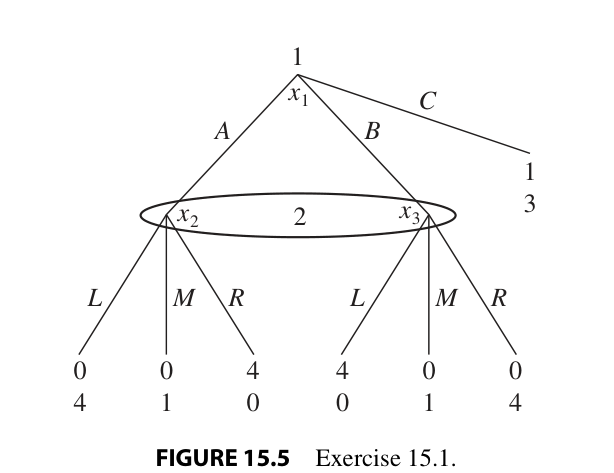
>
> **FIGURE 15.5** Exercise 15.1.

#### 2. Gibbons 4.1

<!-- id: Gibbons 4.1 -->
**Source.** Gibbons (1992), *Game Theory for Applied Economists*, §4.1 Problems, Problem 4.1, p. 245 [PDF p. 251]. Reproduced verbatim. Answer: none in the book.
**Moved here from.** Old Lecture 8 list (`git show fe47ead:Listas/pratica-lecture-08.md`), item 2.

> 4.1. In the following extensive-form games, derive the normal-form game and find all the pure-strategy Nash, subgame-perfect, and perfect Bayesian equilibria.
>
> 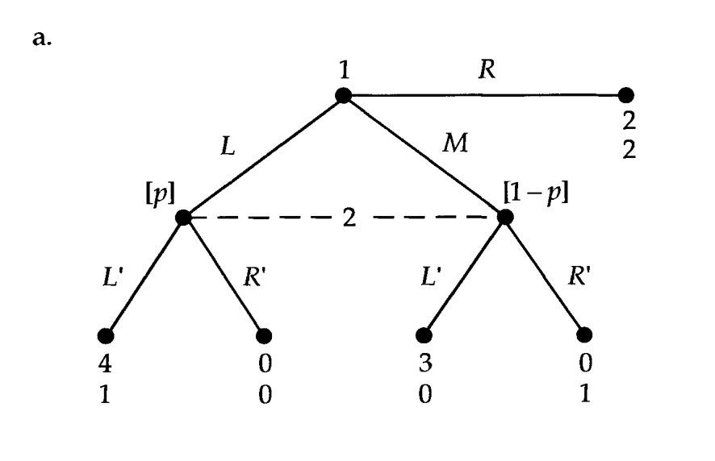
>
> 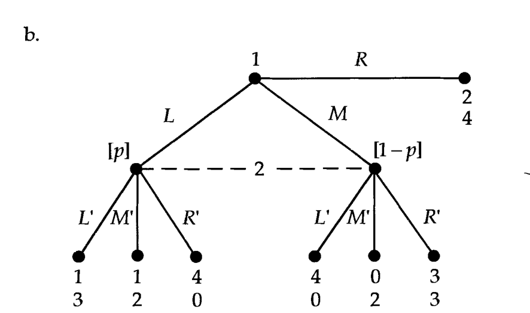

#### 3. Tadelis 15.3

<!-- id: Tadelis 15.3 -->
**Source.** Tadelis (2013), *Game Theory: An Introduction*, Exercise 15.3 "Trust Thy Neighbor", pp. 315–316 [PDF pp. 334–335]. Reproduced verbatim. Answer: none in the book.
**Moved here from.** Old Lecture 8 list (`git show fe47ead:Listas/pratica-lecture-08.md`), item 3.

> **Trust Thy Neighbor:** A student, player 1, has to hand in a problem set at the other end of (a large) campus but needs to rush into an exam. She has two options. She can deliver the problem set after the exam (call this option $L$) and incur a late penalty. Alternatively she can give the problem set to player 2, a random student who happens to be next to player 1 (call this option $S$). Player 2 can then either deliver the problem set on time (call this option $D$) or throw it away in the nearest trash can (call this option $T$). For player 1 the payoff is 1 if the problem set is delivered on time, $-1$ if it is thrown away, and 0 if it is delivered late. The payoffs for player 2 are $x$ if he delivers and $y$ if he throws it away.
>
> a. Draw the game tree that represents this game. Using equilibrium analysis, what conditions on $x$ and $y$ would justify player 1 trusting player 2 to deliver the problem set?
>
> b. Now assume that some proportion $p$ of the population of students are "nice guys" ($N$), for which $x = 1$ and $y = 0$, while a proportion $1 - p$ of the population are "jerks" ($J$), for which $x = 0$ and $y = 1$. Thus we can think that before the game is played, Nature first chooses the type of player 2 that player 1 will meet, according to the probabilities previously described. Draw the game tree.
>
> c. Now assume that for (b) $p = \frac{3}{4}$. What are the pure-strategy Bayesian Nash equilibria of this game? Are there Bayesian Nash equilibria that are not perfect Bayesian equilibria?
>
> d. For which values of $p$ are all the Bayesian Nash equilibria also perfect Bayesian equilibria?

#### 4. Muñoz-Garcia Ch. 9 Ex. 1

<!-- id: Muñoz-Garcia Ch. 9 Ex. 1 -->
**Source.** Muñoz-Garcia & Toro-Gonzalez (2019), *Strategy and Game Theory: Practice Exercises with Answers*, Ch. 9, Exercise 1 "Finding Separating and Pooling Equilibria", pp. 376–377 [PDF pp. 385–386]. Reproduced verbatim (statement only; the book's worked answer follows it). Answer: yes, the book's worked answer follows the exercise.
**Moved here from.** Old Lecture 8 list (`git show fe47ead:Listas/pratica-lecture-08.md`), item 4.

> Consider the following game of incomplete information: nature first determines player 1's type, either high or low, with equal probabilities. Then player 1, observing his own type, decides whether to choose left (L) or Right (R). If he chooses left, the game ends and players' payoffs become $(u_1, u_2) = (2, 0)$, regardless of player 1's type. Figure 9.1 depicts these payoffs in the left-hand side of the tree. If, instead, player 1 chooses Right, player 2 is called on to move. In particular, without observing whether player 1's type is high or low, player 2 must respond by either selecting Up (U) or Down (D). As indicated by the payoffs in the right-hand side of the tree, when player 1's type is high, player 2 prefers to play Up. The opposite preference ranking applies when player 1's type is low.
>
> 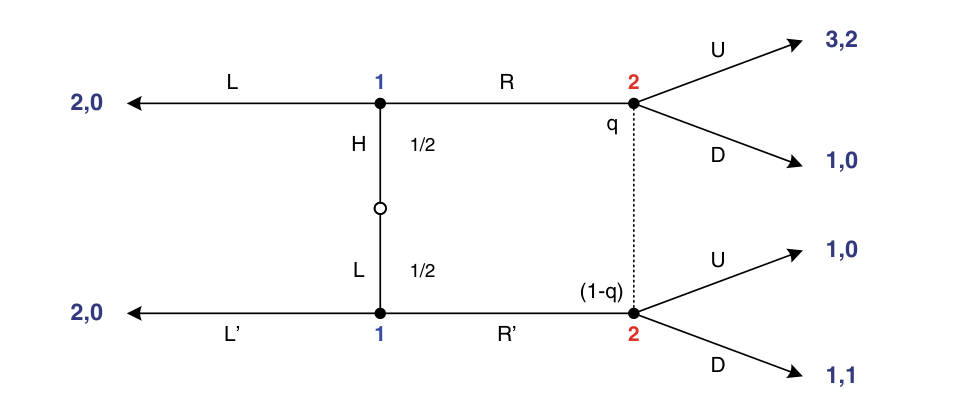
>
> *Fig. 9.1* Game tree where player 2 is uninformed
>
> **Part (a)** Does this game have a Separating Perfect Bayesian Equilibrium (PBE)?
>
> **Part (b)** Does this game have a Pooling PBE?

#### 5. Gibbons 4.3

<!-- id: Gibbons 4.3 -->
**Source.** Gibbons (1992), *Game Theory for Applied Economists*, §4.2 Problems, Problem 4.3, pp. 246–247 [PDF pp. 252–253]. Reproduced verbatim. Answer: none in the book.
**Moved here from.** Old Lecture 8 list (`git show fe47ead:Listas/pratica-lecture-08.md`), item 5.

> 4.3. a. Specify a pooling perfect Bayesian equilibrium in which both Sender types play $R$ in the following signaling game.
>
> 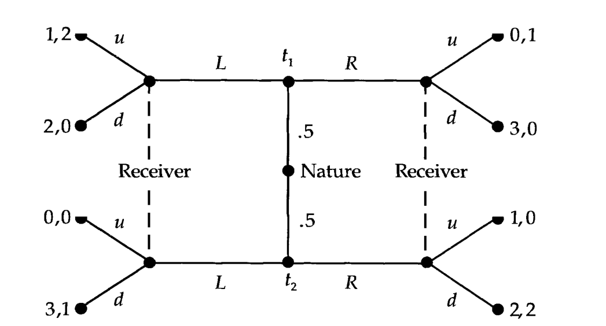
>
> b. The following three-type signaling game begins with a move by nature, not shown in the tree, that yields one of the three types with equal probability. Specify a pooling perfect Bayesian equilibrium in which all three Sender types play $L$.
>
> 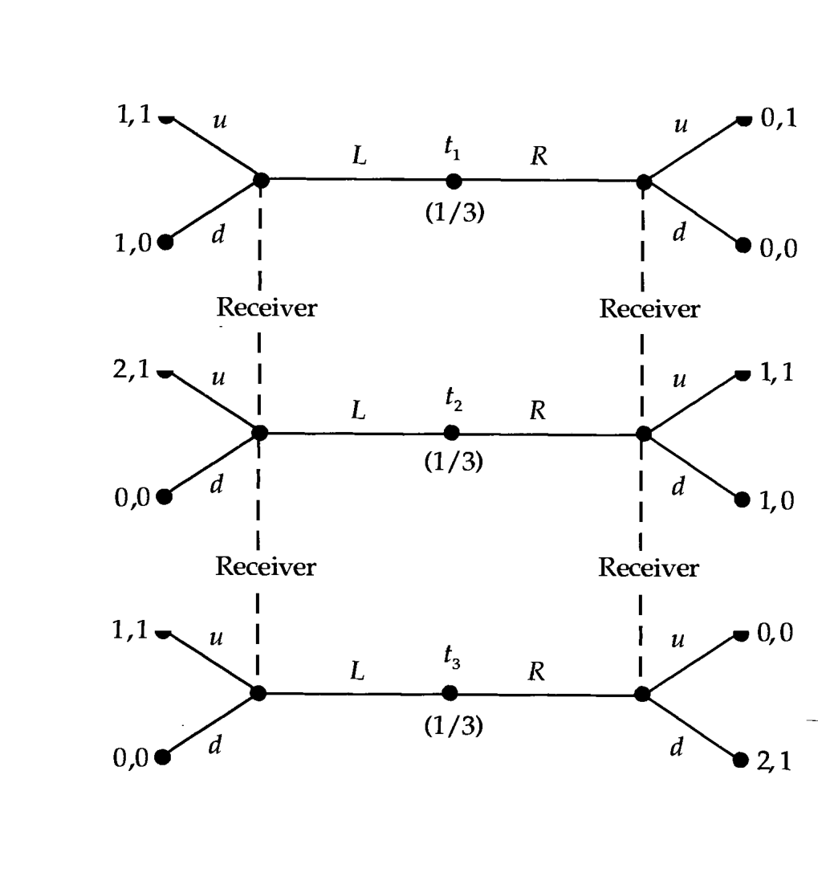

#### 6. Gibbons 4.4

<!-- id: Gibbons 4.4 -->
**Source.** Gibbons (1992), *Game Theory for Applied Economists*, §4.2 Problems, Problem 4.4, p. 248 [PDF p. 254]. Reproduced verbatim. Answer: none in the book.
**Moved here from.** Old Lecture 8 list (`git show fe47ead:Listas/pratica-lecture-08.md`), item 6.

> 4.4. Describe all the pure-strategy pooling and separating perfect Bayesian equilibria in the following signaling games.
>
> 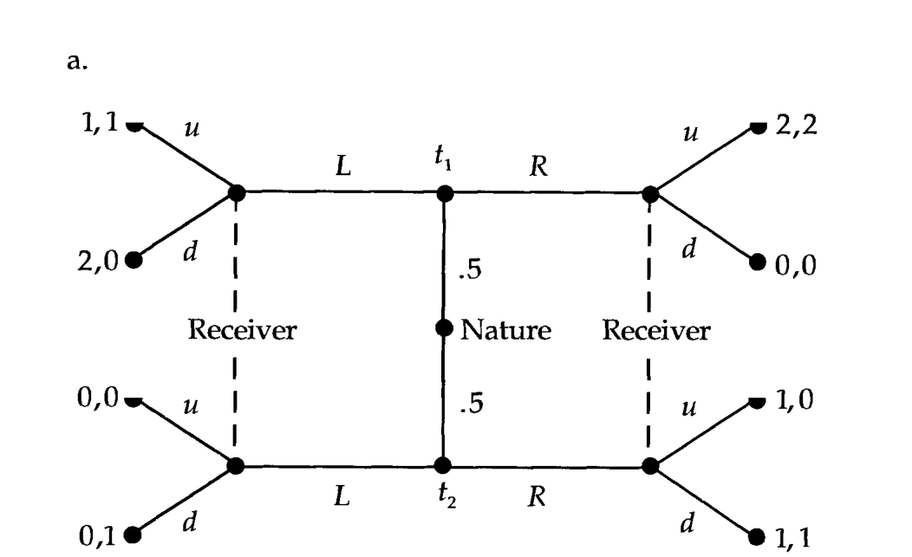
>
> 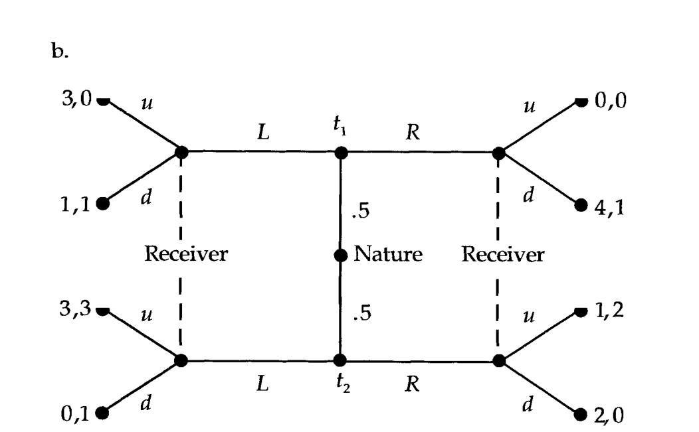

#### 7. Tadelis 16.5

<!-- id: Tadelis 16.5 -->
**Source.** Tadelis (2013), *Game Theory: An Introduction*, Exercise 16.5 "Drug Ads", p. 337 [PDF p. 356]. Reproduced verbatim. Answer: none in the book.
**Moved here from.** Old Lecture 8 list (`git show fe47ead:Listas/pratica-lecture-08.md`), item 7.

> **Drug Ads:** A pharmaceutical company (player 1) introduces a new cold medicine. The medicine may either be highly effective ($H$) or have little effect ($L$). The company knows the effectiveness of the drug, but a representative consumer (player 2) knows only that the prior probability that it is highly effective is $\frac{1}{2}$. The company can choose either to advertise the drug excessively ($A$), at a cost $c > 0$, or not to advertise ($N$), which costs nothing. The representative consumer decides whether or not to buy the product after observing whether the company advertised the drug. The net payoff to the representative consumer from buying the drug is 1 if it is highly effective and $-1$ if it has little effect, and his payoff from not buying the drug is 0. If the drug is highly effective then if consumers buy the drug once they will learn of its efficacy and buy it many more times, in which case the company earns a high payoff equal to $R > c$. If instead consumers learn that the drug has little effect then the company will sell the drug to them only once, and the company's returns are equal to $r > 0$. If the representative consumer does not buy the drug then the revenue of the company is 0. Assume that $R > c > r > 0$.
>
> a. Write down the extensive-form game tree.
>
> b. Find a separating perfect Bayesian Nash equilibrium in which the company chooses a different action depending on the drug's efficacy.
>
> c. Find a pooling perfect Bayesian Nash equilibrium in which the company chooses the same action regardless of the drug's efficacy.
>
> d. What changes when $R > r > c > 0$?

#### 8. Muñoz-Garcia Ch. 9 Ex. 2

<!-- id: Muñoz-Garcia Ch. 9 Ex. 2 -->
**Source.** Muñoz-Garcia & Toro-Gonzalez (2019), *Strategy and Game Theory: Practice Exercises with Answers*, Ch. 9, Exercise 2 "Job-Market Signaling Game", pp. 385–386 [PDF pp. 394–395] (figure on p. 386). Reproduced verbatim (statement and its footnote 3 only; the book's worked answer follows it). Answer: yes, the book's worked answer follows the exercise.
**Moved here from.** Old Lecture 8 list (`git show fe47ead:Listas/pratica-lecture-08.md`), item 8.

> Let us consider the sequential game with incomplete information depicted in Fig. 9.11. A worker privately observes whether he has a High productivity or a Low productivity, and then decides whether to acquire some education, such as a college degree, which he will subsequently be able to use as a signal about his innate productivity to potential employers. For simplicity, assume that education is not productivity enhancing. A firm that considers hiring the candidate, however, does not observe the real productivity of the worker, but only knows whether the worker decided to acquire a college education or not (the firm can observe whether the candidate has a valid degree). In this setting, the firm must respond hiring the worker as a manager (M) or as a cashier (C).³
>
> **Part (a)** Does this game have an equilibrium using the strategy profile [NE']
>
> **Part (b)** Does this game have an equilibrium using the opposite separating strategy profile [EN']
>
> **Part (c)** Does this game have an equilibrium using the Pooling strategy profile [EE'] in which both types of workers acquire education.
>
> **Part (d)** Does this game have an equilibrium using the pooling strategy profile [NN'], in which neither type of worker acquires education.
>
> 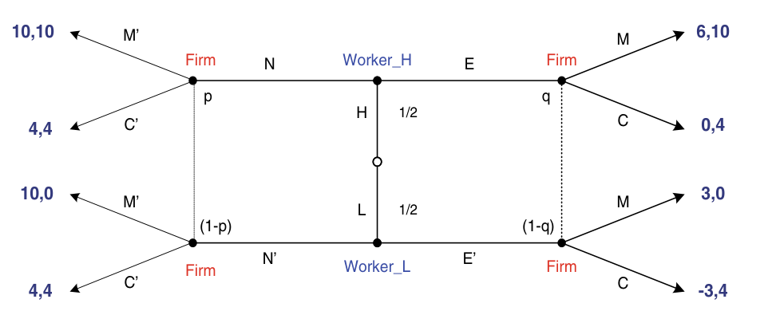
>
> *Fig. 9.11* The job-market signaling game
>
> ³This game presents a simplified version of Spence's (1973) labor market signaling game, where the worker can be of only two types (either high or low productivity), and the firm manager can only respond with two possible actions (either hiring the candidates as a manager, thus offering him a high salary, or as a cashier, at a lower salary). A richer version of this model, with a continuum of education levels and a continuum of salaries, is presented in the next chapter.

## Tier 2 — Exam level

| # | Block | Source | Ch./Sec. | Exercise | Page | What it trains |
|---|---|---|---|---|---|---|
| 9 | B1 | Gibbons | §4.1, Problems | 4.2 | 245–246 | A game with no pure-strategy PBE; solving for the mixed PBE with beliefs |
| 10 | B1 | Tadelis | Ch. 15, Exercises | 15.5 | 316–317 | Entry with tough and weak entrants: BNE by matrix, the incumbent's preferred one, all PBE |
| 11 | B2 | Muñoz-Garcia | Ch. 9 | Ex. 5 | 422–423 | No pure separating or pooling PBE in a poker game; a semi-separating PBE |
| 12 | B2 | Tadelis | Ch. 16, Exercises | 16.4 | 336–337 | School choice as a signal: Bayesian matrix, all BNE, all PBE, and why they differ |
| 13 | B4 | Tadelis | Ch. 16, Exercises | 16.3 | 335–336 | Discrete limit pricing: pooling at $p_L$, and the discount factors that allow separation |
| 14 | B4 | Muñoz-Garcia | Ch. 11 | Ex. 5 | 505 | Entry deterrence through a price war by a "sane" or "crazy" incumbent |
| 15 | B3 | Tadelis | Ch. 16, Exercises | 16.6 | 337–338 | Publish or perish: pooling outcome, separating PBE in parameters, the least-cost one |
| 16 | B5 | Tadelis | Ch. 16, Exercises | 16.8 | 338 | Beer–Quiche: BNE, PBE, and which pooling equilibrium fails the intuitive criterion |
| 17 | B5 | Gibbons | §4.4, Problems | 4.16 | 253 | Signaling Requirements 5 and 6 applied to the pooling equilibria of item 5 |

### Statements

#### 9. Gibbons 4.2

<!-- id: Gibbons 4.2 -->
**Source.** Gibbons (1992), *Game Theory for Applied Economists*, §4.1 Problems, Problem 4.2, pp. 245–246 [PDF pp. 251–252]. Reproduced verbatim. Answer: none in the book.
**Moved here from.** Old Lecture 8 list (`git show fe47ead:Listas/pratica-lecture-08.md`), item 9.

> 4.2. Show that there does not exist a pure-strategy perfect Bayesian equilibrium in the following extensive-form game. What is the mixed-strategy perfect Bayesian equilibrium?
>
> 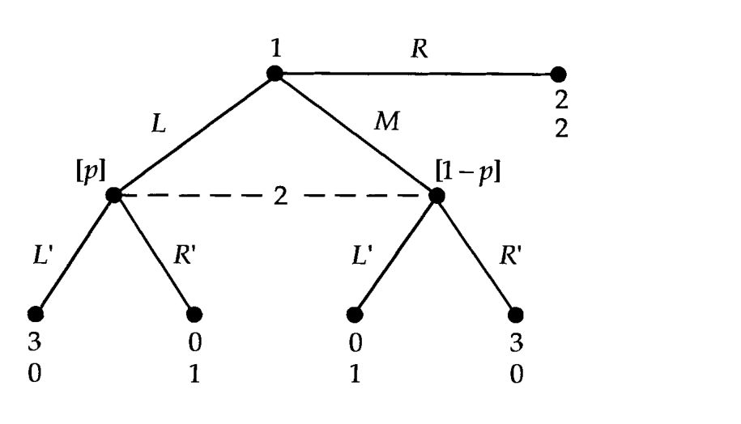

#### 10. Tadelis 15.5

<!-- id: Tadelis 15.5 -->
**Source.** Tadelis (2013), *Game Theory: An Introduction*, Exercise 15.5 "Entry (again)", pp. 316–317 [PDF pp. 335–336]. Reproduced verbatim. Answer: none in the book.
**Moved here from.** Old Lecture 8 list (`git show fe47ead:Listas/pratica-lecture-08.md`), item 10.

> **Entry (again):** The market for widgets has an incumbent firm. The total value of having 100% of the market is 10, which the incumbent receives if no one enters. A potential entrant arrives, and it can be one of two types: tough ($T$) or weak ($W$). A weak entrant can choose one of three options: small entry ($S$), big entry ($B$), or exit ($X$). A tough entrant can choose only between $S$ or $B$ (it is inconceivable that it would choose $X$). There is no cost for a tough entrant to enter at any level. However, it costs a weak entrant 6 to enter at any level. Exiting costs nothing to the entrant. The entrant knows his type, but the incumbent knows only the prior distribution: $\Pr\{T\} = \frac{1}{2}$.
>
> In response to any level of entry, the incumbent can choose to accommodate ($A$) or fight ($F$). Accommodating an entrant imposes no costs. Independent of the entrant's type, accommodating small entry gives the incumbent 60% of the market and the entrant 40%, while accommodating big entry gives the incumbent 40% of the market and the entrant 60%. Fighting a tough entrant increases the incumbent's market share by 20% (relative to accommodating) but imposes a cost of 4 on the incumbent. Fighting a weak entrant that chose $S$ increases the market share of the incumbent to 100% but imposes a cost of 2 on the incumbent. Fighting a weak entrant that chose $B$ increases the market share of the incumbent to 100% but imposes a cost of 8 on the incumbent.
>
> a. Draw this game in extensive form.
>
> b. Using a matrix representation, find all the pure-strategy Bayesian Nash equilibria for this game.
>
> c. Which one of the Bayesian Nash equilibria is preferred by the incumbent? Can it be supported as a perfect Bayesian equilibrium?
>
> d. Find all the perfect Bayesian equilibria of this game.

#### 11. Muñoz-Garcia Ch. 9 Ex. 5

<!-- id: Muñoz-Garcia Ch. 9 Ex. 5 -->
**Source.** Muñoz-Garcia & Toro-Gonzalez (2019), *Strategy and Game Theory: Practice Exercises with Answers*, Ch. 9, Exercise 5 "Finding Semi-Separating Equilibrium", pp. 422–423 [PDF pp. 431–432]. Reproduced verbatim (statement only; the book's worked answer follows it). "Obviously, player makes his choice" is as printed. Answer: yes, the book's worked answer follows the exercise.
**Moved here from.** Old Lecture 8 list (`git show fe47ead:Listas/pratica-lecture-08.md`), item 11.

> Consider the sequential game with incomplete information depicted in Fig. 9.46. Two players are playing the following super-simple poker game. The first player gets his cards, and obviously he is the only one who can observe them. He can either get a High hand or a Low hand, with equal probabilities. After observing his hand, he must decide whether to Bet (let us imagine that he is betting a fixed amount of a dollar) or Resign from the game. If he resigns his payoff is $-1$, independent of whether he has a High or a Low hand, and player 2 gets a dollar. If he bets, player 2 must decide whether to Call or Fold from the game. Obviously, player makes his choice without being able to observe player 1's hands, but only observing that player 1 Bets.
>
> 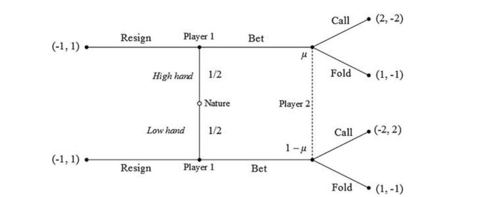
>
> *Fig. 9.46* A simple poker game
>
> (a) Show that no separating PBE can be sustained where player 1 chooses a pure strategy (i.e., betting or resigning, given his cards, with 100% probability).
>
> (b) Show that no pooling PBE can be sustained where player 1 chooses a pure strategy (i.e., betting or resigning, given his cards, with 100% probability).
>
> (c) Find a semi-separating PBE where player 1 chooses Bet or Resign in pure strategies when having a high hand, but randomizes between bet and resign when having a low hand.

#### 12. Tadelis 16.4

<!-- id: Tadelis 16.4 -->
**Source.** Tadelis (2013), *Game Theory: An Introduction*, Exercise 16.4 "School Choice", pp. 336–337 [PDF pp. 355–356]. Reproduced verbatim. Answer: none in the book.
**Moved here from.** Old Lecture 8 list (`git show fe47ead:Listas/pratica-lecture-08.md`), item 12.

> **School Choice:** A prospective student, player 1, is deciding whether to go to Brown Bear University ($B$) or Silly Tree University ($S$). Both are top-rated universities that accept only the very best students. The difference is that Silly Tree offers a more holistic and comfortable lifestyle, while Brown Bear requires harder work and imposes more "studying" costs on its students. For this reason a player who goes to Brown Bear learns to become more self-sufficient and becomes more productive in the workforce. The cost of learning and level of final productivity depend on the type of player 1, who can be either excellent ($E$) or just really good ($G$) (because no other type would be accepted into these universities). Player 1 knows his type, but all others in society know only that a proportion $p$ of young adults are type $E$. The cost of learning and the level of productivity from each choice are given as follows:
>
> | Type | University choice | Learning cost | Productivity |
> |:---:|:---:|:---:|:---:|
> | $E$ | $B$ | 2 | 12 |
> | $E$ | $S$ | 0 | 4 |
> | $G$ | $B$ | 8 | 10 |
> | $G$ | $S$ | 2 | 2 |
>
> Once player 1 finishes school, he is hired by a firm (player 2), which can place him in one of two jobs: low-tech ($L$) or high-tech ($H$). The wage for the $L$ job is $w_L = 2$ and that for the $H$ job is $w_H = 6$. The payoffs to player 1 are the wages less the cost of education. The firm's profits depend on both the job assignment and the type of employee. If the employee is assigned to an $H$ job, the net profits to the firm are equal to the productivity of the employed player 1 less the wage he is paid. If the assignment is to an $L$ job, the net profits are half the productivity of the employed player 1 less the wage he is paid.
>
> a. Draw this game in extensive form.
>
> b. Assume that $p = \frac{1}{2}$. Represent the matrix form of the Bayesian game.
>
> c. Find all the pure-strategy Bayesian Nash equilibria.
>
> d. Find all the pure-strategy perfect Bayesian equilibria.
>
> e. In brief terms, what is the intuition that explains the comparison between your results in (d) and (c)?

#### 13. Tadelis 16.3

<!-- id: Tadelis 16.3 -->
**Source.** Tadelis (2013), *Game Theory: An Introduction*, Exercise 16.3 "More Limit Pricing", pp. 335–336 [PDF pp. 354–355]. Reproduced verbatim. Answer: none in the book.
**Moved here from.** Old Lecture 8 list (`git show fe47ead:Listas/pratica-lecture-08.md`), item 13.

> **More Limit Pricing:** An incumbent firm (player 1) is either a low-cost type $\theta_1 = \theta_L$ or a high-cost type $\theta_1 = \theta_H$, each with equal probability. In period $t = 1$ the incumbent is a monopolist and sets one of two prices $p_L$ or $p_H$, and its profits in this period depend on its type and the price it chooses, given by the following table:
>
> | Type | Profit from $p_L$ | Profit from $p_H$ |
> |:---:|:---:|:---:|
> | $\theta_L$ | 6 | 8 |
> | $\theta_H$ | 1 | 5 |
>
> After observing the period $t = 1$ price, a potential entrant (player 2), which does not know the incumbent's type but knows the distribution of types, can choose to enter the market ($E$) or stay out ($O$) in period $t = 2$. The payoffs of both players in period 2 depend on the entrant's choice and on the incumbent's type and are given by the following table:
>
> | Incumbent's type | Entrant's choice | Incumbent's payoff | Entrant's payoff |
> |:---:|:---:|:---:|:---:|
> | $\theta_L$ | $E$ | 0 | $-2$ |
> | $\theta_L$ | $O$ | 8 | 0 |
> | $\theta_H$ | $E$ | 0 | 1 |
> | $\theta_H$ | $O$ | 5 | 0 |
>
> At the beginning of the game the incumbent discounts profits for period $t = 2$ using a discount factor $\delta \le 1$.
>
> a. Draw the extensive-form game tree of this game and write down the corresponding matrix.
>
> b. For $\delta = 1$ find a pooling perfect Bayesian equilibrium of the game in which both types of player 1 choose $p_L$ in period $t = 1$.
>
> c. Find the range of discount factors for which a separating perfect Bayesian equilibrium of the game exists in which type $\theta_L$ chooses $p_L$ and type $\theta_H$ chooses $p_H$ in period $t = 1$.

#### 14. Muñoz-Garcia Ch. 11 Ex. 5

<!-- id: Muñoz-Garcia Ch. 11 Ex. 5 -->
**Source.** Muñoz-Garcia & Toro-Gonzalez (2019), *Strategy and Game Theory: Practice Exercises with Answers*, Ch. 11, Exercise 5 "Entry Deterrence Through Price Wars", p. 505 [PDF p. 512]. Reproduced verbatim (statement only; the book's worked answer follows it). Answer: yes, the book's worked answer follows the exercise.
**Moved here from.** Old Lecture 8 list (`git show fe47ead:Listas/pratica-lecture-08.md`), item 14.

> Consider two firms competing in an industry, an incumbent and an entrant. The entrant has already entered the market, and in period 1 the incumbent must decide whether to fight or accommodate; if she fights, the entrant loses $f_E > 0$ (i.e., profit $= -f_E$) and if she accommodates the entrant makes a profit of $a_E > 0$. The incumbent may be either "sane", in which case he loses $f_I > 0$ from fighting, and gains $a_I > 0$ from accommodating; or "crazy", in which case his only available action is to fight. In period 2, the entrant must choose whether to stay in the market or exit; if she exits, the incumbent makes a profit of m; if she stays, the incumbent gets to fight or accommodate again and the payoffs are as described before. Assume that there is no discounting, and that the prior probability of a "sane" incumbent is $0 < p < 1$ (the actual type of the incumbent is private knowledge to the incumbent).
>
> **Part (a)** Draw the game in its extensive form.
>
> **Part (b)** Show that if payoffs satisfy $m - f_I \le 2a_I$, then there is a separating equilibrium.
>
> **Part (c)** Show that if $m - f_I \le 2a_I$ does not hold there is a pooling equilibrium when $p \le \frac{f_E}{f_E + a_E}$.

#### 15. Tadelis 16.6

<!-- id: Tadelis 16.6 -->
**Source.** Tadelis (2013), *Game Theory: An Introduction*, Exercise 16.6 "Publish or Perish", pp. 337–338 [PDF pp. 356–357]. Reproduced verbatim (with the book's footnote 6). Answer: none in the book.
**Moved here from.** Old Lecture 8 list (`git show fe47ead:Listas/pratica-lecture-08.md`), item 15.

> **Publish or Perish:**⁶ Imagine that any newly minted Ph.D. who starts a tenure-track assistant professor job (player 1) is one of two types: high-ability ($\theta_H$) or low-ability ($\theta_L$), where $\theta_H > \theta_L > 0$. The assistant professor knows his type, but the department that hires him (player 2) knows only that he has high ability with probability $p < \frac{1}{2}$. The assistant professor first chooses how hard to work, which is effectively how many papers to publish in period 1 (the pre-tenure period). After observing how many papers the assistant professor published, the department decides whether to grant him tenure ($T$) or not to do so ($N$). If the department chooses to grant tenure then the assistant professor's payoff is $v_1(q, T \mid \theta) = V - \frac{q}{\theta}$, where $V$ is the value of being tenured. The department's payoff is 1 if it tenures a high-ability type and $-1$ if it tenures a low-ability type. If the department denies tenure, it gets a payoff of 0 and the assistant professor's payoff is $v_1(q, N \mid \theta) = -\frac{q}{\theta}$. Denote by $\mu(q)$ the department's belief that the professor is a high-ability type given that he published $q$ papers.
>
> a. Write down a "rough" extensive form of this game.
>
> b. If there is a pooling perfect Bayesian equilibrium, will the assistant professor be tenured? Does he write any papers? What then is the unique outcome of the pooling perfect Bayesian equilibrium?
>
> c. Characterize the perfect Bayesian separating equilibria using the parameters of the game.
>
> d. If there is more than one separating perfect Bayesian equilibrium, what is the smallest number of papers that an assistant professor needs to publish in order to get tenure?
>
> ⁶This exercise is based on one written by Rod Garrett and John Wooders.

#### 16. Tadelis 16.8

<!-- id: Tadelis 16.8 -->
**Source.** Tadelis (2013), *Game Theory: An Introduction*, Exercise 16.8 "Beer or Quiche?", p. 338 [PDF p. 357]. Reproduced verbatim. Answer: none in the book.
**Moved here from.** Old Lecture 8 list (`git show fe47ead:Listas/pratica-lecture-08.md`), item 16.

> **Beer or Quiche?** Cho and Kreps (1987) introduced what is now a famous two-player signaling game. First, Nature selects player 1, who knows his type, to be either a wimp ($W$), with probability $p = 0.1$, or surly ($S$), with probability $1 - p = 0.9$. Player 1 then chooses what to have for breakfast: beer ($B$) or quiche ($Q$). A surly type prefers beer while a wimp prefers quiche. Player 1's preferred breakfast gives him a payoff of 1 while his less-preferred choice gives him 0. After breakfast player 2 observes what player 1 ate but does not know whether he is a wimp or surly. Player 2 then chooses whether to duel ($D$) with player 1 or not to duel ($N$). Player 1, regardless of his type, prefers no duel, yielding him an extra payoff of 2, to a duel, which gives him 0. (For example, if player 1 eats his preferred breakfast and avoids a duel then his final payoff is 3, while if he eats his preferred breakfast and is forced into a duel then his final payoff is 1.) Player 2, however, prefers to duel if and only if player 1 is a wimp. If player 1 is surly then player 2's payoff is 0 from $D$ and 1 from $N$. If player 1 is a wimp then player 2's payoff is 2 from $D$ and 1 from $N$.
>
> a. Draw the extensive form of this game.
>
> b. What are the Bayesian Nash equilibria of this game?
>
> c. What are the perfect Bayesian equilibria?
>
> d. Of the equilibria you found in (c), which fail the intuitive criterion?

Note (errata, `.agent/notes/errata-game-theory-books.md`): Tadelis's Def. 16.1 (the intuitive criterion) prints $v_2$ in condition 2 where $v_1$ belongs; apply the corrected version (`Notas/L08/L08-08-intuitive-criterion.md`).

#### 17. Gibbons 4.16

<!-- id: Gibbons 4.16 -->
**Source.** Gibbons (1992), *Game Theory for Applied Economists*, §4.4 Problems, Problem 4.16, p. 253 [PDF p. 259]. Reproduced verbatim. Problem 4.3, to which it refers, is copied below the statement (it is also item 5). Answer: none in the book.
**Moved here from.** Old Lecture 8 list (`git show fe47ead:Listas/pratica-lecture-08.md`), item 17.

> 4.16. Consider the pooling equilibria described in Problem 4.3 (a) and (b). For each equilibrium: (i) determine whether the equilibrium can be supported by beliefs that satisfy Signaling Requirement 5; (ii) determine whether the equilibrium can be supported by beliefs that satisfy Signaling Requirement 6 (The Intuitive Criterion).

**Problem 4.3 (§4.2 Problems, pp. 246–247 [PDF pp. 252–253]), copied from the book because the exercise refers to it.**

> 4.3. a. Specify a pooling perfect Bayesian equilibrium in which both Sender types play $R$ in the following signaling game.
>
> 
>
> b. The following three-type signaling game begins with a move by nature, not shown in the tree, that yields one of the three types with equal probability. Specify a pooling perfect Bayesian equilibrium in which all three Sender types play $L$.
>
> 

## Tier 3 — Advanced

| # | Block | Source | Ch./Sec. | Exercise | Page | What it trains |
|---|---|---|---|---|---|---|
| 18 | B2 | MWG | §13.C, Exercises | 13.C.1 | 474 | Unravelling: with a costless verifiable test every type submits to it |
| 19 | B2 | MWG | §13.C, Exercises | 13.C.5 | 475 | Can pure money-burning advertising separate qualities at a regulated price? |
| 20 | B1 | Tadelis | Ch. 15, Exercises | 15.6 | 317 | Selten's horse: a BNE that is not a PBE (non-credible $D$), the PBE, and its consistent beliefs |
| 21 | B3 | Gibbons | §4.2, Problems | 4.7 | 249 | A hybrid (semi-separating) job-market PBE in the indifference-curve diagram |
| 22 | B5 | Tadelis | Ch. 16, Exercises | 16.7 | 338 | The intuitive criterion on the continuum of separating limit-pricing equilibria |
| 23 | B5 | Muñoz-Garcia | Ch. 11 | Ex. 4 | 500 | All separating PBE with convex education cost, then the intuitive criterion |
| 24 | B3 | MWG | §13.C, Exercises | 13.C.2 | 475 | Spence with productive education: separating and pooling PBE vs the full-information outcome |
| 25 | B3 | MWG | §13.C, Exercises | 13.C.4 | 475 | Spence with a continuum of types: the unique separating PBE from a differential equation |

### Statements

#### 18. MWG 13.C.1

<!-- id: MWG 13.C.1 -->
**Source.** Mas-Colell, Whinston & Green (1995), *Microeconomic Theory*, Ch. 13 Exercises, Exercise 13.C.1^B, p. 474 [PDF p. 248]. Reproduced verbatim. Answer: none in the book; entries for 13.C.1, 13.C.2, 13.C.4 and 13.C.5 are in the MWG solutions manual (`Livros/`).
**Moved here from.** Old Lecture 8 list (`git show fe47ead:Listas/pratica-lecture-08.md`), item 22.

> **13.C.1^B** Consider a game in which, first, nature draws a worker's type from some continuous distribution on $[\underline{\theta}, \bar{\theta}]$. Once the worker observes her type, she can choose whether to submit to a costless test that reveals her ability perfectly. Finally, after observing whether the worker has taken the test and its outcome if she has, two firms bid for the worker's services. Prove that in any subgame perfect Nash equilibrium of this model all worker types submit to the test, and firms offer a wage no greater than $\underline{\theta}$ to any worker not doing so.

#### 19. MWG 13.C.5

<!-- id: MWG 13.C.5 -->
**Source.** Mas-Colell, Whinston & Green (1995), *Microeconomic Theory*, Ch. 13 Exercises, Exercise 13.C.5^B, p. 475 [PDF p. 248]. Reproduced verbatim. Answer: none in the book; entries for 13.C.1, 13.C.2, 13.C.4 and 13.C.5 are in the MWG solutions manual (`Livros/`).
**Moved here from.** Old Lecture 8 list (`git show fe47ead:Listas/pratica-lecture-08.md`), item 23.

> **13.C.5^B** Assume a single firm and a single consumer. The firm's product may be either high or low quality and is of high quality with probability $\lambda$. The consumer cannot observe quality before purchase and is risk neutral. The consumer's valuation of a high-quality product is $v_H$; her valuation of a low-quality product is $v_L$. The costs of production for high ($H$) and low ($L$) quality are $c_H$ and $c_L$, respectively. The consumer desires at most one unit of the product. Finally, the firm's price is regulated and is set at $p$. Assume that $v_H > p > v_L > c_H > c_L$.
>
> (a) Given the level of $p$, under what conditions will the consumer buy the product?
>
> (b) Suppose that before the consumer decides whether to buy, the firm (which knows its type) can advertise. Advertising conveys no information directly, but consumers can observe the total amount of money that the firm is spending on advertising, denoted by $A$. Can there be a separating perfect Bayesian equilibrium, that is, an equilibrium in which the consumer rationally expects firms with different quality levels to pick different levels of advertising?

#### 20. Tadelis 15.6

<!-- id: Tadelis 15.6 -->
**Source.** Tadelis (2013), *Game Theory: An Introduction*, Exercise 15.6 "Selten's Horse", p. 317 [PDF p. 336]. Reproduced verbatim. Answer: none in the book.
**Moved here from.** Old Lecture 8 list (`git show fe47ead:Listas/pratica-lecture-08.md`), item 18.

> **Selten's Horse:** Consider the three-person game described in Figure 15.6, known as Selten's horse (for the obvious reason).
>
> 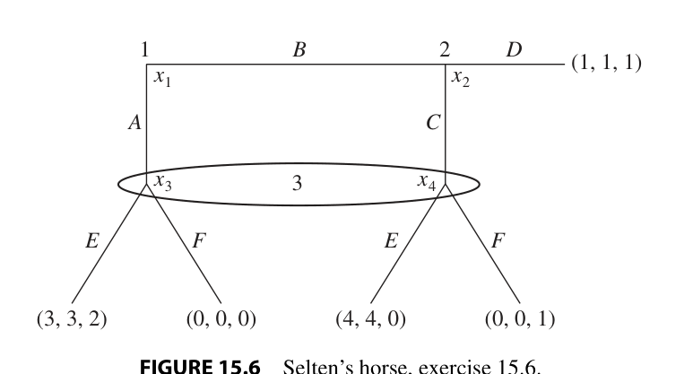
>
> **FIGURE 15.6** Selten's horse, exercise 15.6.
>
> a. What are the pure-strategy Bayesian Nash equilibria of this game?
>
> b. Which of the Bayesian Nash equilibria that you found in (a) are perfect Bayesian equilibria?
>
> c. Which of the Bayesian Nash equilibria that you found in (a) are sequential equilibria?

#### 21. Gibbons 4.7

<!-- id: Gibbons 4.7 -->
**Source.** Gibbons (1992), *Game Theory for Applied Economists*, §4.2 Problems, Problem 4.7, p. 249 [PDF p. 255]. Reproduced verbatim. Answer: none in the book.
**Moved here from.** Old Lecture 8 list (`git show fe47ead:Listas/pratica-lecture-08.md`), item 20.

> 4.7. Draw indifference curves and production functions for a two-type job-market signaling model. Specify a hybrid perfect Bayesian equilibrium in which the high-ability worker randomizes.

#### 22. Tadelis 16.7

<!-- id: Tadelis 16.7 -->
**Source.** Tadelis (2013), *Game Theory: An Introduction*, Exercise 16.7 "Intuitive Limit Pricing", p. 338 [PDF p. 357]. Reproduced verbatim. Answer: none in the book.
**Moved here from.** Old Lecture 8 list (`git show fe47ead:Listas/pratica-lecture-08.md`), item 19.

> **Intuitive Limit Pricing:** Show that of all the separating equilibria of the limit pricing–entry deterrence game in Section 16.2 only the best separating equilibrium does not fail the intuitive criterion.

Note: the game of Tadelis §16.2 (pp. 323–332) is worked in `Notas/L08/L08-07-limit-pricing.md` (inverse demand $5 - q$, costs 1 and 2, separating $q_1^{1L} \in [2.62, 3.32]$). Errata: Tadelis p. 331 prints the entrant's pooled-entry profit as $\frac{7}{18}$, arithmetic gives $\frac{7}{36}$; Def. 16.1 condition 2 reads $v_2$ where $v_1$ belongs.

**Game of Section 16.2 (pp. 323–324 [PDF pp. 342–343]), copied from the book because the exercise refers to it.**

> Consider a market for some good that will last for two periods with demand $P = 5 - q$ in each period. In period $t = 1$ only one firm, the incumbent (player 1), is in the market, and this incumbent will continue to produce in period $t = 2$. A potential entrant (player 2) observes what happened in period $t = 1$ and then makes a choice of whether to enter the market at a fixed cost of $\frac{1}{2}$ and compete against the incumbent in period $t = 2$, or to remain out of the market. If player 2 stays out of the market then player 1 remains a monopolist in period 2, while if player 2 enters the market then they compete in a Cournot duopoly game. Each firm has marginal costs $c_i$, where it is common knowledge that the entrant's marginal costs are $c_2 = 2$. There is asymmetric information with respect to the costs (the type) of the incumbent. In particular the entrant knows only that $c_1 \in \{1, 2\}$, so that the incumbent can be either more efficient than the entrant (have low [$L$] costs of $c_1 = 1$) or as efficient (have high [$H$] costs of $c_1 = 2$). It is common knowledge that $\Pr\{c_1 = 1\} = \frac{1}{2}$, but only the incumbent knows his true costs.
>
> The timing of this game, which captures the story, is described as follows:
>
> 1. Nature chooses the type of player 1, $c_1 \in \{1, 2\}$, each type with equal probability.
> 2. Player 1 observes his costs and decides how much to produce in the first period, $q_1^1$, and the price in the first period is then $P = 5 - q_1^1$.
> 3. Player 2 observes $q_1^1$ and decides whether or not to enter at a fixed cost of $F = \frac{1}{2}$.
> 4. If player 2 stays out then in period $t = 2$ player 1 chooses $q_1^2$ and the price is $P = 5 - q_1^2$.
> 5. If player 2 enters then in period $t = 2$ each player $i$ simultaneously chooses $q_i^2$ and the price is $P = 5 - q_1^2 - q_2^2$ (Cournot competition).

#### 23. Muñoz-Garcia Ch. 11 Ex. 4

<!-- id: Muñoz-Garcia Ch. 11 Ex. 4 -->
**Source.** Muñoz-Garcia & Toro-Gonzalez (2019), *Strategy and Game Theory: Practice Exercises with Answers*, Ch. 11, Exercise 4 "Labor Market Signaling Game and Equilibrium Refinements", p. 500 [PDF p. 507]. Reproduced verbatim (statement only; the book's worked answer follows it). Answer: yes, the book's worked answer follows the exercise.
**Moved here from.** Old Lecture 8 list (`git show fe47ead:Listas/pratica-lecture-08.md`), item 21.

> Consider the following labor market signaling model. A worker with privately known productivity $\theta$ chooses an education level $e$. Upon observing $e$, each firm responds with a wage offer that corresponds to the worker's expected productivity (That is, we assume that the labor market is perfectly competitive, so firms pay the value of the expected marginal productivity to every worker. Otherwise, competing firms would have incentives to increase their salaries in order to attract workers with higher productivities.). The worker's payoff from receiving a wage $w$ and acquiring an education level $e$, given an innate productivity $\theta$, is $u(w, e \mid \theta) = w - \frac{e^3}{\theta}$, i.e., the cost of acquiring education, $\frac{e^3}{\theta}$, is convex, and decreases in the worker's innate productivity, $\theta$ (Note that, for simplicity, we assume that the worker's innate productivity, $\theta$, is unaffected by the education level he acquires.).
>
> **Part (a)** Assuming that there are two equally likely types $\theta_1 = 1$ and $\theta_2 = 2$, characterize the set of all separating equilibria.
>
> **Part (b)** Which of these equilibria survive the Cho and Kreps' (1987) Intuitive Criterion?

#### 24. MWG 13.C.2

<!-- id: MWG 13.C.2 -->
**Source.** Mas-Colell, Whinston & Green (1995), *Microeconomic Theory*, Ch. 13 Exercises, Exercise 13.C.2^C, p. 475 [PDF p. 248]. Reproduced verbatim. Answer: none in the book; entries for 13.C.1, 13.C.2, 13.C.4 and 13.C.5 are in the MWG solutions manual (`Livros/`).
**Moved here from.** Old Lecture 8 list (`git show fe47ead:Listas/pratica-lecture-08.md`), item 24.

> **13.C.2^C** Reconsider the two-type signaling model with $r(\theta_L) = r(\theta_H) = 0$, assuming a worker's productivity is $\theta(1 + \mu e)$ with $\mu > 0$. Identify the separating and pooling perfect Bayesian equilibria, and relate them to the perfect information competitive outcome.

**Model of Section 13.C (p. 450 [PDF p. 236]), copied from the book because the exercise refers to it.**

> Consider the following adaptation of the model discussed in Section 13.B. For simplicity, we restrict attention to the case of two types of workers with productivities $\theta_H$ and $\theta_L$, where $\theta_H > \theta_L > 0$ and $\lambda = \text{Prob}\,(\theta = \theta_H) \in (0, 1)$. The important extension of our previous model is that before entering the job market a worker can get some education, and the amount of education that a worker receives is observable. To make matters particularly stark, we assume that education does *nothing* for a worker's productivity (see Exercise 13.C.2 for the case of productive signaling). The cost of obtaining education level $e$ for a type $\theta$ worker (the cost may be of either monetary or psychic origin) is given by the twice continuously differentiable function $c(e, \theta)$, with $c(0, \theta) = 0$, $c_e(e, \theta) > 0$, $c_{ee}(e, \theta) > 0$, $c_\theta(e, \theta) < 0$ for all $e > 0$, and $c_{e\theta}(e, \theta) < 0$ (subscripts denote partial derivatives). Thus, both the cost and the marginal cost of education are assumed to be lower for high-ability workers; for example, the work required to obtain a degree might be easier for a high-ability individual. Letting $u(w, e \mid \theta)$ denote the utility of a type $\theta$ worker who chooses education level $e$ and receives wage $w$, we take $u(w, e \mid \theta)$ to equal her wage less any educational costs incurred: $u(w, e \mid \theta) = w - c(e, \theta)$. As in Section 13.B, a worker of type $\theta$ can earn $r(\theta)$ by working at home.

#### 25. MWG 13.C.4

<!-- id: MWG 13.C.4 -->
**Source.** Mas-Colell, Whinston & Green (1995), *Microeconomic Theory*, Ch. 13 Exercises, Exercise 13.C.4^B, p. 475 [PDF p. 248]. Reproduced verbatim. The upper bound's accent is blurred in the scan; read as $\bar{\theta}$, the notation of §13.C and of 13.C.1. Answer: none in the book; entries for 13.C.1, 13.C.2, 13.C.4 and 13.C.5 are in the MWG solutions manual (`Livros/`).
**Moved here from.** Old Lecture 8 list (`git show fe47ead:Listas/pratica-lecture-08.md`), item 25.

> **13.C.4^B** Reconsider the signaling model discussed in Section 13.C, now assuming that worker types are drawn from the interval $[\underline{\theta}, \bar{\theta}]$ with a density function $f(\theta)$ that is strictly positive everywhere on this interval. Let the cost function be $c(e, \theta) = (e^2/\theta)$. Derive the (unique) perfect Bayesian equilibrium.

**Model of Section 13.C (p. 450 [PDF p. 236]), copied from the book because the exercise refers to it.**

> Consider the following adaptation of the model discussed in Section 13.B. For simplicity, we restrict attention to the case of two types of workers with productivities $\theta_H$ and $\theta_L$, where $\theta_H > \theta_L > 0$ and $\lambda = \text{Prob}\,(\theta = \theta_H) \in (0, 1)$. The important extension of our previous model is that before entering the job market a worker can get some education, and the amount of education that a worker receives is observable. To make matters particularly stark, we assume that education does *nothing* for a worker's productivity (see Exercise 13.C.2 for the case of productive signaling). The cost of obtaining education level $e$ for a type $\theta$ worker (the cost may be of either monetary or psychic origin) is given by the twice continuously differentiable function $c(e, \theta)$, with $c(0, \theta) = 0$, $c_e(e, \theta) > 0$, $c_{ee}(e, \theta) > 0$, $c_\theta(e, \theta) < 0$ for all $e > 0$, and $c_{e\theta}(e, \theta) < 0$ (subscripts denote partial derivatives). Thus, both the cost and the marginal cost of education are assumed to be lower for high-ability workers; for example, the work required to obtain a degree might be easier for a high-ability individual. Letting $u(w, e \mid \theta)$ denote the utility of a type $\theta$ worker who chooses education level $e$ and receives wage $w$, we take $u(w, e \mid \theta)$ to equal her wage less any educational costs incurred: $u(w, e \mid \theta) = w - c(e, \theta)$. As in Section 13.B, a worker of type $\theta$ can earn $r(\theta)$ by working at home.

**Optional extras.**
- Tadelis 15.4 "Campaigning" (p. 316): a second two-type signaling game with commitment by the rival, after item 10.
- Tadelis 16.1 (p. 335): uniqueness of beliefs in separating PBE of the item 10 game.
- Tadelis 16.2 "Limit Pricing Revisited" (p. 335): separation at monopoly quantities with a discount factor $\delta$. As printed, the second quantity reads $q_1^{1L} = 1.5$; by Claim 16.2 it is the high-cost type's, $q_1^{1H} = 1.5$.
- Gibbons 4.5 (all pure PBE of Problem 4.3) and 4.6 (a signaling version of Fig. 4.1.1), p. 249.
- Muñoz-Garcia Ch. 9 Ex. 3–4 (pp. 394, 406: Spence with productivity- and utility-enhancing education), Ex. 6 (p. 432: cost uncertainty), Ex. 7 (p. 437: three types, three messages); Ch. 11 Ex. 1–3 (pp. 482, 487, 497) and Ex. 6 (p. 510). Pages from the PDF bookmarks with the registry offsets; not opened.

---

## Suggested study order

1. **PBE.** Read Tadelis §15.1–15.2 (pp. 303–312) and Gibbons §4.1 (pp. 175–183), then do items **1–3**, then **9, 10**.
2. **Signaling games.** Read Tadelis Ch. 16 opening and §16.1 (pp. 318–323) and Gibbons §4.2.A (pp. 183–190), then do **4–7**, then **11, 12**.
3. **Spence.** Read Gibbons §4.2.B (pp. 190–205) and M&R Ch. 5 "Signaling" (pp. 154–157), then do **8, 15**.
4. **Limit pricing.** Read Tadelis §16.2 (pp. 323–332), then do **13, 14**.
5. **Intuitive criterion.** Read Tadelis §16.3 (pp. 332–335) and Gibbons §4.4 (pp. 233–244), then do **16, 17**.
6. **Advanced.** Read Tadelis §15.3 (pp. 312–313) before **20**; read MWG §13.C (pp. 450–459) before **18, 19, 24, 25**; do **21** after step 3, **22** after step 4 and **23** after step 5. Items **18** and **19** are the shortest of the tier and come first.

---

## Consolidated Reading by Book

### Tadelis — Tadelis (2013)
| Topic | Chapter / Section | Pages | Priority |
|---|---|---|---|
| Subgame perfection fails with incomplete information; beliefs; PBE | Ch. 15, §15.1–15.2 | p. 303–312 | Foundations |
| Sequential equilibrium | Ch. 15, §15.3 | p. 312–313 | Advanced |
| Exercises 15.1, 15.3, 15.5, 15.6 | Ch. 15, Exercises | p. 314–317 | Exam |
| The MBA signaling game | Ch. 16, §16.1 | p. 319–323 | Foundations |
| Limit pricing and entry deterrence | Ch. 16, §16.2 | p. 323–332 | Exam |
| Refinements: the intuitive criterion | Ch. 16, §16.3 | p. 332–335 | Exam |
| Exercises 16.3–16.8 | Ch. 16, Exercises | p. 335–338 | Exam |

### Gibbons — Gibbons (1992)
| Topic | Chapter / Section | Pages | Priority |
|---|---|---|---|
| Introduction to PBE | §4.1 | p. 175–183 | Foundations |
| Signaling games; job-market signaling | §4.2 | p. 183–210 (Spence p. 190) | Exam |
| Refinements of PBE | §4.4 | p. 233–244 | Advanced |
| Problems 4.1–4.4, 4.7, 4.16 | Ch. 4, Problems | p. 245–253 | Exam |

### MWG — Mas-Colell, Whinston & Green (1995)
| Topic | Chapter / Section | Pages | Priority |
|---|---|---|---|
| Sequential rationality, weak PBE, sequential equilibrium | §9.C | p. 282–292 | Advanced |
| Signaling | §13.C | p. 450–459 | Advanced |
| Equilibrium refinements in signaling models | Appendix 13.AA | p. 467 | Advanced |
| Exercises 13.C.1, 13.C.2, 13.C.4, 13.C.5 | Ch. 13, Exercises | p. 474–475 | Advanced |

### Muñoz-Garcia — Muñoz-Garcia & Toro-Gonzalez (2019)
| Topic | Chapter / Section | Pages | Priority |
|---|---|---|---|
| PBE and signaling games: exercises with worked answers | Ch. 9 | p. 375–451 | Foundations |
| More advanced signaling games (skip cheap talk) | Ch. 11 | p. 481–520 | Exam |

## Consolidated Exercises

| # | Exercise | Book | Page | Topic | Level |
|---|---|---|---|---|---|
| 1 | 15.1 | Tadelis | p. 314 | BNE vs PBE on a tree | Foundations |
| 2 | 15.3 | Tadelis | p. 315–316 | Trust with nice and jerk types | Foundations |
| 3 | 15.5 | Tadelis | p. 316–317 | Entry with tough and weak entrants | Exam |
| 4 | 15.6 | Tadelis | p. 317 | Selten's horse; sequential equilibrium | Advanced |
| 5 | 16.3 | Tadelis | p. 335–336 | Discrete limit pricing | Exam |
| 6 | 16.4 | Tadelis | p. 336–337 | School choice signaling | Exam |
| 7 | 16.5 | Tadelis | p. 337 | Advertising as a signal | Foundations |
| 8 | 16.6 | Tadelis | p. 337–338 | Publish or perish | Exam |
| 9 | 16.7 | Tadelis | p. 338 | Intuitive criterion in limit pricing | Advanced |
| 10 | 16.8 | Tadelis | p. 338 | Beer–Quiche | Exam |
| 11 | 4.1 | Gibbons | p. 245 | Nash, SPE and PBE on two trees | Foundations |
| 12 | 4.2 | Gibbons | p. 245–246 | No pure PBE; mixed PBE | Exam |
| 13 | 4.3 | Gibbons | p. 246–247 | Specifying pooling PBE | Foundations |
| 14 | 4.4 | Gibbons | p. 248 | All pure pooling and separating PBE | Foundations |
| 15 | 4.7 | Gibbons | p. 249 | Hybrid job-market PBE | Advanced |
| 16 | 4.16 | Gibbons | p. 253 | Signaling Requirements 5 and 6 | Exam |
| 17 | 13.C.1 | MWG | p. 474 | Unravelling with a costless test | Advanced |
| 18 | 13.C.2 | MWG | p. 475 | Spence with productive education | Advanced |
| 19 | 13.C.4 | MWG | p. 475 | Spence with a continuum of types | Advanced |
| 20 | 13.C.5 | MWG | p. 475 | Advertising and quality | Advanced |
| 21 | Ch. 9 Ex. 1 | Muñoz-Garcia | p. 376–377 | Separating and pooling candidates | Foundations |
| 22 | Ch. 9 Ex. 2 | Muñoz-Garcia | p. 385–386 | Discrete job-market signaling | Foundations |
| 23 | Ch. 9 Ex. 5 | Muñoz-Garcia | p. 422–423 | Semi-separating PBE in poker | Exam |
| 24 | Ch. 11 Ex. 4 | Muñoz-Garcia | p. 500 | Separating PBE and the intuitive criterion | Advanced |
| 25 | Ch. 11 Ex. 5 | Muñoz-Garcia | p. 505 | Entry deterrence through price wars | Exam |

## Study roadmap

| Priority | Topic | Reading | Exercises | Suggested time |
|:---:|---|---|---|:---:|
| 1 | PBE and sequential rationality | Tadelis §15.1–15.2 p. 303–312; Gibbons §4.1 p. 175–183 | Tadelis 15.1, 15.3, 15.5; Gibbons 4.1, 4.2 | 2–2.5 h |
| 2 | Signaling games | Tadelis §16.1 p. 318–323; Gibbons §4.2.A p. 183–190 | Muñoz-Garcia Ch. 9 Ex. 1, Ex. 5; Gibbons 4.3, 4.4; Tadelis 16.4, 16.5 | 2.5–3 h |
| 3 | Spence job market | Gibbons §4.2.B p. 190–205; M&R p. 154–157 | Muñoz-Garcia Ch. 9 Ex. 2; Tadelis 16.6 | 1.5 h |
| 4 | Limit pricing | Tadelis §16.2 p. 323–332 | Tadelis 16.3; Muñoz-Garcia Ch. 11 Ex. 5 | 1–1.5 h |
| 5 | Intuitive criterion | Tadelis §16.3 p. 332–335; Gibbons §4.4 p. 233–244 | Tadelis 16.8; Gibbons 4.16 | 1–1.5 h |
| 6 | Advanced | Tadelis §15.3 p. 312–313; MWG §13.C p. 450–459 | Tadelis 15.6, 16.7; Gibbons 4.7; Muñoz-Garcia Ch. 11 Ex. 4; MWG 13.C.1, 13.C.2, 13.C.4, 13.C.5 | 3–4 h |
