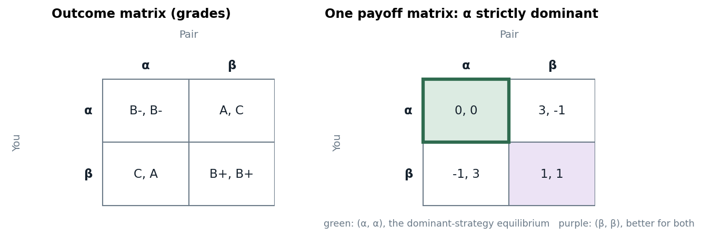

# Slides 2–14, 19 · What a game is, and how to write one down

> **Claim.** A game is a decision problem in which **my payoff depends on your choice and yours
> on mine**, so each player must reason about the others' reasoning. The normal form
> $G=\langle I,\{S_i\}_{i\in I},\{u_i\}_{i\in I}\rangle$ is the minimum bookkeeping for that: who
> plays, what each can do, and **how every profile of choices is valued by every player**. An
> outcome table (grades, prison years, prices) is not yet a game; it becomes one only when the
> outcomes are turned into payoffs.
>
> Prev: — · Next: [[L01-02-information-and-strategies]] · Map: [[L01-00-map]]

---

## 1 · U — why decision theory is not enough

Tadelis opens Ch. 3 with the student's own problem (pp. 43–44): you choose how hard to study,
but **grades are set on a curve**, so your outcome depends on how hard everyone else studies.
Treating classmates as random "noise" would be inconsistent: they optimize too, and they are
guessing what you will do. The slides put the same idea in three words (slide 2):

| Ingredient | Meaning | New relative to Micro I? |
|---|---|---|
| **Model** | abstract from behaviour to expose the logic of strategic choice | no |
| **Rationality** | choices follow preferences, represented by a utility function (methodological individualism) | no |
| **Interdependence** | $u_i$ depends on the actions of **all** players | **yes** |

> **Strategic reasoning is reasoning about reasoning** (slide 3): my best action depends on what I
> expect you to do, and what you do depends on what you expect me to do. Game theory formalizes
> the interaction between **preferences** and **expectations**.

Tadelis splits a **static game** into two steps (p. 44): (1) each player chooses an action
*simultaneously and independently*, meaning **without observing** the others' choices (not
necessarily at the same instant); (2) payoffs are distributed as a function of the profile.
Gibbons makes the same point (p. 4): the prisoners need not decide at the same moment, only
without knowing the other's choice.

## 2 · C — the normal form

**Slides (13):** a normal-form game is a triple $G=\langle I,\{S_i\}_{i\in I},\{u_i\}_{i\in I}\rangle$ where

- $I=\{1,2,\dots,n\}$ is the set of players;
- $S_i$ is the set of (pure) strategies of player $i$;
- $u_i:S_1\times\dots\times S_n\to\mathbb R$ is player $i$'s payoff function.

**Tadelis, Definition 3.3 (p. 47):** a finite set of players $N=\{1,\dots,n\}$, a collection of
pure-strategy sets $\{S_1,\dots,S_n\}$, and payoff functions $\{v_1,\dots,v_n\}$ with
$v_i:S_1\times\dots\times S_n\to\mathbb R$. **Definition 3.2 (p. 46):** a *pure strategy* is a
deterministic plan of action; a profile is $s=(s_1,\dots,s_n)$ with $s_i\in S_i$.

| Object | Slides | Tadelis | Gibbons (p. 4) | MWG (§7.D, §8.A) |
|---|---|---|---|---|
| players | $I$ | $N$ | $1,\dots,n$ | $I$ |
| payoff | $u_i$ | $v_i$ | $u_i$ | $u_i$ |
| the game | $\langle I,\{S_i\},\{u_i\}\rangle$ | $\langle N,\{S_i\}_{i=1}^n,\{v_i\}_{i=1}^n\rangle$ | $\{S_1,\dots,S_n;u_1,\dots,u_n\}$ | $\Gamma_N=[I,\{S_i\},\{u_i(\cdot)\}]$ |

These notes use the **slides' notation** ($I$, $u_i$) and cite Tadelis's numbering.

### 2.1 · The notation for "everyone else" (slide 14; Tadelis §4.1.1, p. 59)

$$S=S_1\times\dots\times S_n,\qquad s=(s_1,\dots,s_n)\in S,$$
$$s_{-i}=(s_1,\dots,s_{i-1},s_{i+1},\dots,s_n)\in S_{-i}=\prod_{j\neq i}S_j,\qquad s=(s_i,s_{-i}).$$

> **$(s_i,s_{-i})$ is a reordering for reading, not a new object**: it lists the same profile with
> player $i$'s entry pulled out front. Every dominance statement in this lecture is a statement
> "for all $s_{-i}\in S_{-i}$", so $|S_{-i}|=\prod_{j\ne i}|S_j|$ is the number of inequalities to
> check.

### 2.2 · Finite two-player games are matrices (Tadelis §3.2, pp. 50–52)

**Definition 3.4 (p. 51):** a *finite game* has finitely many players and finitely many
strategies for each. A two-player finite game is a **bimatrix**: rows are $S_1$, columns are
$S_2$, and the cell $(r,c)$ holds $(u_1(r,c),u_2(r,c))$ — player 1's payoff first (slide 11;
Gibbons p. 3). Cournot (a continuum of quantities) and the three-player voting game (pp. 49–50)
are normal-form games that are **not** single matrices.

---

## 3 · Worked — the grade game (slides 10–12, 19)

Each student writes $\alpha$ or $\beta$ without seeing the partner's sheet. The **outcome
matrix** lists grades (You, Pair):

| You \ Pair | $\alpha$ | $\beta$ |
|---|---|---|
| $\alpha$ | B−, B− | A, C |
| $\beta$ | C, A | B+, B+ |

The slide's question (11) is the point: **how does each person value their own grade, and the
other's?** Until that is fixed there is no game. Slide 12 proposes one set of payoffs, a selfish
student with $A\mapsto3$, B+ $\mapsto1$, B− $\mapsto0$, C $\mapsto-1$:

| You \ Pair | $\alpha$ | $\beta$ |
|---|---|---|
| $\alpha$ | **0, 0** | 3, −1 |
| $\beta$ | −1, 3 | 1, 1 |

**Example 2 (slide 19), written out.** $I=\{1,2\}$ (You, Pair); $S_1=S_2=\{\alpha,\beta\}$;

$$u_1(\alpha,\alpha)=0,\quad u_1(\alpha,\beta)=3,\quad u_1(\beta,\alpha)=-1,\quad u_1(\beta,\beta)=1,$$
$$u_2(s_1,s_2)=u_1(s_2,s_1)\quad\text{(the game is symmetric)}.$$

Four profiles, two payoff numbers each: the eight entries of the bimatrix are the whole of
$\{u_i\}$.

*The same situation as an outcome table and as a game: only the right-hand table can be solved. Source: slides 11–12.*

On the right, $\alpha$ beats $\beta$ for You whatever Pair writes ($0>-1$ and $3>1$), so the
selfish student writes $\alpha$; by symmetry so does Pair, and both get B− although both
prefer B+. That is the prisoner's dilemma of [[L01-04-dominance]] §3 and
[[L01-05-pareto-social-dilemmas]] §2. Change the payoffs (a student who also values the pair's
grade) and the same outcome table becomes a different game with a different prediction —
Tadelis's "altruistic" prisoner's dilemma makes the point with prison years (p. 53;
[[L01-05-pareto-social-dilemmas]] §4).

---

## 4 · Worked — the three examples of slide 4 in normal form

### 4.1 · Partnership (two partners)

$I=\{1,2\}$, $S_i=\{E,S\}$. Output is $y$ times the number of partners who exert effort, split
equally; effort costs the partner who exerts it $c>0$. With $k$ efforts, each partner receives
$yk/2$, so

| 1 \ 2 | $E$ | $S$ |
|---|---|---|
| $E$ | $y-c,\ y-c$ | $\tfrac y2-c,\ \tfrac y2$ |
| $S$ | $\tfrac y2,\ \tfrac y2-c$ | $0,\ 0$ |

Every cell is "half of output, minus own cost": e.g. $(E,S)$ gives output $y$, so partner 1
gets $y/2-c$ and partner 2 gets $y/2$. Solved in [[L01-04-dominance]] §4.

### 4.2 · Cournot duopoly — Tadelis §3.1.2 (p. 49)

Two identical firms, cost $c_i(q_i)=q_i^2$, inverse demand $p=100-q$ with $q=q_1+q_2$.
Normal form: $N=\{1,2\}$, $S_i=[0,\infty)$, and for $i\neq j$

$$v_i(s_i,s_j)=\begin{cases}(100-s_i-s_j)\,s_i-s_i^2 & s_i+s_j<100\\ -s_i^2 & s_i+s_j\ge100\end{cases}$$

(the second line because price cannot fall below zero). The **competitive benchmark** (p. 49,
fn. 4): $MC=2q_i=p$ gives supply $q_i=p/2$, market supply $q=p$, and $p=100-p$ yields
$p=50$, $q_i=25$, profit $50\cdot25-25^2=625$. Cournot's objection: a firm that sees its effect
on price does better. If firm 1 cuts to $q_1=24$, $q=49$, $p=51$, and

$$v_1=51\cdot24-24^2=1224-576=648>625.$$

So price-taking is not a rational prediction once each firm knows it moves the price; what it
*should* produce depends on the rival's quantity — the strategic problem. Tadelis solves the
linear-cost version by iterated elimination in §4.2.2 → [[L01-07-cournot-iesds]].

### 4.3 · Second-price auction (slide 4)

$n\ge2$ buyers, values $v_1,\dots,v_n$ (part of the payoffs, hence common knowledge in this
lecture). $S_i=[0,\infty)$ (bids). With $m_i=\max_{j\ne i}b_j$:

$$u_i(b_i,b_{-i})=\begin{cases}v_i-m_i & b_i>m_i\\[2pt] \dfrac{v_i-m_i}{\#\{j:b_j=b_i\}} & b_i=m_i\\[4pt] 0 & b_i<m_i\end{cases}$$

The price is the **second**-highest bid, so the winner's own bid sets *whether* she wins, never
*what* she pays. That separation is why bidding $v_i$ is weakly dominant →
[[L01-04-dominance]] §6.

---

## 5 · G — MWG's normal form (§7.D, p. 228)

MWG builds the normal form from the extensive form: a strategy is a **complete contingent plan**
(a function from a player's information sets to actions), and $\Gamma_N=[I,\{S_i\},\{u_i(\cdot)\}]$
records only what each profile of plans yields. This is the "key fact" of slide 15 — every
dynamic game has a normal form — and it is used from [[../L03/L03-00-map|Lecture 3]] on.
Named here; not examinable beyond the slides' statement.

---

## Links

- Next: information, common knowledge and strategies → [[L01-02-information-and-strategies]].
- The games of §3–§4 solved: [[L01-04-dominance]], [[L01-07-cournot-iesds]].
- Python: building payoff arrays for these games → [[L01-11-python]] §1.
- Rules pack: [[../../rules/game-theory|rules/game-theory]] rule 1 ("specify the game completely before solving").
- Practice: `Listas/pratica-lecture-01.md` items 1–4, 9–10 (Tadelis 3.2, 3.4, 3.6, 3.7, p. 58; Muñoz-Garcia Ch. 1 Ex. 2 p. 4, Ex. 5 p. 8); quiz `Simulados/quiz-lecture01-1-normal-form-2026-10-13.md`.
