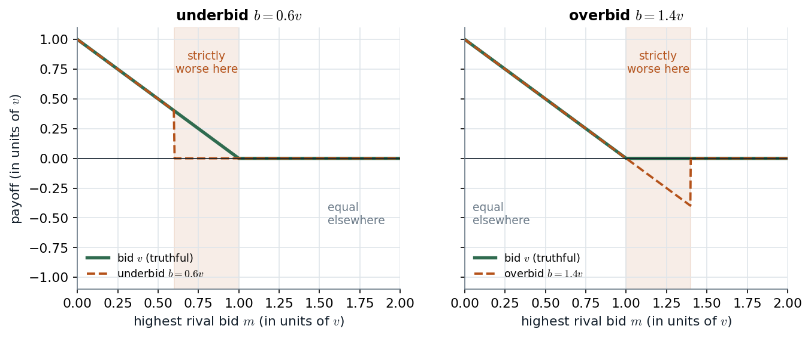

# Slides 23–25, 27 · Dominance and dominant-strategy equilibrium

> **Claim.** If one strategy pays more than another **against every possible choice of the
> others**, a rational player never uses the worse one (Lesson 1). When every player has a
> strategy that beats all his others in this way, the profile of those strategies is the
> **strict dominant-strategy equilibrium**: it needs only rationality, it is unique (Prop. 4.1),
> and it is robust. Its weakness is existence: most games have no dominant strategies. Weak
> dominance (ties allowed) is useful — truthful bidding in a second-price auction — but it is
> neither robust nor a consequence of rationality alone.
>
> Prev: [[L01-03-solution-concepts]] · Next: [[L01-05-pareto-social-dilemmas]] · Map: [[L01-00-map]]

---

## 1 · C — the definitions (slide 23)

Let $s_i,s_i'\in S_i$.

| Term | Definition | Source |
|---|---|---|
| $s_i$ **strictly dominated** by $s_i'$ | $u_i(s_i,s_{-i})<u_i(s_i',s_{-i})$ for **all** $s_{-i}\in S_{-i}$ | slide 23; Tadelis Def. 4.1 (p. 60), written $s_i'\succ_i s_i$; MWG Def. 8.B.2 |
| $s_i$ **weakly dominated** by $s_i'$ | $u_i(s_i,s_{-i})\le u_i(s_i',s_{-i})$ for all $s_{-i}$, **with strict inequality for at least one** $s_{-i}$ | slide 23; MWG Def. 8.B.3 (p. 238) |
| **strictly (weakly) dominant** | strictly (weakly) dominates **every other** strategy of that player | slide 23; Tadelis Def. 4.2 (p. 61); MWG Def. 8.B.1 |

**Claim 4.1 (Tadelis p. 60).** *A rational player will never play a strictly dominated strategy.*
If he did, the dominating strategy would give him more whatever the others do, so he could not be
maximizing under any belief. This is **Lesson 1** (slide 25).

> **The quantifier is the definition.** "Strictly dominated" is "for all $s_{-i}$, there is one
> $s_i'$ that does better" — **one fixed alternative, against everything**. It is *not* "for each
> $s_{-i}$ some alternative does better" (Cabral p. 162 warns about exactly this; §7.1 below).

### 1.1 · How many inequalities

To show $s_i'$ strictly dominates $s_i$: $|S_{-i}|$ strict inequalities. To show $s_i^*$ strictly
dominant: $(|S_i|-1)\,|S_{-i}|$ of them. In a 3×3 game, a dominance claim between two rows is 3
inequalities; a dominant-row claim is 6.

## 2 · C — dominant-strategy equilibrium (slide 25)

**Definition 4.3 (Tadelis p. 61; slide 25).** $s^D\in S$ is a *strict dominant-strategy
equilibrium* if, for every $i\in I$, $s_i^D$ is a strictly dominant strategy.

**Proposition 4.1 (Tadelis p. 61; slide 25).** *If $G$ has a strict dominant-strategy
equilibrium $s^D$, then $s^D$ is its unique dominant-strategy equilibrium.*

*Proof.* Suppose $s'\neq s^D$ were also a strict dominant-strategy equilibrium. Then
$s_i'\neq s_i^D$ for some player $i$. Because $s_i^D$ is strictly dominant and $s_i'\ne s_i^D$,
$$u_i(s_i^D,s_{-i})>u_i(s_i',s_{-i})\quad\text{for all } s_{-i}.$$
But $s_i'$ strictly dominant would require $u_i(s_i',s_{-i})>u_i(s_i^D,s_{-i})$ for all $s_{-i}$ —
the opposite inequality at every $s_{-i}$. Contradiction; so $s'=s^D$. $\blacksquare$

(Tadelis leaves this proof as exercise 4.1, p. 76.)

## 3 · Worked — the prisoner's dilemma (slide 24; Tadelis p. 52)

| 1 \ 2 | M | F |
|---|---|---|
| M | −2, −2 | −5, −1 |
| F | −1, −5 | **−4, −4** |

Player 1, F against M, column by column (the lawyer's argument, Tadelis p. 53):

| Player 2 plays | $u_1(F,\cdot)$ | $u_1(M,\cdot)$ | F better? |
|---|---|---|---|
| M | −1 | −2 | $-1>-2$ ✓ |
| F | −4 | −5 | $-4>-5$ ✓ |

So F strictly dominates M; with two strategies, F is strictly dominant. By symmetry the same
holds for player 2, and **(F, F) is the unique strict dominant-strategy equilibrium**, with
payoffs (−4, −4). Gibbons's version (p. 3) uses months in jail ($-1,-9,0,-6$); what makes it a PD
is only the ordering $T>R>P>S$ (temptation, reward, punishment, sucker; Gibbons pp. 4–5), here
$-1>-2>-4>-5$. The **grade game** of slide 12 has the same structure ($3>1>0>-1$): $\alpha$ is
strictly dominant for both ([[L01-01-games-normal-form]] §3).

## 4 · Worked — the partnership (slide 4)

From the matrix of [[L01-01-games-normal-form]] §4.1, compare $E$ with $S$ for partner 1:

$$u_1(E,E)-u_1(S,E)=(y-c)-\tfrac y2=\tfrac y2-c,\qquad u_1(E,S)-u_1(S,S)=(\tfrac y2-c)-0=\tfrac y2-c .$$

**The gain from effort does not depend on what the other partner does.** Hence

| Cost | Result |
|---|---|
| $c<y/2$ | $E$ strictly dominant for both; (E, E) the strict DSE |
| $c>y/2$ | $S$ strictly dominant for both; (S, S) the strict DSE |
| $c=y/2$ | $E$ and $S$ pay the same against everything: neither dominates the other, **not even weakly** |

With $n$ partners and output $y$ per effort split $n$ ways, the gain is $y/n-c$, for the same
reason: my effort raises *my* share by $y/n$ whatever the others do. Whether the dominant choice
is *good for the partnership* is a separate question → [[L01-05-pareto-social-dilemmas]] §3.

> **Interactive companion.** [Shirk or Work](companions/companion-partnership-dominance.html) —
> move $c$, $y$ and $n$ and watch the two payoff lines stay parallel: the gap $y/n-c$ is the whole
> dominance verdict.

## 5 · Worked — Example 3 (slide 27) and the advertising game

**Slide 27 = Tadelis matrix (4.1), p. 64.** *Does any player have a dominant strategy? Are there
dominated strategies?*

| 1 \ 2 | L | C | R |
|---|---|---|---|
| U | 4, 3 | 5, 1 | 6, 2 |
| M | 2, 1 | 8, 4 | 3, 6 |
| D | 3, 0 | 9, 6 | 2, 8 |

*Player 1* (compare rows column by column):

| Pair | L | C | R | Verdict |
|---|---|---|---|---|
| U vs M | 4 > 2 | 5 < 8 | 6 > 3 | no dominance |
| U vs D | 4 > 3 | 5 < 9 | 6 > 2 | no dominance |
| M vs D | 2 < 3 | 8 < 9 | 3 > 2 | no dominance |

No row dominates another, so player 1 has **no dominated and no dominant strategy**.

*Player 2* (compare columns row by row):

| Pair | U | M | D | Verdict |
|---|---|---|---|---|
| R vs C | 2 > 1 | 6 > 4 | 8 > 6 | **C strictly dominated by R** |
| L vs R | 3 > 2 | 1 < 6 | 0 < 8 | no dominance |
| L vs C | 3 > 1 | 1 < 4 | 0 < 6 | no dominance |

Player 2 has one dominated strategy (C) and no dominant one (L and R each win somewhere). So
**no dominant-strategy equilibrium exists** — yet removing C is where IESDS starts
([[L01-06-iesds]] §3).

**Tadelis's advertising game (p. 60)**, rows/columns L, M, H: L is strictly dominated by M for
each player ($8>6$, $4>2$, $1>0$), but neither M nor H is dominated (M is best against M, H
against H). Rationality alone removes L and stops there.

## 6 · Worked — weak dominance in the second-price auction (slide 4)

Bidder $i$ with value $v$ compares bidding $v$ with any other bid $b$, for every highest rival bid
$m$ (payoffs from [[L01-01-games-normal-form]] §4.3; $k\ge2$ is the number tied).

**Underbid, $b<v$:**

| Rival bid $m$ | Bid $v$ | Bid $b$ | Comparison |
|---|---|---|---|
| $m<b$ | win, $v-m$ | win, $v-m$ | equal |
| $m=b$ | win, $v-m>0$ | tie, $(v-m)/k$ | $v$ **strictly better** |
| $b<m<v$ | win, $v-m>0$ | lose, 0 | $v$ **strictly better** |
| $m=v$ | tie, $0$ | lose, 0 | equal |
| $m>v$ | lose, 0 | lose, 0 | equal |

**Overbid, $b>v$:**

| Rival bid $m$ | Bid $v$ | Bid $b$ | Comparison |
|---|---|---|---|
| $m<v$ | win, $v-m$ | win, $v-m$ | equal |
| $m=v$ | tie, 0 | win, $v-m=0$ | equal |
| $v<m<b$ | lose, 0 | win, $v-m<0$ | $v$ **strictly better** |
| $m=b$ | lose, 0 | tie, $(v-m)/k<0$ | $v$ **strictly better** |
| $m>b$ | lose, 0 | lose, 0 | equal |

So bidding $v$ is **never worse and sometimes strictly better**: it weakly dominates every other
bid, i.e. it is **weakly dominant**. It is *not* strictly dominant, and no bid is strictly
dominated: against an $m$ below both bids, all bids tie.

*Truthful bidding loses nothing anywhere and gains in the band between the two bids: weak, not strict, dominance. Payoffs from the second-price rule of slide 4; bids in units of $v$ (illustrative).*

The shaded band is the only place the bid matters: there the underbidder loses an auction worth
winning, and the overbidder wins one worth losing (paying $m>v$). Everywhere else the price is
set by someone else's bid, which is the whole logic of the second-price rule.

## 7 · C — weak vs strict, and a definitional trap

| | Strict | Weak |
|---|---|---|
| Follows from rationality alone? | **yes** (Claim 4.1) | no: a player sure that $s_{-i}$ is one where the two strategies tie can rationally use the weakly dominated one (MWG p. 238) |
| Invariant to small payoff changes? | **yes** | **no** ([[L01-03-solution-concepts]] §3.2) |
| Iterated elimination order-independent? | **yes** | **no** ([[L01-06-iesds]] §6) |
| Dominant-strategy equilibrium unique? | **yes** (Prop. 4.1) | depends on the definition — below |

> **Trap.** Tadelis's remark (p. 63) defines "weakly dominated" with $\le$ for all $s_{-i}$ and
> **no** strictness requirement, and says a weakly dominant equilibrium "need not be unique"
> (his exercise 4.2). With the **slides' definition** (MWG Def. 8.B.3: strict for at least one
> $s_{-i}$), a player has **at most one** weakly dominant strategy: if $s$ and $s'$ both weakly
> dominated each other, then $u_i(s,\cdot)\ge u_i(s',\cdot)$ and $u_i(s',\cdot)\ge u_i(s,\cdot)$
> everywhere, so they are equal everywhere and neither can be strictly better anywhere. On an exam,
> state which definition you use.

### 7.1 · Never the best reply, yet not dominated (Cabral p. 162)

Player 1's payoffs (original numbers, in the spirit of Cabral's modified Figure 7.2):

| | L | R |
|---|---|---|
| T | 3 | 0 |
| M | 1 | 1 |
| B | 0 | 3 |

Against L, T beats M ($3>1$); against R, B beats M ($3>1$). So **for each column some row beats
M** — but no single row does it against both: T fails at R ($0<1$), B fails at L ($0<1$). M is
**not strictly dominated by any pure strategy**. (It is dominated by the 50–50 mix of T and B,
which pays $1.5>1$ in both columns — dominance by mixed strategies, [[../L02/L02-00-map|Lecture 2]].)

---

## Links

- Prev / next: [[L01-03-solution-concepts]] · [[L01-05-pareto-social-dilemmas]].
- Dominated strategies removed repeatedly: [[L01-06-iesds]]. Strictly dominated strategies are never best responses (Tadelis Prop. 4.3, p. 70) and dominance by *mixed* strategies (MWG Prop. 8.B.1, p. 241) → [[../L02/L02-00-map|Lecture 2]].
- Python: `strictly_dominated`, `dominant`, the SPA check → [[L01-11-python]] §2, §6.
- Rules pack: [[../../rules/game-theory|rules/game-theory]] rule 6 ("start with dominance").
- Practice: `Listas/pratica-lecture-01.md` items 5, 11–13, 22–24 (Muñoz-Garcia Ch. 1 Ex. 13 p. 26; Tadelis 4.1, 4.2 p. 76, 4.4 pp. 76–77; MWG 8.B.1, 8.B.3, 8.B.7 p. 262); `Listas/lista-lecture-01.tex` Q1(b)–(c); quiz `Simulados/quiz-lecture01-2-dominance-pareto-2026-10-13.md` (sections `dom`, `partnership`, `auction`).
