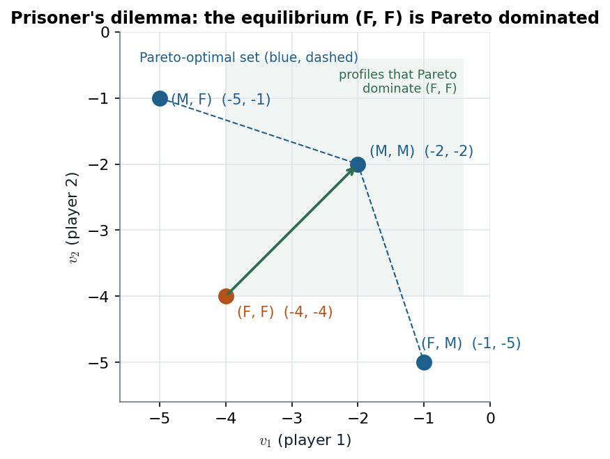
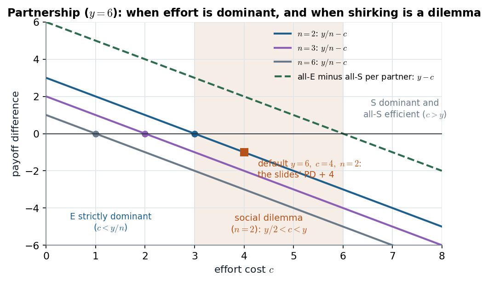

# Slide 26 · Pareto optimality, and why rational play can waste value

> **Claim.** Pareto optimality judges *outcomes* (can someone gain without anyone losing?);
> dominance and equilibrium predict *behaviour* (what will self-interested players do?). The two
> can disagree: in the prisoner's dilemma every player has a strictly dominant strategy and the
> resulting profile is Pareto dominated (**Lesson 2**). The disagreement has a precise source —
> each player ignores the effect of his choice on the others — and a precise remedy: change the
> game (a contract, a sanction, ownership), because no amount of reasoning inside the game
> removes it.
>
> Prev: [[L01-04-dominance]] · Next: [[L01-06-iesds]] · Map: [[L01-00-map]]

---

## 1 · C — the definition (slide 26; Tadelis Def. 3.5, p. 57)

$s\in S$ **Pareto dominates** $s'\in S$ if $u_i(s)\ge u_i(s')$ for all $i\in I$ and
$u_i(s)>u_i(s')$ for at least one $i$. A profile is **Pareto optimal** if no other profile Pareto
dominates it.

> **Lesson 2 (slide 26): individually rational choices can lead to socially undesirable
> outcomes.**

Two clarifications from Tadelis (p. 57):

- **Pareto optimal is not "fair" or "symmetric".** In the PD, (M, F) and (F, M) are Pareto
  optimal too: no other profile makes the sucker better off without hurting the finker.
- **The criterion is incomplete.** It cannot rank $(5,5)$ against $(6,60)$ in Tadelis's
  footnote 8 sense of equity; it only rules out *waste*. It says nothing about which Pareto
  optimal profile is "best".

## 2 · Worked — the prisoner's dilemma, every pair compared

Payoffs (Tadelis p. 48): $(M,M)=(-2,-2)$, $(M,F)=(-5,-1)$, $(F,M)=(-1,-5)$, $(F,F)=(-4,-4)$.

| Profile | Dominated by | Why | Pareto optimal? |
|---|---|---|---|
| (F, F) | (M, M) | $-2>-4$ for both | **no** |
| (M, M) | — | (M, F) and (F, M) each hurt one player ($-5<-2$) | yes |
| (M, F) | — | anything better for 1 gives 2 less than $-1$ | yes |
| (F, M) | — | symmetric | yes |

*The unique dominant-strategy equilibrium (orange) lies strictly inside the set of profiles that would make both players better off. Source: Tadelis p. 48 (payoffs) and Def. 3.5, p. 57.*

The equilibrium is the **only** profile that is not Pareto optimal. The figure shows why the
dilemma is structural: moving from (F, F) to (M, M) requires *both* players to switch, and each
switch alone is a move to a sucker payoff.

**The grade game** (slide 12) is the same: $(\alpha,\alpha)=(0,0)$ is the strict DSE and is
Pareto dominated by $(\beta,\beta)=(1,1)$. **Cabral's Figure 7.1** (p. 161) reads it as pricing:
both firms prefer (high, high) $=(5,5)$ to (low, low) $=(4,4)$, yet low is dominant ($6>5$,
$4>3$).

## 3 · Worked — the partnership's dilemma band

With $n$ partners (slide 4, generalized), [[L01-04-dominance]] §4 gave the private gain from
effort $y/n-c$, the same against every profile of the others. Compare the two symmetric
profiles: all exert effort, each gets $\frac{ny}{n}-c=y-c$; all shirk, each gets $0$. So:

| Condition | Meaning |
|---|---|
| $c>y/n$ | $S$ strictly dominant: all-S is the strict DSE |
| $c<y$ | all-E gives each partner $y-c>0$: **all-E Pareto dominates all-S** |
| $\boxed{\ y/n<c<y\ }$ | **social dilemma**: the dominant-strategy outcome is Pareto dominated |

**Why the band exists.** Effort produces $y$ at cost $c$; the partnership gains when $y>c$. But
the partner who bears the whole cost receives only $y/n$ of the product; the other
$(n-1)y/n$ goes to partners who did nothing for it. The private return understates the social
return by the factor $n$, and the band $y/n<c<y$ is exactly where that gap changes the sign of
the decision. **It widens with $n$** — the free-rider problem of team production.

*Each solid line is the private gain from effort, $y/n-c$; the dashed line is the per-partner gain from everyone working, $y-c$. Between the two zeros, shirking is dominant and wasteful. Source: slide 4's partnership with $y=6$; the square ($c=4$, $n=2$) is Tadelis's PD (p. 48) with 4 added to every payoff.*

At $y=6$, $c=4$, $n=2$ the matrix is $(E,E)=(2,2)$, $(E,S)=(-1,3)$, $(S,E)=(3,-1)$, $(S,S)=(0,0)$ —
the slides' prisoner's dilemma shifted by $+4$, so the partnership **is** a PD whenever it is in
the band. Adding partners at fixed $y$ moves the zero of the private line left ($y/n$) while the
social zero stays at $y$: the band only grows.

> **Interactive companion.** [Shirk or Work](companions/companion-partnership-dominance.html) —
> set $n$ and drag $c$ across the two landmarks $c=y/n$ and $c=y$; the verdict switches from
> "effort dominant" to "dilemma" to "shirking dominant and efficient".

## 4 · Worked — changing the game

**The altruistic PD (Tadelis p. 53).** If each year in prison costs the prisoner $1$ and his
partner $\tfrac12$:

| 1 \ 2 | M | F |
|---|---|---|
| M | $-2-1=-3,\ -3$ | $-5-\tfrac12=-5\tfrac12,\ -1-\tfrac52=-3\tfrac12$ |
| F | $-3\tfrac12,\ -5\tfrac12$ | $-4-2=-6,\ -6$ |

Now M is strictly dominant ($-3>-3\tfrac12$, $-5\tfrac12>-6$): cooperation, because the
*payoffs* changed. "Garbage in, garbage out" (p. 53).

**The mafia-modified PD (Tadelis pp. 62–63).** A sanction $z$ on every finker:

| 1 \ 2 | M | F |
|---|---|---|
| M | −2, −2 | −5, −1 − z |
| F | −1 − z, −5 | −4 − z, −4 − z |

M beats F for player 1 against M iff $-2>-1-z\iff z>1$, and against F iff $-5>-4-z\iff z>1$.
So **any sanction $z>1$ makes M strictly dominant** and (M, M) the Pareto-optimal DSE. If players
believe the code is enforced, it is never used. Whether the enforcer will actually punish is a
question about *his* incentives — repeated games, [[../L05/L05-00-map|Lecture 5]] and
[[../L06/L06-00-map|Lecture 6]].

**Milgrom & Roberts, Table 5.1 (pp. 138–139): grabbing in a joint venture.** Each firm invests
2 in a cospecialized asset; gross return 8; grabbing costs 3 and takes everything if the other
does not grab. Payoffs (A as row player; M&R print A on the columns):

| A \ B | Grab | Don't |
|---|---|---|
| Grab | $4-2-3=-1,\ -1$ | $8-2-3=3,\ 0-2=-2$ |
| Don't | $-2,\ 3$ | $4-2=2,\ 2$ |

Grab is strictly dominant ($3>2$, $-1>-2$), so (Grab, Grab) $=(-1,-1)$ is the DSE, Pareto
dominated by $(2,2)$. M&R's twist (p. 139): **the firms do not have to play**. Anticipating
$-1$ each, they compare investing ($-1$) with not investing ($0$) and do not invest — the
hold-up problem: opportunism that cannot be contracted away destroys the investment itself.
Remedies they list: common ownership, reputation, costly commitment.

## 5 · C — Pareto and the other solution concepts

| Game | Prediction | Pareto dominated by | Source |
|---|---|---|---|
| PD | (F, F), payoffs (−4, −4) | (M, M) | Tadelis p. 62 |
| Matrix (4.1) | IESDS: (U, L), payoffs (4, 3) | (M, C) = (8, 4), (D, C) = (9, 6) | Tadelis p. 68 |
| Cournot, $p=100-q$, $c=10$ | IESDS: $q_i=30$, profit 900 | $q_i=20$: profit 1000 | Tadelis p. 68 |

> **The failure of Pareto optimality is not a failure of the solution concept** (Tadelis p. 62):
> it is a correct prediction that the players, left to their own devices and unable to make
> binding agreements, waste value. It points to where institutions pay.

---

## Links

- Prev / next: [[L01-04-dominance]] · [[L01-06-iesds]].
- The same tension with Nash equilibrium and repeated play: [[../L02/L02-00-map|Lecture 2]], [[../L05/L05-00-map|Lecture 5]], [[../L06/L06-00-map|Lecture 6]].
- Python: `pareto_optimal`, the partnership band, the mafia threshold → [[L01-11-python]] §2, §4.
- Rules pack: [[../../rules/game-theory|rules/game-theory]] rule 20 (zero-sum framing of positive-sum play); M&R hold-up in [[../../rules/06_racionalidade_limitada_contratos|rules/06]].
- Practice: `Listas/lista-lecture-01.tex` Q1(a) (partnership with synergy), Q1(d) (Pareto with $n$ players), Q2 (continuous effort); quiz `Simulados/quiz-lecture01-2-dominance-pareto-2026-10-13.md` (sections `partnership`, `pareto`); `Listas/pratica-lecture-01.md` item 13 (MWG 8.B.1, p. 262).
