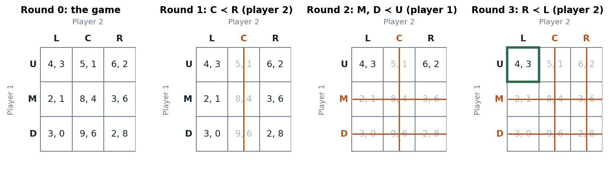

# Slides 27–29 · Iterated elimination of strictly dominated strategies

> **Claim.** Rationality removes strictly dominated strategies; **common knowledge of
> rationality** lets every player remove the others' dominated strategies too, look at the
> smaller game, and remove what has *become* dominated there — again and again. Each round costs
> one more level of "I know that you know that …". The procedure always exists in finite games,
> its result does not depend on the order of removal, it contains any strict dominant-strategy
> equilibrium as its unique survivor (Prop. 4.2), and it often leaves many profiles standing.
>
> Prev: [[L01-05-pareto-social-dilemmas]] · Next: [[L01-07-cournot-iesds]] · Map: [[L01-00-map]]

---

## 1 · U — the idea (slide 28; Tadelis §4.2.1, pp. 63–64)

1. A rational player never plays a strictly dominated strategy (Claim 4.1).
2. If all players know this, each can **ignore the others' strictly dominated strategies** —
   everyone is effectively playing a smaller game.
3. In the smaller game, strategies that were not dominated before may be dominated now; and the
   others can reason the same way.
4. This works because **rationality is common knowledge** (slide 28); repeat until nothing more
   can be removed.

## 2 · C — the procedure, formally (slide 29)

Let $S_i^0=S_i$. For each $k\ge1$ and each player $i$,

$$S_i^k=\Bigl\{s_i\in S_i^{k-1}:\ \nexists\, s_i'\in S_i^{k-1}\ \text{such that}\ u_i(s_i',s_{-i})>u_i(s_i,s_{-i})\ \ \forall s_{-i}\in S_{-i}^{k-1}\Bigr\},$$

$$S_i^\infty=\bigcap_{k\ge1}S_i^k .$$

Read the quantifiers: the dominator $s_i'$ must itself still be available ($S_i^{k-1}$), and the
inequality is required only against the opponents' **surviving** profiles ($S_{-i}^{k-1}$) — that
restriction is where knowledge of the others' rationality enters. Every player is pruned
**simultaneously** in each round.

Tadelis gives the same thing as an algorithm (p. 65): set $S_i^0=S_i$, $k=0$; if some
$s_i\in S_i^k$ is strictly dominated, remove every such strategy for every player, set $k=k+1$ and
repeat; otherwise stop — the remaining strategies are the prediction.

**Definition 4.4 (Tadelis p. 65; slide 29).** Any profile $s^{ES}=(s_1^{ES},\dots,s_n^{ES})$ that
survives IESDS is an **iterated-elimination equilibrium**.

**Proposition 4.2 (Tadelis p. 68; slide 29).** *If $s^*$ is a strict dominant-strategy
equilibrium, then $s^*$ is the unique profile that survives IESDS.*

*Proof.* For each $i$, $s_i^*$ strictly dominates every other $s_i\in S_i$ against all of
$S_{-i}=S_{-i}^0$. So in round 1 every $s_i\ne s_i^*$ is removed and $s_i^*$ is not (nothing
dominates it: it strictly beats everything). Hence $S_i^1=\{s_i^*\}$ for all $i$; a singleton has
nothing left to remove, so $S^\infty=\{s^*\}$. $\blacksquare$

> **One round needs only rationality; every later round needs one more level of knowledge.**
> That is why Prop. 4.2's survivor is as robust as the DSE itself, while an IESDS prediction
> reached after many rounds is only as credible as a long chain of mutual knowledge.

## 3 · Worked — Example 3 continued: matrix (4.1), round by round

The game of slide 27 (Tadelis (4.1), p. 64). [[L01-04-dominance]] §5 found no dominated strategy
for player 1 and one for player 2.

**Round 1** (needs: player 2 is rational). C ≺ R for player 2: $2>1$ (U), $6>4$ (M), $8>6$ (D).
Nothing for player 1. $S_1^1=\{U,M,D\}$, $S_2^1=\{L,R\}$.

| 1 \ 2 | L | R |
|---|---|---|
| U | 4, 3 | 6, 2 |
| M | 2, 1 | 3, 6 |
| D | 3, 0 | 2, 8 |

**Round 2** (needs: player 1 is rational **and knows** player 2 is rational). Against $\{L,R\}$
only: U vs M: $4>2$, $6>3$; U vs D: $4>3$, $6>2$. **M and D are both strictly dominated by U** —
neither was dominated in the full game, because C (where they paid 8 and 9) was still possible.
$S_1^2=\{U\}$, $S_2^2=\{L,R\}$.

**Round 3** (needs: player 2 is rational, knows player 1 is rational, and knows that player 1
knows player 2 is rational). Against U only: $u_2(U,L)=3>2=u_2(U,R)$, so R ≺ L.
$S_1^3=\{U\}$, $S_2^3=\{L\}$.

**Round 4:** nothing left to remove. **$S^\infty=\{(U,L)\}$**, payoffs $(4,3)$ (Tadelis p. 65).

*IESDS on matrix (4.1): each round strikes what the previous rounds made dominated. Source: slide 27; Tadelis p. 64–65.*

Read the second panel against the third: M and D survive round 1 only because column C
protects them, and they fall the moment C is gone. Elimination is **cumulative** — later rounds
are possible only because earlier ones happened. Note also that the survivor (4, 3) is Pareto
dominated by (M, C) and (D, C) ([[L01-05-pareto-social-dilemmas]] §5).

## 4 · Worked — Gibbons's Figure 1.1.1 (pp. 5–7)

| 1 \ 2 | Left | Middle | Right |
|---|---|---|---|
| Up | 1, 0 | 1, 2 | 0, 1 |
| Down | 0, 3 | 0, 1 | 2, 0 |

| Round | Removed | Inequalities | Knowledge used |
|---|---|---|---|
| 1 | Right (player 2) | Middle beats Right: $2>1$, $1>0$ | 2 rational |
| 2 | Down (player 1) | Up beats Down against {Left, Middle}: $1>0$, $1>0$ | 1 rational, knows 2 rational |
| 3 | Left (player 2) | Middle beats Left against Up: $2>0$ | 2 knows 1 knows 2 rational |

Survivor: **(Up, Middle)**. In the full game Up and Down are not ranked (Up wins at Left, Down
at Right) — Down falls only once Right is gone.

## 5 · C — evaluating IESDS (Tadelis §4.2.3, pp. 67–68)

| Criterion | Verdict | Why |
|---|---|---|
| **Existence** | always, in finite games | the procedure can always be run; each $S_i^k$ stays nonempty (a strategy that is best against some fixed $s_{-i}$ is never strictly dominated) and it stops after at most $\sum_i(\lvert S_i\rvert-1)$ rounds |
| **Uniqueness** | often fails | Battle of the Sexes: nothing is dominated, "anything can happen" (p. 68); Gibbons's Figure 1.1.4 (p. 7): a 3×3 game with no dominated strategy at all |
| **Invariance** | holds | every removal rests on strict inequalities ([[L01-03-solution-concepts]] §3.1) |
| **Pareto** | not guaranteed | PD, matrix (4.1), Cournot ([[L01-05-pareto-social-dilemmas]] §5) |
| **Assumptions** | heavy | common knowledge of rationality; Gibbons's first "drawback" (p. 7); Tadelis: players must be "extremely intelligent" (p. 68) |

> **IESDS is weaker than dominant-strategy equilibrium in what it predicts, stronger in where it
> applies.** It predicts exactly the DSE when one exists (Prop. 4.2), predicts something sharp
> in games with no dominant strategies (matrix (4.1), Cournot), and predicts nothing in games
> like the Battle of the Sexes.

## 6 · G — order of deletion (MWG pp. 239–240)

**Strict: order does not matter.** "If at any given point several strategies (of one or several
players) are strictly dominated, then we can eliminate them all at once or in any sequence
without changing the set of strategies that we ultimately end up with" (MWG p. 239–240;
proof is MWG Exercise 8.B.4, p. 262). The reason: if $s_i'$ beats $s_i$ against a set of opponent
profiles, it still beats it against any subset, so a strategy dominated now stays dominated
after other removals — as long as a dominator survives, which in a finite game is guaranteed
because a removed dominator was itself beaten by a survivor, and strict dominance is transitive.

**Weak: order matters** (MWG Figure 8.B.3, p. 238):

| 1 \ 2 | L | R |
|---|---|---|
| U | 5, 1 | 4, 0 |
| M | 6, 0 | 3, 1 |
| D | 6, 4 | 4, 4 |

D weakly dominates U ($6>5$, $4=4$) and M ($6=6$, $4>3$).

| Order | Step 1 | Step 2 (player 2 on the remaining rows) | Step 3 | Prediction |
|---|---|---|---|---|
| remove U first | rows {M, D} | R beats L: $1>0$, $4=4$ → remove L | at R: D $4>3$ M → remove M | **(D, R)** |
| remove M first | rows {U, D} | L beats R: $1>0$, $4=4$ → remove R | at L: D $6>5$ U → remove U | **(D, L)** |

A third order — remove U and then M before touching player 2 — leaves $\{D\}\times\{L,R\}$, where L and R tie at 4 and nothing more can go. Three orders, three different predictions — and player 2's payoff differs only through which of his
"ties" was broken first. MWG's diagnosis (p. 240): weak elimination assumes a player assigns
positive probability to every rival strategy, but iterated deletion assumes the deleted ones are
never played. The slides' IESDS uses **strict** dominance only.

**Infinite strategy sets** (G): with $S=[0,1)$ and $u(s)=s$, every $s$ is strictly dominated by
$(s+1)/2$, so nothing survives round 1 — existence needs finiteness (or compactness and
continuity). Cournot ([[L01-07-cournot-iesds]]) survives because profit is continuous and
strategies can be bounded.

---

## Links

- Prev / next: [[L01-05-pareto-social-dilemmas]] · [[L01-07-cournot-iesds]].
- The same logic on a line: [[L01-08-spatial-competition]]. IESDS survivors as best responses (Tadelis Prop. 4.4, p. 70), rationalizability and Nash → [[../L02/L02-00-map|Lecture 2]].
- Python: `iesds2` and the round log, reused from `Listas/lista-lecture-01-check.py` → [[L01-11-python]] §3.
- Rules pack: [[../../rules/game-theory|rules/game-theory]] rules 5–6.
- Practice: `Listas/pratica-lecture-01.md` items 6–8, 14, 19–20 (Tadelis 4.5 p. 77; Gibbons 1.2 p. 48; Muñoz-Garcia Ch. 1 Ex. 9 p. 17, Ex. 12 p. 23, Ex. 16 p. 31; MWG 8.B.4 p. 262); `Listas/lista-lecture-01.tex` Q3; quiz `Simulados/quiz-lecture01-3-iesds-2026-10-13.md` (sections `props`, `ck`).
