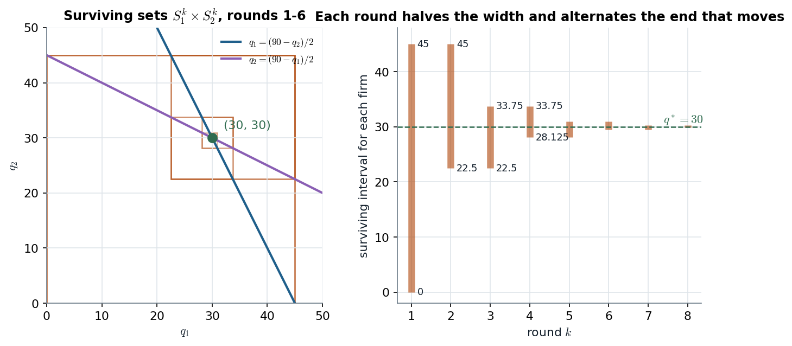

# Tadelis §4.2.2 · Cournot duopoly solved by iterated elimination

> **Claim.** With linear demand and constant marginal cost, a quantity above the monopoly output
> is strictly dominated (round 1); once rivals are known to stay below it, quantities too *low*
> become dominated (round 2); and so on. The surviving interval halves every round, alternately
> from above and below, and shrinks to the single point $q_1=q_2=30$ in Tadelis's example —
> a sharp prediction from dominance alone, in a game with a **continuum** of strategies and no
> dominant strategy. The prediction is not Pareto optimal for the firms: each would earn more if
> both produced less.
>
> Prev: [[L01-06-iesds]] · Next: [[L01-08-spatial-competition]] · Map: [[L01-00-map]]

---

## 1 · C — the game (Tadelis p. 65)

Two firms, cost $c_i(q_i)=10q_i$, inverse demand $p=100-q$, $q=q_1+q_2$. Firm 1's payoff:

$$v_1(q_1,q_2)=\underbrace{(100-q_1-q_2)\,q_1}_{\text{revenue}}-\underbrace{10q_1}_{\text{cost}}=90q_1-q_1^2-q_1q_2 .$$

**Best response.** For a given $q_2$, $v_1$ is concave in $q_1$; the first-order condition
$90-2q_1-q_2=0$ gives

$$q_1=\frac{90-q_2}{2}\qquad(4.2)$$

and symmetrically for firm 2. (If $q_2\ge90$ the best response is $q_1=0$.)

## 2 · Worked — round 1: everything above 45 is strictly dominated

Since $q_2\ge0$, (4.2) never exceeds $45$. Tadelis shows the dominance directly (p. 66):

$$v_1(45,q_2)=(100-45-q_2)45-450=2025-45q_2,$$

$$v_1(45,q_2)-v_1(q_1,q_2)=2025-45q_2-90q_1+q_1q_2+q_1^2 .$$

Group the terms (a factorization the book leaves as "easy to check", fn. 3):

$$=\underbrace{(q_1^2-90q_1+2025)}_{(q_1-45)^2}+\underbrace{(q_1q_2-45q_2)}_{q_2(q_1-45)}=(q_1-45)\,(q_1-45+q_2).$$

For $q_1>45$ and any $q_2\ge0$ both factors are positive, so **every $q_1>45$ is strictly
dominated by $q_1=45$**. Same for firm 2. After round 1: $q_i\in[0,45]$.

## 3 · Worked — the general step, and round 2

**Lemma (the step every round uses).** Write $v_i(x,q_j)-v_i(z,q_j)$ for two own quantities:

$$v_i(x,q_j)-v_i(z,q_j)=90(x-z)-(x^2-z^2)-q_j(x-z)=(x-z)\,\bigl(90-x-z-q_j\bigr).$$

- If the rival is known to produce **at most $U$**, let $x=(90-U)/2$ (the best reply to $U$). For
  any $z<x$ and any $q_j\le U$: $90-x-z-q_j>90-2x-U=0$, so $x$ strictly beats $z$. **Quantities
  below $BR(U)$ are dominated.**
- If the rival is known to produce **at least $L$**, let $x=(90-L)/2$. For any $z>x$ and $q_j\ge L$:
  $90-x-z-q_j<90-2x-L=0$, and $x-z<0$, so the product is again positive. **Quantities above
  $BR(L)$ are dominated.**

**Round 2.** Rivals are in $[0,45]$, so $L=0$, $U=45$: the lower bound becomes
$BR(45)=(90-45)/2=22.5$ and the upper bound stays $BR(0)=45$. Surviving: $[22.5,45]$.

**Round 3.** Rivals in $[22.5,45]$: lower bound $BR(45)=22.5$, upper bound
$BR(22.5)=(90-22.5)/2=33.75$. Surviving: $[22.5,\,33\tfrac34]$ (Tadelis p. 66).

## 4 · Worked — the whole sequence and its limit

The recursion is $L^k=BR(U^{k-1})$, $U^k=BR(L^{k-1})$, starting from $L^0=0$ and no upper bound
($BR$ of "anything" is at most 45).

| Round $k$ | $L^k$ | $U^k$ | Width $U^k-L^k$ | Endpoint that moved |
|---|---|---|---|---|
| 1 | 0 | 45 | 45 | upper |
| 2 | 22.5 | 45 | 22.5 | lower |
| 3 | 22.5 | 33.75 | 11.25 | upper |
| 4 | 28.125 | 33.75 | 5.625 | lower |
| 5 | 28.125 | 30.9375 | 2.8125 | upper |
| 6 | 29.53125 | 30.9375 | 1.40625 | lower |

**Why it halves.** Measure from 30: $BR(q)-30=\frac{90-q}{2}-30=-\frac{q-30}{2}$. Each application
of the best response **halves the distance to 30 and flips its side**. The endpoint updated at
round $k$ is therefore

$$30+15\left(-\tfrac12\right)^{k-1}\quad(45,\ 22.5,\ 33.75,\ 28.125,\dots),\qquad\text{width}=\frac{45}{2^{k-1}} .$$

**The limit (Tadelis p. 67).** If the process stopped at an interval $[q_{\min},q_{\max}]$, by
symmetry $q_{\min}=\frac{90-q_{\max}}{2}$ and $q_{\max}=\frac{90-q_{\min}}{2}$. Subtracting,
$q_{\max}-q_{\min}=\frac{q_{\max}-q_{\min}}{2}$, so $q_{\max}=q_{\min}=q$, and $q=\frac{90-q}{2}$ gives
$\mathbf{q=30}$. The width is positive after every finite round; the prediction is the
intersection $S_i^\infty=\bigcap_kS_i^k=\{30\}$.

*IESDS in the Cournot game: each square is the set of profiles still standing; the bars are the same intervals for one firm. Source: Tadelis eq. (4.2) and Figure 4.1, pp. 66–67; $p=100-q$, $c_i=10$.*

The left panel is Tadelis's Figure 4.1 drawn for both firms at once: the upper end of one
round's interval sets the lower end of the next through the best-response line. The right panel
makes the halving visible — after 6 rounds both firms are within $1.5$ units of 30.

**Profits** (Tadelis p. 68). At $q_1=q_2=30$: $p=40$, $v_i=(40-10)\cdot30=900$. If both produced
20: $p=60$, $v_i=50\cdot20=1000$. The joint optimum maximizes $(90-q)q$ at $q=45$, i.e. 22.5 each,
$p=55$, $v_i=45\cdot22.5=1012.5$. **IESDS is not Pareto optimal for the firms**
([[L01-05-pareto-social-dilemmas]] §5); collusion and its enforcement are
[[../L06/L06-00-map|Lecture 6]].

## 5 · C — general linear Cournot (asymmetric costs)

Demand $p=a-bq$, costs $c_1,c_2<a$. Then $BR_i(q_j)=\max\bigl\{0,\frac{a-c_i-bq_j}{2b}\bigr\}$, round 1
removes $q_i>m_i=\frac{a-c_i}{2b}$ (the monopoly output), and the intervals converge to the
intersection of the best responses. Solving $2bq_1=a-c_1-bq_2$ and $2bq_2=a-c_2-bq_1$: double the
first and substitute the second,

$$4bq_1=2a-2c_1-(a-c_2-bq_1)\ \Longrightarrow\ 3bq_1=a-2c_1+c_2,$$

$$\boxed{q_i^*=\frac{a-2c_i+c_j}{3b}},\qquad p^*=\frac{a+c_1+c_2}{3},\qquad v_i^*=\frac{(a-2c_i+c_j)^2}{9b}.$$

Check with Tadelis's numbers: $q^*=(100-20+10)/3=30$, $p^*=40$, $v^*=90^2/9=900$. ✓

| Change | Effect on $q_1^*$ | Reading |
|---|---|---|
| $a\uparrow$ | $+\frac{1}{3b}$ | bigger market |
| $c_1\uparrow$ | $-\frac{2}{3b}$ | own cost: twice the weight |
| $c_2\uparrow$ | $+\frac{1}{3b}$ | rival weaker, I expand |
| $b\uparrow$ | $q_i^*\propto1/b$ | steeper demand shrinks both |

**Exit.** If $a-2c_1+c_2\le0$, i.e. $c_1\ge\frac{a+c_2}{2}$, firm 1's interval collapses to $\{0\}$
and firm 2 produces its monopoly output $\frac{a-c_2}{2b}$. With strict inequality firm 1 is
eliminated after finitely many rounds (checked in `Listas/lista-lecture-01-check.py`, Q4).

> **Interactive companion.** [The Cournot Squeeze](companions/companion-cournot-iesds.html) — set
> $a$, $b$, $c_1$, $c_2$ and step through rounds $k$: the nested rectangles close in on the
> Cournot point; raise $c_1$ past $(a+c_2)/2$ and watch firm 1 squeezed out.

## 6 · G — three or more firms: IESDS stops after one round

Gibbons warns (p. 7) that with three or more Cournot firms IESDS removes almost nothing (MWG
Exercise 8.B.5, p. 262, asks for the argument). Sketch with identical firms: round 1 leaves
$q_j\in[0,m]$, $m=\frac{a-c}{2b}$. Firm $i$ now faces $Q_{-i}=\sum_{j\ne i}q_j\in[0,2m]$, and its best
reply $m-Q_{-i}/2$ sweeps **all** of $[0,m]$ as $Q_{-i}$ ranges over $[0,2m]$. A quantity that is
the unique best reply to some surviving $Q_{-i}$ cannot be strictly dominated, so nothing more
is removed: the prediction is the cube $[0,m]^3$. With two firms the rival alone can never push
$Q_{-i}$ to $2m$, which is what makes the interval shrink. The sharper tool for $n$ firms is Nash
equilibrium → [[../L02/L02-00-map|Lecture 2]] (Gibbons §1.2.A).

---

## Links

- Prev / next: [[L01-06-iesds]] · [[L01-08-spatial-competition]].
- The normal form of Cournot (quadratic-cost version, Tadelis p. 49): [[L01-01-games-normal-form]] §4.2. Best responses and the Nash equilibrium of the same model → [[../L02/L02-00-map|Lecture 2]]; leadership (Stackelberg) → [[../L03/L03-00-map|Lecture 3]].
- Python: `cournot_iesds` reused from `Listas/lista-lecture-01-check.py` → [[L01-11-python]] §5.
- Practice: `Listas/pratica-lecture-01.md` items 15, 21 (Tadelis 4.6, p. 77; MWG 8.B.5, p. 262); `Listas/lista-lecture-01.tex` Q4 (asymmetric costs); quiz `Simulados/quiz-lecture01-3-iesds-2026-10-13.md` (section `cournot`).
