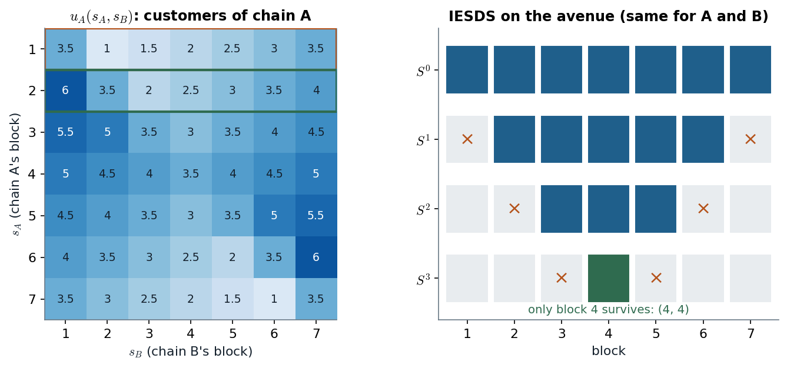

# Slides 31–33 · Spatial competition: where to open the pharmacy

> **Claim.** On a line of equally populated blocks, a store at the edge is strictly dominated by
> the block next to it, because moving inward keeps every customer it had and wins some of the
> rival's. Common knowledge of rationality peels the avenue from both ends, one layer per
> round, until **both chains sit on the middle block** — the clustering of rival pharmacies on
> the same street. The prediction doubles the customers' total walking relative to the best
> pair of locations, and it rests on fixed, equal prices: once prices are chosen too, being next
> to the rival invites a price war and firms spread out (Cabral §14.2).
>
> Prev: [[L01-07-cournot-iesds]] · Next: [[L01-09-formulas]] · Map: [[L01-00-map]]

> **Spoiler.** This note solves the in-class mini case (handed in on Oct 13). To practise first,
> work `Listas/prep-mini-case-lecture-01.md` (different streets, same skills) and Tadelis 4.10
> (p. 78).

---

## 1 · The setup (slide 32)

Two chains, A and B, each open one store on a 7-block avenue; one customer per block; both
choose a block simultaneously; identical prices and products; each customer buys from the
nearest store and splits evenly when equidistant; each chain maximizes its number of customers.
The motivation (slide 31): rival pharmacies opening right next to each other in Brasília.

## 2 · Worked — (a) the normal form

$I=\{A,B\}$, $S_A=S_B=\{1,\dots,7\}$. Since every customer buys from someone,
$u_A+u_B=7$ in every cell (a **constant-sum** game).

**Case $s_A<s_B$.** Block $j$ goes to A when $j-s_A<s_B-j$, i.e. $j<\frac{s_A+s_B}{2}$.

- Blocks $1,\dots,s_A$ are all closer to A: $s_A$ customers.
- If $s_A+s_B$ is odd, the midpoint is not a block; blocks $s_A+1,\dots,\frac{s_A+s_B-1}{2}$ go to
  A: $\frac{s_B-s_A-1}{2}$ more. Total $s_A+\frac{s_B-s_A-1}{2}=\frac{s_A+s_B-1}{2}$.
- If $s_A+s_B$ is even, block $\frac{s_A+s_B}{2}$ is equidistant and splits; A gets blocks
  $s_A+1,\dots,\frac{s_A+s_B}{2}-1$ plus half the midpoint:
  $s_A+\bigl(\frac{s_A+s_B}{2}-1-s_A\bigr)+\frac12=\frac{s_A+s_B-1}{2}$. **Same formula.**

$$u_A(s_A,s_B)=\begin{cases}\dfrac{s_A+s_B-1}{2} & s_A<s_B\\[6pt] \dfrac72 & s_A=s_B\\[6pt] 7-\dfrac{s_A+s_B-1}{2} & s_A>s_B\end{cases}$$

(the third line is $7-u_B$ with the roles swapped; at $s_A=s_B$ every block is equidistant and
splits). Example: $u_A(2,5)=\frac{2+5-1}{2}=3$ — blocks 1, 2, 3; block 4 is closer to 5 ($1<2$).

*Row 2 beats row 1 cell by cell (the outlined rows); elimination removes the two outermost surviving blocks each round. Source: slides 32–33; payoffs from the formula above.*

## 3 · Worked — (b) block 1 is strictly dominated by block 2

Compare the two outlined rows of the heat map, against **every** $s_B$:

| $s_B$ | 1 | 2 | 3 | 4 | 5 | 6 | 7 |
|---|---|---|---|---|---|---|---|
| $u_A(1,s_B)$ | 3.5 | 1 | 1.5 | 2 | 2.5 | 3 | 3.5 |
| $u_A(2,s_B)$ | 6 | 3.5 | 2 | 2.5 | 3 | 3.5 | 4 |
| difference | +2.5 | +2.5 | +0.5 | +0.5 | +0.5 | +0.5 | +0.5 |

Seven strict inequalities, all positive: **$1\prec2$** (and $7\prec6$ by symmetry). For
$s_B\ge3$ the gain is always $\frac12$: moving from 1 to 2 shifts the midpoint half a block toward
B.

**Is any block strictly dominant?** No. A dominant block would have to be the best reply to
every $s_B$. Against $s_B=1$ the unique best reply is block 2 ($u_A=6$; block 4 gives only 5),
and against $s_B=7$ it is block 6. No block is best against both, so none is dominant — the
game has **no dominant-strategy equilibrium**.

## 4 · Worked — (c) IESDS, round by round

| Round | Surviving before | Removed (each chain) | Dominator and inequalities | Knowledge needed |
|---|---|---|---|---|
| 1 | $\{1,\dots,7\}$ | 1 and 7 | $2\succ1$ (table above), $6\succ7$; nothing else: block 2 is the best reply to $s_B=1$, so nothing dominates 2 | rationality |
| 2 | $\{2,\dots,6\}$ | 2 and 6 | $3\succ2$ against $s_B\in\{2,\dots,6\}$: $5>3.5$, $3.5>2$, then $+0.5$ at $s_B=4,5,6$ | each knows the other is rational |
| 3 | $\{3,4,5\}$ | 3 and 5 | $4\succ3$ against $s_B\in\{3,4,5\}$: $4>3.5$, $3.5>3$, $4>3.5$ | second-order knowledge |
| 4 | $\{4\}$ | — | nothing left | — |

**$S^\infty=\{(4,4)\}$**: both chains open on the middle block and split the avenue, 3.5
customers each. Round 2 needs the round-1 removals: in the full game block 2 is the unique best
reply to a rival at 1, so 3 does not dominate 2 until block 1 is gone.

> **The median wins.** Each round, a chain moves one block toward the centre because the rival
> is known not to be outside it. The survivor is the block with half the customers on each side —
> the same logic as Hotelling's and the median voter's ([[../L02/L02-00-map|Lecture 2]], Tadelis
> §5.2.5, p. 93).

## 5 · Worked — (d) total walking

Total distance walked, each customer to the nearest store, $D(x,y)=\sum_{j=1}^7\min\{|j-x|,|j-y|\}$:

$$D(4,4)=3+2+1+0+1+2+3=\mathbf{12}.$$

Splitting the avenue does better. With stores at 2 and 5: blocks 1–3 walk $1+0+1=2$, blocks 4–7
walk $1+0+1+2=4$, total $\mathbf 6$. The minimum over all pairs is 6, reached at $\{2,5\}$,
$\{2,6\}$ and $\{3,6\}$: each store sits at a median of the customers it serves.

| Profile | Customers walk | Chains' customers |
|---|---|---|
| IESDS $(4,4)$ | 12 | 3.5, 3.5 |
| $(2,5)$ | 6 | 3, 4 |

**IESDS doubles the walking.** The chains do not care: the game is constant-sum, so *every*
profile is Pareto optimal **for the chains** ($u_A+u_B=7$ — no profile makes one better off
without hurting the other). The inefficiency falls entirely on customers, who are not players.

## 6 · C — (e) what drives the prediction (Cabral §14.2)

| Assumption | If dropped |
|---|---|
| prices fixed and equal | **the main one**: with price competition, clustering makes the products identical and invites Bertrand pricing at cost |
| inelastic demand (everyone buys) | far customers may not buy; spreading out gains them |
| two firms, one store each | a third firm breaks the clean peeling (IESDS bites much less) |
| discrete blocks, uniform customers | the survivor is the **median** of the customer distribution, not the geometric middle |
| simultaneous choice | a leader would move differently → [[../L03/L03-00-map|Lecture 3]] |

**Cabral's Hotelling model** (pp. 358–359): firms at the two ends of $[0,1]$, consumers uniform,
transport cost $t$ per unit of distance, marginal cost $c$. The indifferent consumer solves
$tx+p_1=t(1-x)+p_2$, so demand is $q_i=\frac12+\frac{p_j-p_i}{2t}$ (14.3); profit maximization gives
the best response $p_i=\frac{c+t+p_j}{2}$ (14.4) and, with equal costs, $\boxed{p=c+t}$ (14.5).
**The margin equals the differentiation parameter $t$**: with $t=0$ this is Bertrand, price at
cost.

**Location with prices** (p. 360): moving toward the centre has a **direct effect** (more demand
at given prices, positive) and a **strategic effect** (the rival cuts its price, negative).

| Price competition | Prediction | Cabral's example |
|---|---|---|
| weak (prices set nationally) | cluster near the centre | European bank branches |
| intense (identical products, local prices) | locate far apart | the two ice-cream vendors on a beach |

The pharmacies of slide 31 fit the first row: chains price largely at the chain level, so the
direct effect dominates and they open side by side.

---

## Links

- Prev / next: [[L01-07-cournot-iesds]] · [[L01-09-formulas]].
- IESDS logic: [[L01-06-iesds]]. Hotelling and voting with Nash equilibrium → [[../L02/L02-00-map|Lecture 2]].
- Python: `line_game`, `iesds_rounds_detail` and the walking distance, reused from `Listas/lista-lecture-01-check.py` → [[L01-11-python]] §7.
- Preparation (unsolved, different streets): `Listas/prep-mini-case-lecture-01.md`.
- Practice: Tadelis 4.10 (p. 78) = `Listas/pratica-lecture-01.md` item 18; `Listas/lista-lecture-01.tex` Q5–Q6 (weighted towns, ring road, general $n$, continuum); quiz `Simulados/quiz-lecture01-3-iesds-2026-10-13.md` (section `space`).
