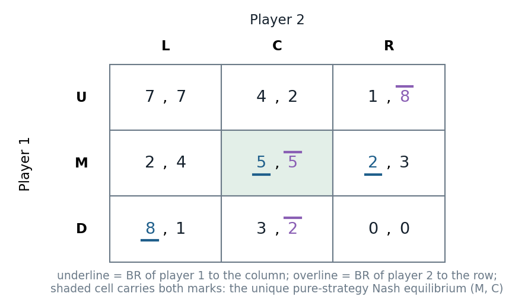

# 5.1 · Nash equilibrium: best responses to beliefs that are correct

> **Claim.** A Nash equilibrium is a profile in which **every player best-responds to the others' actual
> strategies**: rationality plus **correct beliefs**. It refines IESDS and rationalizability (every NE survives
> them; a unique survivor is the unique NE), it is found in a matrix by **marking best replies and looking for a
> cell marked twice**, it can be multiple (Battle of the Sexes, Stag Hunt), and it need not be Pareto optimal.
>
> Prev: [[L02-01-best-response-rationalizability]] · Next: [[L02-03-cournot]] · Map: [[L02-00-map]]

---

## 1 · U — from rationalizable to self-enforcing

Rationalizability allowed (O, F) in the Battle of the Sexes: Alex at the opera believing Chris goes, Chris at the
game believing Alex goes. Each is optimal **given a belief**, but the beliefs are wrong (Tadelis p. 79). Nash's
"heroic leap" ties actions and beliefs together: in equilibrium everyone's belief is what the others actually do.

Gibbons's motivation (§1.1.C, pp. 8–9): if game theory offers a **unique** prediction, each player must be willing to
play the predicted strategy, i.e. it must be a best reply to the predicted strategies of the others. A prediction
that is not a NE is **falsified by the play it predicts**: someone deviates. The same argument applies to a
**convention**: a convention that is not a NE is not obeyed. Such a prediction is **self-enforcing**.

---

## 2 · C — the definition and its relation to Lecture 1

**Definition 5.1 (p. 80).** The pure-strategy profile $s^*=(s_1^*,\dots,s_n^*)\in S$ is a **Nash equilibrium** if
$s_i^*$ is a best response to $s_{-i}^*$ for all $i\in N$:
$$v_i(s_i^*,s_{-i}^*)\ \ge\ v_i(s_i',s_{-i}^*)\qquad\forall s_i'\in S_i,\ \forall i\in N.$$

Equivalently $s_i^*\in BR_i(s_{-i}^*)$ for every $i$: the profile is a **fixed point** of the best-response
correspondences (this is how existence is proved, [[L02-09-existence]]).

> **The two requirements (p. 81):** (1) each player plays a best response to his beliefs; (2) the beliefs are
> correct. Requirement (1) is rationality; requirement (2) is the demanding one.

**Proposition 5.1 (p. 80–81).** If $s^*$ is (1) a strict dominant-strategy equilibrium, (2) the unique survivor of
IESDS, or (3) the unique rationalizable profile, then $s^*$ is the **unique** Nash equilibrium.

*Why, step by step.* (a) $s^*$ is a NE: by Prop. 4.4 ([[L02-01-best-response-rationalizability]] §2) each
$s_i^*$ is a best response to $s_{-i}^*$. (b) No other NE: a NE never contains a strictly dominated strategy (a
strictly dominated strategy is never a best response, Prop. 4.3), and the same holds round by round in the reduced
games, so **every NE survives IESDS** (Gibbons Appendix 1.1.C, Proposition B, pp. 12–13). If only $s^*$ survives,
$s^*$ is the only candidate. (The proof is Tadelis exercise 5.1, p. 95.)

| If the profile is… | then it is… | the converse |
|---|---|---|
| a strict dominant-strategy equilibrium | the unique IESDS survivor and the unique NE | fails: Cournot has a unique NE and no dominant strategy |
| the unique IESDS survivor | the unique NE | fails: the 3×3 game of §3 has a unique NE and nothing is eliminated |
| a NE | an IESDS survivor and rationalizable | fails: in the Battle of the Sexes (O, F) survives both and is not a NE |

Worked (Tadelis p. 80, Lecture 1's IESDS game): rows U, M, D; columns L, C, R; (U, L) is the only IESDS survivor and
the only NE, since $BR_1(L)=\{U\}$ and $BR_2(U)=\{L\}$. In the prisoner's dilemma the unique NE is (F, F): each
plays a dominant strategy, which is a best reply to anything.

---

## 3 · C — finding pure equilibria in a matrix: the underline method (§5.1.1, pp. 81–82)

The game of p. 81, where **nothing is dominated**, so IESDS and rationalizability say "anything can happen":

| P1 \ P2 | L | C | R |
|---|---|---|---|
| **U** | 7, 7 | 4, 2 | 1, 8 |
| **M** | 2, 4 | 5, 5 | 2, 3 |
| **D** | 8, 1 | 3, 2 | 0, 0 |

- **Step 1 (player 1, column by column).** L: max(7, 2, 8) = 8 → D. C: max(4, 5, 3) = 5 → M. R: max(1, 2, 0) = 2 → M.
  Player 1 best-responds at (D, L), (M, C), (M, R).
- **Step 2 (player 2, row by row).** U: max(7, 2, 8) = 8 → R. M: max(4, 5, 3) = 5 → C. D: max(1, 2, 0) = 2 → C.
  Player 2 best-responds at (U, R), (M, C), (D, C).
- **Step 3.** The only cell marked twice is **(M, C)**: the unique pure-strategy NE.

*Underline = player 1's best reply to the column; overline = player 2's best reply to the row; the shaded cell (M, C) is the unique pure NE. Source: Tadelis §5.1.1, pp. 81–82.*

Note what the figure shows that IESDS could not: every row and column is a best reply to something, so nothing is
eliminated, yet only one cell is a **mutual** best reply.

> **"Unique pure-strategy NE" is the exact claim (p. 82).** The game also has **four mixed equilibria** (support
> enumeration, [[L02-12-python]] §7): for instance both players put $\tfrac16$ on their first and $\tfrac56$ on their
> second strategy, which makes U and M pay player 1 the same 4.5 (and D only $\tfrac{23}6$), and likewise for player 2.
> The underline method finds pure equilibria only. Gibbons uses the same device (Figure 1.1.5, p. 10) and so
does Cabral, marking best replies with asterisks (Fig. 7.5, pp. 165–166).

> **Interactive companion.** [The Mixing Square](companions/companion-mixed-2x2.html) — its matrix panel applies the
> underline method live to any 2×2 game; when no cell is marked twice the equilibrium must be mixed.

---

## 4 · C — multiple equilibria and what selects among them

**Battle of the Sexes (pp. 79, 81, 83).** (O, O) and (F, F) are both NE; (O, F) and (F, O) are not (each player would
move to the other's event). Tadelis's selection story: if Alex is *influential*, the belief that both go to the opera
is **self-fulfilling**, not because Chris likes pleasing Alex (that would change the payoffs) but because beliefs
coordinate. As the outside analyst, "one of these two outcomes is what we predict" (p. 81).

**Stag Hunt (§5.2.1, pp. 83–84).**

| 1 \ 2 | S | H |
|---|---|---|
| **S** | 5, 5 | 0, 3 |
| **H** | 3, 0 | 3, 3 |

Best replies: to S the best reply is S (5 > 3); to H it is H (3 > 0). Both (S, S) and (H, H) are NE, and (S, S)
**Pareto dominates** (H, H). Yet (H, H) is a reasonable prediction: a hunter who expects the other to hunt hare
gets 0 from the stag alone. Tadelis's reading: identical societies end up cooperative or individualist through
**self-fulfilling beliefs, or norms** (p. 84; the "big push" in footnote 2).

| Game | NE (pure) | Selection argument |
|---|---|---|
| Battle of the Sexes | (O, O), (F, F) | influence, history, convention |
| Stag Hunt | (S, S), (H, H) | Pareto dominance vs the safety of H (risk) |
| Cabral Fig. 7.6 (standards) | two compatible standards | **focal points** (Cabral pp. 166–167) |

Cabral's "meet me in New York" example (p. 167): infinitely many NE, yet most subjects choose Grand Central at noon,
a **focal point** that comes from outside the game.

> **Multiplicity is not a failure of the concept.** Nash equilibrium is a consistency condition; which consistent
> profile is played is a question about beliefs that the payoff matrix alone cannot answer
> ([[../../rules/game-theory|rules/game-theory]] items 3 and 17).

---

## 5 · C — evaluating Nash equilibrium (§5.1.2, p. 83)

| Criterion | Verdict |
|---|---|
| Existence | not always in pure strategies (Matching Pennies, [[L02-07-mixed-strategies]]; asymmetric Bertrand with continuous prices, [[L02-04-bertrand]]); always in mixed strategies for finite games ([[L02-09-existence]]) |
| Uniqueness | often fails (above); but sharper than IESDS and rationalizability, by Prop. 5.1 |
| Pareto | **not guaranteed**: prisoner's dilemma, the tragedy of the commons ([[L02-05-commons]]) |

---

## 6 · G — MWG §8.D (pp. 246–249)

MWG Def. 8.D.1 (p. 246) states the pure-strategy NE exactly as Def. 5.1. MWG discusses why players might play a NE
(pp. 248–249): a self-enforcing agreement reached by pre-play communication, a stable social convention, a focal
point, or the outcome of learning; it also stresses that common knowledge of rationality alone does **not** imply NE
play, it implies only rationalizability. Named here; not examinable unless the lecture states it.

---

## Links

- Neighbours: [[L02-01-best-response-rationalizability]], [[L02-03-cournot]], [[L02-07-mixed-strategies]].
- Lecture 1 (dominance, IESDS, Pareto): [[../L01/L01-00-map|Lecture 1]]; Lecture 3 refines NE with subgame
  perfection: [[../L03/L03-00-map|Lecture 3]].
- Rules pack: [[../../rules/game-theory|rules/game-theory]].
- Practice: Tadelis 5.1, 5.2, 5.3 (p. 95), 5.4–5.6 (p. 96); Gibbons 1.1 (p. 48); Muñoz-Garcia & Toro-Gonzalez Ch. 2
  (pp. 37–84).
