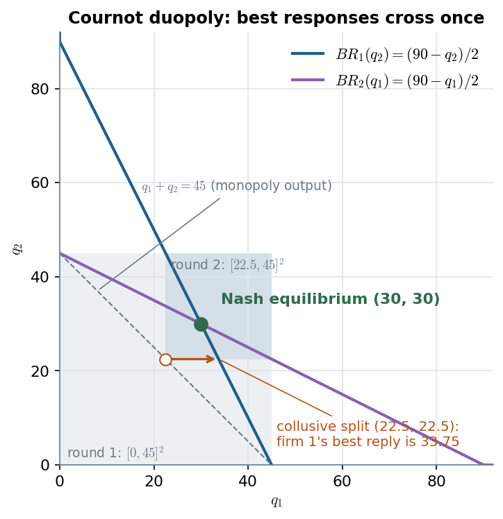

# Slides 20–27 · 5.2.3 · Cournot duopoly: two best-response lines and one crossing

> **Claim.** With continuous strategies a Nash equilibrium is found by **solving every player's first-order
> condition at once**: each FOC is a best-response function, and the equilibrium is where they cross. In Cournot the
> lines slope **down** (strategic substitutes) and cross once, at $q_i^*=(a-2c_i+c_j)/(3b)$. The duopoly produces
> **more than a monopoly and less than competition**, because **collusion at the monopoly output is not a best
> reply to itself**.
>
> Prev: [[L02-02-nash-equilibrium]] · Next: [[L02-04-bertrand]] · Map: [[L02-00-map]]

---

## 0 · C — the lecture's version (slides 20–24), in its notation

**Notation.** $q_i\ge0$ firm $i$'s output; $Q=q_1+q_2$; inverse demand $P(Q)=a-bQ$ ($a>c\ge0$, $b>0$); constant
marginal cost $c$ for both firms; $\Pi_i$ firm $i$'s profit; $q^m$ the monopoly output; $q^{cp}$ the perfectly
competitive output. Example 2 (slide 20): $a=100$, $b=1$, $c=10$.

**The game (slide 21).** Players $I=\{1,2\}$; strategies $S_i=\{q_i:q_i\ge0\}$; payoffs
$$\Pi_i(q_i,q_j)=P(q_i+q_j)\,q_i-c\,q_i=\bigl(a-c-b(q_i+q_j)\bigr)\,q_i .\tag{1}$$
Example: $\Pi_i=(100-q_i-q_j)q_i-10q_i$. Slide 20 asks for (a) this normal form, (b) dominant and dominated
strategies, (c) the best responses and (d) the equilibrium. For (b): no output is dominant, because the best output
depends on $q_j$ (by (5) below); outputs above $q^m$ are strictly dominated, which starts the IESDS sequence below.

**Two benchmarks (slide 22).** A monopolist sets marginal revenue equal to cost: $RM(q^m)=a-2bq^m=c$, so
$$q^m=\frac{a-c}{2b}.\tag{2}$$
Many identical firms push the price to cost: $P(q^{cp})=a-bq^{cp}=c$, so
$$q^{cp}=\frac{a-c}{b}=2q^m.\tag{3}$$
Example: $q^m=\dfrac{100-10}{2}=45$ and $q^{cp}=90$.

**Best response (slide 23).** Given $q_j$, firm $i$ maximizes (1). First-order condition:
$$\frac{\partial\Pi_i}{\partial q_i}=a-c-2bq_i-bq_j=0.\tag{4}$$
Solving (4) for $q_i$: $q_i=\dfrac{a-c-bq_j}{2b}=\dfrac{a-c}{2b}-\dfrac12q_j$, and by (2)
$$q_i^*(q_j)=\begin{cases}q^m-\tfrac12q_j&0\le q_j<q^{cp},\\[2pt]0&q_j\ge q^{cp}.\end{cases}\tag{5}$$
The corner: $q^m-\tfrac12q_j\le0$ exactly when $q_j\ge2q^m=q^{cp}$ by (3). Example: $100-2q_i-q_j-10=0$, so
$q_i^*(q_j)=\dfrac{90-q_j}{2}$.

**Nash equilibrium (slide 24).** A pair of mutual best responses: $q_1=q^m-\tfrac12q_2$ and $q_2=q^m-\tfrac12q_1$.
Substituting the second into the first:
$$q_1=q^m-\tfrac12\bigl(q^m-\tfrac12q_1\bigr)$$
$$q_1=\tfrac12q^m+\tfrac14q_1$$
$$\tfrac34q_1=\tfrac12q^m\ \Longrightarrow\ q_1^*=\tfrac23q^m,$$
and by symmetry
$$q_1^*=q_2^*=\tfrac23q^m.\tag{6}$$
Example: $q^*=\tfrac23(45)=30$, $Q^*=60$, $P^*=100-60=40$, $\Pi^*=(40-10)(30)=900$.

**IESDS gives the same answer (slide 24).** By (5) the largest best response is $q^m$ (at $q_j=0$), so outputs above
$q^m$ are never optimal; given $q_j\le q^m$, the smallest best response is $q^m-\tfrac12q^m=\tfrac12q^m$; and so on.
The surviving interval's end points alternate:
$$\tfrac12q^m,\quad q^m-\tfrac12\cdot\tfrac12q^m=\tfrac34q^m,\quad q^m-\tfrac12\cdot\tfrac34q^m=\tfrac58q^m,\quad
q^m-\tfrac12\cdot\tfrac58q^m=\tfrac{11}{16}q^m,\ \dots\ \to\ \tfrac23q^m .$$
Example: 22.5, 33.75, 28.125, 30.9375, … → 30 (the rounds of [[L02-01-best-response-rationalizability]] §3).

| Market structure | Total output | Example |
|---|---|---|
| Monopoly (or cartel) | $q^m$ | 45 |
| **Cournot duopoly** | $\tfrac43q^m$ | **60** |
| Perfect competition | $q^{cp}=2q^m$ | 90 |

The rest of this note is Tadelis's version with **different** marginal costs $c_i$; set $c_1=c_2=c$ and it collapses
to (5)–(6).

## 1 · C — the game and the best response (Tadelis p. 87)

Players: firms 1, 2. Strategies: $q_i\ge0$. Inverse demand $P=a-b(q_1+q_2)$, costs $c_i(q_i)=c_iq_i$, payoffs

$$u_i(q_i,q_j)=(a-bq_i-bq_j)q_i-c_iq_i .$$

**First-order condition**, given a belief $q_j$:

$$\frac{\partial u_i}{\partial q_i}=a-2bq_i-bq_j-c_i=0 .$$

Second-order condition: $\partial^2u_i/\partial q_i^2=-2b<0$, so the FOC gives the maximum. Solving for $q_i$, and
truncating at zero (a firm never produces at a loss),

$$\boxed{\;BR_i(q_j)=\max\Bigl\{0,\ \frac{a-bq_j-c_i}{2b}\Bigr\}\;}\qquad\text{(eq. 5.2)}$$

Slope $-1/2$: one more unit from the rival cuts the best reply by half a unit. **Strategic substitutes** (Tadelis's
remark, p. 93): a best reply that falls in the rival's choice.

---

## 2 · C — solving the two lines (every step)

Interior equilibrium: both firms on their lines,

$$2bq_1+bq_2=a-c_1,\qquad bq_1+2bq_2=a-c_2 .$$

Multiply the first by 2 and subtract the second: $3bq_1=2(a-c_1)-(a-c_2)=a-2c_1+c_2$. Symmetrically for firm 2:

$$\boxed{\;q_1^*=\frac{a-2c_1+c_2}{3b},\qquad q_2^*=\frac{a-2c_2+c_1}{3b}\;}$$

Then $Q^*=\dfrac{2a-c_1-c_2}{3b}$ and $P^*=a-bQ^*=\dfrac{a+c_1+c_2}{3}$.

**Profits.** From the FOC, $P^*-c_i=bq_i^*$ (substitute $a-bq_j^*-c_i=2bq_i^*$ into $P^*-c_i=a-bq_i^*-bq_j^*-c_i$), so

$$\pi_i^*=(P^*-c_i)q_i^*=b\,(q_i^*)^2 .$$

**Corner.** If $a-2c_1+c_2<0$, i.e. $c_1>(a+c_2)/2$, the formula gives $q_1^*<0$. Then firm 1 produces 0 and firm 2 is
a monopolist, $q_2=(a-c_2)/(2b)$. Check it is an equilibrium: $BR_1\bigl((a-c_2)/(2b)\bigr)=\max\{0,(a-2c_1+c_2)/(4b)\}=0$. ✓

**Comparative statics (interior).** $\partial q_1^*/\partial c_1=-2/(3b)$, $\partial q_2^*/\partial c_1=+1/(3b)$,
$\partial Q^*/\partial c_1=-1/(3b)$, $\partial P^*/\partial c_1=+1/3$. A cost increase is passed to the price only
one-third, and the rival picks up half of the lost output.

---

## 3 · Worked — Tadelis's numbers ($a=100$, $b=1$, $c_1=c_2=10$; pp. 87–88, 90)

| Quantity | Computation | Value |
|---|---|---|
| $BR_i(q_j)$ | $(100-q_j-10)/2$ | $(90-q_j)/2$ |
| $q_i^*$ | $(100-20+10)/3$ | **30** |
| $Q^*$, $P^*$ | $60$; $100-60$ | **60, 40** |
| $\pi_i^*$ | $(40-10)\cdot30$ | **900** |
| Monopoly | $\max (100-q)(q)-10q$: $90-2q=0$ | $q=45$, $P=55$, $\pi=2025$ |
| Competitive | $P=c=10$ | $Q=90$ |
| Joint duopoly profit | $2\cdot900$ | 1800 < 2025 |

$$\underbrace{45}_{\text{monopoly}}\ <\ \underbrace{60}_{\text{Cournot}}\ <\ \underbrace{90}_{\text{competitive}},\qquad Q^*/Q^c=\tfrac23 .$$

*The two lines of eq. (5.2) cross once at (30, 30). The hollow dot is the collusive split (22.5, 22.5) on the monopoly line; the arrow is firm 1's best reply to 22.5, which is 33.75. Source: Tadelis Fig. 5.2, p. 88; Gibbons p. 17.*

The arrow is the whole economics of the figure: starting from the split that maximizes joint profit, each firm wants
to expand, and only at the crossing does no firm want to move.

---

## 4 · U — why collusion fails (Gibbons p. 17)

Joint profit is maximal at total output $q_m=(a-c)/(2b)$, e.g. $q_i=q_m/2$ each. But
$$BR_i\!\left(\frac{q_m}{2}\right)=\frac{a-c-b\,q_m/2}{2b}=\frac{a-c-(a-c)/4}{2b}=\frac{3(a-c)}{8b}>\frac{a-c}{4b}=\frac{q_m}{2}.$$
With Tadelis's numbers: $BR_i(22.5)=(90-22.5)/2=33.75>22.5$. Deviating raises firm $i$'s profit from
$(55-10)\cdot22.5=1012.5$ to $(100-56.25-10)\cdot33.75=1139.06$.

> **The low monopoly output keeps the price high, and at a high price each firm wants to sell more even though
> doing so drives the price down.** In equilibrium the price has fallen just enough that the temptation to expand
> is exactly offset (Gibbons p. 17). This is the prisoner's-dilemma structure of oligopoly that Lectures 5–6 will try
> to escape with repetition ([[../L06/L06-00-map|Lecture 6]]).

### 4b · C — the cartel as a prisoner's dilemma (slide 25)

A **cartel**: competing firms coordinate to maximize joint profit, as a single monopolist. With identical costs each
produces $q^m/2$, 22.5 in the example. Restrict each firm to two choices, **Cartel** ($22.5$) or **Deviate** (the
best response to the cartel output, $q_i^*(22.5)=\tfrac{90-22.5}2=33.75$). The payoffs, worked:

| Profile | $Q$ | $P$ | Profits |
|---|---|---|---|
| (Cartel, Cartel) | 45 | 55 | $(55-10)(22.5)=1{,}012.5$ each |
| (Deviate, Cartel) | 56.25 | 43.75 | deviator $(33.75)(33.75)=1{,}139.06$; cartel firm $(33.75)(22.5)=759.38$ |

The slide's matrix (payoffs rounded):

| Firm 1 \ Firm 2 | Cartel | Deviate |
|---|---|---|
| **Cartel** | 1,012, 1,012 | 759, 1,139 |
| **Deviate** | 1,139, 759 | 900, 900 |

> **Reading the (Deviate, Deviate) cell.** 900 is each firm's profit at the **Nash outputs** (30, 30), where mutual
> deviation ends up. If both literally produced 33.75, $Q=67.5$, $P=32.5$ and each would earn
> $(32.5-10)(33.75)=759.38$, exactly what the cartel firm earns against a deviator; Deviate would then be only weakly
> dominant. With the slide's 900, Deviate strictly dominates Cartel ($1{,}139>1{,}012$ and $900>759$).

"Which game has the same structure?" **The prisoner's dilemma**: each firm has a dominant strategy (deviate), and the
equilibrium (900 each) is Pareto dominated by the cartel (1,012 each). Lectures 5–6 ask whether repetition can sustain
the cartel ([[../L06/L06-00-map|Lecture 6]]).

### 4c · C — Cournot oligopoly with $n$ firms (slides 26–27)

Price $P(q_1+\dots+q_n)=a-b(q_1+\dots+q_n)$; firm $i$'s payoff $q_i\bigl(P(\sum_jq_j)-c\bigr)$. The same FOC as (4),
with $\sum_{j\ne i}q_j$ in place of $q_j$, gives
$$q_i^*(q_{-i})=q^m-\tfrac12\sum_{j\neq i}q_j\quad\text{(if positive)}.\tag{7}$$
In equilibrium (7) holds for every $i$ at $q^*$. Multiply by 2 and move the sum:
$$2q_i^*=2q^m-\sum_{j\ne i}q_j^*\ \Longrightarrow\ q_i^*=2q^m-\sum_{j\in I}q_j^*=2q^m-Q^*.\tag{8}$$
Summing (8) over the $n$ firms:
$$Q^*=2nq^m-nQ^*\ \Longrightarrow\ Q^*=\frac{2n}{n+1}\,q^m.\tag{9}$$
Substituting (9) back into (8):
$$q_i^*=2q^m-\frac{2n}{n+1}q^m=\frac{2q^m}{n+1}\qquad(i=1,\dots,n).\tag{10}$$
Check: $n=1$ gives $q^m$ (monopoly); $n=2$ gives $\tfrac23q^m$, as in (6). As $n\to\infty$, $Q^*\to2q^m=q^{cp}$: **with
many identical firms the market approaches perfect competition** (slide 27). In Tadelis's notation (10) is
$q_i^*=(a-c)/((n+1)b)$ and $P^*=(a+nc)/(n+1)\to c$ (Tadelis exercise 5.8, p. 96; Gibbons problem 1.4, p. 49).
Cournot firms keep some market power when they are few; Bertrand firms lose it with two ([[L02-04-bertrand]]).

---

## 5 · Asymmetric costs, worked (not on the slides; reading)

$a=100$, $b=1$, $c_1=1$, $c_2=2$ (the costs Tadelis uses for asymmetric Bertrand, p. 91):

| | Formula | Value |
|---|---|---|
| $q_1^*$ | $(100-2+2)/3$ | 33.333 |
| $q_2^*$ | $(100-4+1)/3$ | 32.333 |
| $P^*$ | $(100+1+2)/3$ | 34.333 |
| $\pi_1^*=b(q_1^*)^2$ | $33.333^2$ | 1111.11 |
| $\pi_2^*$ | $32.333^2$ | 1045.44 |

The cheaper firm sells exactly $(c_2-c_1)/b=1$ unit more, and **both** firms survive, unlike asymmetric Bertrand where
the efficient firm takes the whole market.

> **Interactive companion.** [The Cournot Crossing](companions/companion-cournot-best-responses.html) — raise $c_1$ to
> the exit threshold $(a+c_2)/2$ (55 at the defaults; there is a button) and watch firm 1's line slide inside firm
> 2's until the crossing reaches the axis; change $b$ and see every quantity rescale while prices stay put.

---

## Links

- Neighbours: [[L02-01-best-response-rationalizability]] §3 (the same game by rationalizability),
  [[L02-04-bertrand]] (prices instead of quantities), [[L02-05-commons]] (another strategic-substitutes game).
- Lecture 1 (Cournot by IESDS, Tadelis p. 65): [[../L01/L01-00-map|Lecture 1]]; Lecture 3 (Stackelberg, the
  sequential version): [[../L03/L03-00-map|Lecture 3]]; Lecture 6 (Cournot collusion under repetition):
  [[../L06/L06-00-map|Lecture 6]].
- Code: [[L02-12-python]] §3; the Cournot IESDS recursion of Lecture 1 lives in `Listas/lista-lecture-01-check.py`
  (`BR`, `cournot_iesds`).
- Practice: Tadelis 5.8 (p. 96), 5.11 (p. 97); Gibbons 1.4, 1.5 (p. 49), 1.6 (pp. 49–50); Cabral §7.1 (pp. 161–167).
