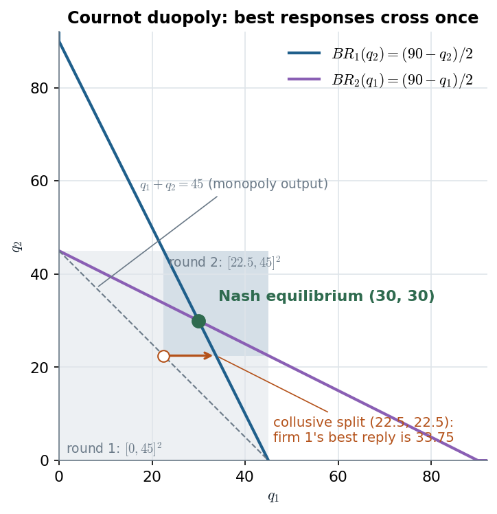

# 5.2.3 · Cournot duopoly: two best-response lines and one crossing

> **Claim.** With continuous strategies a Nash equilibrium is found by **solving every player's first-order
> condition at once**: each FOC is a best-response function, and the equilibrium is where they cross. In Cournot the
> lines slope **down** (strategic substitutes) and cross once, at $q_i^*=(a-2c_i+c_j)/(3b)$. The duopoly produces
> **more than a monopoly and less than competition**, because **collusion at the monopoly output is not a best
> reply to itself**.
>
> Prev: [[L02-02-nash-equilibrium]] · Next: [[L02-04-bertrand]] · Map: [[L02-00-map]]

---

## 1 · C — the game and the best response (Tadelis p. 87)

Players: firms 1, 2. Strategies: $q_i\ge0$. Inverse demand $P=a-b(q_1+q_2)$, costs $c_i(q_i)=c_iq_i$, payoffs

$$v_i(q_i,q_j)=(a-bq_i-bq_j)q_i-c_iq_i .$$

**First-order condition**, given a belief $q_j$:

$$\frac{\partial v_i}{\partial q_i}=a-2bq_i-bq_j-c_i=0 .$$

Second-order condition: $\partial^2v_i/\partial q_i^2=-2b<0$, so the FOC gives the maximum. Solving for $q_i$, and
truncating at zero (a firm never produces at a loss),

$$\boxed{\;BR_i(q_j)=\max\Bigl\{0,\ \frac{a-bq_j-c_i}{2b}\Bigr\}\;}\qquad\text{(eq. 5.2)}$$

Slope $-1/2$: one more unit from the rival cuts the best reply by half a unit. **Strategic substitutes** (Tadelis's
remark, p. 93): a best reply that falls in the rival's choice.

---

## 2 · C — solving the two lines (every step)

Interior equilibrium: both firms on their lines,

$$2bq_1+bq_2=a-c_1,\qquad bq_1+2bq_2=a-c_2 .$$

Multiply the first by 2 and subtract the second: $3bq_1=2(a-c_1)-(a-c_2)=a-2c_1+c_2$. Symmetrically for firm 2:

$$\boxed{\;q_1^*=\frac{a-2c_1+c_2}{3b},\qquad q_2^*=\frac{a-2c_2+c_1}{3b}\;}$$

Then $Q^*=\dfrac{2a-c_1-c_2}{3b}$ and $P^*=a-bQ^*=\dfrac{a+c_1+c_2}{3}$.

**Profits.** From the FOC, $P^*-c_i=bq_i^*$ (substitute $a-bq_j^*-c_i=2bq_i^*$ into $P^*-c_i=a-bq_i^*-bq_j^*-c_i$), so

$$\pi_i^*=(P^*-c_i)q_i^*=b\,(q_i^*)^2 .$$

**Corner.** If $a-2c_1+c_2<0$, i.e. $c_1>(a+c_2)/2$, the formula gives $q_1^*<0$. Then firm 1 produces 0 and firm 2 is
a monopolist, $q_2=(a-c_2)/(2b)$. Check it is an equilibrium: $BR_1\bigl((a-c_2)/(2b)\bigr)=\max\{0,(a-2c_1+c_2)/(4b)\}=0$. ✓

**Comparative statics (interior).** $\partial q_1^*/\partial c_1=-2/(3b)$, $\partial q_2^*/\partial c_1=+1/(3b)$,
$\partial Q^*/\partial c_1=-1/(3b)$, $\partial P^*/\partial c_1=+1/3$. A cost increase is passed to the price only
one-third, and the rival picks up half of the lost output.

---

## 3 · Worked — Tadelis's numbers ($a=100$, $b=1$, $c_1=c_2=10$; pp. 87–88, 90)

| Quantity | Computation | Value |
|---|---|---|
| $BR_i(q_j)$ | $(100-q_j-10)/2$ | $(90-q_j)/2$ |
| $q_i^*$ | $(100-20+10)/3$ | **30** |
| $Q^*$, $P^*$ | $60$; $100-60$ | **60, 40** |
| $\pi_i^*$ | $(40-10)\cdot30$ | **900** |
| Monopoly | $\max (100-q)(q)-10q$: $90-2q=0$ | $q=45$, $P=55$, $\pi=2025$ |
| Competitive | $P=c=10$ | $Q=90$ |
| Joint duopoly profit | $2\cdot900$ | 1800 < 2025 |

$$\underbrace{45}_{\text{monopoly}}\ <\ \underbrace{60}_{\text{Cournot}}\ <\ \underbrace{90}_{\text{competitive}},\qquad Q^*/Q^c=\tfrac23 .$$

*The two lines of eq. (5.2) cross once at (30, 30). The hollow dot is the collusive split (22.5, 22.5) on the monopoly line; the arrow is firm 1's best reply to 22.5, which is 33.75. Source: Tadelis Fig. 5.2, p. 88; Gibbons p. 17.*

The arrow is the whole economics of the figure: starting from the split that maximizes joint profit, each firm wants
to expand, and only at the crossing does no firm want to move.

---

## 4 · U — why collusion fails (Gibbons p. 17)

Joint profit is maximal at total output $q_m=(a-c)/(2b)$, e.g. $q_i=q_m/2$ each. But
$$BR_i\!\left(\frac{q_m}{2}\right)=\frac{a-c-b\,q_m/2}{2b}=\frac{a-c-(a-c)/4}{2b}=\frac{3(a-c)}{8b}>\frac{a-c}{4b}=\frac{q_m}{2}.$$
With Tadelis's numbers: $BR_i(22.5)=(90-22.5)/2=33.75>22.5$. Deviating raises firm $i$'s profit from
$(55-10)\cdot22.5=1012.5$ to $(100-56.25-10)\cdot33.75=1139.06$.

> **The low monopoly output keeps the price high, and at a high price each firm wants to sell more even though
> doing so drives the price down.** In equilibrium the price has fallen just enough that the temptation to expand
> is exactly offset (Gibbons p. 17). This is the prisoner's-dilemma structure of oligopoly that Lectures 5–6 will try
> to escape with repetition ([[../L06/L06-00-map|Lecture 6]]).

**More firms.** With $n$ symmetric firms the same FOCs give $q_i^*=(a-c)/((n+1)b)$ and $P^*=(a+nc)/(n+1)\to c$ as
$n\to\infty$ (Tadelis exercise 5.8, p. 96; Gibbons problem 1.4, p. 49). Cournot firms keep some market power when
they are few; Bertrand firms lose it with two ([[L02-04-bertrand]]).

---

## 5 · Asymmetric costs, worked

$a=100$, $b=1$, $c_1=1$, $c_2=2$ (the costs Tadelis uses for asymmetric Bertrand, p. 91):

| | Formula | Value |
|---|---|---|
| $q_1^*$ | $(100-2+2)/3$ | 33.333 |
| $q_2^*$ | $(100-4+1)/3$ | 32.333 |
| $P^*$ | $(100+1+2)/3$ | 34.333 |
| $\pi_1^*=b(q_1^*)^2$ | $33.333^2$ | 1111.11 |
| $\pi_2^*$ | $32.333^2$ | 1045.44 |

The cheaper firm sells exactly $(c_2-c_1)/b=1$ unit more, and **both** firms survive, unlike asymmetric Bertrand where
the efficient firm takes the whole market.

> **Interactive companion.** [The Cournot Crossing](companions/companion-cournot-best-responses.html) — raise $c_1$ to
> the exit threshold $(a+c_2)/2$ (55 at the defaults; there is a button) and watch firm 1's line slide inside firm
> 2's until the crossing reaches the axis; change $b$ and see every quantity rescale while prices stay put.

---

## Links

- Neighbours: [[L02-01-best-response-rationalizability]] §3 (the same game by rationalizability),
  [[L02-04-bertrand]] (prices instead of quantities), [[L02-05-commons]] (another strategic-substitutes game).
- Lecture 1 (Cournot by IESDS, Tadelis p. 65): [[../L01/L01-00-map|Lecture 1]]; Lecture 3 (Stackelberg, the
  sequential version): [[../L03/L03-00-map|Lecture 3]]; Lecture 6 (Cournot collusion under repetition):
  [[../L06/L06-00-map|Lecture 6]].
- Code: [[L02-12-python]] §3; the Cournot IESDS recursion of Lecture 1 lives in `Listas/lista-lecture-01-check.py`
  (`BR`, `cournot_iesds`).
- Practice: Tadelis 5.8 (p. 96), 5.11 (p. 97); Gibbons 1.4, 1.5 (p. 49), 1.6 (pp. 49–50); Cabral §7.1 (pp. 161–167).
