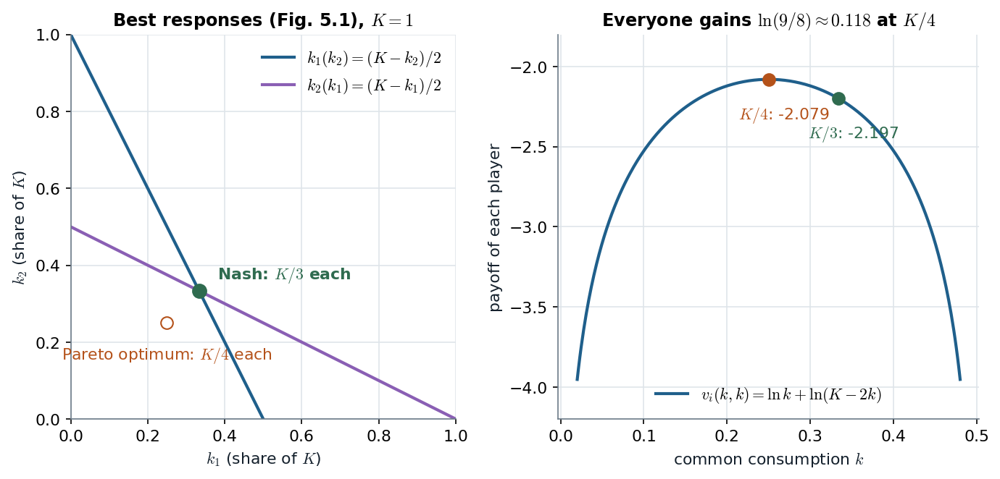

# 5.2.2 · The tragedy of the commons: an equilibrium everyone would vote to leave

> **Claim.** When each player's use of a shared resource harms **all** users but the user counts only **his own**
> share of the harm, the Nash equilibrium over-uses the resource. In Tadelis's clean-air game each of two players
> takes $K/3$ where $K/4$ would make **both** better off; in Gibbons's village too many goats graze because the
> equilibrium condition weighs the harm by $G^*/n$ instead of $G^{**}$. **Nash equilibrium is not Pareto optimal.**
>
> Prev: [[L02-04-bertrand]] · Next: [[L02-06-hotelling-voting]] · Map: [[L02-00-map]]

---

## 1 · U — the story (Hardin 1968)

A pasture shared by herders: each extra animal benefits its owner, but the degradation it causes is shared by all.
Each herder's incentive is to grow his herd, and everyone ends up worse off: the free-rider problem, and the
prisoner's dilemma with continuous strategies (Tadelis p. 84). Hardin's latter-day commons: the atmosphere, oceans,
fish stocks, parking meters.

---

## 2 · C — Tadelis's clean-air game (pp. 84–86)

$n$ players; each chooses $k_i\ge0$ of a common stock $K$ of clean air; the benefit from own use is $\ln k_i$ and every
player also enjoys what is left:

$$v_i(k_i,k_{-i})=\ln k_i+\ln\Bigl(K-\sum_{j=1}^n k_j\Bigr)\qquad\text{(eq. 5.1)}$$

(assuming $\sum_jk_j<K$, footnote 3).

**Best response.** Given $k_{-i}$,

$$\frac{\partial v_i}{\partial k_i}=\frac1{k_i}-\frac1{K-\sum_jk_j}=0\iff K-k_i-\sum_{j\ne i}k_j=k_i
\iff\boxed{\;BR_i(k_{-i})=\frac{K-\sum_{j\neq i}k_j}{2}\;}$$

The second derivative $-1/k_i^2-1/(K-\sum k_j)^2<0$ confirms a maximum. Slope $-1/2$ in each rival's use: strategic
substitutes, like Cournot (Tadelis p. 93).

> **Method (p. 85).** When the best responses are functions, a Nash equilibrium is a solution of $n$ equations
> $k_i=BR_i(k_{-i})$ in $n$ unknowns.

**Two players.** $k_1=(K-k_2)/2$ and $k_2=(K-k_1)/2$. Substitute the second into the first:
$k_1=\bigl(K-(K-k_1)/2\bigr)/2=K/4+k_1/4$, so $\tfrac34k_1=K/4$ and

$$k_1^*=k_2^*=\frac K3 .$$

**The Pareto benchmark (p. 86).** Maximize the "world's payoff"
$w=\sum_iv_i=\ln k_1+\ln k_2+2\ln(K-k_1-k_2)$:

$$\frac{\partial w}{\partial k_1}=\frac1{k_1}-\frac{2}{K-k_1-k_2}=0,\qquad \frac{\partial w}{\partial k_2}=\frac1{k_2}-\frac{2}{K-k_1-k_2}=0 .$$

So $k_1=k_2=k$ and $K-2k=2k$, giving

$$k_1=k_2=\frac K4 .$$

> **The difference is a single factor of 2.** The private FOC charges the player **one** unit of the harm
> ($1/(K-\sum k)$); the social FOC charges **two**, because the remaining air is enjoyed by both. Each player ignores
> the harm to the other: an externality, so the equilibrium over-consumes.

**Both gain (footnote 5, p. 87).** Each player's payoff at $K/4$ minus at $K/3$:

$$\Delta v_i=\Bigl[\ln\tfrac K4+\ln\tfrac K2\Bigr]-\Bigl[\ln\tfrac K3+\ln\tfrac K3\Bigr]=2\ln3-\ln2-\ln4=\ln\tfrac98\approx0.118>0 .$$

The printed footnote gives $0.051$; that is the same expression in **base-10** logarithms
($2\log_{10}3-\log_{10}8=0.0512$). With the natural logarithm of eq. (5.1) the gain is $0.118$. The sign, which is
the point, is the same.

*Left: Fig. 5.1 with $K=1$; the equilibrium sits on both lines, the optimum on neither. Right: the symmetric payoff $\ln k+\ln(K-2k)$ peaks at $K/4$ ($-2.079$); the equilibrium $K/3$ gives $-2.197$. Source: eq. (5.1), pp. 85–87.*

The right panel is the tragedy in one curve: the equilibrium is to the right of the peak, on the falling side, so
a uniform cut in everyone's use raises everyone's payoff. No single player will make that cut alone, because on his
own best-response line a unilateral cut lowers his payoff.

Tadelis closes (p. 87) with Hardin's policy point and its counterweight: regulation could help everyone, if the
regulator can be trusted, a question game theory alone cannot answer. The $n$-player version is Tadelis exercise 5.7
(p. 96).

---

## 3 · C — Gibbons's village green (§1.2.D, pp. 27–29)

$n$ farmers choose goats $g_i$; $G=\sum_ig_i$; each goat costs $c$ and is worth $v(G)$, with $v'<0$, $v''<0$ below
$G_{\max}$. Payoff (1.2.4): $g_iv(g_1+\dots+g_n)-cg_i$.

**FOC of farmer $i$ (1.2.5):** $v(g_i+g_{-i}^*)+g_iv'(g_i+g_{-i}^*)-c=0$. The first term is the value of one more
goat, the second the harm it does to **his own** $g_i$ goats.

**Sum over $i$ and divide by $n$ (1.2.6):** $v(G^*)+\tfrac1nG^*v'(G^*)-c=0$.

**Social optimum (1.2.7):** $\max_G Gv(G)-Gc$ gives $v(G^{**})+G^{**}v'(G^{**})-c=0$.

**Proof that $G^*>G^{**}$ (footnote 12, p. 28).** Suppose instead $G^*\le G^{**}$. Then $v(G^*)\ge v(G^{**})$
($v'<0$); $0>v'(G^*)\ge v'(G^{**})$ ($v''<0$); and $G^*/n<G^{**}$. So
$\tfrac1nG^*v'(G^*)>G^{**}v'(G^{**})$ (a smaller positive number times a smaller-in-size negative number). Hence the
left side of (1.2.6) **strictly exceeds** the left side of (1.2.7). Both equal zero: contradiction. ∎

> **Read the two FOCs side by side:** the farmer weighs the marginal harm by **his own herd**; society weighs it by
> **the whole herd**. Too many goats graze.

---

## 4 · U — where this goes in an organization

Any shared input with private use and common cost follows the same arithmetic: a shared IT budget, a common sales
pool, team effort with a shared output (Lecture 1's partnership game was its discrete cousin). Lecture 5 asks whether
repetition can sustain the cooperative $K/4$ ([[../L05/L05-00-map|Lecture 5]]).

---

## Links

- Neighbours: [[L02-03-cournot]] (same strategic-substitutes structure), [[L02-02-nash-equilibrium]] §5 (NE need not
  be Pareto optimal).
- Lecture 1 (Pareto, social dilemmas): [[../L01/L01-00-map|Lecture 1]].
- Code: [[L02-12-python]] §5.
- Practice: Tadelis 5.7, 5.9 (pp. 96–97); Muñoz-Garcia & Toro-Gonzalez Ch. 2 (pp. 37–84).
