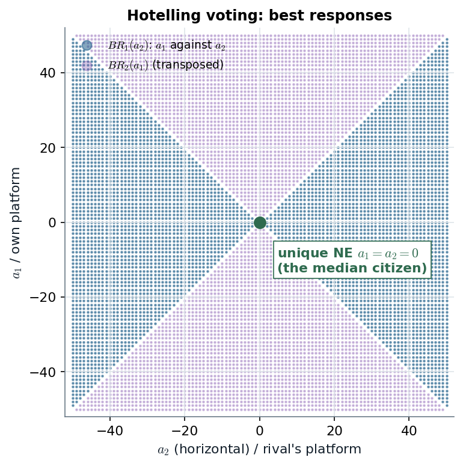

# 5.2.5 · Political ideology and electoral competition: both candidates go to the middle

> **Claim.** Two office-seeking candidates choose platforms on a left–right line of 101 citizens, each citizen
> voting for the nearer platform. Against a rival at $a_j>0$ any platform strictly between $-a_j$ and $a_j$ wins, so
> the best response is an **interval**, and the intervals of the two players meet in a single point: **both at the
> median citizen, $a_1=a_2=0$**. This is Hotelling's (1929) insight and the seed of the median voter theorem, and
> it is Lecture 1's pharmacy case solved with best responses instead of dominance.
>
> Prev: [[L02-05-commons]] · Next: [[L02-07-mixed-strategies]] · Map: [[L02-00-map]]

---

## 1 · C — the game (pp. 93–94)

- Players: two candidates who care **only about winning**: win ≻ tie ≻ lose.
- Citizens: 101, labelled $-50,\dots,0,\dots,+50$ by ideology; each votes for the nearer platform, and an indifferent
  citizen tosses a coin (or abstains, footnote 9).
- Strategies: $a_i\in\{-50,\dots,+50\}$. Majority wins.

**Worked (Fig. 5.4, p. 94).** $a_1=-15$, $a_2=+22$. Citizen 3 is at distance 18 from $-15$ and 19 from $+22$, so votes
for candidate 1; citizen 4 is at 19 and 18, so votes for candidate 2. Candidate 1 gets $-50,\dots,3$: **54 votes**;
candidate 2 gets $4,\dots,50$: **47 votes**. Candidate 1 wins: being nearer the middle wins.

---

## 2 · C — the best-response correspondence (p. 94)

Fix $a_j>0$. Candidate $i$ at $a_i$:

| $a_i$ | Outcome | Why |
|---|---|---|
| $a_i=a_j$ or $a_i=-a_j$ | tie | identical platforms split everything; mirror platforms split the line at 0 |
| $a_i>a_j$ or $a_i<-a_j$ | lose | the rival is nearer to more than half the citizens |
| $-a_j<a_i<a_j$ | **win** | the midpoint $(a_i+a_j)/2$ lies right of 0, so $i$ gets every citizen $\le0$ plus some more |

So for integers

$$BR_i(a_j)=\begin{cases}[a_j+1,\,-a_j-1]&a_j<0\\ \{0\}&a_j=0\\ [-a_j+1,\,a_j-1]&a_j>0\end{cases}$$

**Against $a_j=0$** every other platform loses and 0 ties, so the best response is 0. **Against $a_j=\pm1$** the
interval collapses to $\{0\}$ (footnote 10).

**Equilibrium.** Suppose $a_j\ne0$. Then $BR_i(a_j)$ lies strictly inside $(-|a_j|,|a_j|)$, so $|a_i|<|a_j|$; but
the same argument for $j$ requires $|a_j|<|a_i|$. Contradiction. Hence $a_j=0$, and then $BR_i(0)=\{0\}$:

$$\boxed{\;a_1^*=a_2^*=0\ \text{is the unique Nash equilibrium}\;}$$

*Each column of dots is $BR_1(a_2)$; the transposed set is $BR_2(a_1)$. The two bow-ties overlap only at the centre, the unique equilibrium. Computed by brute force over all $101^2$ platform pairs. Source: Tadelis §5.2.5, pp. 93–95.*

The bow-tie shape is the content: the further the rival moves from the centre, the **more** platforms beat him,
but all of them are closer to the centre than he is, so nobody can rest anywhere but the middle.

Hotelling (1929, p. 54), quoted by Tadelis (p. 94): the parties do not offer "two strongly contrasted positions";
"each party strives to make its platform as much like the other's as possible."

---

## 3 · C — the median voter theorem and the continuum (pp. 94–95)

**Median voter theorem** (Black 1948; Downs 1957): with voters ordered on one dimension and **single-peaked**
preferences (footnote 11: utility highest at the bliss point and falling on both sides), the platform at the median
voter beats any other in a simple majority vote.

**Remark (p. 95).** With a continuum of voters on $[\underline a,\overline a]$ with distribution $F$, the median
$a_m$ solves $\Pr\{a\le a_m\}=\tfrac12$ ($a_m=(\underline a+\overline a)/2$ for uniform $F$). For $a_j\ne a_m$ the best
response is an **open** interval: between $a_j$ and the "opposite" platform $a'$ that ties with it. Only $a_j=a_m$ has
a unique best reply, $a_m$ itself, so both at $a_m$ is the unique NE (Tadelis exercise 5.15, p. 99).

---

## 4 · U — the link to Lecture 1's pharmacies

Lecture 1's mini case (two chains on a 7-block avenue) is the **same model with customers instead of voters and a
payoff equal to the number of customers instead of win/tie/lose**. There IESDS removed the outer blocks round by round
until both chains stood in the middle; here best responses deliver the centre directly. Both predict **clustering**,
which is excessive from the walking-distance point of view: total distance falls when the two stores spread out
toward the two halves of the avenue. The prediction depends on fixed prices and one dimension; Tadelis exercise 5.16 (p. 99) adds price
competition.

---

## Links

- Neighbours: [[L02-02-nash-equilibrium]], [[L02-01-best-response-rationalizability]] (best-response correspondences).
- Lecture 1 (the pharmacy case by IESDS): [[../L01/L01-00-map|Lecture 1]]. Cabral's linear city (Ch. 14) is the IO
  version.
- Code: [[L02-12-python]] §6.
- Practice: Tadelis 5.15 (p. 99), 4.10 (p. 78, the popsicle stands by rationalizability); Gibbons 1.8 (p. 50).
