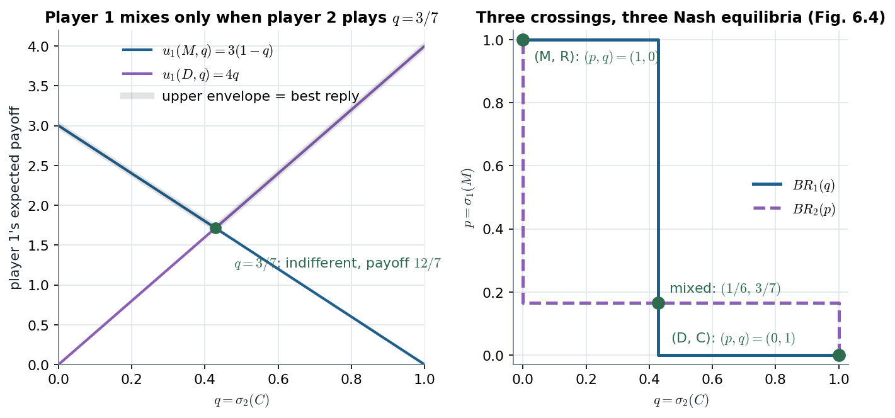

# Slides 42–55 · 6.1–6.2 · Mixed strategies: each player's mix is pinned by the *other* player's indifference

> **Claim.** A mixed strategy is a probability distribution over pure strategies; a belief is a distribution over the
> rivals' strategies. A mixed-strategy NE is a profile of mutual best responses, and **a player mixes only between
> strategies that pay the same** (Prop. 6.1). So the recipe is: find the rival's mix that makes **me** indifferent;
> that is the rival's equilibrium strategy. The lecture's example is the Battle of the Sexes, whose two pure equilibria
> gain a third, mixed one, $(p,q)=(\tfrac23,\tfrac13)$, worth only $\tfrac23$ to each player (slides 47–50). The book's
> other examples (Matching Pennies, rock-paper-scissors, the §6.2.3 game) are reading.
>
> Prev: [[L02-06-hotelling-voting]] · Next: [[L02-08-iesds-rationalizability-revisited]] · Map: [[L02-00-map]]

---

## 1 · U — why mix (slide 42), and games with no pure equilibrium (reading)

Slide 42's motivation: **a player randomizes to avoid being predictable**, to surprise or to avoid being surprised.
The book's examples below (Matching Pennies, rock-paper-scissors) were not covered in class.

**Matching Pennies (p. 101).** Player 1 wins if the pennies match:

| 1 \ 2 | H | T |
|---|---|---|
| **H** | 1, −1 | −1, 1 |
| **T** | −1, 1 | 1, −1 |

Underline method: player 1 wants to match, player 2 to mismatch, so **no cell is a mutual best reply**. The same
holds in rock-paper-scissors (p. 102): from any pure pair at least one player switches. Gibbons (pp. 29–30): poker
(bluffing), pitcher vs batter, attack by land or sea: games where each wants to **outguess** the other. Tadelis
(p. 111): penalty kicks, bosses monitoring employees, police and criminals.

---

## 2 · C — the definitions, exactly

**Definition 6.1 (p. 102; slide 42).** A **mixed strategy** of player $i$ is a probability distribution over $S_i$:
$\sigma_i:S_i\to[0,1]$ with $\sum_{s_i\in S_i}\sigma_i(s_i)=1$. The set of mixed strategies is
$\Sigma_i:=\Delta(S_i)$ (Tadelis writes $\Delta S_i$, the simplex), and a mixed-strategy profile is
$\sigma=(\sigma_1,\dots,\sigma_n)\in\Sigma:=\Sigma_1\times\dots\times\Sigma_n$. Every pure strategy is a (degenerate)
mixed strategy, and with mixed strategies players evaluate **expected** payoffs (slide 42).

**Definition 6.2 (p. 104).** $s_i$ is in the **support** of $\sigma_i$ iff $\sigma_i(s_i)>0$.

**Definition 6.3 (p. 104).** If $S_i$ is an interval, a mixed strategy is a CDF $F_i(x)=\Pr\{s_i\le x\}$; with density
$f_i$, the support is $\{s_i:f_i(s_i)>0\}$. Tadelis's example: in Cournot with capacity 100, choose $q_i$ uniformly on
$[30,50]$: $F_i(s)=(s-30)/20$ on $[30,50]$, $f_i=1/20$ there (Fig. 6.1).

**Definition 6.4 (p. 105).** A **belief** of player $i$ is $\pi_i\in\Delta S_{-i}$, with $\pi_i(s_{-i})$ the probability
$i$ assigns to $s_{-i}$. Beliefs live in the same set as the rivals' mixed profiles.

**Definition 6.5 (p. 105; slide 43).** Expected payoffs, in the slide's three formulas (players randomize
independently, so the probability of a pure profile is the product of the individual probabilities):
$$u_i(\sigma)=\sum_{s\in S}\sigma_1(s_1)\cdots\sigma_n(s_n)\,u_i(s),\tag{1}$$
$$u_i(s_i,\sigma_{-i})=\sum_{s_{-i}\in S_{-i}}\Bigl(\prod_{j\neq i}\sigma_j(s_j)\Bigr)u_i(s_i,s_{-i}),\tag{2}$$
$$u_i(\sigma_i,\sigma_{-i})=\sum_{s_i\in S_i}\sigma_i(s_i)\,u_i(s_i,\sigma_{-i}).\tag{3}$$

> **A mixed strategy's payoff is a weighted average of its pure strategies' payoffs.** Everything below follows from
> that one line: no mix can beat the best pure strategy in its support, and a mix ties with it only if every pure
> strategy in the support ties.

**Worked (p. 106; reading).** RPS against $\sigma_2=(\tfrac12,\tfrac12,0)$:
$u_1(R,\sigma_2)=\tfrac12\cdot0+\tfrac12(-1)+0\cdot1=-\tfrac12$;
$u_1(P,\sigma_2)=\tfrac12\cdot1+\tfrac12\cdot0+0\cdot(-1)=\tfrac12$;
$u_1(S,\sigma_2)=\tfrac12(-1)+\tfrac12\cdot1+0=0$. Unique best reply: **P**.

**Worked, continuous (pp. 106–107; reading): the all-pay auction for a dollar.** Both bid, both pay, the higher bid wins.
Against $s_2\sim U[0,1]$, a bid $s_1<1$ gives
$$u_1=\Pr\{s_1<s_2\}(-s_1)+\Pr\{s_1>s_2\}(1-s_1)=(1-s_1)(-s_1)+s_1(1-s_1)=0,$$
(ties have probability 0), and any bid above 1 gives $1-s_1<0$. **Every bid in $[0,1]$ earns exactly 0**: player 1 is
indifferent across a continuum. (Uniform bidding is in fact a symmetric equilibrium: Tadelis exercise 6.10, p. 125.)

**Definition 6.6 (p. 107; slide 44).** $\sigma^*\in\Sigma$ is a **Nash equilibrium** if for every $i\in I$,
$\sigma_i^*$ is a best response to $\sigma_{-i}^*$:
$$u_i(\sigma_i^*,\sigma_{-i}^*)\ \ge\ u_i(\sigma_i,\sigma_{-i}^*)\qquad\forall\sigma_i\in\Sigma_i .\tag{4}$$
Reading $\sigma_{-i}^*$ as $i$'s belief: rational play given beliefs (rationalizability with uncertain beliefs), plus
correct beliefs (p. 108).

**Proposition 6.1 (p. 108).** If $\sigma^*$ is a NE and $s_i$, $s_i'$ are both in the support of $\sigma_i^*$, then
$$u_i(s_i,\sigma_{-i}^*)=u_i(s_i',\sigma_{-i}^*)=u_i(\sigma_i^*,\sigma_{-i}^*).$$

*Proof.* Suppose $u_i(s_i,\sigma_{-i}^*)>u_i(s_i',\sigma_{-i}^*)$. Move the probability $\sigma_i^*(s_i')>0$ from $s_i'$ to
$s_i$. By Def. 6.5 the payoff rises by $\sigma_i^*(s_i')\,[u_i(s_i,\sigma_{-i}^*)-u_i(s_i',\sigma_{-i}^*)]>0$, so $\sigma_i^*$
was not a best response. Hence the two are equal, and the weighted average of equal numbers equals each of them. ∎

Tadelis's Prop. 6.1 is one direction of one condition. The lecture states and proves the **full characterisation**:

### 2b · C — the principle of indifference (slides 44–46)

**Support.** $\operatorname{supp}\sigma_i:=\{s_i\in S_i:\sigma_i(s_i)>0\}$ (Tadelis Def. 6.2).

**Principle of indifference (slide 44).** $\sigma^*\in\Sigma$ is a Nash equilibrium **if and only if**, for every
$i\in I$,
$$\text{(i)}\quad u_i(\sigma^*)=u_i(s_i,\sigma_{-i}^*)\quad\text{for every }s_i\in\operatorname{supp}\sigma_i^*;\tag{5}$$
$$\text{(ii)}\quad u_i(\sigma^*)\ge u_i(s_i,\sigma_{-i}^*)\quad\text{for every }s_i\in S_i\setminus\operatorname{supp}\sigma_i^*.\tag{6}$$
In words: **every strategy played with positive probability yields the same expected payoff, and no strategy
outside the support yields more.** This is MWG Prop. 8.D.1 (p. 250).

*Proof, indifference ⇒ Nash (slide 45).* Suppose $\sigma^*$ satisfies (5) and (6) for every $i$. Together they say
$u_i(s_i,\sigma_{-i}^*)\le u_i(\sigma_i^*,\sigma_{-i}^*)$ for **every** pure $s_i\in S_i$. Take any $\sigma_i\in\Sigma_i$; by (3),
$$u_i(\sigma_i,\sigma_{-i}^*)=\sum_{s_i\in S_i}\sigma_i(s_i)\,u_i(s_i,\sigma_{-i}^*)$$
$$\le\sum_{s_i\in S_i}\sigma_i(s_i)\,u_i(\sigma_i^*,\sigma_{-i}^*)$$
$$=u_i(\sigma_i^*,\sigma_{-i}^*),$$
because the weights $\sigma_i(s_i)$ are non-negative and sum to 1. That is (4). ∎

*Proof, Nash ⇒ indifference (slide 46).* Suppose $\sigma^*$ is a NE but (5) fails for some player $j$: there are
$s_j',s_j''\in\operatorname{supp}\sigma_j^*$ with $u_j(s_j'',\sigma_{-j}^*)>u_j(s_j',\sigma_{-j}^*)$. Build $\hat\sigma_j$ by
moving the probability of $s_j'$ onto $s_j''$:
$$\hat\sigma_j(s_j)=\begin{cases}\sigma_j^*(s_j)&s_j\notin\{s_j',s_j''\},\\ 0&s_j=s_j',\\ \sigma_j^*(s_j')+\sigma_j^*(s_j'')&s_j=s_j''.\end{cases}$$
By (3) the payoff changes by $\sigma_j^*(s_j')\,[u_j(s_j'',\sigma_{-j}^*)-u_j(s_j',\sigma_{-j}^*)]>0$, so
$u_j(\hat\sigma_j,\sigma_{-j}^*)>u_j(\sigma_j^*,\sigma_{-j}^*)$, contradicting (4). Condition (6) follows the same way: if
some $s_j\notin\operatorname{supp}\sigma_j^*$ paid more than $u_j(\sigma^*)$, moving all the weight onto $s_j$ would pay
more. ∎

> **How to use it.** To find a mixed NE, guess the supports, then write the indifference conditions (5): player
> $i$'s indifference is an equation in the **others'** probabilities. Then check (6) for the unused strategies.
> To verify a candidate, it suffices to check deviations to **pure** strategies.

### 2c · Worked — Example 3, the Battle of the Sexes in mixed strategies (slides 47–50)

**Notation.** $p=\Pr(\text{Alex plays O})\in[0,1]$, $q=\Pr(\text{Chris plays O})\in[0,1]$; payoffs as in
[[L02-01-best-response-rationalizability]] §1 (Alex 2 and Chris 1 at (O, O); Alex 1 and Chris 2 at (F, F); 0 apart).

**Alex's expected payoffs (slide 47),** from (2):
$$u_A(O,q)=2q+0\,(1-q)=2q,\tag{7}$$
$$u_A(F,q)=0\,q+1\,(1-q)=1-q.\tag{8}$$
Alex prefers O iff (7) > (8): $2q>1-q$, i.e. $q>\tfrac13$. So (slide 48)
$$BR_A(q)=\begin{cases}F\ (p=0)&q<\tfrac13,\\ \text{any }p\in[0,1]&q=\tfrac13,\\ O\ (p=1)&q>\tfrac13.\end{cases}\tag{9}$$

**Chris's expected payoffs (slide 49):**
$$u_C(O,p)=1\cdot p+0\,(1-p)=p,\tag{10}$$
$$u_C(F,p)=0\cdot p+2\,(1-p)=2-2p.\tag{11}$$
Chris prefers O iff (10) > (11): $p>2-2p$, i.e. $p>\tfrac23$. So
$$BR_C(p)=\begin{cases}q=0\ (F)&p<\tfrac23,\\ q\in[0,1]&p=\tfrac23,\\ q=1\ (O)&p>\tfrac23.\end{cases}\tag{12}$$

**All Nash equilibria (slide 50)** are the intersections of (9) and (12):

| $(p,q)$ | Profile | Alex's payoff | Chris's payoff |
|---|---|---|---|
| $(0,0)$ | (F, F) | 1 | 2 |
| $(1,1)$ | (O, O) | 2 | 1 |
| $(\tfrac23,\tfrac13)$ | **mixed** | $2q=2\cdot\tfrac13=\tfrac23$ | $p=\tfrac23$ |

At the mixed equilibrium both supports are full, so (5) is the whole check: (7) = (8) at $q=\tfrac13$ and (10) = (11) at
$p=\tfrac23$.

*Left: eqs. (7)–(8); the upper envelope is Alex's best-reply payoff, and Alex is willing to mix only at $q=\tfrac13$. Right: eqs. (9) and (12), three crossings, three equilibria. Source: slides 47–50.*

Two things to read off. **Each probability is pinned down by the other player's payoffs**: Alex's $p=\tfrac23$ is what
makes **Chris** indifferent in (10)–(11), and Chris's $q=\tfrac13$ is what makes **Alex** indifferent in (7)–(8). And
**each player expects $\tfrac23$, less than in either pure equilibrium** (where the worse-off player still gets 1),
because they miscoordinate with probability $p(1-q)+(1-p)q=\tfrac23\cdot\tfrac23+\tfrac13\cdot\tfrac13=\tfrac59$.

---

## 3 · Not covered in class — Matching Pennies (§6.2.1, pp. 108–111)

Let $p=\Pr(\text{1 plays H})$, $q=\Pr(\text{2 plays H})$.

**Player 1's payoffs (6.1)–(6.2):** $u_1(H,q)=q-(1-q)=2q-1$; $u_1(T,q)=-q+(1-q)=1-2q$.
H is better iff $2q-1>1-2q$ iff $q>\tfrac12$. So

$$BR_1(q)=\begin{cases}p=0&q<\tfrac12\\ p\in[0,1]&q=\tfrac12\\ p=1&q>\tfrac12\end{cases}\qquad
BR_2(p)=\begin{cases}q=1&p<\tfrac12\\ q\in[0,1]&p=\tfrac12\\ q=0&p>\tfrac12\end{cases}$$

(player 2: $u_2(p,H)=-p+(1-p)=1-2p$, $u_2(p,T)=2p-1$). The correspondences cross once:

$$\boxed{(p,q)=(\tfrac12,\tfrac12)}$$

> **The indifference logic (p. 111):** player 1 is willing to mix only if $q=\tfrac12$, so **player 1's
> indifference pins player 2's strategy**, and vice versa. Each player mixes in a way that makes the *other*
> indifferent. A player's own payoffs do not determine his own mix.

Gibbons writes the same payoff as one linear function of the mixing probability, $(2q-1)+r(2-4q)$ (eq. 1.3.1, p. 34;
his $r$ is the probability of Heads for player 1): increasing in $r$ when $q<\tfrac12$ in his orientation, flat at
$q=\tfrac12$. Flat means **every** $r$ is a best reply: that is why the correspondence has a vertical segment.

---

## 4 · Not covered in class — rock-paper-scissors (§6.2.2, pp. 111–113)

**Claim 6.1.** No equilibrium has one player pure and the other mixing: against a pure strategy the other player's
three payoffs are all different (0, 1, −1 in some order), so he cannot be indifferent, so he plays pure; and there is no
pure equilibrium.

**Claim 6.2.** No equilibrium has a player mixing over exactly two strategies. If $i$ mixes R and P, then for $j$, P
beats R against both ($j$'s payoffs: vs R, P gives 1 > 0; vs P, P gives 0 > −1), so $j$ never plays R; but if $j$
never plays R, then for $i$, S beats P against both remaining (vs P: 1 > 0; vs S: 0 > −1), so $i$ never plays P,
contradicting the mix. Same for every pair.

**Full support.** Let $i$ play $(\sigma_R,\sigma_P,1-\sigma_R-\sigma_P)$. Player $j$'s payoffs:
$$u_j(R)=-\sigma_P+(1-\sigma_R-\sigma_P)=1-\sigma_R-2\sigma_P,\quad u_j(P)=\sigma_R-(1-\sigma_R-\sigma_P)=2\sigma_R+\sigma_P-1,\quad u_j(S)=-\sigma_R+\sigma_P .$$
$u_j(R)=u_j(S)$: $1-\sigma_R-2\sigma_P=-\sigma_R+\sigma_P\Rightarrow\sigma_P=\tfrac13$.
$u_j(P)=u_j(S)$: $2\sigma_R+\sigma_P-1=-\sigma_R+\sigma_P\Rightarrow\sigma_R=\tfrac13$. Hence $\sigma_S=\tfrac13$, and

$$\sigma_1^*=\sigma_2^*=(\tfrac13,\tfrac13,\tfrac13)\ \text{ is the unique NE, each player's payoff 0.}$$

---

## 5 · Not covered in class — pure and mixed together (§6.2.3, pp. 113–114)

| 1 \ 2 | C | R |
|---|---|---|
| **M** | 0, 0 | 3, 5 |
| **D** | 4, 4 | 0, 3 |

Pure NE (underline method): against C player 1 prefers D (4 > 0); against R, M (3 > 0); against M player 2 prefers R
(5 > 0); against D, C (4 > 3). Mutual: **(M, R)** and **(D, C)**.

Mixed: $p=\sigma_1(M)$, $q=\sigma_2(C)$.

- Player 1 indifferent: $u_1(M,q)=3(1-q)$, $u_1(D,q)=4q$; $3-3q=4q\Rightarrow\boxed{q=\tfrac37}$.
- Player 2 indifferent: $u_2(p,C)=4(1-p)$, $u_2(p,R)=5p+3(1-p)=3+2p$; $4-4p=3+2p\Rightarrow\boxed{p=\tfrac16}$.

$$\sigma^*=\bigl((\tfrac16,\tfrac56),(\tfrac37,\tfrac47)\bigr).$$

Payoffs there: player 1 gets $4q=\tfrac{12}7$; player 2 gets $3+2p=\tfrac{10}3$. Best responses:

$$BR_1(q)=\begin{cases}p=1&q<\tfrac37\\ [0,1]&q=\tfrac37\\ p=0&q>\tfrac37\end{cases}\qquad
BR_2(p)=\begin{cases}q=1&p<\tfrac16\\ [0,1]&p=\tfrac16\\ q=0&p>\tfrac16\end{cases}$$

They cross three times: $(p,q)\in\{(1,0),(\tfrac16,\tfrac37),(0,1)\}$.

*Left: the analogue of Tadelis Fig. 6.2 for the §6.2.3 game; the upper envelope is player 1's best-reply payoff. Right: Fig. 6.4, three crossings, three equilibria. Source: pp. 113–114.*

Read the left panel to see why player 1's mix is irrelevant to player 1: at $q=\tfrac37$ both lines give $\tfrac{12}7$,
so every $p$ is optimal; what fixes $p=\tfrac16$ is player 2's indifference, on the other side of the game.

> **"Almost always" an odd number (footnote 6, p. 113).** A 2×2 game with two pure equilibria generically has a
> third, mixed one; generic finite games have an odd number of equilibria (the index theorem, named only).

> **Interactive companion.** [The Mixing Square](companions/companion-mixed-2x2.html) — the default is this game; set
> the belief sliders to $q=\tfrac37$, $p=\tfrac16$ with "Beliefs to indifference" and watch both gain read-outs hit
> zero; then load Matching Pennies, the Battle of the Sexes and the Stag Hunt.

---

## 6 · Not covered in class — every 2×2 game, by cases (Gibbons §1.3.B, pp. 41–44)

Write player 1's payoffs as $x=u_1(\text{Up},\text{Left})$, $y=u_1(\text{Up},\text{Right})$, $z=u_1(\text{Down},\text{Left})$,
$w=u_1(\text{Down},\text{Right})$ (Fig. 1.3.8), $q=\Pr(\text{Left})$.

| Case | Condition | $r^*(q)$, with $r=\Pr(\text{Up})$ |
|---|---|---|
| (i) | $x>z$, $y>w$ | Up strictly dominant: $r=1$ |
| (ii) | $x<z$, $y<w$ | Down strictly dominant: $r=0$ |
| (iii) | $x>z$, $y<w$ | Up iff $q>q'$, any $r$ at $q=q'$ |
| (iv) | $x<z$, $y>w$ | Up iff $q<q'$, any $r$ at $q=q'$ |

with $q'=\dfrac{w-y}{(x-z)+(w-y)}$. Equalities ($x=z$ or $y=w$) give L-shaped correspondences. Pairing any of
player 1's four shapes with any of player 2's always produces **at least one crossing**, and the generic outcomes are
(1) one pure NE, (2) one mixed NE (Matching Pennies), or (3) two pure and one mixed (Battle of the Sexes, Tadelis
§6.2.3). This is the graphical existence proof for 2×2 games, previewing [[L02-09-existence]].

**Battle of the Sexes (Gibbons p. 40, Tadelis exercise 6.1, p. 123).** The lecture's Example 3, worked in §2c:
**each goes to his own favourite event with probability $\tfrac23$**, and they miscoordinate with probability
$\tfrac59$. In Gibbons's case language it is case (iii) for both players: two pure equilibria and one mixed.

---

## 7 · C — what a mixed strategy means, and existence (slide 51)

The slides list three **common interpretations** of mixed strategies:

| Interpretation | What $\sigma_j$ is |
|---|---|
| **Beliefs** | $\sigma_{-i}$ describes what player $i$ **believes** the others will do |
| **Empirical frequencies** | long-run frequencies of actions in **repeated** interactions |
| **Population distribution** | the **share of a population** of players using each action |

**Theorem (Nash, 1950; slide 51).** Every finite normal-form game has a Nash equilibrium in mixed strategies
([[L02-09-existence]]). Slide 51's "why?": a profile of pure strategies is also a profile of mixed strategies, because
each pure $s_i$ is the degenerate $\sigma_i$ with $\sigma_i(s_i)=1$; so a pure equilibrium, when it exists, is one of
the equilibria the theorem counts (the Battle of the Sexes has three).

The book's version of the beliefs reading:

Gibbons (pp. 39–40), following Harsanyi (1973): a mixed equilibrium **does not require anyone to flip a coin**. Player
$j$'s mix represents player $i$'s **uncertainty** about $j$'s pure choice, e.g. a pitcher who picks the pitch from
private information the batter does not see. Tadelis (p. 105) offers the same reading: an opponent whose unknown
background determines his play. [[../../rules/game-theory|rules/game-theory]] item 8: the indifference condition
**pins the opponent's mix**, which is the useful part. Tadelis returns to this "purification" in §12.5
([[../L07/L07-00-map|Lecture 7]]).

---

## 8 · G → C — MWG Prop. 8.D.1 (p. 250) is the slides' principle of indifference

Promoted to the course layer by the lecture (§2b). MWG Def. 8.D.2 (p. 250) is Def. 6.6. **Prop. 8.D.1 (p. 250):** with $S_i^+$ the support of $\sigma_i$, $\sigma$ is a NE iff
for every $i$ (i) $u_i(s_i,\sigma_{-i})=u_i(s_i',\sigma_{-i})$ for all $s_i,s_i'\in S_i^+$, and (ii)
$u_i(s_i,\sigma_{-i})\ge u_i(s_i',\sigma_{-i})$ for all $s_i\in S_i^+$, $s_i'\notin S_i^+$. Condition (ii) is the half
Prop. 6.1 does not state: **unused strategies must not do better**. Its corollary: to test a profile it suffices to
check deviations to **pure** strategies. This is the basis of support enumeration ([[L02-12-python]] §7).

---

## 9 · C — the mini case: monitoring remote work (slides 53–55; graded, method only)

**Motivation (slide 53).** In September 2025 Itaú dismissed employees after finding mismatches between their clock-in
records and the activity monitored on their computers while working from home; the bank workers' union estimated
about 1,000 dismissals (source on the slide: g1, 2025). Monitoring software is costly, and employees know it may be in
place. *How much should a firm monitor, and how much shirking should it expect?*

**The game (slide 54).** A remote employee chooses **work** ($W$) or **shirk** ($S$); simultaneously the manager
chooses **monitor** ($M$) or **not** ($N$). A shirker who is caught loses the wage.

| Employee \ Manager | $M$ | $N$ |
|---|---|---|
| $W$ | $w-g,\ v-w-h$ | $w-g,\ v-w$ |
| $S$ | $0,\ -h$ | $w,\ -w$ |

Parameters: $w=10$ wage, $g=2$ cost of effort, $v=20$ value of output, $h=1$ cost of monitoring.

> **Graded in-class exercise (in pairs, handed in on the day).** These notes describe the **method only**; they do not
> solve parts (a)–(e). Work it yourself before looking at any solution.

**Method, part by part (slide 55).**
- *(a) No pure equilibrium.* Apply the underline method of [[L02-02-nash-equilibrium]] §3 to the four cells with
  the numbers plugged in: for each cell, ask whether one player gains by switching. A cell where nobody gains would be
  a pure NE; show that every cell has a profitable unilateral deviation.
- *(b) The mixed equilibrium.* Name the probabilities (e.g. $s=\Pr(S)$ for the employee, $m=\Pr(M)$ for the manager).
  By the principle of indifference (§2b): the **manager's** indifference between $M$ and $N$ is one equation in the
  **employee's** shirking probability; the **employee's** indifference between $W$ and $S$ is one equation in the
  **manager's** monitoring probability. Solve each linear equation and check both lie in $(0,1)$.
- *(c)–(d) Comparative statics.* Re-solve with the new parameter ($h=0.5$; then $w=20$) and compare. For the
  intuition, ask **whose** indifference condition contains the changed parameter, and therefore **whose** probability
  moves (slide 50's lesson).
- *(e) General formulas.* Redo (b) with $w$, $g$, $h$ (and $v$) as symbols; read each probability's dependence off its
  formula. For the policy question, compare what each lever costs the firm; for the critique, list what the 2×2 model
  assumes (simultaneous moves, perfect detection when monitoring, a fixed wage, one period, no other sanctions) and
  ask which of these the Itaú story strains.

Related book exercises, kept out of the practice list until the case is returned: Tadelis 6.4 "Monitoring"
(pp. 123–124) and 6.12 "The Tax Man" (p. 126).

## Links

- Neighbours: [[L02-08-iesds-rationalizability-revisited]] (mixed strategies sharpen IESDS),
  [[L02-09-existence]] (why a mixed equilibrium always exists).
- Lecture 7 (Bayesian games, purification): [[../L07/L07-00-map|Lecture 7]].
- Code: [[L02-12-python]] §7.
- Practice: Tadelis 6.1, 6.4–6.8 (pp. 123–125); Gibbons 1.9–1.11 (pp. 50–51), 1.3 (p. 49); MWG 8.D.3–8.D.5 (p. 263);
  Muñoz-Garcia & Toro-Gonzalez Ch. 3 (pp. 85–151).
