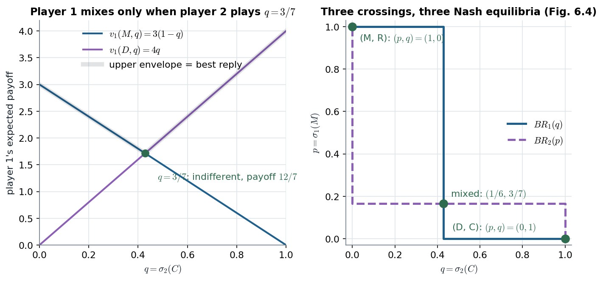

# 6.1–6.2 · Mixed strategies: each player's mix is pinned by the *other* player's indifference

> **Claim.** A mixed strategy is a probability distribution over pure strategies; a belief is a distribution over the
> rivals' strategies. A mixed-strategy NE is a profile of mutual best responses, and **a player mixes only between
> strategies that pay the same** (Prop. 6.1). So the recipe is: find the rival's mix that makes **me** indifferent;
> that is the rival's equilibrium strategy. Matching Pennies gets its only equilibrium this way, $(\tfrac12,\tfrac12)$;
> rock-paper-scissors gets $(\tfrac13,\tfrac13,\tfrac13)$; a 2×2 game with two pure equilibria (Tadelis §6.2.3)
> gets a third, mixed one, $(p,q)=(\tfrac16,\tfrac37)$.
>
> Prev: [[L02-06-hotelling-voting]] · Next: [[L02-08-iesds-rationalizability-revisited]] · Map: [[L02-00-map]]

---

## 1 · U — games with no pure equilibrium

**Matching Pennies (p. 101).** Player 1 wins if the pennies match:

| 1 \ 2 | H | T |
|---|---|---|
| **H** | 1, −1 | −1, 1 |
| **T** | −1, 1 | 1, −1 |

Underline method: player 1 wants to match, player 2 to mismatch, so **no cell is a mutual best reply**. The same
holds in rock-paper-scissors (p. 102): from any pure pair at least one player switches. Gibbons (pp. 29–30): poker
(bluffing), pitcher vs batter, attack by land or sea: games where each wants to **outguess** the other. Tadelis
(p. 111): penalty kicks, bosses monitoring employees, police and criminals.

---

## 2 · C — the definitions, exactly

**Definition 6.1 (p. 102).** With $S_i=\{s_{i1},\dots,s_{im}\}$ finite, $\Delta S_i$ is the simplex of probability
distributions over $S_i$; a **mixed strategy** is $\sigma_i\in\Delta S_i$, $\sigma_i(s_i)$ the probability of $s_i$, with
$\sigma_i(s_i)\ge0$ and $\sum_{s_i}\sigma_i(s_i)=1$ (p. 103). A pure strategy is the degenerate mixed strategy.

**Definition 6.2 (p. 104).** $s_i$ is in the **support** of $\sigma_i$ iff $\sigma_i(s_i)>0$.

**Definition 6.3 (p. 104).** If $S_i$ is an interval, a mixed strategy is a CDF $F_i(x)=\Pr\{s_i\le x\}$; with density
$f_i$, the support is $\{s_i:f_i(s_i)>0\}$. Tadelis's example: in Cournot with capacity 100, choose $q_i$ uniformly on
$[30,50]$: $F_i(s)=(s-30)/20$ on $[30,50]$, $f_i=1/20$ there (Fig. 6.1).

**Definition 6.4 (p. 105).** A **belief** of player $i$ is $\pi_i\in\Delta S_{-i}$, with $\pi_i(s_{-i})$ the probability
$i$ assigns to $s_{-i}$. Beliefs live in the same set as the rivals' mixed profiles.

**Definition 6.5 (p. 105).** Expected payoffs:
$$v_i(s_i,\sigma_{-i})=\sum_{s_{-i}\in S_{-i}}\sigma_{-i}(s_{-i})\,v_i(s_i,s_{-i}),\qquad
v_i(\sigma_i,\sigma_{-i})=\sum_{s_i\in S_i}\sigma_i(s_i)\,v_i(s_i,\sigma_{-i}).$$

> **A mixed strategy's payoff is a weighted average of its pure strategies' payoffs.** Everything below follows from
> that one line: no mix can beat the best pure strategy in its support, and a mix ties with it only if every pure
> strategy in the support ties.

**Worked (p. 106).** RPS against $\sigma_2=(\tfrac12,\tfrac12,0)$:
$v_1(R,\sigma_2)=\tfrac12\cdot0+\tfrac12(-1)+0\cdot1=-\tfrac12$;
$v_1(P,\sigma_2)=\tfrac12\cdot1+\tfrac12\cdot0+0\cdot(-1)=\tfrac12$;
$v_1(S,\sigma_2)=\tfrac12(-1)+\tfrac12\cdot1+0=0$. Unique best reply: **P**.

**Worked, continuous (pp. 106–107): the all-pay auction for a dollar.** Both bid, both pay, the higher bid wins.
Against $s_2\sim U[0,1]$, a bid $s_1<1$ gives
$$v_1=\Pr\{s_1<s_2\}(-s_1)+\Pr\{s_1>s_2\}(1-s_1)=(1-s_1)(-s_1)+s_1(1-s_1)=0,$$
(ties have probability 0), and any bid above 1 gives $1-s_1<0$. **Every bid in $[0,1]$ earns exactly 0**: player 1 is
indifferent across a continuum. (Uniform bidding is in fact a symmetric equilibrium: Tadelis exercise 6.10, p. 125.)

**Definition 6.6 (p. 107).** $\sigma^*=(\sigma_1^*,\dots,\sigma_n^*)$ is a **Nash equilibrium** if for each $i$,
$\sigma_i^*$ is a best response to $\sigma_{-i}^*$:
$$v_i(\sigma_i^*,\sigma_{-i}^*)\ \ge\ v_i(\sigma_i,\sigma_{-i}^*)\qquad\forall\sigma_i\in\Delta S_i .$$
Reading $\sigma_{-i}^*$ as $i$'s belief: rational play given beliefs (rationalizability with uncertain beliefs), plus
correct beliefs (p. 108).

**Proposition 6.1 (p. 108).** If $\sigma^*$ is a NE and $s_i$, $s_i'$ are both in the support of $\sigma_i^*$, then
$$v_i(s_i,\sigma_{-i}^*)=v_i(s_i',\sigma_{-i}^*)=v_i(\sigma_i^*,\sigma_{-i}^*).$$

*Proof.* Suppose $v_i(s_i,\sigma_{-i}^*)>v_i(s_i',\sigma_{-i}^*)$. Move the probability $\sigma_i^*(s_i')>0$ from $s_i'$ to
$s_i$. By Def. 6.5 the payoff rises by $\sigma_i^*(s_i')\,[v_i(s_i,\sigma_{-i}^*)-v_i(s_i',\sigma_{-i}^*)]>0$, so $\sigma_i^*$
was not a best response. Hence the two are equal, and the weighted average of equal numbers equals each of them. ∎

---

## 3 · Worked — Matching Pennies (§6.2.1, pp. 108–111)

Let $p=\Pr(\text{1 plays H})$, $q=\Pr(\text{2 plays H})$.

**Player 1's payoffs (6.1)–(6.2):** $v_1(H,q)=q-(1-q)=2q-1$; $v_1(T,q)=-q+(1-q)=1-2q$.
H is better iff $2q-1>1-2q$ iff $q>\tfrac12$. So

$$BR_1(q)=\begin{cases}p=0&q<\tfrac12\\ p\in[0,1]&q=\tfrac12\\ p=1&q>\tfrac12\end{cases}\qquad
BR_2(p)=\begin{cases}q=1&p<\tfrac12\\ q\in[0,1]&p=\tfrac12\\ q=0&p>\tfrac12\end{cases}$$

(player 2: $v_2(p,H)=-p+(1-p)=1-2p$, $v_2(p,T)=2p-1$). The correspondences cross once:

$$\boxed{(p,q)=(\tfrac12,\tfrac12)}$$

> **The indifference logic (p. 111):** player 1 is willing to mix only if $q=\tfrac12$, so **player 1's
> indifference pins player 2's strategy**, and vice versa. Each player mixes in a way that makes the *other*
> indifferent. A player's own payoffs do not determine his own mix.

Gibbons writes the same payoff as one linear function of the mixing probability, $(2q-1)+r(2-4q)$ (eq. 1.3.1, p. 34;
his $r$ is the probability of Heads for player 1): increasing in $r$ when $q<\tfrac12$ in his orientation, flat at
$q=\tfrac12$. Flat means **every** $r$ is a best reply: that is why the correspondence has a vertical segment.

---

## 4 · Worked — rock-paper-scissors (§6.2.2, pp. 111–113)

**Claim 6.1.** No equilibrium has one player pure and the other mixing: against a pure strategy the other player's
three payoffs are all different (0, 1, −1 in some order), so he cannot be indifferent, so he plays pure; and there is no
pure equilibrium.

**Claim 6.2.** No equilibrium has a player mixing over exactly two strategies. If $i$ mixes R and P, then for $j$, P
beats R against both ($j$'s payoffs: vs R, P gives 1 > 0; vs P, P gives 0 > −1), so $j$ never plays R; but if $j$
never plays R, then for $i$, S beats P against both remaining (vs P: 1 > 0; vs S: 0 > −1), so $i$ never plays P,
contradicting the mix. Same for every pair.

**Full support.** Let $i$ play $(\sigma_R,\sigma_P,1-\sigma_R-\sigma_P)$. Player $j$'s payoffs:
$$v_j(R)=-\sigma_P+(1-\sigma_R-\sigma_P)=1-\sigma_R-2\sigma_P,\quad v_j(P)=\sigma_R-(1-\sigma_R-\sigma_P)=2\sigma_R+\sigma_P-1,\quad v_j(S)=-\sigma_R+\sigma_P .$$
$v_j(R)=v_j(S)$: $1-\sigma_R-2\sigma_P=-\sigma_R+\sigma_P\Rightarrow\sigma_P=\tfrac13$.
$v_j(P)=v_j(S)$: $2\sigma_R+\sigma_P-1=-\sigma_R+\sigma_P\Rightarrow\sigma_R=\tfrac13$. Hence $\sigma_S=\tfrac13$, and

$$\sigma_1^*=\sigma_2^*=(\tfrac13,\tfrac13,\tfrac13)\ \text{ is the unique NE, each player's payoff 0.}$$

---

## 5 · Worked — pure and mixed together (§6.2.3, pp. 113–114)

| 1 \ 2 | C | R |
|---|---|---|
| **M** | 0, 0 | 3, 5 |
| **D** | 4, 4 | 0, 3 |

Pure NE (underline method): against C player 1 prefers D (4 > 0); against R, M (3 > 0); against M player 2 prefers R
(5 > 0); against D, C (4 > 3). Mutual: **(M, R)** and **(D, C)**.

Mixed: $p=\sigma_1(M)$, $q=\sigma_2(C)$.

- Player 1 indifferent: $v_1(M,q)=3(1-q)$, $v_1(D,q)=4q$; $3-3q=4q\Rightarrow\boxed{q=\tfrac37}$.
- Player 2 indifferent: $v_2(p,C)=4(1-p)$, $v_2(p,R)=5p+3(1-p)=3+2p$; $4-4p=3+2p\Rightarrow\boxed{p=\tfrac16}$.

$$\sigma^*=\bigl((\tfrac16,\tfrac56),(\tfrac37,\tfrac47)\bigr).$$

Payoffs there: player 1 gets $4q=\tfrac{12}7$; player 2 gets $3+2p=\tfrac{10}3$. Best responses:

$$BR_1(q)=\begin{cases}p=1&q<\tfrac37\\ [0,1]&q=\tfrac37\\ p=0&q>\tfrac37\end{cases}\qquad
BR_2(p)=\begin{cases}q=1&p<\tfrac16\\ [0,1]&p=\tfrac16\\ q=0&p>\tfrac16\end{cases}$$

They cross three times: $(p,q)\in\{(1,0),(\tfrac16,\tfrac37),(0,1)\}$.

*Left: the analogue of Tadelis Fig. 6.2 for the §6.2.3 game; the upper envelope is player 1's best-reply payoff. Right: Fig. 6.4, three crossings, three equilibria. Source: pp. 113–114.*

Read the left panel to see why player 1's mix is irrelevant to player 1: at $q=\tfrac37$ both lines give $\tfrac{12}7$,
so every $p$ is optimal; what fixes $p=\tfrac16$ is player 2's indifference, on the other side of the game.

> **"Almost always" an odd number (footnote 6, p. 113).** A 2×2 game with two pure equilibria generically has a
> third, mixed one; generic finite games have an odd number of equilibria (the index theorem, named only).

> **Interactive companion.** [The Mixing Square](companions/companion-mixed-2x2.html) — the default is this game; set
> the belief sliders to $q=\tfrac37$, $p=\tfrac16$ with "Beliefs to indifference" and watch both gain read-outs hit
> zero; then load Matching Pennies, the Battle of the Sexes and the Stag Hunt.

---

## 6 · C — every 2×2 game, by cases (Gibbons §1.3.B, pp. 41–44)

Write player 1's payoffs as $x=u_1(\text{Up},\text{Left})$, $y=u_1(\text{Up},\text{Right})$, $z=u_1(\text{Down},\text{Left})$,
$w=u_1(\text{Down},\text{Right})$ (Fig. 1.3.8), $q=\Pr(\text{Left})$.

| Case | Condition | $r^*(q)$, with $r=\Pr(\text{Up})$ |
|---|---|---|
| (i) | $x>z$, $y>w$ | Up strictly dominant: $r=1$ |
| (ii) | $x<z$, $y<w$ | Down strictly dominant: $r=0$ |
| (iii) | $x>z$, $y<w$ | Up iff $q>q'$, any $r$ at $q=q'$ |
| (iv) | $x<z$, $y>w$ | Up iff $q<q'$, any $r$ at $q=q'$ |

with $q'=\dfrac{w-y}{(x-z)+(w-y)}$. Equalities ($x=z$ or $y=w$) give L-shaped correspondences. Pairing any of
player 1's four shapes with any of player 2's always produces **at least one crossing**, and the generic outcomes are
(1) one pure NE, (2) one mixed NE (Matching Pennies), or (3) two pure and one mixed (Battle of the Sexes, Tadelis
§6.2.3). This is the graphical existence proof for 2×2 games, previewing [[L02-09-existence]].

**Battle of the Sexes (Gibbons p. 40, Tadelis exercise 6.1, p. 123).** In Tadelis's payoffs (Alex rows, 2/1 at O),
Alex is indifferent when Chris goes to O with probability $\tfrac13$ ($2q=1-q$), Chris when Alex goes to O with
probability $\tfrac23$ ($p=2(1-p)$): **each goes to his own favourite event with probability $\tfrac23$**, and they
miscoordinate with probability $\tfrac23\cdot\tfrac23+\tfrac13\cdot\tfrac13=\tfrac59$.

---

## 7 · U — what a mixed strategy means

Gibbons (pp. 39–40), following Harsanyi (1973): a mixed equilibrium **does not require anyone to flip a coin**. Player
$j$'s mix represents player $i$'s **uncertainty** about $j$'s pure choice, e.g. a pitcher who picks the pitch from
private information the batter does not see. Tadelis (p. 105) offers the same reading: an opponent whose unknown
background determines his play. [[../../rules/game-theory|rules/game-theory]] item 8: the indifference condition
**pins the opponent's mix**, which is the useful part. Tadelis returns to this "purification" in §12.5
([[../L07/L07-00-map|Lecture 7]]).

---

## 8 · G — MWG Prop. 8.D.1 (p. 250)

MWG Def. 8.D.2 (p. 250) is Def. 6.6. **Prop. 8.D.1 (p. 250):** with $S_i^+$ the support of $\sigma_i$, $\sigma$ is a NE iff
for every $i$ (i) $u_i(s_i,\sigma_{-i})=u_i(s_i',\sigma_{-i})$ for all $s_i,s_i'\in S_i^+$, and (ii)
$u_i(s_i,\sigma_{-i})\ge u_i(s_i',\sigma_{-i})$ for all $s_i\in S_i^+$, $s_i'\notin S_i^+$. Condition (ii) is the half
Prop. 6.1 does not state: **unused strategies must not do better**. Its corollary: to test a profile it suffices to
check deviations to **pure** strategies. This is the basis of support enumeration ([[L02-12-python]] §7).

---

## Links

- Neighbours: [[L02-08-iesds-rationalizability-revisited]] (mixed strategies sharpen IESDS),
  [[L02-09-existence]] (why a mixed equilibrium always exists).
- Lecture 7 (Bayesian games, purification): [[../L07/L07-00-map|Lecture 7]].
- Code: [[L02-12-python]] §7.
- Practice: Tadelis 6.1, 6.4–6.8 (pp. 123–125); Gibbons 1.9–1.11 (pp. 50–51), 1.3 (p. 49); MWG 8.D.3–8.D.5 (p. 263);
  Muñoz-Garcia & Toro-Gonzalez Ch. 3 (pp. 85–151).
