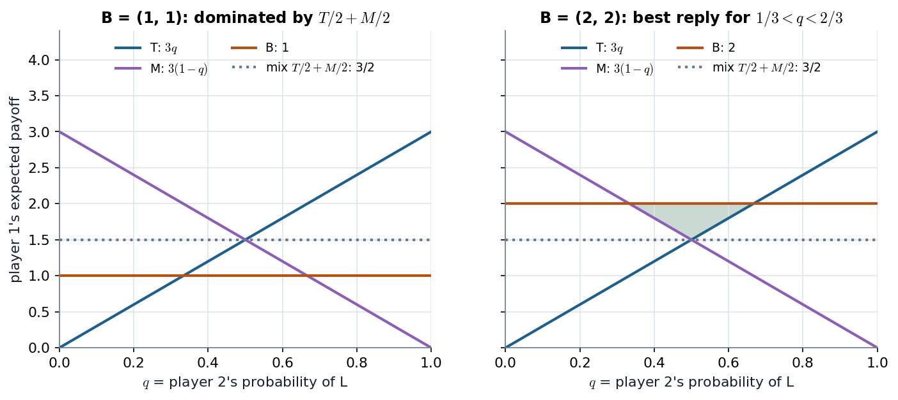

# 6.3 · IESDS and rationalizability revisited: let mixtures dominate, let beliefs be mixed

> **Claim.** Once mixed strategies exist, a pure strategy can be **strictly dominated by a mixture** without being
> dominated by any pure strategy, and can be a **best response to a mixed belief** without being a best response to
> any pure one. Both sharpen the Lecture 1 tools: in Tadelis's 3×3 game nothing is pure-dominated, yet mixed IESDS
> reduces it to the 2×2 game of §6.2.3. **In two-player games, "strictly dominated" and "never a best response" are
> the same thing** (Prop. 6.2), so IESDS and rationalizability coincide.
>
> Prev: [[L02-07-mixed-strategies]] · Next: [[L02-09-existence]] · Map: [[L02-00-map]]

---

## 1 · C — the two definitions (p. 114)

**Definition 6.7.** $s_i$ is **strictly dominated by $\sigma_i\in\Delta S_i$** if
$$v_i(\sigma_i,s_{-i})>v_i(s_i,s_{-i})\qquad\forall s_{-i}\in S_{-i}.$$

**Definition 6.8.** $\sigma_i$ is **never a best response** if there is no belief $\sigma_{-i}\in\Delta S_{-i}$ with
$\sigma_i\in BR_i(\sigma_{-i})$.

> **Checking against pure $s_{-i}$ is enough.** The payoff against a mixed $\sigma_{-i}$ is an average of payoffs against
> pure $s_{-i}$ (Def. 6.5), so a strict inequality at every pure $s_{-i}$ survives every average.

---

## 2 · Worked — Gibbons's two pictures (pp. 31–33)

Player 1 has T, M, B; player 2 has L, R; $q=\Pr(L)$; only player 1's payoffs matter.

| | L | R | payoff vs $q$ |
|---|---|---|---|
| T | 3 | 0 | $3q$ |
| M | 0 | 3 | $3(1-q)$ |
| B (Fig. 1.3.1) | 1 | 1 | 1 |
| B (Fig. 1.3.2) | 2 | 2 | 2 |

**Fig. 1.3.1: dominated by a mix, not by a pure strategy.** B is not beaten by T against R ($1>0$), nor by M against L.
But $\tfrac12T+\tfrac12M$ pays $\tfrac32$ against L and $\tfrac32$ against R, and $\tfrac32>1$: **B is strictly
dominated by the mixture**. Equivalently, the best reply is T for $q\ge\tfrac12$ and M for $q\le\tfrac12$, **never B**.

**Fig. 1.3.2: a best reply only to a mixed belief.** With B = 2, B is a best reply to neither L (T gives 3) nor R (M gives
3). Against a mixed belief, B beats both iff $2>3q$ and $2>3(1-q)$, i.e.
$$\tfrac13<q<\tfrac23 .$$
So with pure beliefs only, B would be wrongly eliminated as "never a best response".

*Left: B = 1 is below the mixture's 3/2 everywhere: dominated by a mix. Right: B = 2 rises above the upper envelope of T and M on $(\tfrac13,\tfrac23)$ (shaded): a best reply only to mixed beliefs. Source: Gibbons Figs. 1.3.1–1.3.2, pp. 32–33.*

The two panels are the two halves of Prop. 6.2: in the left one, "below the upper envelope everywhere" coincides
with "below some mixture everywhere"; in the right one, sticking above the envelope somewhere is exactly what
survives.

Cabral makes the same point in a footnote (f, p. 162): in his Fig. 7.2 variant, M is not dominated by any pure strategy
and is a best reply to the belief that player 2 plays C with probability 2/3 and R with 1/3.

---

## 3 · Worked — Tadelis's 3×3 game (pp. 115–116)

| P1 \ P2 | L | C | R |
|---|---|---|---|
| **U** | 5, 1 | 1, 4 | 1, 0 |
| **M** | 3, 2 | 0, 0 | 3, 5 |
| **D** | 4, 3 | 4, 4 | 0, 3 |

**No pure domination.** Player 2: L beats C against M ($2>0$), beats R against U ($1>0$), so L is not pure-dominated;
C and R are best replies to U and M respectively. Player 1: U is best against L, D against C, M against R. Pure IESDS
removes nothing.

**Round 1: L is dominated by $\sigma_2=(0,\tfrac12,\tfrac12)$.**

| Row | $v_2(L)$ | $v_2(\tfrac12C+\tfrac12R)$ | |
|---|---|---|---|
| U | 1 | $\tfrac12(4)+\tfrac12(0)=2$ | $2>1$ |
| M | 2 | $\tfrac12(0)+\tfrac12(5)=2.5$ | $2.5>2$ |
| D | 3 | $\tfrac12(4)+\tfrac12(3)=3.5$ | $3.5>3$ |

Remove L.

**Round 2: in the reduced game (columns C, R), U is dominated by $\sigma_1=(0,\tfrac12,\tfrac12)$.**

| Column | $v_1(U)$ | $v_1(\tfrac12M+\tfrac12D)$ | |
|---|---|---|---|
| C | 1 | $\tfrac12(0)+\tfrac12(4)=2$ | $2>1$ |
| R | 1 | $\tfrac12(3)+\tfrac12(0)=1.5$ | $1.5>1$ |

Remove U. (U was **not** dominated before L went: against L, U's 5 beats the mix's 3.5. Order matters for *what you
can see* at each round, though not for the final survivors.)

**What is left** is the 2×2 game of §6.2.3 (M, D vs C, R), which has no dominated strategy, pure or mixed, because
each of its strategies is a best reply to something. Its three equilibria are in [[L02-07-mixed-strategies]] §5.

**How to find the dominating mix (p. 116).** "A good eye for numbers", or a linear program ([[L02-12-python]] §8). Strict
dominance is an open condition: shift a small $\varepsilon$ of probability and the mix still dominates, so there are
infinitely many dominating mixtures (Tadelis exercise 6.3, p. 123, asks for others).

---

## 4 · C — the equivalence

**Fact (p. 116).** If $\sigma_i$ is strictly dominated, it is never a best response. (If $\sigma_i'$ does strictly better
against every $\sigma_{-i}$, no belief makes $\sigma_i$ at least as good as $\sigma_i'$.)

So every strategy removed by IESDS is removed by rationalizability: **rationalizable ⊆ IESDS survivors**.

**Proposition 6.2 (p. 116).** In any **two-player** game, a strategy is strictly dominated **iff** it is never a best
response. Hence the two procedures give the **same** survivors. Proof beyond the course (Fudenberg and Tirole 1991,
Ch. 2; Bernheim 1984, Pearce 1984). With three or more players, rationalizability can be strictly smaller unless
beliefs may be correlated (footnote 7, p. 117; Gibbons footnote 13, p. 31).

| | IESDS | Rationalizability |
|---|---|---|
| Removes | strategies strictly dominated by a pure **or mixed** strategy | strategies that are a best response to **no** (mixed) belief |
| Two players | same survivors (Prop. 6.2) | same survivors |
| $n\ge3$ | can be larger | can be smaller |
| Relation to NE | every NE survives both ([[L02-02-nash-equilibrium]] Prop. 5.1) | every NE is rationalizable |

---

## 5 · G — MWG §8.C (pp. 243–245)

MWG builds rationalizability directly on mixed strategies (Defs. 8.C.1–8.C.2, p. 243), remarks that a probabilistic
conjecture over rivals' mixed strategies reduces to a deterministic mixed profile when rivals' choices are treated as
independent, and proves that the set of rationalizable strategies is no larger than the set surviving iterated
strict dominance. Named only.

---

## Links

- Neighbours: [[L02-01-best-response-rationalizability]] (pure beliefs), [[L02-07-mixed-strategies]].
- Lecture 1 (pure IESDS, same procedure with fewer dominators): [[../L01/L01-00-map|Lecture 1]].
- Code: [[L02-12-python]] §8 (LP test for dominance by a mixed strategy).
- Practice: Tadelis 6.2, 6.3 (p. 123); MWG 8.C.1 (p. 263); Gibbons 1.2 (p. 48) revisited with mixed dominance.
