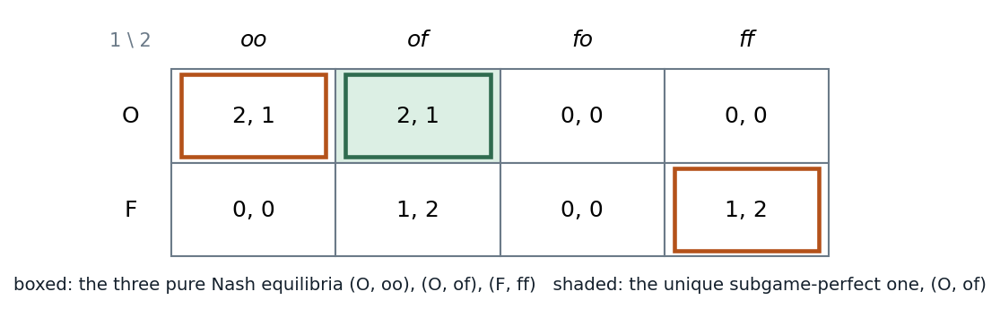

# 7.2.3–7.3 · Back to the matrix: Nash equilibria of a tree, and the threats that hold them up

> **Claim.** Every extensive form has a unique normal form, and Nash equilibrium only needs the
> normal form, so **finding all Nash equilibria of a tree is a matrix exercise.** The matrix also
> shows the problem: a Nash equilibrium only asks for best responses *on* the path of play, so it can
> be held up by **what a player promises to do at a node that is never reached**, even when that
> promise is against her own interest there.
> Prev: [[L03-02-strategies]] · Next: [[L03-04-sequential-rationality-backward-induction]] · Map: [[L03-00-map]]

---

## 1 · C — from tree to matrix (§7.2.3, pp. 143–144)

Rows are player 1's pure strategies, columns player 2's, and each cell is the payoff at the terminal
node that the pair of plans reaches.

**Worked — sequential BoS.** $S_1=\{O,F\}$, $S_2=\{oo,of,fo,ff\}$ ([[L03-02-strategies]] §1). If player
1 plays $O$, only the *first* letter of player 2's plan is used; if $F$, only the second:

| | $oo$ | $of$ | $fo$ | $ff$ |
|---|---|---|---|---|
| $O$ | $2,1$ | $2,1$ | $0,0$ | $0,0$ |
| $F$ | $0,0$ | $1,2$ | $0,0$ | $1,2$ |

Row $O$: $oo$ and $of$ both answer $O$ with $o$ → $(2,1)$; $fo$ and $ff$ answer with $f$ → $(0,0)$.
Row $F$: $oo,fo$ answer $F$ with $o$ → $(0,0)$; $of,ff$ answer with $f$ → $(1,2)$. **Each terminal
payoff appears twice** because, for a given row, two of player 2's plans differ only at the node that
row does not reach (p. 144).

> **Uniqueness runs one way only.** Every extensive form has one normal form; one normal form can come
> from several trees (Remark, p. 144). The matrix $\begin{smallmatrix} & C & D\\ N & 0,0 & 0,0\\ E & 1,1 & -1,2\end{smallmatrix}$
> represents both a perfect-information tree (player 2 moves only after $E$) and an imperfect-information
> tree (player 2 moves after both $N$ and $E$ without seeing which), Fig. 7.12. **The normal form throws
> away the order of moves and the information, which is exactly what Ch. 8 will need back.**

---

## 2 · C — the Nash equilibria (§7.3, p. 145)

Mark best responses in each column for player 1 and in each row for player 2 (Lecture 2's method):

| Column | Player 1's best reply | Row | Player 2's best replies |
|---|---|---|---|
| $oo$ | $O$ ($2>0$) | $O$ | $oo$, $of$ (both 1) |
| $of$ | $O$ ($2>1$) | $F$ | $of$, $ff$ (both 2) |
| $fo$ | $O$ or $F$ (both 0) | | |
| $ff$ | $F$ ($1>0$) | | |

A cell is a Nash equilibrium when both marks meet:

$$\{(O,oo),\ (O,of),\ (F,ff)\}\qquad(p.~145)$$

$(F,fo)$ fails: player 2's best replies to $F$ are $of,ff$, not $fo$. $(O,fo)$ fails for the same
reason in row $O$.

*Figure — the normal form of the sequential Battle of the Sexes: three pure Nash equilibria (boxed), one of them subgame perfect (shaded). Source: Tadelis matrix p. 143, equilibria p. 145, SPE p. 157.*

Two equilibria, $(O,oo)$ and $(O,of)$, produce the **same outcome** (both at the opera, $(2,1)$); they
differ only in what player 2 plans after $F$, a node neither reaches. The third, $(F,ff)$, produces a
different outcome, $(1,2)$, and it is the one player 1 dislikes.

---

## 3 · C — paths of play (Definition 7.8, p. 146)

Because each node has one predecessor, every outcome corresponds to a **unique path** from the root.

> **Definition 7.8.** Let $\sigma^*$ be a Nash equilibrium profile of behavioral strategies. An
> information set is **on the equilibrium path** if, given $\sigma^*$, it is reached with positive
> probability, and **off the equilibrium path** if it is never reached.

| Equilibrium | Path | $x_1$ (after $O$) | $x_2$ (after $F$) | What holds player 1 on the path |
|---|---|---|---|---|
| $(O,oo)$ | $O\to o$ | on | **off**: plans $o$ | nothing needed: $O$ is best anyway |
| $(O,of)$ | $O\to o$ | on | **off**: plans $f$ | nothing needed |
| $(F,ff)$ | $F\to f$ | **off**: plans $f$ | on | **the plan $f$ at $x_1$**: if 1 switched to $O$ she would get 0 |

> **In $(F,ff)$ player 1 stays at $F$ only because of what player 2 says she would do at a node that
> is never reached** (p. 146). Player 2's plan off the path works as a threat: "if you go to the opera,
> I go to the football."

### 3.1 · Why the threat is suspect

Suppose player 1 did play $O$. At $x_1$ player 2 compares $o$, worth 1, with $f$, worth 0. **She would
play $o$.** The plan $ff$ commits her to the worse action at $x_1$, and it costs her nothing only
because $x_1$ is never reached. Nash equilibrium checks best replies to the *strategies*, computed from
the root, so a suboptimal action at an unreached node costs nothing and passes the test (p. 146). The
same logic underlies the "incredible" threat in the Stackelberg game ([[L03-07-stackelberg]] §4) and
the entry game ([[L03-06-credibility-entry-commitment]]).

> **The normal form treats every choice as made once and for all at the start, so beliefs about
> off-path play are never put to the test** (p. 146). That is the weakness Ch. 8 repairs.

---

## 4 · Worked — Gibbons's version (Figs. 2.4.1, 2.4.2, 2.4.5, pp. 116–128)

Player 1 chooses $L$ or $R$; player 2 sees it and chooses $L'$ or $R'$.

| | after $L$ | after $R$ |
|---|---|---|
| $L'$ | $(3,1)$ | $(2,1)$ |
| $R'$ | $(1,2)$ | $(0,0)$ |

Player 2's four strategies are written (action after $L$, action after $R$). Normal form (Fig. 2.4.2):

| | $(L',L')$ | $(L',R')$ | $(R',L')$ | $(R',R')$ |
|---|---|---|---|---|
| $L$ | $3,1$ | $3,1$ | $1,2$ | $1,2$ |
| $R$ | $2,1$ | $0,0$ | $2,1$ | $0,0$ |

Best replies: player 2 against $L$ wants $R'$ first (2 > 1), i.e. $(R',L')$ or $(R',R')$; against $R$
wants $L'$ second (1 > 0), i.e. $(L',L')$ or $(R',L')$. Player 1 against $(R',L')$: $L$ gives 1, $R$
gives 2 → $R$; against $(R',R')$: $L$ gives 1, $R$ gives 0 → $L$.

$$\text{NE}=\{(R,(R',L')),\ (L,(R',R'))\}\qquad(p.~126)$$

In $(L,(R',R'))$ player 2 "threatens" $R'$ after $R$, which would give her 0 instead of 1 from $L'$.
**The threat is not credible, and $(L,(R',R'))$ is not subgame perfect** (p. 128). The tree is solved in
[[L03-04-sequential-rationality-backward-induction]] §3.

---

## Links

- Next: rule the empty threats out, [[L03-04-sequential-rationality-backward-induction]].
- Best-response marking and the simultaneous BoS: [[../L02/L02-00-map|Lecture 2]].
- Python: `pure_nash` on `bos_seq` and `gib`, [[L03-11-python]] §1.
- Exercises: Tadelis 7.2(d) (p. 147), 7.4(d) (p. 148), 7.5(c) (p. 148), 7.6 (p. 148–149), 7.7 (p. 149),
  7.8 (p. 149); Muñoz-Garcia & Toro-González Ch. 4, Exercise 4 (p. 163), Exercise 5 (p. 166),
  Exercise 6 (p. 169).
