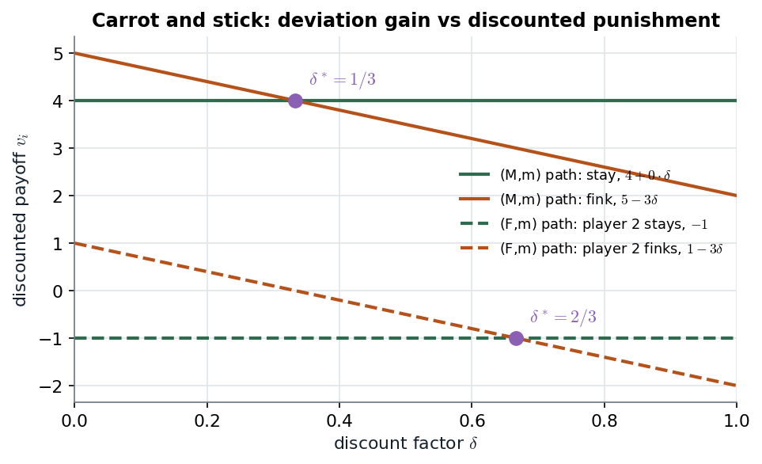
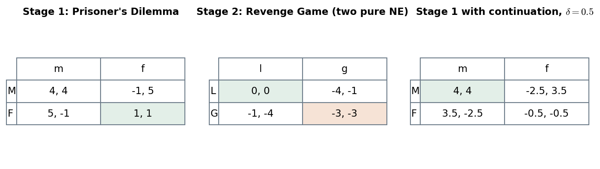

# 9.4 · Subgame-perfect equilibria of multistage games: the carrot and the stick

> **Claim.** Stringing stage-game equilibria together is always subgame perfect, and if every
> stage has a unique equilibrium nothing else is. Behaviour that is **not** a stage-1 equilibrium
> can be sustained only when a later stage has **two equilibria with different payoffs** (a carrot
> and a stick) **and** players are patient enough that the gap outweighs the one-shot gain from
> deviating. In the Prisoner-Revenge Game: mutual mum needs $\delta\ge\frac13$; the lopsided
> $(F,m)$ needs $\delta\ge\frac23$.

Prev: [[L04-01-multistage-games]] · Next: [[L04-03-one-stage-deviation]] · Map: [[L04-00-map]]

---

## 1 · C — Proposition 9.1: stage equilibria in sequence are always an SPE (p. 180)

> **Proposition 9.1.** Consider a multistage game with $T$ stages, and let $\sigma^{t*}$ be a Nash
> equilibrium strategy profile for the $t$-th stage-game. There exists a subgame-perfect
> equilibrium in the multistage game in which the equilibrium path coincides with the path
> generated by $\sigma^{1*},\sigma^{2*},\dots,\sigma^{T*}$.

**Proof, step by step (p. 180).** Let every player play $\sigma_i^{t*}$ at stage $t$
**regardless of history** ("unconditional" strategies).

1. In any subgame starting at stage $T$: the profile is $\sigma^{T*}$, a NE of stage $T$, and
   earlier payoffs are sunk constants. So it is a NE of that subgame.
2. In any subgame starting at stage $T-1$: a player's total payoff is the stage-$(T-1)$ payoff
   **plus a constant** made of (a) the sunk payoffs of earlier stages and (b) the discounted
   stage-$T$ payoff, which **does not depend on the stage-$(T-1)$ outcome** because stage-$T$ play
   is unconditional. Adding a constant changes no best response (Tadelis's footnote 3, p. 181), so
   $\sigma^{T-1*}$ followed by $\sigma^{T*}$ is a NE of the subgame.
3. Induct backwards to $t=1$. $\blacksquare$

**Prisoner-Revenge (pp. 180–181).** Two pure SPE with unconditional play:

$$s_1=(F,L,L,L,L),\ s_2=(f,l,l,l,l)\qquad\text{and}\qquad s_1=(F,G,G,G,G),\ s_2=(f,g,g,g,g),$$

and a third one with the mixed Revenge equilibrium after every history (footnote 4, p. 181).
In each, stage 2 adds the same constant to every stage-1 cell (0, $-3\delta$ or $-2\delta$), so
$F$ stays dominant.

> **Unconditional strategies remove every strategic link between the stages.** Each stage is
> then a separate game, and Proposition 9.1 is just that observation made rigorous.

---

## 2 · C — Propositions 9.2 and 9.3: the last stage pins everything when equilibria are unique

> **Proposition 9.2 (p. 181).** If $\sigma^*$ is a Nash equilibrium of the multistage game
> consisting of stage-games $G_1,\dots,G_T$, then the restriction of $\sigma^*$ to the stage-game in
> period $T$ must be a Nash equilibrium of that stage-game.

*Why:* nothing follows stage $T$, so the only thing that determines what is best at $T$ is a best
response to what others do at $T$.

> **Proposition 9.3 (p. 181).** If a finite multistage game consists of stage-games that each have
> a unique Nash equilibrium, then the multistage game has a unique subgame-perfect equilibrium.

**Proof by backward induction (p. 182).** At $T$ the unique stage NE is played after every
history. At $T-1$, stage-$T$ play cannot depend on the stage-$(T-1)$ outcome, so the unique
stage-$(T-1)$ NE is played; and so on to $t=1$. $\blacksquare$

> **Corollary to carry to [[../L05/L05-00-map|Lecture 5]]:** a Prisoner's Dilemma repeated a
> **known finite** number of times has a unique SPE, fink in every period, because each stage has
> a unique NE. Cooperation needs either a stage with multiple equilibria (this note) or an infinite
> horizon (Lecture 5).

---

## 3 · C — supporting $(M,m)$ in stage 1 (pp. 182–183)

**Target path:** $(M,m)$, then $(L,l)$. Proposition 9.2 says stage 2 must be a Revenge NE after
**every** history, so the only tool is **which** NE follows which history.

**Strategies (p. 182).**

$$s_1=\bigl(s_{11},s_{12}(Mm),s_{12}(Mf),s_{12}(Fm),s_{12}(Ff)\bigr)=(M,\ L,\ G,\ G,\ G)$$
$$s_2=\bigl(s_{21},s_{22}(Mm),s_{22}(Mf),s_{22}(Fm),s_{22}(Ff)\bigr)=(m,\ l,\ g,\ g,\ g)$$

"Friendly equilibrium if we both stayed mum; gang war after anything else."

**Check, subgame by subgame.**

1. *Stage-2 subgames.* After $Mm$ they play $(L,l)$; after $Mf,Fm,Ff$ they play $(G,g)$. Both are
   NE of the Revenge Game (note 01 §2.1). ✓
2. *The whole game.* Only stage-1 deviations remain to check. Player 1, given $s_2$:
   $$v_1(M,s_2)=4+0\cdot\delta,\qquad v_1(F,s_2)=5+(-3)\delta .$$
   $M$ is a best response iff
   $$4\ge5-3\delta\iff3\delta\ge1\iff\boxed{\delta\ge\tfrac13}\quad\text{(p. 183)}.$$
   Player 2 is symmetric. ✓

*Figure — the deviation gain is fixed (1 for (M,m), 2 for (F,m)); the discounted punishment $3\delta$ grows with patience and overtakes it at $\delta^*=\tfrac13$ and $\tfrac23$. Source: Tadelis pp. 183–184.*

Read each pair of lines as "stay" (flat: the carrot pays 0, so patience adds nothing on path)
against "fink" (falling: the deviation is followed by the stick, $-3$, weighted by $\delta$).
Cooperation is sustained to the right of each crossing.

### 3.1 · The reduced stage-1 game

Substitute the continuation values into the stage-1 matrix: $+\delta\cdot0$ in cell $Mm$,
$+\delta(-3)$ in every other cell. With $\delta=\tfrac12$:

| | $m$ | $f$ |
|---|---|---|
| $M$ | $4+0=\mathbf{4},\ \mathbf{4}$ | $-1-1.5=-2.5,\ 5-1.5=3.5$ |
| $F$ | $5-1.5=3.5,\ -2.5$ | $1-1.5=-0.5,\ -0.5$ |

$(M,m)$ is now a NE ($4>3.5$ for each), and so is $(F,f)$ ($-0.5>-2.5$).

*Figure — left and centre: the two stage-games (pp. 176–177); right: stage 1 after adding $\delta\times$(continuation) under the carrot-and-stick strategies, $\delta=0.5$. Source: Tadelis p. 182.*

The right-hand table is how to *see* the construction: the linkage subtracts $3\delta$ from every
cell except the target, and once $3\delta$ exceeds the one-shot gain of 1 the target becomes a
best response.

---

## 4 · C — the two requirements (p. 183)

> **1. There must be at least two distinct equilibria in the second stage: a "stick" and a
> "carrot."**
> **2. The discount factor has to be large enough for the difference in payoffs between the
> "stick" and the "carrot" to have enough impact in the first stage.**

**Why each is necessary.**

- *Requirement 1.* If the target is not a stage-1 NE, some player gains in the short run by
  deviating. A **credible** punishment must itself be a stage-2 NE (Proposition 9.2), so the only
  credible punishment is a *switch from a better NE to a worse one*. With one stage-2 NE there is
  nothing to switch between (that is Proposition 9.3).
- *Requirement 2.* The punishment is worth $\delta\times(\text{carrot}-\text{stick})$ today. A smaller
  $\delta$ "makes the carrot smaller and the stick less painful" (p. 183).

**The general threshold.** With one-shot deviation gain $g$ and continuation gap
$c-s$ (carrot minus stick),

$$\boxed{\;\text{target sustainable}\iff g\le\delta\,(c-s)\iff\delta\ge\delta^*=\frac{g}{c-s}\;}$$

For $(M,m)$: $g=5-4=1$, $c-s=0-(-3)=3$, $\delta^*=\tfrac13$.

---

## 5 · Worked — supporting $(F,m)$, the lopsided path (pp. 183–184)

**Target:** $(F,m)$, then $(L,l)$. **Strategies:**

$$s_1=(F,\ G,\ G,\ L,\ G),\qquad s_2=(m,\ g,\ g,\ l,\ g)$$

(friendly only after $Fm$).

- *Player 1* plays $F$, a stage-1 dominant strategy, **and** gets the best stage-2 equilibrium.
  No incentive to deviate.
- *Player 2*:
  $$v_2(s_1,m)=-1+0\cdot\delta,\qquad v_2(s_1,f)=1+(-3)\delta,$$
  $$m\text{ is a best response}\iff-1\ge1-3\delta\iff\boxed{\delta\ge\tfrac23}\quad\text{(p. 184)}.$$

| Path | Who is tempted | One-shot gain $g$ | Punishment gap $c-s$ | $\delta^*$ |
|---|---|---|---|---|
| $(M,m)$ | both, symmetric | $5-4=1$ | 3 | $\mathbf{1/3}$ |
| $(F,m)$ | player 2 | $1-(-1)=2$ | 3 | $\mathbf{2/3}$ |
| $(M,f)$ | player 1 (mirror) | 2 | 3 | $2/3$ |
| $(F,f)$ | nobody | 0 | — | any $\delta$ (Prop. 9.1) |

> **The same stick buys more the smaller the temptation it must overcome.** That is why the
> efficient path $(M,m)$ is *easier* to sustain than $(F,m)$, which hurts player 2 in stage 1.

> **Interactive companion.** [The Carrot and the Stick](companions/companion-carrot-and-stick.html)
> — move $\delta$, the temptation $T$, the sucker payoff $S$ and the stick $s$; watch both
> thresholds move, and use the "$\delta=1/3$ exactly" and "$\delta=2/3$ exactly" buttons to see the
> verdicts flip at the book's values. Setting $s=0$ deletes the stick and every non-$(F,f)$ outcome
> with it.

---

## 6 · U — what the chapter summary asks you to keep (§9.6, p. 186)

| Summary point (p. 186) | Where above |
|---|---|
| Any sequence of stage-game NE is an SPE, **regardless of $\delta$** | §1 |
| Credible threats and promises in later stages give long-term incentives for short-term actions | §3–§5 |
| Their effectiveness depends on patience; the supportable set often depends on $\delta$ | §4 |

**Organizational reading.** This is the logic of *relational* incentives inside firms: a future
interaction with a good and a bad equilibrium (cooperative or hostile teams, a friendly or a
litigious supplier relationship) can discipline behaviour today without any contract. The repeated
version, with no last stage, is [[../L06/L06-00-map|Lecture 6]]'s relational contracts.

---

## Links

- Previous / next: [[L04-01-multistage-games]] · [[L04-03-one-stage-deviation]] (why checking one
  stage at a time suffices).
- The same carrot-and-stick logic with an infinite horizon: [[../L05/L05-00-map|Lecture 5]]
  (grim trigger), [[../L06/L06-00-map|Lecture 6]] (collusion, relational contracts).
- Python: [[L04-12-python]] §1 (`two_stage_threshold`).
- Pitfalls: [[L04-11-pitfalls]] items 1–3.
- Rules pack: [[../../rules/game-theory|rules/game-theory]] items 3–4 (multiplicity; finite vs
  infinite horizon).
- **Exercises (number and page only):** Tadelis 9.1 (p. 186), 9.2 (pp. 186–187), 9.3
  (pp. 187–188), 9.4 (p. 188), 9.5 (pp. 188–189), 9.6 (p. 189).
