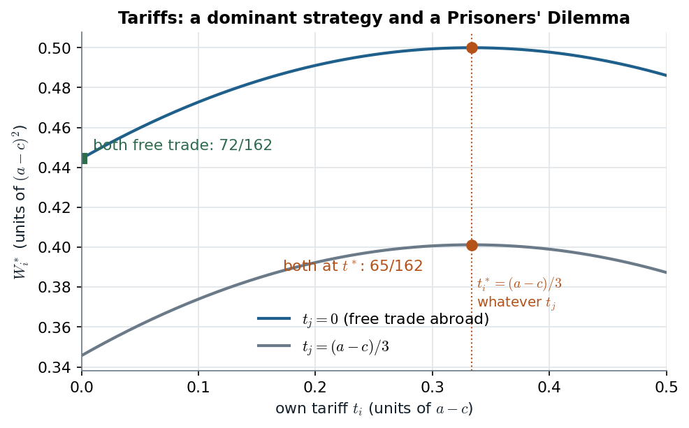

# Gibbons 2.2.B–D · Three two-stage games: a run, a tariff war, a tournament

> **Claim.** The two-stage method of note 01 §5 (solve stage 2 for every stage-1 outcome,
> substitute, solve stage 1) produces three different lessons. **Bank runs:** stage 2 is harmless,
> but the reduced stage 1 has **two** equilibria, one of them a run. **Tariffs:** the reduced stage
> 1 is a **Prisoners' Dilemma** with a dominant tariff of $(a-c)/3$. **Tournaments:** the boss
> moves first and **chooses the stage-2 game** the workers play; the prize spread buys effort,
> noise makes it expensive.

Prev: [[L04-03-one-stage-deviation]] · Next: [[L04-05-ultimatum-game]] · Map: [[L04-00-map]]

---

## 1 · Bank runs (§2.2.B, pp. 73–75)

**Setup.** Two investors each deposit $D$. The bank's project returns $2r$ if liquidated early and
$2R$ at maturity, with $D>r>D/2$ and $R>D$; no discounting. Date 1 is before maturity, date 2
after.

| Date 1 | withdraw | don't |
|---|---|---|
| **withdraw** | $r,\ r$ | $D,\ 2r-D$ |
| **don't** | $2r-D,\ D$ | *go to date 2* |

| Date 2 | withdraw | don't |
|---|---|---|
| **withdraw** | $R,\ R$ | $2R-D,\ D$ |
| **don't** | $D,\ 2R-D$ | $R,\ R$ |

**Step 1, date 2.** $R>D$ implies $2R-D>R$, so "withdraw" strictly dominates: against withdraw
$R>D$, against don't $2R-D>R$. Unique NE: both withdraw, $(R,R)$.

**Step 2, substitute (Figure 2.2.1, p. 75).**

| Date 1 reduced | withdraw | don't |
|---|---|---|
| **withdraw** | $\mathbf{r,\ r}$ | $D,\ 2r-D$ |
| **don't** | $2r-D,\ D$ | $\mathbf{R,\ R}$ |

**Step 3.** $r<D$ gives $2r-D<r$: against withdraw, withdraw pays $r>2r-D$. Against don't, don't pays
$R>D$. **Two pure NE.**

**Worked with illustrative numbers** ($D=100$, $r=75$, $R=150$; they satisfy $100>75>50$ and
$150>100$):

| Date 1 reduced | withdraw | don't |
|---|---|---|
| **withdraw** | $\mathbf{75,\ 75}$ | $100,\ 50$ |
| **don't** | $50,\ 100$ | $\mathbf{150,\ 150}$ |

> **Two subgame-perfect outcomes (p. 75): a run, $(r,r)$ at date 1, and no run, $(R,R)$ at date
> 2.** Unlike the Prisoners' Dilemma, an efficient equilibrium exists. The model does not predict
> *when* runs happen; it shows they **can** happen as equilibrium behaviour (Diamond and Dybvig,
> 1983). The inefficiency is a **coordination failure**, not a dominant-strategy trap.

Note the structure: Gibbons's §2.2.A assumed a unique stage-2 NE; here stage 2 is unique, and the
**multiplicity is in stage 1**.

---

## 2 · Tariffs and imperfect international competition (§2.2.C, pp. 75–79)

**Setup.** Two identical countries $i=1,2$. Inverse demand in country $i$: $P_i=a-Q_i$. Firm
$i$ sells $h_i$ at home and exports $e_i$, with constant marginal cost $c$, and pays tariff
$t_j$ per unit exported to country $j$. **Timing:** governments choose $t_1,t_2$ simultaneously;
firms observe them and choose $(h_1,e_1),(h_2,e_2)$ simultaneously. **Payoffs:** firm profit, and
government welfare
$$W_i=\underbrace{\tfrac12Q_i^2}_{\text{consumer surplus}}+\pi_i+\underbrace{t_ie_j}_{\text{tariff revenue}} .$$

### 2.1 · Stage 2: Cournot in each market

Firm $i$'s profit splits into a home part and an export part, so it solves two problems:

$$\max_{h_i}\ [a-(h_i+e_j^*)-c]\,h_i\ \Rightarrow\ h_i^*=\tfrac12(a-e_j^*-c),\tag{2.2.1}$$
$$\max_{e_i}\ [a-(e_i+h_j^*)-c-t_j]\,e_i\ \Rightarrow\ e_i^*=\tfrac12(a-h_j^*-c-t_j).\tag{2.2.2}$$

**Market $i$ is a Cournot duopoly** between firm $i$ (cost $c$) and firm $j$ (cost $c+t_i$).
Solve the pair $h_i=\tfrac12(a-e_j-c)$, $e_j=\tfrac12(a-h_i-c-t_i)$:

$$h_i=\tfrac12\Bigl(a-c-\tfrac12(a-h_i-c-t_i)\Bigr)\ \Rightarrow\ 4h_i=a-c+h_i+t_i\ \Rightarrow\ h_i^*=\frac{a-c+t_i}{3},$$
$$e_j^*=\tfrac12\Bigl(a-c-t_i-\frac{a-c+t_i}{3}\Bigr)=\frac{a-c-2t_i}{3}.\tag{2.2.3}$$

A tariff raises the home firm's output and cuts the import by twice as much (p. 77).

### 2.2 · Stage 1: the governments' game

Write $A=a-c$. On market $i$: $Q_i=h_i^*+e_j^*=(2A-t_i)/3$, and the price-cost margins equal the
quantities ($P_i-c=h_i^*$, $P_j-c-t_j=e_i^*$), so $\pi_i=h_i^{*2}+e_i^{*2}$. Hence

$$W_i^*(t_i,t_j)=\frac{(2A-t_i)^2}{18}+\frac{(A+t_i)^2}{9}+\frac{(A-2t_j)^2}{9}+\frac{t_i(A-2t_i)}{3}\quad\text{(p. 78)}.$$

$t_j$ enters only through the export-profit term, which does not involve $t_i$. Differentiate:

$$\frac{\partial W_i^*}{\partial t_i}=-\frac{2A-t_i}{9}+\frac{2(A+t_i)}{9}+\frac{A-4t_i}{3}
=\frac{-2A+t_i+2A+2t_i+3A-12t_i}{9}=\frac{3A-9t_i}{9}=0$$

$$\boxed{\;t_i^*=\frac{a-c}{3}\ \text{ for each }i,\ \text{independent of }t_j\;}$$

(second derivative $(1+2-12)/9<0$). **A dominant strategy.** Substituting:
$h_i^*=4(a-c)/9$, $e_i^*=(a-c)/9$, total $5(a-c)/9$ per market, against $2(a-c)/3=6(a-c)/9$ under free
trade.

**The governments' game in numbers** (units of $A^2/162$, computed from $W_i^*$):

| | $t_j=0$ | $t_j=A/3$ |
|---|---|---|
| $t_i=0$ | $72,\ 72$ | $56,\ 81$ |
| $t_i=A/3$ | $81,\ 56$ | $\mathbf{65,\ 65}$ |

Check one cell: $W_i^*(A/3,A/3)=\frac{(5/3)^2}{18}+\frac{(4/3)^2}{9}+\frac{(1/3)^2}{9}+\frac{(1/3)(1/3)}{3}
=\frac{25}{162}+\frac{32}{162}+\frac{2}{162}+\frac{6}{162}=\frac{65}{162}$.

*Figure — $W_i^*(t_i,t_j)$ with $a-c=1$: the peak sits at $t_i=1/3$ whatever $t_j$ (dominance), yet both at $t^*$ (65/162) is worse than both free (72/162). Source: Gibbons p. 78.*

The foreign tariff only shifts the curve down (it taxes *our* exports), never moves its peak; that
is what "dominant" looks like. Free trade maximizes joint welfare among non-negative tariffs, so
the governments face a **Prisoners' Dilemma** and have a reason to sign a free-trade treaty
(pp. 78–79). (If subsidies were allowed the joint optimum would be $t=-(a-c)$, p. 78.)

---

## 3 · Tournaments (§2.2.D, pp. 79–82)

**Setup.** Worker $i\in\{1,2\}$ produces $y_i=e_i+\varepsilon_i$, effort $e_i\ge0$, noise
$\varepsilon_i$ i.i.d. with zero-mean density $f$. Output is observed, effort is not. The boss pays
$w_H$ to the higher output, $w_L$ to the other. Worker payoff $w-g(e)$ with $g'>0$, $g''>0$; boss
payoff $y_1+y_2-w_H-w_L$. In Gibbons's mapping the boss is player 1 (stage 1: choose $w_H,w_L$),
there is no player 2, and the workers are players 3 and 4 (stage 2: choose efforts).

**Stage 2.** Worker $i$ solves (2.2.4)
$\max_{e_i}\ w_L+(w_H-w_L)\Pr\{y_i(e_i)>y_j(e_j^*)\}-g(e_i)$, with first-order condition

$$(w_H-w_L)\,\frac{\partial\Pr\{y_i>y_j\}}{\partial e_i}=g'(e_i).\tag{2.2.5}$$

Conditioning on $\varepsilon_j$:
$$\Pr\{\varepsilon_i>e_j-e_i+\varepsilon_j\}=\int\bigl[1-F(e_j-e_i+\varepsilon_j)\bigr]f(\varepsilon_j)\,d\varepsilon_j,
\qquad\frac{\partial}{\partial e_i}=\int f(e_j-e_i+\varepsilon_j)f(\varepsilon_j)\,d\varepsilon_j .$$

In a symmetric equilibrium $e_i=e_j=e^*$:
$$(w_H-w_L)\int f(\varepsilon)^2\,d\varepsilon=g'(e^*).\tag{2.2.6}$$

**Normal noise, worked.** With $\varepsilon\sim N(0,\sigma^2)$,
$f(\varepsilon)^2=\frac{1}{2\pi\sigma^2}e^{-\varepsilon^2/\sigma^2}$ and
$\int e^{-\varepsilon^2/\sigma^2}d\varepsilon=\sigma\sqrt\pi$, so
$$\int f^2=\frac{\sigma\sqrt\pi}{2\pi\sigma^2}=\frac{1}{2\sigma\sqrt\pi},$$
which falls in $\sigma$: a bigger prize buys more effort, more noise buys less (p. 81).

**Stage 1.** Each worker wins with probability $\tfrac12$ in the symmetric equilibrium, so
participation requires
$$\tfrac12w_H+\tfrac12w_L-g(e^*)\ge U_a.\tag{2.2.7}$$
The boss makes it bind: $w_L=2U_a+2g(e^*)-w_H$ (2.2.8). Expected profit becomes
$2e^*-w_H-w_L=2e^*-2U_a-2g(e^*)$, maximized at $g'(e^*)=1$; then (2.2.6) gives the **optimal prize**

$$\boxed{\;(w_H-w_L)\int f(\varepsilon)^2d\varepsilon=1\;}\qquad\text{normal noise: }w_H-w_L=2\sigma\sqrt\pi .$$

*Illustrative:* $g(e)=e^2/2$ gives $e^*=1$; with $\sigma=1$ the spread is $2\sqrt\pi\approx3.54$
(checked in [[L04-12-python]] §2).

> **The first mover designs the second stage.** The boss is not in the workers' game; she picks
> the prize that makes the workers' equilibrium effort equal the efficient one. The incentive
> question behind it (hidden effort) is the subject of moral hazard, which is outside this course
> unless a lecture brings it (`CLAUDE.md` scope); here the tournament is used only as a two-stage
> game.

---

## Links

- The method: [[L04-01-multistage-games]] §5. Coordination failures with two equilibria:
  [[../L02/L02-00-map|Lecture 2]]; Cournot best responses: [[../L02/L02-00-map|Lecture 2]].
- Python: [[L04-12-python]] §2 (tariff welfare table, tournament integral).
- Pitfalls: [[L04-11-pitfalls]] item 5.
- **Exercises (number and page only):** Gibbons Problems 2.6–2.9 (p. 133); Tadelis 9.4 (p. 188),
  9.6 (p. 189).
