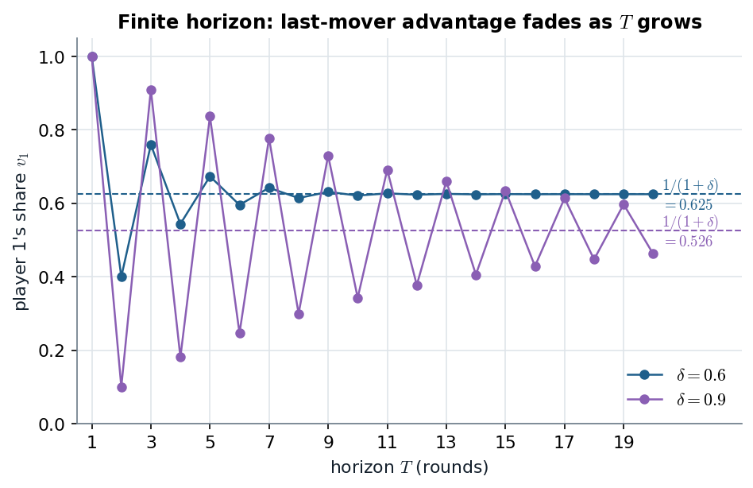

# 11.2 · Finitely many rounds: backward induction, the last word, and the first move

> **Claim.** With a deadline, backward induction pins a **unique** SPE: the last proposer takes
> the pie, and each step back the proposer offers the responder **exactly the discounted value of
> rejecting**. Agreement is immediate. Player 1's share is
> $x_1=\frac{1-(-\delta)^T}{1+\delta}$: it zig-zags with the parity of $T$ (**last-mover
> advantage**) and settles at $\frac{1}{1+\delta}>\frac12$ as $T\to\infty$ (**first-mover
> advantage** from discounting).

Prev: [[L04-05-ultimatum-game]] · Next: [[L04-07-rubinstein-infinite-horizon]] · Map: [[L04-00-map]]

---

## 1 · C — Nash still says anything, and even "any time" (p. 224)

The strategies of Proposition 11.1 extend to any horizon: in odd rounds 1 proposes $x^*$ and 2
accepts $x\le x^*$; in even rounds 2 proposes $x^*$ and 1 accepts $x\ge x^*$. Worse, Nash cannot even
pin **when** agreement happens: let player 1 open with $x=1$ and player 2 reject everything in
round 1; agreement comes in round 2, and the pair is still a NE (p. 224). Subgame perfection
restores a unique answer.

---

## 2 · C — two rounds (Figure 11.2, pp. 224–225)

Work backwards, $\delta<1$.

1. **Round 2** is an ultimatum game with player 2 proposing: she offers $x=0$ and keeps the pie,
   worth $\delta$ in round-1 terms.
2. **Round 1, player 2 responds.** Rejecting is worth $\delta$, so she accepts iff $1-x\ge\delta$,
   i.e. $x\le1-\delta$.
3. **Round 1, player 1 proposes** the largest accepted $x$:

$$\boxed{\;x_1=1-\delta,\qquad(v_1,v_2)=(1-\delta,\ \delta)\;}$$

With $\delta=1$ player 2 takes everything (pure last-mover advantage); with $\delta<1$ player 1
keeps $1-\delta$ only because waiting costs player 2 (p. 225).

---

## 3 · C — odd $T$: the induction written out (pp. 225–226)

$T$ odd, so player 1 proposes first **and** last. Payoffs are in round-1 values.

| Round | Proposer | Responder accepts iff | Offer $x$ (player 1's share) | $v_1$ | $v_2$ |
|---|---|---|---|---|---|
| $T$ | 1 | anything (ultimatum) | $1$ | $\delta^{T-1}$ | $0$ |
| $T-1$ | 2 | $\delta^{T-2}x\ge\delta^{T-1}$, i.e. $x\ge\delta$ | $\delta$ | $\delta^{T-1}$ | $\delta^{T-2}(1-\delta)$ |
| $T-2$ | 1 | $\delta^{T-3}(1-x)\ge\delta^{T-2}(1-\delta)$ | $1-\delta+\delta^2$ | $\delta^{T-3}-\delta^{T-2}+\delta^{T-1}$ | $\delta^{T-2}-\delta^{T-1}$ |
| $T-3$ | 2 | $\delta^{T-4}x\ge\delta^{T-3}-\delta^{T-2}+\delta^{T-1}$ | $\delta-\delta^2+\delta^3$ | as above | $\delta^{T-4}-\delta^{T-3}+\delta^{T-2}-\delta^{T-1}$ |

**Check one step ($T-2$).** Divide the acceptance condition by $\delta^{T-3}$:
$1-x\ge\delta(1-\delta)$, so the largest accepted offer is $x=1-\delta+\delta^2$. ✓

**The pattern (p. 226).** In odd rounds $T-s$ ($s$ even) the offer is
$1-\delta+\delta^2-\dots+\delta^s$; in even rounds ($s$ odd) it is
$\delta-\delta^2+\dots+\delta^s$. In round 1, $s=T-1$:

$$x_1=1-\delta+\delta^2-\delta^3+\dots+\delta^{T-1}
=\underbrace{(1+\delta^2+\dots+\delta^{T-1})}_{\frac{1-\delta^{T+1}}{1-\delta^2}}
-\underbrace{(\delta+\delta^3+\dots+\delta^{T-2})}_{\frac{\delta-\delta^T}{1-\delta^2}}
=\frac{(1-\delta)(1+\delta^T)}{(1-\delta)(1+\delta)} .$$

$$\boxed{\;v_1=x_1=\frac{1+\delta^T}{1+\delta},\qquad v_2=1-x_1=\frac{\delta-\delta^T}{1+\delta}\qquad(T\text{ odd})\;}\tag{11.1}$$

**Even $T$** (MWG Example 9.AA.1, p. 297; Tadelis leaves it as Exercise 11.3). Now player 2 is the
first proposer of the odd-length game that starts in round 2, which is worth
$\delta\cdot\frac{1+\delta^{T-1}}{1+\delta}$ to her today; player 1 offers exactly that:

$$x_1=1-\delta\,\frac{1+\delta^{T-1}}{1+\delta}=\frac{1-\delta^T}{1+\delta}\qquad(T\text{ even}).$$

**Both cases in one line:** $\displaystyle x_1(T)=\sum_{k=0}^{T-1}(-\delta)^k=\frac{1-(-\delta)^T}{1+\delta}$.

### 3.1 · Worked, $\delta=0.6$ (the project's calibration, `check_part2.py`)

| $T$ | 1 | 2 | 3 | 4 | 5 | 6 | $\infty$ |
|---|---|---|---|---|---|---|---|
| $x_1$ | $1$ | $1-0.6=0.400$ | $1-0.6+0.36=0.760$ | $\frac{1-0.1296}{1.6}=0.544$ | $\frac{1+0.07776}{1.6}=0.674$ | $\frac{1-0.046656}{1.6}=0.596$ | $\frac1{1.6}=0.625$ |
| last word | 1 | 2 | 1 | 2 | 1 | 2 | — |

*Figure — $x_1(T)=\frac{1-(-\delta)^T}{1+\delta}$ for $\delta=0.6$ and $0.9$; dashed lines at $1/(1+\delta)$. Source: eq. (11.1), p. 226, and MWG p. 297.*

The distance to the limit is $\delta^T/(1+\delta)$, so the last-mover advantage decays
geometrically, and **more slowly the more patient the players**: at $\delta=0.9$ it is still
visible at $T=20$.

---

## 4 · C — Proposition 11.3: agreement in round 1 (p. 226)

> **Proposition 11.3.** Any subgame-perfect equilibrium must have the players reach an agreement
> in the first round.

**Proof.** Suppose agreement came later with payoffs $(v_1,v_2)$. Discounting wastes part of the
pie, so $v_1+v_2<1$. Player 1 could instead offer $x=1-v_2-\varepsilon$ in round 1: player 2 gets
$v_2+\varepsilon$ now, more than by continuing, so sequential rationality makes her accept; and for
small $\varepsilon$, player 1 gets $1-v_2-\varepsilon>v_1$. A profitable deviation, a contradiction.
$\blacksquare$

> **With complete information, delay is pure waste, and rational bargainers do not waste.** The
> off-path rounds still matter: they set the price of round 1. Where delay *does* occur in reality
> (strikes), something in this model must be missing: [[L04-09-bargaining-private-information]].

---

## 5 · C — what the formula says about power (pp. 226–227)

| Case | $x_1$ | Reading |
|---|---|---|
| $\delta=0$ | $1$ for every $T$ | only round 1 matters: an ultimatum game |
| $\delta=1$, $T$ odd | $1$ | no cost of waiting: **only the last word matters**, however long the game |
| $\delta=1$, $T$ even | $0$ | the same, for player 2 |
| $T$ odd, $0<\delta<1$ | $v_1>v_2$ | player 1 has both advantages |

**The limits (11.2)–(11.3).** Fix $\delta\in(0,1)$ and lengthen the game: $\delta^T\to0$, so

$$\lim_{T\to\infty}v_1=\frac{1}{1+\delta},\qquad\lim_{T\to\infty}v_2=\frac{\delta}{1+\delta}.\tag{11.2}$$

The deadline effect disappears; only the first-mover advantage from discounting remains. Then let
players become patient:

$$\lim_{\delta\to1}\lim_{T\to\infty}v_1=\lim_{\delta\to1}\frac{1}{1+\delta}=\frac12=\lim_{\delta\to1}\lim_{T\to\infty}v_2.\tag{11.3}$$

> **The order of limits matters (footnote 2, p. 227).** Take $\delta\to1$ first, at fixed odd $T$:
> $v_1=\frac{1+1}{1+1}=1$, and then $T\to\infty$ keeps it at 1. The artificial take-it-or-leave-it
> advantage survives. **Long horizon first, patience second, gives the equal split.**

> **Interactive companion.** [The Patience Ledger](companions/companion-rubinstein-bargaining.html)
> — slide $T$ and watch the highlighted dot jump above and below the dashed limit; the ladder panel
> shows every round's offer, the path that is never played. The "$\delta=1$ first, $T=39$" button is
> footnote 2.

---

## 6 · Worked — Gibbons's three-period model and different discount factors

**Gibbons (pp. 68–70).** Round 3's settlement $(s,1-s)$ is given exogenously. Round 2: player 1
accepts $s_2$ iff $s_2\ge\delta s$, so player 2 offers $s_2^*=\delta s$ (keeping $1-\delta s$, better than
$\delta(1-s)$). Round 1: player 2 accepts iff $1-s_1\ge\delta(1-s_2^*)$, so

$$s_1^*=1-\delta(1-\delta s)=1-\delta+\delta^2s .$$

With $s=1$ (player 1 would get all in round 3) this is $1-\delta+\delta^2$, the $T=3$ value of
(11.1). Note 07 reuses $f(s)=1-\delta+\delta^2s$ to solve the infinite game.

**Different discount factors** ($\delta_1$ for player 1, $\delta_2$ for player 2; three rounds,
player 1 proposes in rounds 1 and 3):

1. Round 3: player 1 takes the pie: $s_3=1$.
2. Round 2: player 1 accepts iff $s_2\ge\delta_1\cdot1$; player 2 offers $s_2=\delta_1$.
3. Round 1: player 2 accepts iff $1-s_1\ge\delta_2(1-\delta_1)$; player 1 offers
   $$s_1=1-\delta_2(1-\delta_1).$$

*Numbers* ($\delta_1=0.9$, $\delta_2=0.7$, the values verified in `check_part2.py`):
$s_1=1-0.7\times0.1=0.93$. This is exactly `Listas/lista-aulas-01-02.tex` Block 3, Question 5a
(answer E), there with the joint value $W^*$ as the pie.

### 6.1 · G — MWG Example 9.AA.1 (pp. 296–297)

MWG run the same induction on a pie of $v$ dollars (Ståhl's model) and get, for odd $T$,
$v_1^*(T)=v\,[1-\delta+\delta^2-\dots+\delta^{T-1}]=v\,\frac{1+\delta^T}{1+\delta}$, with $v_2^*(T)=v-v_1^*(T)$, and
the even case as in §3. Scaling the pie scales every payoff and no share.

---

## Links

- Previous / next: [[L04-05-ultimatum-game]] · [[L04-07-rubinstein-infinite-horizon]].
- Earlier treatment: `Aula/aula-02-notes.md` §5.2; `Aula/notes-aulas-01-02/main.pdf` part 2 and
  `check_part2.py::proposer_share` (the same induction, any $\delta_1,\delta_2$);
  `Listas/lista-aulas-01-02-check.py::finite_share` checks (11.1) symbolically for $T\le8$.
- Python: [[L04-12-python]] §3. Pitfalls: [[L04-11-pitfalls]] items 8–10.
- Rules pack: [[../../rules/02_barganha|rules/02_barganha]] ("Alternating offers").
- **Exercises (number and page only):** Tadelis 11.3 (p. 236), 11.4 (p. 236), 11.5
  (pp. 236–237); Muñoz-Garcia Ch. 4 Ex. 16 (p. 198), Ex. 17 (p. 199), Ex. 18 (p. 200);
  MWG 9.B.13 (pp. 302–303); `Listas/lista-aulas-01-02.pdf` Block 3, Question 5a.
