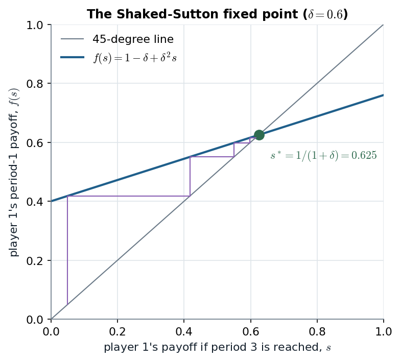
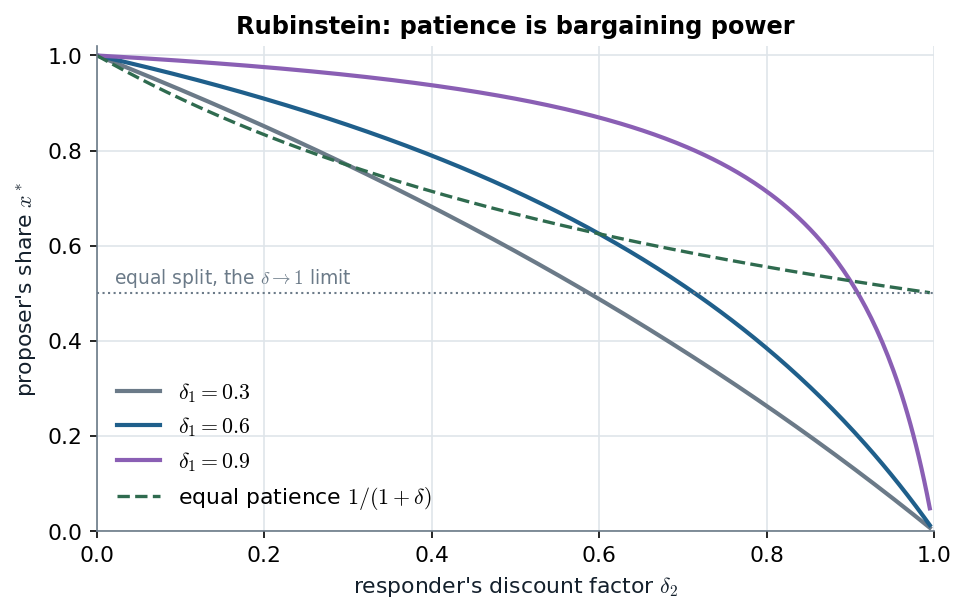

# 11.3 · Rubinstein's infinite horizon: stationarity replaces the last period

> **Claim.** With no deadline there is no last round to start backward induction from, yet the
> game still has a **unique** SPE. Every odd round looks like round 1 and every even round like
> round 1 with the roles swapped, so the best and the worst equilibrium payoffs must solve the
> same pair of equations: the proposer gets $\frac{1}{1+\delta}$, agreement is immediate, and with
> different patience the share is $\frac{1-\delta_2}{1-\delta_1\delta_2}$. **Patience is bargaining
> power**, and as offers become frequent the split converges to the Nash bargaining solution with
> weights set by the discount rates.

Prev: [[L04-06-finite-alternating-offers]] · Next: [[L04-08-legislative-bargaining]] · Map: [[L04-00-map]]

---

## 1 · U — why the finite method breaks, and what replaces it (p. 228)

Disagreeing forever gives 0 (discounting leaves nothing to split), but the path of perpetual
disagreement is **infinitely long**, so there is no terminal node to fold back from. What the game
has instead is a **stationary structure**: the subgame after any two rejections *is* the original
game (Gibbons p. 70, crediting Shaked and Sutton, 1984). The infinite game is **not** "the limit of
the finite games" by definition; that the answers coincide is a result, and MWG stress it is not a
general property of infinite games (p. 298; Lecture 5's repeated games are the counterexample).

---

## 2 · C — the Shaked–Sutton argument (Tadelis pp. 228–229)

**Step 0: immediate agreement.** The logic of Proposition 11.3 applies unchanged: delay wastes pie
that a slightly better round-1 offer could share. So in every SPE the first offer is accepted.

**Step 1: best and worst.** Suppose several SPE exist. Let $\bar v$ and $\underline v$ be the
**highest and lowest** SPE payoffs of the player who proposes in round 1. By stationarity the same
two numbers bound player 2's payoff in the subgame where **she** proposes (round 2), and vice versa.

**Step 2: the worst for player 1 is the best for player 2.** In the SPE worst for player 1, player
2 can secure $\bar v$ by rejecting and proposing in round 2, worth $\delta\bar v$ today. Player 1 must
offer at least that, and offers no more:

$$\underline v=1-\delta\bar v.\tag{11.4}$$

**Step 3: symmetrically,** in the SPE best for player 1, player 2's threat is worth $\delta\underline v$:

$$\bar v=1-\delta\underline v.\tag{11.5}$$

**Step 4: solve.** Subtract (11.4) from (11.5): $\bar v-\underline v=\delta(\bar v-\underline v)$, so
$(1-\delta)(\bar v-\underline v)=0$ and, since $\delta<1$, $\bar v=\underline v\equiv v$. Then
$v=1-\delta v$:

$$\boxed{\;v_1^*=\frac{1}{1+\delta},\qquad v_2^*=\frac{\delta}{1+\delta}\;}$$

**The strategies (p. 229).** In odd rounds player 1 offers $x=\frac{1}{1+\delta}$ and player 2 accepts
any $x\le\frac{1}{1+\delta}$. In even rounds player 2 offers $x=\frac{\delta}{1+\delta}$ (player 1's
share) and player 1 accepts any $x\ge\frac{\delta}{1+\delta}$.

**Worked, $\delta=0.6$:** $v_1^*=1/1.6=0.625$, $v_2^*=0.6/1.6=0.375$; with $\delta=0.9$:
$0.526$ against $0.474$. This is the $T\to\infty$ limit (11.2) of note 06, now derived without any
deadline.

### 2.1 · Gibbons's version: a fixed point (pp. 70–71)

Gibbons truncates the game after round 2: if the continuation from round 3 gives player 1 the
payoff $s$, the three-period logic of note 06 §6 gives player 1, in round 1,

$$f(s)=1-\delta(1-\delta s)=1-\delta+\delta^2s .$$

Let $s_H$ be the highest backward-induction payoff of player 1 in the whole game. Using $s_H$ as the
round-3 payoff yields $f(s_H)$, the highest possible round-1 payoff because $f$ is increasing; but
that *is* $s_H$, so $f(s_H)=s_H$. Likewise $f(s_L)=s_L$. The only fixed point:

$$s=1-\delta+\delta^2s\iff s(1-\delta^2)=1-\delta\iff s^*=\frac{1}{1+\delta}.$$

*Figure — $f$ has slope $\delta^2<1$, so it crosses the diagonal exactly once, at $s^*=1/(1+\delta)$; iterating $f$ from any start converges there. Source: Gibbons p. 71.*

The slope $\delta^2<1$ is the whole proof of uniqueness in one picture: a contraction has one fixed
point. Iterating $f$ from $s=1$ reproduces the odd-$T$ shares of note 06 ($1$, $1-\delta+\delta^2$, …).

---

## 3 · C — verifying the strategies by one-stage deviations

Use [[L04-03-one-stage-deviation]]: with discounting it applies to this infinite game. Check
player 2 as responder in round 1, offered $1-x$:

- accept: $1-x$;
- reject, then follow the strategies: she proposes in round 2 and keeps
  $1-\frac{\delta}{1+\delta}=\frac{1}{1+\delta}$, worth $\frac{\delta}{1+\delta}$ today.

Accepting is optimal iff $1-x\ge\frac{\delta}{1+\delta}$, i.e. $x\le\frac{1}{1+\delta}$: exactly the rule. ✓

Player 1 as proposer: any $x\le\frac1{1+\delta}$ is accepted, so the largest, $\frac1{1+\delta}$, is best;
a larger $x$ is rejected and yields at most $\delta\cdot\frac{\delta}{1+\delta}<\frac{1}{1+\delta}$. ✓
Even rounds are the mirror image.

---

## 4 · C — different discount factors: patience is power

Let player $i$ discount at $\delta_i$. Stationary shares: player 1 proposing keeps $x$; player 2
proposing keeps $y$ (her own share). Each proposer gives the responder exactly the responder's
discounted proposer share:

$$x=1-\delta_2y,\qquad y=1-\delta_1x .$$

Substitute: $x=1-\delta_2(1-\delta_1x)\Rightarrow x(1-\delta_1\delta_2)=1-\delta_2$:

$$\boxed{\;x^*=\frac{1-\delta_2}{1-\delta_1\delta_2},\qquad 1-x^*=\frac{\delta_2(1-\delta_1)}{1-\delta_1\delta_2}\;}$$

(the case Tadelis sets as Exercise 11.6, p. 237, and MWG 9.B.12, p. 302; derived also in
`Aula/aula-02-notes.md` §5.2). With $\delta_1=\delta_2=\delta$, $x^*=\frac{1-\delta}{1-\delta^2}=\frac1{1+\delta}$. ✓

**Signs (differentiate).**

$$\frac{\partial x^*}{\partial\delta_1}=\frac{(1-\delta_2)\,\delta_2}{(1-\delta_1\delta_2)^2}>0,\qquad
\frac{\partial x^*}{\partial\delta_2}=\frac{-(1-\delta_1\delta_2)+(1-\delta_2)\delta_1}{(1-\delta_1\delta_2)^2}=\frac{-(1-\delta_1)}{(1-\delta_1\delta_2)^2}<0 .$$

> **Your own patience raises your share; your opponent's patience lowers it.** A patient responder
> is expensive to buy off because waiting costs her little.

**Worked** ($\delta_1=0.9$, $\delta_2=0.7$, as in `check_part2.py`):
$x^*=\frac{0.3}{1-0.63}=\frac{0.3}{0.37}=0.811$, against $0.93$ with three rounds (note 06 §6): the
deadline was worth $0.12$ to player 1, the last mover.

*Figure — the proposer's share falls as the responder grows more patient and rises with the proposer's own patience; the dashed curve is the equal-patience case. Source: Tadelis eqs. (11.4)–(11.5), p. 229, extended to $\delta_1\ne\delta_2$.*

Each solid curve starts at 1 (an impatient responder accepts anything) and falls to 0 as
$\delta_2\to1$ (a responder who does not mind waiting can hold out for everything).

> **Interactive companion.** [The Patience Ledger](companions/companion-rubinstein-bargaining.html)
> — tick "No deadline" and move $\delta_1$ and $\delta_2$ separately; the read-out names who is more
> patient and the dashed line in the left panel is this formula. "Patient pair, no deadline" sets
> $\delta=0.99$, a nearly equal split. At $\delta_1=\delta_2=1$ the page reports the share as
> indeterminate rather than computing $0/0$.

---

## 5 · C — frequent offers and the Nash bargaining solution

Write $\delta_i=e^{-r_i\Delta}$, where $r_i$ is $i$'s discount rate and $\Delta$ the time between
offers. As $\Delta\to0$ (by l'Hôpital, or $1-e^{-z}\approx z$):

$$x^*=\frac{1-e^{-r_2\Delta}}{1-e^{-(r_1+r_2)\Delta}}\ \longrightarrow\ \frac{r_2}{r_1+r_2}.$$

That is the **generalized Nash bargaining solution** with threat points 0 and weight
$\beta_1=r_2/(r_1+r_2)$ for player 1 ([[../../Aula/aula-02-notes|Aula 2 notes]] §5.1–5.2; Tadelis's
Remark on Nash's axiomatic approach, p. 229). Equal rates give $\tfrac12$, matching (11.3), and
the first-mover advantage vanishes because a round lasts no time.

> **The axiomatic weights of the Nash solution have a strategic foundation: relative impatience.**
> `Listas/lista-aulas-01-02.pdf` Block 3, Question 5b examines exactly this limit.

---

## 6 · G — MWG's proof of uniqueness, written with bounds (Example 9.AA.2, pp. 297–298)

Pie $v$. Let $\bar v_1$ and $\underline v_1$ be player 1's highest and lowest SPE payoffs.

1. **Lower bound.** Player 2 can get at most $\bar v_1$ as the round-2 proposer, worth $\delta\bar v_1$.
   Offering her slightly more is surely accepted, so $\underline v_1\ge v-\delta\bar v_1$.
2. **Upper bound.** Player 2 can get at least $\underline v_1$ as round-2 proposer and rejects any round-1
   offer below $\delta\underline v_1$; and a rejected offer leaves player 1 at most
   $\delta v-\delta\underline v_1<v-\delta\underline v_1$. So $\bar v_1\le v-\delta\underline v_1$.
3. **Squeeze.** $\bar v_1\le v-\delta\underline v_1\le v-\delta(v-\delta\bar v_1)$, so
   $\bar v_1(1-\delta^2)\le v(1-\delta)$ and $\bar v_1\le\frac{v}{1+\delta}$. Then
   $\underline v_1\ge v-\delta\bar v_1\ge v-\frac{\delta v}{1+\delta}=\frac{v}{1+\delta}$.

$$\frac{v}{1+\delta}\le\underline v_1\le\bar v_1\le\frac{v}{1+\delta}\quad\Longrightarrow\quad v_1^*=\frac{v}{1+\delta},\ v_2^*=\frac{\delta v}{1+\delta}.$$

MWG add a warning (p. 298): the result is **sensitive to the protocol and to preferences**; with a
fixed cost per round instead of discounting (Exercises 9.B.7, 9.B.13) the infinite game can have
many SPE.

---

## Links

- Previous / next: [[L04-06-finite-alternating-offers]] · [[L04-08-legislative-bargaining]].
- Earlier project material: `Aula/aula-02-notes.md` §5 (Nash solution, alternating offers);
  `Aula/notes-aulas-01-02/main.pdf` part 2; `Listas/lista-aulas-01-02.pdf` Block 3 (Questions 5–6)
  and its check `Listas/lista-aulas-01-02-check.py`; quiz
  `Simulados/quiz-aula02-3-nash-offers-2026-10-13.md`.
- Python: [[L04-12-python]] §3. Pitfalls: [[L04-11-pitfalls]] items 9–12.
- Rules pack: [[../../rules/02_barganha|rules/02_barganha]].
- **Exercises (number and page only):** Tadelis 11.6 (p. 237); Gibbons Problem 2.3 (p. 131);
  MWG 9.B.12 (pp. 302–303); Muñoz-Garcia Ch. 6 Ex. 8 (p. 303).
