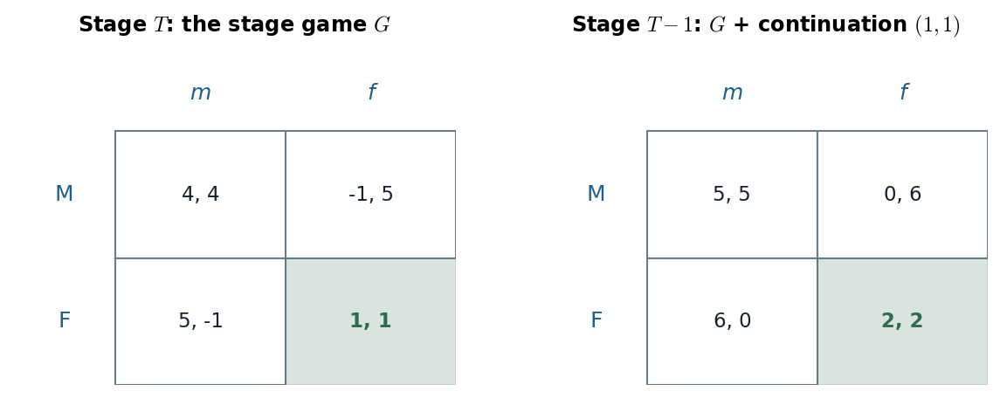

# 10.1 · Finitely repeated games: a unique stage equilibrium unravels every period

> **Claim.** Repeat a game with a **unique** Nash equilibrium a known, finite number of times and
> the future can discipline nothing: the last period must be the stage equilibrium whatever
> happened before, so the second-to-last period has no reward or punishment left to offer, and the
> argument walks back to period 1. **Five hundred rounds of the Prisoner's Dilemma have exactly one
> subgame-perfect equilibrium: fink, every period.**
>
> Prev: [[L05-00-map]] · Next: [[L05-02-two-stage-carrot-stick]] · Map: [[L05-00-map]]

---

## 1 · C — the object: a stage game played $T$ times

**Definition 10.1** (Tadelis, p. 190). *Given a stage-game $G$, $G(T,\delta)$ denotes the finitely
repeated game in which the stage-game $G$ is played $T$ consecutive times, and $\delta$ is the
common discount factor.*

A repeated game is **a multistage game in which every stage is the same game** (p. 190, the
chapter opener). Everything [[../L04/L04-00-map|Lecture 4]] proved for multistage games therefore
applies; the repetition only adds structure. Two ingredients are implicit and both matter:

| Ingredient | Meaning | Where it bites |
|---|---|---|
| **Perfect monitoring** | the outcome of every stage is observed before the next begins (Gibbons's definition, p. 84) | strategies can condition on the history (note [[L05-03-discounting-histories-strategies]] §4) |
| **A known last period $T$** | common knowledge that stage $T$ is the end | the unraveling below |

Gibbons states the same object without discounting: $G(T)$ with payoffs **the sum of the $T$
stage payoffs** (p. 84). With $\delta<1$ or $\delta=1$ the result below is identical — it never uses
the size of $\delta$.

---

## 2 · C — Proposition 10.1

**Proposition 10.1** (Tadelis, p. 192). *If the stage-game of a finitely repeated game has a unique
Nash equilibrium, then the finitely repeated game has a unique subgame-perfect equilibrium.*

It is a special case of **Proposition 9.3** (p. 181): a finite multistage game whose stage-games
each have a unique Nash equilibrium has a unique subgame-perfect equilibrium. **The unique SPE is
the stage equilibrium played in every period, after every history.**

Gibbons's version (p. 84): *if the stage game $G$ has a unique Nash equilibrium then, for any
finite $T$, the repeated game $G(T)$ has a unique subgame-perfect outcome: the Nash equilibrium of
$G$ is played in every stage.*

### 2.1 · The proof, by induction from the end

Let $a^*$ be the unique stage equilibrium with payoffs $u_i(a^*)$.

1. **Stage $T$.** Every subgame starting at $T$ is a one-shot play of $G$: no future depends on the
   action. Each player best-responds to what the others do now, so play is a Nash equilibrium of
   $G$ (Prop. 9.2, p. 181) — and there is only one, $a^*$. **This holds after every history.**
2. **Stage $T-1$, after any history.** Whatever is played now, stage $T$ delivers $a^*$. Player
   $i$'s payoff from action profile $a$ at $T-1$ is therefore
   $$u_i(a)+\delta\,u_i(a^*),$$
   and $\delta\,u_i(a^*)$ is **the same constant in every cell**. Adding a constant to every payoff
   does not change any best response (Tadelis fn. 3, p. 181), so the stage-$(T-1)$ game is
   strategically $G$ itself: its unique equilibrium is $a^*$.
3. **Inductive step.** Suppose that from stage $t+1$ on, $a^*$ is played after every history. Then at
   stage $t$ the continuation adds $\sum_{s=t+1}^{T}\delta^{s-t}u_i(a^*)$, again the same in every
   cell; the stage-$t$ game is $G$ plus a constant, and its unique equilibrium is $a^*$.
4. By induction, $a^*$ is played at every stage after every history. Uniqueness at each step gives
   uniqueness of the SPE. $\blacksquare$

> **The engine is step 2: a continuation that does not depend on today's action is a constant, and a
> constant cannot reward or punish.** Conditioning tomorrow on today needs **at least two different
> things tomorrow could be** — two continuation equilibria. Remove that and nothing is left.

---

## 3 · Worked — the Prisoner's Dilemma unravels

Tadelis's stage game (p. 197; also the folk-theorem matrix, p. 210):

| | $m$ | $f$ |
|---|---|---|
| $M$ | $4,\ 4$ | $-1,\ 5$ |
| $F$ | $5,\ -1$ | $1,\ 1$ |

**Stage $T$.** $F$ strictly dominates $M$ for player 1: $5>4$ against $m$ and $1>-1$ against $f$;
symmetrically $f$ for player 2. The unique NE is $(F,f)$ — "in fact it is the unique dominant
strategy!" (p. 192).

**Stage $T-1$.** Stage $T$ will be $(F,f)$ whatever happens, worth $\delta\cdot1$ to each player.
The game at $T-1$ is the matrix above with $\delta$ added to every entry. With $\delta=1$ (Gibbons's
no-discounting case):

| | $m$ | $f$ |
|---|---|---|
| $M$ | $5,\ 5$ | $0,\ 6$ |
| $F$ | $6,\ 0$ | $2,\ 2$ |

$F$ still dominates: $6>5$ and $2>0$. **Unique NE $(F,f)$ again.** The same addition happens at
$T-2$ (now $+\delta+\delta^2$), and so on to period 1.

*Figure — folding back one stage adds the same continuation payoff to every cell, so the equilibrium cannot move. Source: Prop. 10.1, p. 192; matrix p. 197; the $+1$ is Gibbons's Figure 2.3.2 logic, p. 83.*

The right table is the left table shifted by one unit everywhere. Every comparison a best response
makes — $5$ vs $4$, $1$ vs $-1$ — becomes $6$ vs $5$, $2$ vs $0$: same signs, same equilibrium.

### 3.1 · Gibbons's two-stage Prisoners' Dilemma (pp. 82–83)

Gibbons's Figure 2.3.1 uses $L_i$ for "defect" and $R_i$ for "cooperate":

| | $L_2$ | $R_2$ |
|---|---|---|
| $L_1$ | $1,\ 1$ | $5,\ 0$ |
| $R_1$ | $0,\ 5$ | $4,\ 4$ |

Played twice with summed payoffs, the second stage is $(L_1,L_2)$ after every first-stage outcome,
so the first stage is the game of **Figure 2.3.2**: add $(1,1)$ to every cell.

| | $L_2$ | $R_2$ |
|---|---|---|
| $L_1$ | $2,\ 2$ | $6,\ 1$ |
| $R_1$ | $1,\ 6$ | $5,\ 5$ |

Unique NE $(L_1,L_2)$. **The unique subgame-perfect outcome is $(L_1,L_2)$ in both stages;
cooperation, $(R_1,R_2)$, cannot be achieved in either stage** (p. 84).

---

## 4 · U — why the result feels wrong, and why it is right

Tadelis (p. 192): two players facing 500 rounds "can use the future to discipline behavior and try
to cooperate by playing mum in early periods." The intuition fails **because it is common knowledge
that the game ends after 500 periods**: at $T=500$ both must fink; at $T=499$ no
reward-and-punishment incentive is left; and so on.

> **What the intuition gets wrong is not "the future matters" — it is "the future can be made to
> depend on today."** A threat to punish tomorrow is only credible if punishing is itself an
> equilibrium of tomorrow's game, and a promise to reward is only credible if rewarding is one.
> With a unique stage equilibrium there is exactly one thing tomorrow can be.

| Feature | Matters for the result? |
|---|---|
| Length of the horizon ($T=2$ or $T=500$) | **No** — the induction does not care |
| Size of $\delta$ | **No** — $\delta$ only scales a constant |
| Uniqueness of the stage NE | **Yes** — see [[L05-02-two-stage-carrot-stick]] |
| A known last period | **Yes** — see [[L05-04-grim-trigger-spe]] |

The same holds for the finitely repeated Cournot and Bertrand games of Tadelis §5.2: their stage
equilibria are unique, so repetition changes nothing (p. 192).

---

## 5 · G — the same argument in MWG

MWG §12.D (p. 401) runs the argument for the finitely repeated **Bertrand** duopoly: in period $T$
prices equal cost whatever happened earlier, so period $T-1$ is "strategically speaking, at the last
period", and backward induction delivers $T$ repetitions of the static Bertrand outcome. Gibbons's
footnote 13 (p. 84) extends the proposition to **dynamic** stage games: a unique backwards-induction
(or subgame-perfect) outcome of $G$ is played in every stage of $G(T)$. Not examinable beyond the
statement.

---

## Links

- Next: what changes with **two** stage equilibria — [[L05-02-two-stage-carrot-stick]].
- What changes with **no last period** — [[L05-03-discounting-histories-strategies]], [[L05-04-grim-trigger-spe]].
- Backward induction and Prop. 9.3: [[../L03/L03-00-map|Lecture 3]], [[../L04/L04-00-map|Lecture 4]].
- Dominance in the stage game: [[../L01/L01-00-map|Lecture 1]].
- Rules: [[../../rules/game-theory|rules/game-theory]] item 4 ("Repeated games are not one-shot games").
- Interactive: [The Endgame Reward](companions/companion-finite-carrot-stick.html) — set $r=p$ (the two stage equilibria pay the same) and every round collapses to stage play.
- Exercises: Tadelis 10.6(b) (p. 217) and 10.7(b) (pp. 217–218); Gibbons 2.12 (p. 135).
