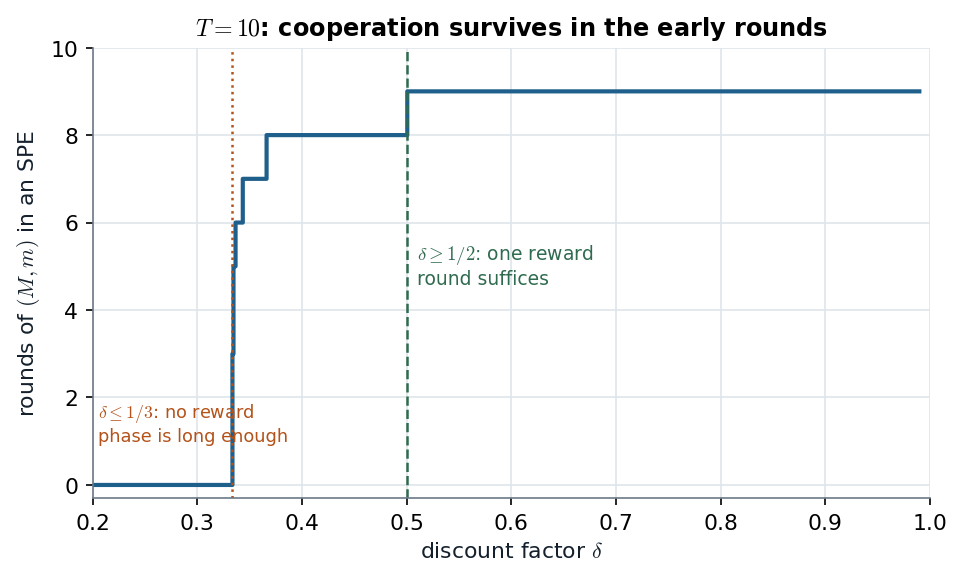

# 10.1 · Two stage equilibria: a carrot, a stick, and cooperation in the early rounds

> **Claim.** When the stage game has **two Pareto-ranked Nash equilibria**, the last period can
> still reward or punish: play the good one if everyone behaved, the bad one if anyone cheated.
> That gap buys behaviour in earlier periods **that is not a stage equilibrium at all** — in
> Tadelis's game, $(M,m)$ in period 1 is subgame-perfect **iff $\delta\geq1/2$**. Over a longer
> horizon the early rounds are the easy ones, because they have the most future at stake.
>
> Prev: [[L05-01-finite-repetition-unraveling]] · Next: [[L05-03-discounting-histories-strategies]] · Map: [[L05-00-map]]

---

## 1 · C — Tadelis's two-stage example (p. 191)

The stage game, played twice with discount factor $\delta$:

| | $m$ | $f$ | $r$ |
|---|---|---|---|
| $M$ | $4,\ 4$ | $-1,\ 5$ | $0,\ 0$ |
| $F$ | $5,\ -1$ | $1,\ 1$ | $0,\ 0$ |
| $R$ | $0,\ 0$ | $0,\ 0$ | $3,\ 3$ |

**Its pure Nash equilibria.** Check each cell by best responses.

| Cell | Player 1's alternatives | Player 2's alternatives | NE? |
|---|---|---|---|
| $(M,m)=(4,4)$ | $F$ gives $5>4$ | $f$ gives $5>4$ | **no** |
| $(F,f)=(1,1)$ | $M$ gives $-1$, $R$ gives $0$ | $m$ gives $-1$, $r$ gives $0$ | **yes** |
| $(R,r)=(3,3)$ | $M$, $F$ give $0$ | $m$, $f$ give $0$ | **yes** |

Two equilibria, **Pareto ranked**: $(R,r)$ beats $(F,f)$ for both. $(M,m)$ beats both but is not an
equilibrium — the upper-left $2\times2$ block is the Prisoner's Dilemma of
[[L05-01-finite-repetition-unraveling]].

**The strategies** (p. 191):

- **Player 1:** play $M$ in stage 1. In stage 2 play $R$ if $(M,m)$ was played in stage 1, and $F$
  otherwise.
- **Player 2:** play $m$ in stage 1. In stage 2 play $r$ if $(M,m)$ was played in stage 1, and $f$
  otherwise.

Formally (fn. 1): $s_1=(s_{11},s_{12}(h_1))$ with $s_{11}=M$ and $s_{12}(h_1)=R$ if $h_1=(M,m)$,
$F$ if $h_1\neq(M,m)$. One first-stage action and **nine** contingent second-stage actions — a
strategy names an action for every history, including those that never happen.

### 1.1 · Verifying subgame perfection, every step

**Stage 2.** After every first-stage outcome the prescribed pair, $(R,r)$ or $(F,f)$, is a stage
Nash equilibrium. No one-stage deviation pays in any of the nine stage-2 subgames.

**Stage 1.** Fix player 2's strategy. Player 1's three options, each with its continuation:

| Player 1 plays | Stage-1 payoff | Stage-2 outcome | Total $v_1$ |
|---|---|---|---|
| $M$ | $4$ | $(R,r)$: $3$ | $4+3\delta$ |
| $F$ | $5$ | $(F,f)$: $1$ | $5+\delta$ |
| $R$ | $0$ | $(F,f)$: $1$ | $0+\delta$ |

$R$ is never better than $M$ ($\delta<4+3\delta$). $M$ beats $F$ iff

$$4+3\delta\;\geq\;5+\delta\iff 2\delta\geq1\iff\boxed{\;\delta\geq\tfrac12\;}$$

(fn. 2: "$M$ is a best response if and only if $-1\geq-2\delta$, or $\delta\geq\frac12$"). Player 2
is symmetric.

> **Gain from deviating today: $5-4=+1$. Loss tomorrow: the switch from $(R,r)$ to $(F,f)$ costs
> $3-1=2$, worth $2\delta$ today.** Cooperate iff $2\delta\geq1$. Tadelis (p. 191): "both players will
> incur a loss of $-2$ in the second-period stage-game … The temptation to deviate … [is] the added
> payoff of $+1$."

---

## 2 · Worked — folding the second stage into the first

Replace stage 2 by its prescribed payoff: $+3\delta$ to both after $(M,m)$, $+\delta$ to both after
any other cell. At $\delta=1/2$:

| | $m$ | $f$ | $r$ |
|---|---|---|---|
| $M$ | $5.5,\ 5.5$ | $-0.5,\ 5.5$ | $0.5,\ 0.5$ |
| $F$ | $5.5,\ -0.5$ | $1.5,\ 1.5$ | $0.5,\ 0.5$ |
| $R$ | $0.5,\ 0.5$ | $0.5,\ 0.5$ | $3.5,\ 3.5$ |

Three pure equilibria of the folded game:

| Cell | Check | Repeated-game outcome |
|---|---|---|
| $(M,m)$ | $5.5\geq5.5$ (vs $F$), $5.5\geq0.5$ (vs $R$) — **a tie at exactly $\delta=1/2$** | $((M,m),(R,r))$: **cooperation in stage 1** |
| $(F,f)$ | $1.5>-0.5$, $1.5>0.5$ | $((F,f),(F,f))$ |
| $(R,r)$ | $3.5>0.5$ | $((R,r),(F,f))$ |

*Figure — the stage game, its first stage after folding back at $\delta=1/2$, and the gain-versus-loss comparison behind fn. 2. Source: Tadelis p. 191.*

The middle table is where the work happens: the $(M,m)$ cell gained $3\delta=1.5$ while every other
cell gained only $\delta=0.5$, and that **extra $2\delta$ is exactly enough** to offset the $+1$ from
$F$. Below $\delta=1/2$ the line on the right sits under the flat gain and $(M,m)$ stops being an
equilibrium of the folded game.

### 2.1 · Gibbons's version (Figures 2.3.3–2.3.4, pp. 84–86)

Gibbons's stage game (Figure 2.3.3) is the same idea with defect $=L$, cooperate $=M$, and the
added equilibrium $R$: $(L,L)=(1,1)$, $(M,M)=(4,4)$, $(R,R)=(3,3)$, $(L_1,M_2)=(5,0)$. With summed
payoffs ($\delta=1$), adding $(3,3)$ to the $(M_1,M_2)$ cell and $(1,1)$ to the other eight gives
Figure 2.3.4, whose three pure equilibria correspond to the three subgame-perfect outcomes
$((L_1,L_2),(L_1,L_2))$, $((R_1,R_2),(L_1,L_2))$ and $((M_1,M_2),(R_1,R_2))$ (p. 86). **The third
is "qualitatively different": the first-stage outcome is not a Nash equilibrium of $G$.**

Gibbons's general point (p. 86): *if $G$ has multiple Nash equilibria then there may be
subgame-perfect outcomes of $G(T)$ in which, for any $t<T$, the outcome in stage $t$ is not a Nash
equilibrium of $G$.*

---

## 3 · C — why this is Chapter 9 again

Tadelis (p. 191) points to the **Prisoner-Revenge Game** of §9.1 (p. 176): a reward-and-punishment
second stage disciplines first-stage play. The difference is only that here the *same* game is
repeated. The requirement, from Prop. 9.3 (p. 181) read in reverse:

> **Non-Nash behaviour early needs multiple continuation equilibria later** (p. 192). The good one is
> the **carrot**, the bad one the **stick**, and the players must be **patient enough** that the gap
> outweighs the one-period temptation.

---

## 4 · Extension — $T$ rounds and a reward phase of length $k$

*This section is the notes' construction on Tadelis's game, not the book's text. It is what the
second companion computes.*

Play $(M,m)$ in rounds $1,\dots,n$ and $(R,r)$ in rounds $n+1,\dots,T$ (the **reward phase**, of
length $k=T-n$); any deviation sends play to $(F,f)$ until the end. Write the payoffs generally:
$a=4$ on $(M,m)$, $b=5$ for $F$ against $m$, $r=3$ on $(R,r)$, $p=1$ on $(F,f)$.

**Rounds in the reward or punishment phase** prescribe a stage equilibrium; no one-stage deviation
pays there.

**The last cooperative round, $n$.** Deviating gains $b-a$ now; from round $n+1$ the deviator gets
$p$ instead of $r$ in each of the $k$ remaining rounds:

$$\text{loss}=\sum_{j=1}^{k}\delta^{j}(r-p)=(r-p)\,\delta\,(1+\delta+\dots+\delta^{k-1})
=(r-p)\,\frac{\delta(1-\delta^{k})}{1-\delta}.$$

So round $n$ holds iff

$$\boxed{\;b-a\;\leq\;(r-p)\,\frac{\delta(1-\delta^{k})}{1-\delta}\;}$$

- $k=1$: $b-a\leq(r-p)\delta$, i.e. $\delta\geq\dfrac{b-a}{r-p}=\dfrac12$ — Tadelis's condition.
- $k\to\infty$: the right side tends to $(r-p)\delta/(1-\delta)$, so **some** reward phase works iff
  $$\delta>\frac{b-a}{(b-a)+(r-p)}=\frac{1}{1+2}=\frac13 .$$
  At $\delta\leq1/3$ no finite game supports a single round of $(M,m)$ with this profile.

**Earlier cooperative rounds are slack** (when $r\leq a$). Let $L_n$ be the loss at round $n$. The
loss one round earlier is $L_{n-1}=\delta(a-p)+\delta L_n$, so

$$L_{n-1}-L_n=\delta(a-p)-(1-\delta)L_n=\delta(a-p)-(r-p)\delta(1-\delta^{k})\;\geq\;\delta\big[(a-p)-(r-p)\big]\;\geq0 .$$

Every earlier round has more at stake, so **only the last cooperative round binds**, and the most
cooperation is $n^*=T-k_{\min}$ with $k_{\min}$ the smallest $k$ satisfying the box.

**Worked, $T=10$:**

| $\delta$ | $\dfrac{\delta(1-\delta^k)}{1-\delta}(r-p)$ for $k=1,2,3,4$ | $k_{\min}$ | rounds of $(M,m)$ |
|---|---|---|---|
| $0.30$ | $0.60,\ 0.78,\ 0.83,\ 0.85$ — never $\geq1$ | — | **0** |
| $0.34$ | $0.68,\ 0.91,\ 0.99,\ 1.02$ | 4 | **6** |
| $0.40$ | $0.80,\ 1.12$ | 2 | **8** |
| $0.50$ | $1.00$ | 1 | **9** |
| $0.90$ | $1.80$ | 1 | **9** |

*Figure — patience buys cooperative rounds, but never the last one. Source: the box above with Tadelis's payoffs, p. 191; computed by `coop_rounds` in `figures/make_figures.py`.*

The curve never reaches 10: the last round must be a stage equilibrium (Prop. 9.2, p. 181). Between
$1/3$ and $1/2$ the curve climbs in steps as one more reward round becomes necessary; from $1/2$ on a
single reward round is enough.

> **Interactive companion.** [The Endgame Reward](companions/companion-finite-carrot-stick.html) — move $\delta$, $T$ and the carrot and stick payoffs; watch the bars (what a deviator loses) against the line (what he gains), and see how many early rounds of $(M,m)$ survive.

---

## 5 · U/G — the renegotiation problem (Gibbons pp. 86–88)

The stick $(F,f)$ hurts the punisher too. After a first-stage deviation both players would rather
play $(R,r)$, worth $3$ each, than $(F,f)$, worth $1$: "bygones are bygones" and they might
**renegotiate** (p. 87). If they would, the threat is empty, stage 2 is $(R,r)$ after every history,
and $F$ is again a best response in stage 1.

Gibbons's fix (Figure 2.3.5, p. 87) adds two more equilibria, $(P_1,P_2)$ with payoffs $(4,\tfrac12)$
and $(Q_1,Q_2)$ with $(\tfrac12,4)$. Punish player 1's deviation with $(Q_1,Q_2)$ and player 2's with
$(P_1,P_2)$; reward mutual cooperation with $(R_1,R_2)$. Cooperating gives $4+3$, deviating at best
$5+\tfrac12$ (p. 88). Each punishment equilibrium is on the Pareto frontier of the stage equilibria,
**so the punisher has nothing to renegotiate toward.** Named here as the **U/G** caveat; it is not part
of Tadelis's treatment.

---

## Links

- Previous: the unique-equilibrium case — [[L05-01-finite-repetition-unraveling]].
- Next: infinite horizons manufacture the second equilibrium themselves — [[L05-03-discounting-histories-strategies]], [[L05-04-grim-trigger-spe]].
- Multistage games, the Prisoner-Revenge Game, Props. 9.1–9.3: [[../L04/L04-00-map|Lecture 4]].
- Rules: [[../../rules/game-theory|rules/game-theory]] items 3–4.
- Exercises: Gibbons 2.10 (p. 134), 2.11 (p. 135); Tadelis 9.1 (pp. 186–187) is the multistage warm-up ([[../L04/L04-00-map|Lecture 4]]).
