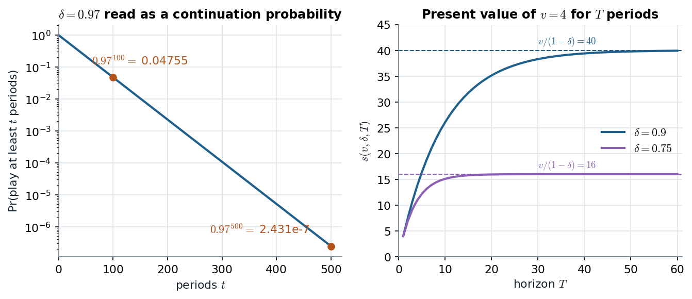

# 10.2 · Infinite horizons: discounting, average payoffs, histories and strategies

> **Claim.** Remove the last period and the unraveling has nowhere to start. To compare infinite
> payoff streams we **discount** them, and $\delta$ can be read as **the probability that the
> relationship survives one more period** — so "infinitely repeated" means "no one knows which period
> is the last", not "lasts forever". The **average payoff** $(1-\delta)\times$ PV puts a stream on the
> same scale as a stage payoff, and a **strategy** is a rule mapping every past history to an action.
>
> Prev: [[L05-02-two-stage-carrot-stick]] · Next: [[L05-04-grim-trigger-spe]] · Map: [[L05-00-map]]

---

## 1 · C — present value (Definition 10.2)

Let $G(\delta)$ be the infinitely repeated game with discount factor $\delta$ (p. 193).

**Definition 10.2** (p. 193). *Given the discount factor $0<\delta<1$, the present value of an
infinite sequence of payoffs $\{v_i^t\}_{t=1}^\infty$ for player $i$ is*
$$v_i=v_i^1+\delta v_i^2+\delta^2v_i^3+\dots+\delta^{t-1}v_i^t+\dots=\sum_{t=1}^{\infty}\delta^{t-1}v_i^t .$$

$\delta<1$ is **needed**: at $\delta=1$ a stream of $4$s and a stream of $1$s both sum to infinity
and cannot be ranked (Gibbons, p. 89).

### 1.1 · Why the sum is finite (fn. 3, p. 193)

Suppose every stage payoff is below a bound $b>0$. Then $v_i<\sum_t\delta^{t-1}b\equiv B$. To see
$B$ is finite, multiply by $(1-\delta)$:
$$B(1-\delta)=\sum_{t=1}^{\infty}\delta^{t-1}b-\sum_{t=1}^{\infty}\delta^{t}b
=b+\sum_{t=1}^{\infty}\delta^{t}b-\sum_{t=1}^{\infty}\delta^{t}b=b,$$
so $B=b/(1-\delta)<\infty$.

---

## 2 · U — $\delta$ as a continuation probability (pp. 193–194)

Suppose after each period the relationship continues with probability $\delta$ and ends with
probability $1-\delta$. With no time discounting, the expected payoff is
$$Ev=v_i^1+\delta v_i^2+(1-\delta)\cdot0+\delta^2v_i^3+\delta(1-\delta)\cdot0+\dots=\sum_{t=1}^{\infty}\delta^{t-1}v_i^t ,$$
**the same expression as Definition 10.2.** The probability of playing infinitely many times is
$\lim\delta^{t}=0$: the game ends in finite time with probability 1, yet **at every period a future
is still ahead** (p. 194).

| $\delta=0.97$ | Value (p. 194) |
|---|---|
| Pr(at least 100 periods) $=0.97^{100}$ | $0.0475$ |
| Pr(at least 500 periods) $=0.97^{500}$ | $2.4315\times10^{-7}$ — "less than one in four million" |

Both effects together (fn. 4, p. 194): with continuation probability $p$ and time discount factor
$\delta$, the effective discount factor is the product $p\delta$. Gibbons writes the same thing as
$\delta=(1-p)/(1+r)$, with $p$ the per-stage end probability and $r$ the interest rate (p. 90).
Cabral calls this reading the **indefinitely repeated game** and notes that for risk-neutral players
the two interpretations give the same computation (p. 174).

*Figure — left, how unlikely a long game is at $\delta=0.97$ (p. 194); right, $s(v,\delta,T)$ of (10.1) for $v=4$ (the cooperative PD payoff, p. 197) converging to $v/(1-\delta)$.*

The left panel is why "infinitely repeated" is not science fiction: even a 97% continuation
probability makes 500 periods essentially impossible, yet the analysis below needs only that **some**
future is always possible. The right panel shows that most of a discounted stream's value arrives
early — at $\delta=0.75$ the sum is within 1% of its limit by $T=17$ ($0.75^{17}=0.0075$).

---

## 3 · C — the average payoff (Definition 10.3) and the sum $s(v,\delta,T)$

**Definition 10.3** (p. 194). *Given $\delta<1$, the average payoff of an infinite sequence of payoffs
$\{v_i^t\}_{t=1}^\infty$ is*
$$\bar v_i=(1-\delta)\sum_{t=1}^{\infty}\delta^{t-1}v_i^t .$$

**Why $(1-\delta)$.** Take a constant payment $v$ for $T$ periods:
$$s(v,\delta,T)=v+\delta v+\delta^2v+\dots+\delta^{T-1}v. \tag{10.1}$$
Multiply by $\delta$:
$$\delta s(v,\delta,T)=\delta v+\delta^2v+\dots+\delta^{T-1}v+\delta^{T}v. \tag{10.2}$$
Subtract (10.2) from (10.1): every term except the first of (10.1) and the last of (10.2) cancels,
$$s(v,\delta,T)-\delta s(v,\delta,T)=v-\delta^{T}v\quad\Longrightarrow\quad s(v,\delta,T)=\frac{v-\delta^{T}v}{1-\delta}.$$
Let $T\to\infty$; since $\delta^{T}\to0$,
$$s(v,\delta)=\frac{v}{1-\delta},\qquad\bar v=(1-\delta)\,s(v,\delta)=v .$$

> **The average payoff of a constant stream $v$ is $v$ itself.** That is the whole point of the
> normalization: average payoffs of repeated-game paths live on the **same axes as the stage game's
> payoffs**, which is what lets the folk theorem draw them in one picture ([[L05-06-folk-theorem]]).

**Worked.** $(M,m)$ forever in Tadelis's PD: PV $=4/(1-\delta)$ (at $\delta=0.9$, $40$); average
$=(1-0.9)\cdot40=4$. Maximizing the average or the PV is the same problem, since one is a positive
multiple of the other (Gibbons, p. 97).

---

## 4 · C — histories and strategies (Definition 10.4)

The game tree grows in length and in width: after each period, every action profile opens a new
branch. In the repeated PD, **at stage 4 each player has 64 information sets** — one per possible
3-period history, $4^3=64$ (fn. 5, p. 195). In general, with $|A|$ action profiles in the stage game,
there are $|A|^{t-1}$ histories before stage $t$.

Because **each information set is identified with a unique history**, a strategy can be written as a
function of the history (p. 196).

**Definition 10.4** (p. 196). *Let $H_t$ denote the set of all possible histories of length $t$,
$h_t\in H_t$, and let $H=\bigcup_{t=1}^{\infty}H_t$ be the set of all possible histories. A pure
strategy for player $i$ is a mapping $s_i:H\to S_i$ that maps histories into actions of the
stage-game. Similarly a behavioral strategy of player $i$, $\sigma_i:H\to\Delta S_i$, maps histories
into stochastic choices of actions in each stage.*

**How big is a strategy?** In the two-stage PD a strategy has **five** instructions — one for stage 1
and one for each of the four first-stage outcomes; in a two-stage game whose stage game is $3\times3$
(Gibbons's Figure 2.3.3, or Tadelis's p. 191 example) it has **ten** (Gibbons, p. 93). In $G(\delta)$ it is an infinite list. The *useful* strategies are short
rules ("cooperate unless someone has ever defected") that compress the list.

**Subgames.** A subgame starts after any history and includes everything that follows. In $G(T)$
the subgame after stage $t$ is $G(T-t)$; **in $G(\delta)$ every subgame is identical to the
original game** (Gibbons, p. 94). This self-similarity is what makes the "bootstrap" argument of
[[L05-04-grim-trigger-spe]] §5 consistent rather than circular.

> **The $t$-th stage on its own is not a subgame** (Gibbons, p. 95): a subgame includes all the moves
> that follow. Analysing stage $t$ in isolation treats it as the last stage — exactly the mistake the
> repeated game exists to avoid.

---

## 5 · C — the trivial equilibrium (Proposition 10.2)

**Proposition 10.2** (p. 196). *Let $G(\delta)$ be an infinitely repeated game, and let
$(\sigma_1^*,\dots,\sigma_n^*)$ be a (static) Nash equilibrium strategy profile of the stage-game $G$.
Define the repeated-game strategy for each player $i$ to be the history-independent Nash strategy,
$\sigma_i^*(h)=\sigma_i^*$ for all $h\in H$. Then $(\sigma_1^*(h),\dots,\sigma_n^*(h))$ is a
subgame-perfect equilibrium in the repeated game for any $\delta<1$.*

**Why.** If the opponents' play ignores the history, today's action cannot change tomorrow; each
period is a one-shot game in which $\sigma_i^*$ is a best response to $\sigma_{-i}^*$ (p. 196). So
**fink forever is always an SPE of the repeated PD** (p. 197) — the stick is available for free. The
question of [[L05-04-grim-trigger-spe]] is whether anything *better* is.

---

## Links

- Next: the grim-trigger equilibrium — [[L05-04-grim-trigger-spe]].
- Discounting in multistage games and in Rubinstein bargaining: [[../L04/L04-00-map|Lecture 4]].
- Rules: [[../../rules/game-theory|rules/game-theory]] item 4.
- Exercises: Gibbons 2.12 (p. 135) asks for the definitions of a strategy and a subgame in a repeated game.
