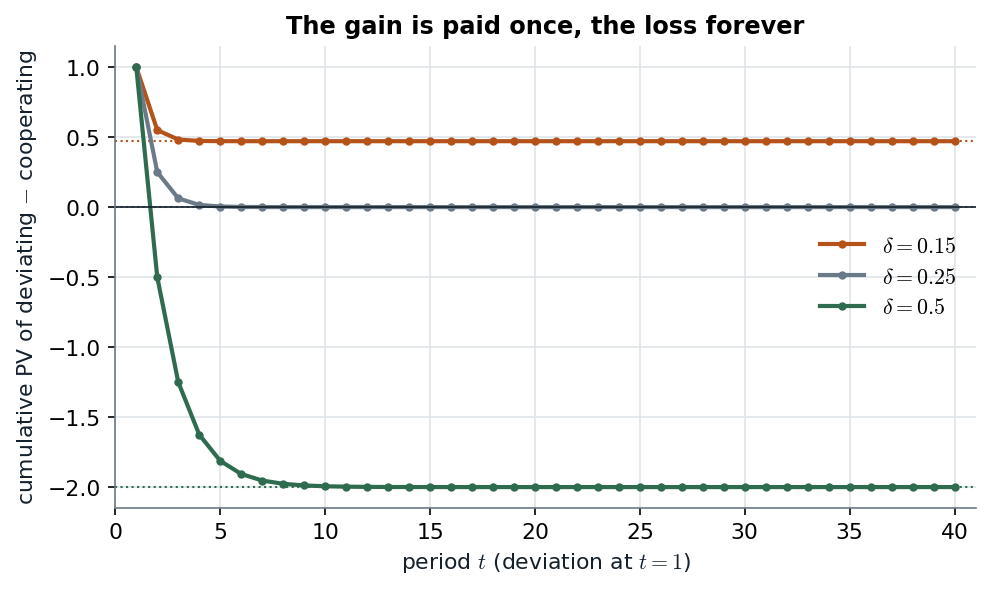

# 10.3 · Grim trigger: cooperation forever is subgame-perfect iff $\delta\geq1/4$

> **Claim.** In the infinitely repeated Prisoner's Dilemma, "cooperate until anyone defects, then
> defect forever" is a subgame-perfect equilibrium **iff $\delta\geq1/4$** with Tadelis's payoffs.
> The stick is the stage equilibrium repeated (always an SPE); the carrot is **the cooperative
> equilibrium itself** — a bootstrap, consistent because every subgame of $G(\delta)$ is the same
> game. Checking the infinitely many subgames reduces to **two** checks, one per state, thanks to the
> one-stage deviation principle.
>
> Prev: [[L05-03-discounting-histories-strategies]] · Next: [[L05-05-critical-discount-factor]] · Map: [[L05-00-map]]

---

## 1 · C — subgame-perfect equilibrium in a repeated game

**Definition 10.5** (p. 196), in words: a profile $\sigma^*=(\sigma_1^*,\dots,\sigma_n^*)$ of
history-contingent strategies is a **subgame-perfect equilibrium** of $G(\delta)$ if, **for every
history $h$**, the strategies restricted to the subgame that starts after $h$ form a Nash
equilibrium of that subgame.

Gibbons (p. 95, after Selten 1965): *a Nash equilibrium is subgame-perfect if the players'
strategies constitute a Nash equilibrium in every subgame.* Two consequences:

- **Off-path behaviour matters.** Histories that never occur in equilibrium (someone defected) are
  subgames too, and the threatened play there must be an equilibrium — a **credible** threat.
- **Infinitely many subgames** — one per history. Checking them one by one is impossible, which is
  why §3 matters.

---

## 2 · C — the grim-trigger strategies (p. 198)

Tadelis's stage game (p. 197): $(M,m)=(4,4)$, $(M,f)=(-1,5)$, $(F,m)=(5,-1)$, $(F,f)=(1,1)$.

- **Player 1:** in the first stage play $s_1^1=M$. For any stage $t>1$, play $s_1^t(h_{t-1})=M$ **if
  and only if** the history $h_{t-1}$ consists only of $(M,m)$; otherwise play $F$.
- **Player 2:** the mirror strategy: $m$ at $t=1$, $m$ iff $h_{t-1}=\{(M,m),\dots,(M,m)\}$, else $f$.

Read it as a two-state machine:

| State | Entered when | Prescribed play | Leaves when |
|---|---|---|---|
| **Cooperation** | $t=1$, or every past outcome was $(M,m)$ | $(M,m)$ | any outcome other than $(M,m)$ |
| **Punishment** | some past outcome was not $(M,m)$ — "be it once or more than once, be it by one player or both" (p. 198) | $(F,f)$ | never |

"Grim" because the punishment is **forever**; "trigger" because **any** deviation pulls it.

Gibbons's trigger strategy (p. 91) is the same with his labels: *Play $R_i$ in the first stage. In
the $t$th stage, if the outcome of all $t-1$ preceding stages has been $(R_1,R_2)$ then play $R_i$;
otherwise, play $L_i$.*

---

## 3 · C — the one-stage deviation principle (Proposition 10.3)

**Proposition 10.3** (p. 198). *In an infinitely repeated game $G(\delta)$ a profile of strategies
$\sigma^*=(\sigma_1^*,\dots,\sigma_n^*)$ is a subgame-perfect equilibrium if and only if there is no
player $i$ and no single history $h_{t-1}$ for which player $i$ would gain from deviating from
$s_i(h_{t-1})$.*

It is the repeated-game form of **Theorem 9.1** (p. 185): *a one-stage unimprovable strategy must be
optimal* ([[../L04/L04-00-map|Lecture 4]]). A one-stage deviation changes the action at **one**
history and follows the strategy everywhere else.

**Why it survives an infinite horizon** (fn. 6, p. 199). In a finite tree a profitable deviation
can be broken into finitely many one-stage deviations, and induction finishes the proof. With an
infinite horizon a profitable deviation may change infinitely many actions; but **discounting makes
payoffs continuous at infinity**: changes after period $N$ are worth at most a multiple of
$\delta^{N}$, so some deviation that differs from $\sigma_i$ in only finitely many stages must also be
profitable, and the finite argument applies (Fudenberg and Tirole, 1991, Thm 4.2, cited there).

> **The practical rule: list the states, and in each state check the single most tempting action
> today, followed by the equilibrium continuation from tomorrow.** For grim trigger that is two
> checks.

---

## 4 · Worked — the two checks

### 4.1 · Off the path: the punishment state

After any history with a deviation, the strategies prescribe $(F,f)$ now and forever, whatever
happens next. Facing $f$ today and $f$ forever after:

| Player 1 plays today | Today | From tomorrow | Total |
|---|---|---|---|
| $F$ (prescribed) | $1$ | $(F,f)$ forever: $\delta/(1-\delta)$ | $1+\dfrac{\delta}{1-\delta}$ |
| $M$ (deviation) | $-1$ | still $(F,f)$ forever: $\delta/(1-\delta)$ | $-1+\dfrac{\delta}{1-\delta}$ |

Deviating loses $2$ today "with no gains in subsequent stages" (p. 199). **The punishment is
credible for every $\delta$** — it is Proposition 10.2's equilibrium.

### 4.2 · On the path: the cooperation state

After a history of only $(M,m)$, with the opponent playing grim trigger:

**Follow the strategy** — $4$ today, $(M,m)$ forever after:
$$v_i=4+4\delta+4\delta^2+\dots=4+\frac{4\delta}{1-\delta}.$$

**Deviate to $F$** — $5$ today, then the opponent plays $f$ forever and $F$ is the best reply:
$$v_i'=5+\delta+\delta^2+\dots=5+\frac{\delta}{1-\delta}.$$

No profitable deviation iff
$$4+\frac{4\delta}{1-\delta}\;\geq\;5+\frac{\delta}{1-\delta}. \tag{10.3}$$

Solve, every step:

1. Multiply both sides by $1-\delta>0$: $\;4(1-\delta)+4\delta\geq5(1-\delta)+\delta$.
2. Expand: $\;4\geq5-5\delta+\delta=5-4\delta$.
3. Rearrange: $\;4\delta\geq1$.
4. $$\boxed{\;\delta\geq\tfrac14\;}$$

| $\delta$ | $v_i$ (cooperate) | $v_i'$ (deviate) | Verdict |
|---|---|---|---|
| $0.20$ | $4/0.8=5.000$ | $5+0.2/0.8=5.250$ | deviate: **not** an SPE |
| $0.25$ | $4/0.75=5.333$ | $5+0.25/0.75=5.333$ | indifferent: SPE (weak) |
| $0.50$ | $8.000$ | $6.000$ | cooperate: SPE |

> **Two effects of today's action** (p. 199): the **direct** effect on today's payoff ($5$ vs $4$,
> $+1$) and the **indirect** effect on the continuation ($4\delta/(1-\delta)$ vs $\delta/(1-\delta)$, a
> loss of $3\delta/(1-\delta)$). Patience is what makes the indirect effect large.

*Figure — a deviation at $t=1$ pays $+1$ once and costs $3$ in every later period; discounted, the running total converges to $1-3\delta/(1-\delta)$. Source: (10.3), pp. 199–200.*

At $\delta=0.25$ the running total converges exactly to zero — the threshold. Below it the
one-period gain is never paid back; above it the losses overtake the gain within a few periods. The
first loss already counts $3\delta$, so the verdict is mostly settled by the period right after the
deviation.

> **Interactive companion.** [The Patience Threshold](companions/companion-grim-trigger.html) — move $\delta$ across $\delta^*$ and watch the verdict flip; move $T$, $R$, $P$ and see which payoff moves the threshold and which ($S$) does not.

### 4.3 · Gibbons's recursive version (pp. 91–92)

Gibbons first shows grim trigger is a **Nash** equilibrium, with his PD $(L,L)=(1,1)$, $(R,R)=(4,4)$,
$(L_j$ vs $R_i)=5$. Once someone defects, $j$'s best reply is $L_j$ forever. In a cooperative stage,
let $V$ be the value of making the $L$-or-$R$ choice optimally now and whenever it recurs:

- if $R_j$ is optimal, it yields $4$ now and **the same choice next stage**: $V=4+\delta V$, so
  $V=4/(1-\delta)$;
- if $L_j$ is optimal: $V=5+\delta/(1-\delta)$.

$R_j$ is optimal iff $\dfrac{4}{1-\delta}\geq5+\dfrac{\delta}{1-\delta}$ (2.3.1), i.e. $\delta\geq1/4$.
Then (p. 95) subgame perfection follows from two classes of subgames: after all-cooperation the
continuation is again grim trigger, a Nash equilibrium of the whole game; after any defection it is
$(L_1,L_2)$ forever, also a Nash equilibrium. **Same threshold, with $S=0$ instead of $-1$: the sucker
payoff never enters** (it is not on either side of (10.3)).

### 4.4 · Cabral's indefinitely repeated version (pp. 172–173)

Cabral's game: $(T,L)$ pays $5$ each, the dominant-strategy equilibrium pays $4$ each, and deviating
from $(T,L)$ pays $6$; the game continues with probability $\alpha$.
$$\frac{5}{1-\alpha}\;\geq\;6+\frac{4\alpha}{1-\alpha}\iff5\geq6(1-\alpha)+4\alpha\iff\alpha\geq\tfrac12 .$$
"A gain of 1 in the short run $(6-5)$ against a loss of 1 in every future period $(5-4)$" (p. 173).

---

## 5 · U — the bootstrap

Tadelis (pp. 197–198): to support $(M,m)$ forever we need a **stick** — $(F,f)$ forever, an SPE by
Prop. 10.2 — and a **carrot**. The carrot is the proposed equilibrium itself: if playing $(M,m)$
forever is an SPE, then it is available as the reward continuation that supports itself.

> **"Indeed this is a circular argument, but it is not inconsistent"** (p. 197): a **bootstrap
> equilibrium**. It is consistent because every subgame of $G(\delta)$ is the same infinitely repeated
> game ([[L05-03-discounting-histories-strategies]] §4), so "cooperate forever from tomorrow" is
> exactly the object whose equilibrium status we are checking.

**Back to Chapter 9** (p. 200). Think of "today" as stage 1 and "the infinite future" as stage 2.
Non-Nash behaviour today needs (i) **multiple equilibria tomorrow** and (ii) **sufficient patience**.
$\delta\geq1/4$ is (ii). For (i), "from the unique equilibrium of the stage-game we get multiple
equilibria of the repeated game" — the infinite horizon manufactures the carrot that the finite
game of [[L05-01-finite-repetition-unraveling]] lacked.

**The probability reading** (p. 200): cooperation is credible "as long as the game is likely enough
to be played again" — "what goes around comes around".

---

## Links

- Previous: the objects used here — [[L05-03-discounting-histories-strategies]].
- Next: the threshold for any payoffs, and what moves it — [[L05-05-critical-discount-factor]].
- The folk theorem generalizes the construction — [[L05-06-folk-theorem]].
- Theorem 9.1 and the Prisoner-Revenge Game: [[../L04/L04-00-map|Lecture 4]].
- The same construction for Cournot firms (§10.4) and for trust and reputation (§10.5): [[../L06/L06-00-map|Lecture 6]].
- Rules: [[../../rules/game-theory|rules/game-theory]] items 2 and 4.
- Exercises: Tadelis 10.2(a) (p. 215); Muñoz-Garcia & Toro-Gonzalez Ch. 6 Ex. 1 (p. 274); Gibbons 2.12 (p. 135).
