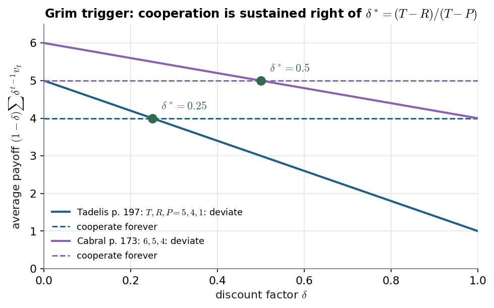

# 10.3 · The critical discount factor: one formula, three readings

> **Claim.** For any stage game, grim trigger supports a path paying $v_i^c$ per period, against a
> best one-shot deviation $v_i^d$ and a stage-Nash punishment $v_i^*$, **iff
> $\delta\geq(v_i^d-v_i^c)/(v_i^d-v_i^*)$ for every player**. In Prisoner's-Dilemma labels this is
> $\delta^*=(T-R)/(T-P)$: **the one-time gain over the one-time gain plus the per-period loss.** A
> bigger temptation or a softer punishment raises it; a better reward lowers it; the sucker payoff is
> irrelevant.
>
> Prev: [[L05-04-grim-trigger-spe]] · Next: [[L05-06-folk-theorem]] · Map: [[L05-00-map]]

---

## 1 · C — the general condition (10.5)

Tadelis's notation (p. 202): on the cooperative path player $i$ earns $v_i^c$ per period; the most
profitable one-stage deviation earns $v_i^d$ once; the stage Nash equilibrium used as the trigger
punishment earns $v_i^*$ per period. Player $i$ does not deviate iff

$$\underbrace{v_i^c}_{\substack{\text{current payoff}\\\text{from cooperate}}}+\underbrace{\frac{\delta v_i^c}{1-\delta}}_{\substack{\text{future payoff}\\\text{if cooperate}}}
\;\geq\;\underbrace{v_i^d}_{\substack{\text{current payoff}\\\text{from best defect}}}+\underbrace{\frac{\delta v_i^*}{1-\delta}}_{\substack{\text{future payoff}\\\text{if defect}}} .$$

"After some algebra" — here it is:

1. Multiply by $1-\delta>0$: $\;v_i^c(1-\delta)+\delta v_i^c\geq v_i^d(1-\delta)+\delta v_i^*$.
2. Simplify the left side: $\;v_i^c\geq v_i^d-\delta v_i^d+\delta v_i^*$.
3. Collect $\delta$: $\;\delta\,(v_i^d-v_i^*)\geq v_i^d-v_i^c$.
4. Divide by $v_i^d-v_i^*>0$ (a deviation beats the punishment, since $v_i^d\geq v_i^c>v_i^*$):

$$\boxed{\;\delta\;\geq\;\frac{v_i^d-v_i^c}{v_i^d-v_i^*}\;}\tag{10.5}$$

Step 1 is also the **average-payoff** form: cooperate gives average $v_i^c$; deviate gives
$(1-\delta)v_i^d+\delta v_i^*$, a weighted average of the deviation and the punishment.

**With several players**, each needs her own condition, so
$$\delta\geq\max_i\frac{v_i^d-v_i^c}{v_i^d-v_i^*}\quad\text{(Gibbons, Appendix 2.3.B, p. 101).}$$
Gibbons writes $d_i$, $x_i$, $e_i$ for Tadelis's $v_i^d$, $v_i^c$, $v_i^*$. Since $d_i\geq x_i>e_i$,
each fraction is **strictly below 1** (p. 102), so a patient enough $\delta<1$ always exists — the
seed of the folk theorem ([[L05-06-folk-theorem]]).

Lecture 6 applies (10.5) to asymmetric Cournot collusion, where the two firms need different
thresholds (Tadelis §10.4, p. 202) → [[../L06/L06-00-map|Lecture 6]].

---

## 2 · C — the Prisoner's Dilemma labels

Write the symmetric PD with the standard labels — **temptation $T$, reward $R$, punishment $P$,
sucker $S$**, $T>R>P>S$ — so that $v^d=T$, $v^c=R$, $v^*=P$:

$$\boxed{\;\delta^*=\frac{T-R}{T-P}=\frac{g}{g+\ell},\qquad g=T-R\ \text{(one-time gain)},\quad \ell=R-P\ \text{(per-period loss)}\;}$$

*Notation clash:* $T$ is also Tadelis's horizon in $G(T,\delta)$. In notes 04–06 and the companion
$T$ is the temptation payoff; in notes 01–02 it is the number of periods.

| Source | $(T,R,P,S)$ | $g$ | $\ell$ | $\delta^*$ |
|---|---|---|---|---|
| Tadelis p. 197 | $(5,4,1,-1)$ | $1$ | $3$ | $\mathbf{1/4}$ |
| Gibbons p. 90 | $(5,4,1,0)$ | $1$ | $3$ | $\mathbf{1/4}$ |
| Cabral p. 173 | $(6,5,4,\cdot)$ | $1$ | $1$ | $\mathbf{1/2}$ |

*Figure — cooperate (dashed, flat at $R$) against deviate (solid, $(1-\delta)T+\delta P$); grim trigger is an SPE right of the crossing. Source: (10.3), p. 200; Cabral pp. 172–173.*

The deviation line runs from $T$ at $\delta=0$ (only today counts) to $P$ at $\delta\to1$ (only the
punishment counts). It crosses $R$ where $(1-\delta)T+\delta P=R$, which is $\delta^*$. Cabral's
temptation is the same $+1$, but his punishment costs only $1$ per period instead of $3$, so his line
is flatter and the crossing moves right, to $1/2$.

> **Interactive companion.** [The Patience Threshold](companions/companion-grim-trigger.html) — reproduce both lines (the "Gibbons p. 90" button gives the same $1/4$ with $S=0$), then move $P$ toward $R$ and watch $\delta^*$ approach 1.

---

## 3 · C — comparative statics, with signs

From $\delta^*=(T-R)/(T-P)$:

$$\frac{\partial\delta^*}{\partial T}=\frac{(T-P)-(T-R)}{(T-P)^2}=\frac{R-P}{(T-P)^2}>0,\qquad
\frac{\partial\delta^*}{\partial R}=-\frac{1}{T-P}<0,$$
$$\frac{\partial\delta^*}{\partial P}=\frac{T-R}{(T-P)^2}>0,\qquad\frac{\partial\delta^*}{\partial S}=0 .$$

| Payoff rises | $\delta^*$ | Why |
|---|---|---|
| Temptation $T$ | **rises** | a bigger one-time gain needs more future to offset it |
| Reward $R$ | **falls** | the gain shrinks and the loss grows |
| Punishment $P$ | **rises** | a milder stick costs the deviator less per period |
| Sucker $S$ | **unchanged** | on the grim-trigger path nobody is ever the sucker |

> **The harshest credible punishment makes cooperation easiest.** That is why grim trigger reverts
> to the *worst* stage equilibrium, and why Gibbons (p. 99) names Abreu's (1988) idea — punish with
> the worst subgame-perfect equilibrium, which can be harsher than stage-Nash reversion — as the
> route to cooperation when $\delta$ is not close to 1. In the PD the two coincide, because the
> stage equilibrium already gives each player her reservation payoff. **G**, named only.

---

## 4 · U — three readings of the same number

**(a) Patience.** $\delta\geq\delta^*$ says the future weighs enough.

**(b) Interest rate.** With $\delta=1/(1+r)$ (Gibbons, p. 89), $\delta\geq\delta^*$ iff
$$1+r\leq\frac{1}{\delta^*}=\frac{g+\ell}{g}\iff r\leq\frac{\ell}{g}.$$
In Tadelis's PD $\ell/g=3$: cooperation survives any per-period interest rate up to **300%**. The
condition is generous because each period's loss is three times the one-time gain.

**(c) Continuation probability.** With $\delta$ the probability of another period
([[L05-03-discounting-histories-strategies]] §2), the expected number of periods is
$1+\delta+\delta^2+\dots=1/(1-\delta)$. At $\delta^*=1/4$ that is $4/3$: **an expected third of a
period of future already disciplines a one-unit temptation** when each lost period costs 3.

---

## 5 · G — MWG's version (Appendix A to Ch. 12)

MWG calls grim trigger **Nash reversion** (Definition 12.AA.1, p. 418): play a prescribed path until
someone deviates, then the stage Nash equilibrium forever. Lemma 12.AA.1 (p. 418) is (10.5) for an
arbitrary path, and the rewriting (12.AA.2) states it as "one-period gain $\leq$ discounted future
loss". **Proposition 12.AA.2** (p. 420): *if a path can be sustained by Nash reversion at discount
factor $\delta$, it can be sustained for any $\delta'\geq\delta$* — the sustainable set only grows with
patience, which is why $\delta^*$ is a threshold rather than a window. Not examinable unless the
lecture brings it.

---

## Links

- Previous: the derivation for Tadelis's numbers — [[L05-04-grim-trigger-spe]].
- Next: what else patient players can support — [[L05-06-folk-theorem]].
- Cournot and Bertrand collusion thresholds: [[../L06/L06-00-map|Lecture 6]].
- Rules: [[../../rules/game-theory|rules/game-theory]] item 4 ("the folk theorem needs sufficiently patient players and observable deviations").
- Exercises: Tadelis 10.2(a)–(b) (p. 215), 10.3 (pp. 215–216; milder "length-$T$" punishments), 10.5(c) (pp. 216–217), 10.9(b) (pp. 218–219); Muñoz-Garcia & Toro-Gonzalez Ch. 6 Ex. 1 (p. 274).
