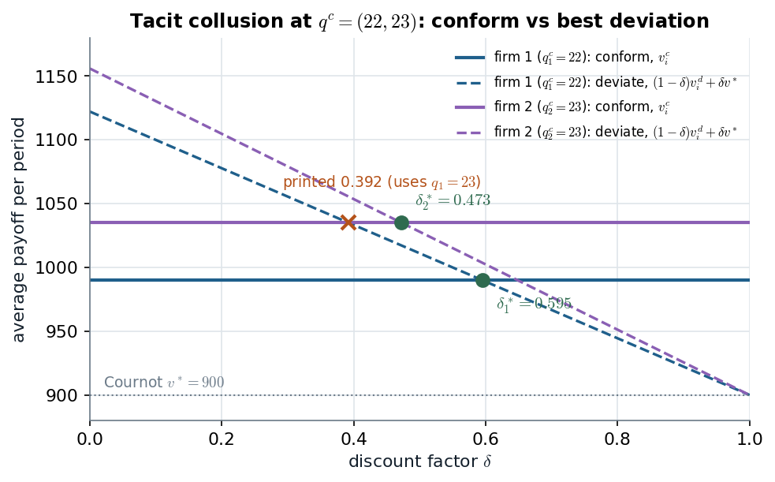
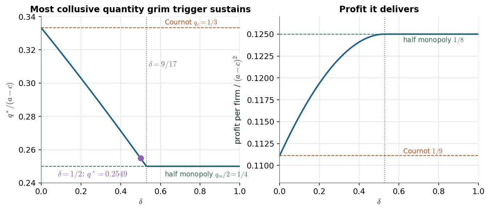

# 10.4 · Tacit collusion in quantities: who needs patience, and how much

> **Claim.** A Cournot cartel is a relational contract between firms that cannot sign one:
> each firm produces less than its static best response **only because** cheating would
> trigger a return to Cournot forever. With linear demand and two firms the monopoly split
> survives iff $\delta\ge 9/17$; below that the cartel does not collapse to Cournot but
> **shrinks** to the most collusive output the threat can still support; and in an
> asymmetric split the firm with the **smaller** share needs the **more** patience.
> Prev: [[L06-01-recap-grim-trigger]] · Next: [[L06-03-bertrand-market-structure]] · Map: [[L06-00-map]]

---

## 1 · U — collusion without a contract

Explicit cartel contracts are illegal (Sherman Act §1, 1890: "conspiracies in restraint of
trade", Tadelis p. 201) and unenforceable anyway. The repeated game shows that firms may not
need one: **shared beliefs about reward and punishment** support output restriction as a
subgame-perfect equilibrium, with no meeting and no agreement — *tacit* collusion. Friedman
(1971) was the first to show it, for exactly this Cournot case (Gibbons p. 102).

---

## 2 · Worked — Tadelis's asymmetric split (pp. 201–202)

**Stage game.** Demand $p=100-q$, costs $c_i(q_i)=10q_i$. From Tadelis §5.2.3:

| Benchmark | Quantities | Price | Profit per firm |
|---|---|---|---|
| Cournot–Nash | $q_1^*=q_2^*=30$ | 40 | $v^*=900$ |
| Monopoly, split equally | $22.5$ each (total 45) | 55 | $(55-10)\times22.5=1012.5$ |

**The split Tadelis uses** — deliberately unequal: $q_1^c=22$, $q_2^c=23$ (total 45, price 55):

$$v_1^c=(55-10)\times22=990,\qquad v_2^c=(55-10)\times23=1035 .$$

**Strategies (grim trigger).** Each firm plays $q_i^c$ in period 1 and keeps doing so while
every past pair was $(22,23)$; after any other history it plays $q_i^*=30$ forever.

**Off the path** each firm expects 30 from the rival, and 30 is a best response to 30 — no
condition, for any $\delta$ (p. 202).

**On the path.** The most tempting deviation is the static best response to the rival's
cooperative output. From $\max_{q_i}(100-q_i-q_j-10)q_i$, the first-order condition
$90-2q_i-q_j=0$ gives

$$BR_i(q_j)=\frac{90-q_j}{2}\qquad\text{(10.4)}$$

| | Firm 1 (rival plays 23) | Firm 2 (rival plays 22) |
|---|---|---|
| deviation $q_i^d=BR_i(q_j^c)$ | $(90-23)/2=33.5$ | $(90-22)/2=34$ |
| price | $100-33.5-23=43.5$ | $100-22-34=44$ |
| deviation profit $v_i^d$ | $(43.5-10)\times33.5=\mathbf{1122.25}$ | $(44-10)\times34=\mathbf{1156}$ |
| conform $v_i^c$ | 990 | 1035 |
| cutoff $\delta_i^*=\dfrac{v_i^d-v_i^c}{v_i^d-v^*}$ | $\dfrac{132.25}{222.25}=\mathbf{0.595}$ | $\dfrac{121}{256}=\mathbf{0.473}$ |

> **Erratum — check before you copy the book.** Tadelis prints firm 2's deviation profit as
> $(100-23-34)\times34-10\times34=1122$ and the cutoff $\delta_2\ge0.392$ (p. 202). The
> formula plugs in $q=23$ — firm 2's **own** cooperative output — where the rival's output
> $q_1^c=22$ belongs. With $q_1^c=22$ the price is 44, $v_2^d=1156$ and
> $\delta_2^*=121/256=0.473$. **The book's conclusion survives**: $0.595>0.473$, so firm 1 is
> still the one that needs more patience. (Verified in [[L06-11-python]] §2.)

**Why the smaller firm is the binding one** (Tadelis p. 203, in his words "nicely reflects the
temptations"): firm 1 **gains more** from deviating ($1122.25-990=132.25$ against
$1156-1035=121$) **and loses less** when Cournot returns ($990-900=90$ per period against
$1035-900=135$). Both effects push its cutoff up. The cartel survives iff
$\delta\ge\max(0.595,0.473)=0.595$.

*Figure — the average-payoff form of (10.5): each firm conforms where its flat line lies above
its falling deviation line. Source: Tadelis §10.4, pp. 201–202, with $v_2^d$ corrected to 1156.*

Each dashed line starts at the deviation profit ($\delta=0$: only today counts) and ends at
Cournot's 900 ($\delta\to1$: only the punishment counts). Firm 1's dashed line crosses its
lower conform line later, so firm 1 sets the cartel's patience requirement. The cross shows
where the printed 0.392 would put firm 2.

> **Lesson for designing a split.** An unequal division of the monopoly profit raises the
> cartel's required $\delta$ to the **worse-treated** firm's cutoff. A cartel that wants to
> survive at the lowest $\delta$ gives every member a share that equalizes the cutoffs, not the
> quantities (Cabral's asymmetry point, [[L06-03-bertrand-market-structure]] §4).

---

## 3 · C — Gibbons's symmetric cartel: $\delta\ge 9/17$ (pp. 102–103)

**Stage game.** $P(Q)=a-Q$, marginal cost $c$, two firms. Cournot output
$q_c=(a-c)/3$; monopoly output $q_m=(a-c)/2$; the cartel plays $q_m/2=(a-c)/4$ each.

| Payoff | Derivation | Value |
|---|---|---|
| collusive, $\pi_m/2$ | price $a-(a-c)/2=(a+c)/2$; margin $(a-c)/2$; times $(a-c)/4$ | $(a-c)^2/8$ |
| Cournot, $\pi_c$ | margin $a-2(a-c)/3-c=(a-c)/3$; times $(a-c)/3$ | $(a-c)^2/9$ |
| deviation, $\pi_d$ | $\max_{q_j}\bigl(a-q_j-\tfrac{a-c}{4}-c\bigr)q_j$: FOC $\tfrac34(a-c)-2q_j=0$, $q_j=\tfrac38(a-c)$; margin $\tfrac38(a-c)$ | $9(a-c)^2/64$ |

Grim trigger is an SPE iff (Gibbons (2.3.2), p. 103)

$$\frac{1}{1-\delta}\cdot\frac{\pi_m}{2}\ \ge\ \pi_d+\frac{\delta}{1-\delta}\,\pi_c .$$

Using the template, with $(a-c)^2$ cancelling:

$$\delta\ \ge\ \frac{\pi_d-\pi_m/2}{\pi_d-\pi_c}=\frac{\frac{9}{64}-\frac{8}{64}}{\frac{9}{64}-\frac19}
=\frac{\frac{1}{64}}{\frac{81-64}{576}}=\frac{1}{64}\cdot\frac{576}{17}=\boxed{\frac{9}{17}\approx0.529}$$

**Tadelis's numbers in Gibbons's model** ($a=100$, $c=10$, $a-c=90$): collusive $1012.5$,
deviation $q_j=33.75$ with profit $33.75^2=1139.06$, Cournot $900$ —
$(1139.06-1012.5)/(1139.06-900)=126.56/239.06=0.529$.

---

## 4 · C — below 9/17 the cartel shrinks instead of dying (Gibbons pp. 103–104)

For $\delta<9/17$ half the monopoly output cannot be sustained, but **repeating Cournot is
always an SPE**, so the best grim-trigger cartel produces some $q^*\in[q_m/2,q_c]$. Take the
trigger strategy "produce $q^*$ while both always did; otherwise $q_c$ forever".

- Conform: $\pi^*=(a-2q^*-c)q^*$.
- Best deviation against $q^*$: $q_j=(a-q^*-c)/2$, profit $\pi_d=(a-q^*-c)^2/4$.
- Punishment: $\pi_c=(a-c)^2/9$.

The condition $\pi^*\ge(1-\delta)\pi_d+\delta\pi_c$ in units of $a-c$ (write $q$ for
$q^*/(a-c)$):

$$(1-2q)q\ \ge\ (1-\delta)\frac{(1-q)^2}{4}+\frac{\delta}{9}.$$

Multiply by 36: $36q-72q^2\ge 9(1-\delta)(1-2q+q^2)+4\delta$. Move everything right:

$$0\ \ge\ \bigl(72+9(1-\delta)\bigr)q^2-\bigl(36+18(1-\delta)\bigr)q+9(1-\delta)+4\delta$$
$$\iff\ 9(9-\delta)\,q^2-18(3-\delta)\,q+(9-5\delta)\ \le\ 0 .$$

The quadratic opens upward, so the condition holds **between its roots**. One root is the
Cournot output $q=1/3$ (check: $9-\delta-6(3-\delta)+9-5\delta=0$). The product of the roots
is $(9-5\delta)/\bigl(9(9-\delta)\bigr)$, so the other root is that product divided by $1/3$:

$$\boxed{\;q^*=\frac{9-5\delta}{3(9-\delta)}\,(a-c)\;}\qquad(\text{Gibbons p. 104})$$

It equals $(a-c)/3$ at $\delta=0$ and $(a-c)/4$ at $\delta=9/17$
($\tfrac{9-45/17}{3(9-9/17)}=\tfrac{108/17}{432/17}=\tfrac14$), and falls monotonically between.

**Worked at $\delta=1/2$, Tadelis's numbers.** $q^*=\dfrac{9-2.5}{3\times8.5}\times90=0.2549\times90=22.94$
per firm; total $45.88$, price $54.12$, profit $(54.12-10)\times22.94=1012.1$ — within half a
unit of the monopoly share $1012.5$, though the full share itself is not sustainable.

*Figure — the most collusive symmetric output grim trigger sustains, and the profit it
delivers. Source: Gibbons §2.3.C, p. 104, $q^*=(9-5\delta)/(3(9-\delta))\,(a-c)$.*

Profit climbs steeply at low $\delta$ and flattens near $9/17$: the last steps toward the
monopoly output are worth little, because profit is flat at its maximum. That is why a cartel
just short of the threshold loses almost nothing — and why the **carrot-and-stick**
punishment of [[L06-04-punishments-price-wars]] §1, which reaches the full monopoly share at
$\delta=1/2$, gains little in profit but a lot in theory.

---

## 5 · C — $n$ Cournot firms

With $n$ identical firms, $P=a-Q$, marginal cost $c$ (the general case of Muñoz-Garcia Ch. 6
Ex. 4, p. 287):

| Payoff per firm | Derivation | Value |
|---|---|---|
| collusive share | monopoly profit $(a-c)^2/4$ split $n$ ways | $(a-c)^2/(4n)$ |
| best deviation | rivals produce $(n-1)\frac{a-c}{2n}$; $q_d=\frac12\bigl(a-c-\frac{(n-1)(a-c)}{2n}\bigr)=\frac{(n+1)(a-c)}{4n}$; margin equals $q_d$ | $\frac{(n+1)^2(a-c)^2}{16n^2}$ |
| Cournot | $q_N=\frac{a-c}{n+1}$, margin $q_N$ | $(a-c)^2/(n+1)^2$ |

Numerator of (10.5): $\frac{(n+1)^2-4n}{16n^2}(a-c)^2=\frac{(n-1)^2}{16n^2}(a-c)^2$.
Denominator: $\frac{(n+1)^4-16n^2}{16n^2(n+1)^2}(a-c)^2=\frac{\bigl((n+1)^2-4n\bigr)\bigl((n+1)^2+4n\bigr)}{16n^2(n+1)^2}(a-c)^2=\frac{(n-1)^2(n^2+6n+1)}{16n^2(n+1)^2}(a-c)^2$.
The ratio:

$$\boxed{\;\delta^*_{\text{Cournot}}(n)=\frac{(n+1)^2}{n^2+6n+1}\;}\qquad
n=2:\ \tfrac{9}{17}=0.529,\quad n=3:\ \tfrac{16}{28}=0.571,\quad n=10:\ \tfrac{121}{161}=0.752 .$$

It rises with $n$ (more firms, smaller share, bigger relative temptation) and tends to 1. The
side-by-side with Bertrand's $1-1/n$ is in [[L06-03-bertrand-market-structure]] §2.

> **Interactive companion.** [The Cartel Patience Dial](companions/companion-collusion-threshold.html)
> — switch to Cournot, move $n$ and $\delta$, and watch the cutoff, the deviation profit and the
> most collusive sustainable output $q^*(\delta)$ respond; "snap to $\delta^*$" lands exactly on
> the cutoff.

---

## 6 · C — Tadelis's two closing remarks (p. 203)

1. **Beliefs without talk.** If firms share these beliefs without ever discussing them, they
   evade antitrust rules; where collusion is legal (OPEC) the same reward-and-punishment
   strategies replace an enforceable contract.
2. **Price wars are a puzzle for this model.** On the equilibrium path nobody deviates, so a
   price (quantity) war is **off-path** behaviour and should never be observed. The resolution
   — imperfect monitoring — is [[L06-04-punishments-price-wars]] §3.

*A second misprint, harmless:* Tadelis writes that the collusive price "will remain fixed (at
$p=45$ in the example previously solved)" (p. 203). Total output is 45; the price is
$100-45=55$.

---

## Links

- Template: [[L06-01-recap-grim-trigger]] §3. Next: [[L06-03-bertrand-market-structure]].
- Static Cournot (the stage game): [[../L02/L02-00-map|Lecture 2]]; its IESDS solution:
  [[../L01/L01-00-map|Lecture 1]].
- Code: [[L06-11-python]] §2–§3. Numbers: [[L06-09-formulas]] §2.1–2.2.
- Rules: [[../../rules/game-theory|rules/game-theory]] items 3–4 (multiplicity; patience).
- Exercises: Muñoz-Garcia Ch. 5 Ex. 4 (p. 228), Ex. 8 (p. 239); Ch. 6 Ex. 2 (p. 278),
  Ex. 4 (p. 287); Cabral Exercise 9.17 (p. 245).
