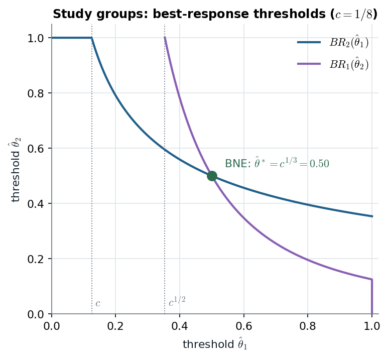

# 12.2.2 · 12.5 · Continuous types: best responses are thresholds, and mixed strategies are pure strategies of a perturbed game

> **Claim.** With a continuum of types and two actions, a player's best response to *any* strategy
> of the other is a **cutoff in his own type** — so the search for a BNE collapses from functions to
> numbers. Two payoffs: the study-group game has the **unique** BNE threshold $c^{1/3}$; and
> **Harsanyi's purification** reads a mixed-strategy equilibrium as the limit of pure, type-contingent
> play when each player's payoff carries a small private perturbation.
>
> Prev: [[L07-03-cournot-private-costs]] · Next: [[L07-05-adverse-selection-lemons]] · Map: [[L07-00-map]]

---

## 1 · C — study groups (§12.2.2, pp. 255–258)

### 1.1 · The game

Two students hand in a joint lab. Each chooses effort $e_i=1$ at cost $c<1$, or shirks ($e_i=0$,
free). The lab succeeds if **at least one** works. Student $i$'s type $\theta_i\sim U[0,1]$,
independent; his value of success is $\theta_i^2$.

| $i$'s choice | $i$'s payoff |
|---|---|
| work, $e_i=1$ | $\theta_i^2-c$ (success guaranteed) |
| shirk, $e_i=0$ | $\theta_i^2$ if $j$ works, $0$ if $j$ shirks |

A pure strategy is a function $s_i:[0,1]\to\{0,1\}$ — a continuum of strategies, so neither a tree
nor a matrix helps (p. 255).

### 1.2 · Only one number about $j$ matters

Whatever $s_j(\cdot)$ is, $i$'s payoff from shirking depends on it only through
$\Pr\{s_j(\theta_j)=1\}$. Working is a (weak) best response iff

$$\theta_i^2-c\;\ge\;\theta_i^2\Pr\{s_j(\theta_j)=1\}
\iff\theta_i^2\big(1-\Pr\{s_j=1\}\big)\ge c
\iff\theta_i\;\ge\;\sqrt{\frac{c}{1-\Pr\{s_j(\theta_j)=1\}}}.\tag{12.3}$$

> **Claim 12.1** (p. 256). The best response of player $i$ to any strategy $s_j(\cdot)$ is a
> **threshold rule**: there is $\hat\theta_i$ such that $i$ works iff $\theta_i\ge\hat\theta_i$.

The right side of (12.3) is a constant for a given $s_j$, so the set of types who work is an upper
interval. Intuition (p. 256): if $j$ surely shirks, $i$ works iff $\theta_i\ge\sqrt c$; any chance that
$j$ works lets $i$ free-ride, so types just above $\sqrt c$ now shirk; if $j$ works with high enough
probability the cutoff exceeds 1 and $i$ always shirks.

### 1.3 · Best response to a threshold

If $j$ uses cutoff $\hat\theta_j$, then $\Pr\{s_j=1\}=\Pr\{\theta_j\ge\hat\theta_j\}=1-\hat\theta_j$, and (12.3)
becomes $\theta_i\ge\sqrt{c/\hat\theta_j}$ (12.4). A cutoff cannot exceed 1, so

$$BR_i(\hat\theta_j)=\begin{cases}\sqrt{c/\hat\theta_j} & \text{if }\hat\theta_j\ge c\\[2pt] 1&\text{if }\hat\theta_j<c.\end{cases}\tag{12.5}$$

### 1.4 · The equilibrium: Claim 12.2 (p. 257)

> **Claim 12.2.** In the unique BNE each player uses the same threshold $\hat\theta^*$, $0<\hat\theta^*<1$.

**Interior candidates.** Both on the top branch of (12.5):
$$\hat\theta_1=\sqrt{c/\hat\theta_2},\qquad\hat\theta_2=\sqrt{c/\hat\theta_1}\tag{12.6}$$
Square both: $\hat\theta_1^2\hat\theta_2=c$ and $\hat\theta_2^2\hat\theta_1=c$. Divide the first by the
second: $\hat\theta_1/\hat\theta_2=1$, so $\hat\theta_1=\hat\theta_2=\hat\theta^*$ and $(\hat\theta^*)^3=c$:

$$\boxed{\;\hat\theta^*=c^{1/3}\;}\qquad(c<1\Rightarrow c<c^{1/2}<c^{1/3}<1).$$

**No corner equilibrium.** Suppose $\hat\theta_j<c$. Then $\hat\theta_i=BR_i(\hat\theta_j)=1$ ($i$ never
works). But then $BR_j(1)=\sqrt c>c$, contradicting $\hat\theta_j<c$. So the BNE strategies are

$$s_i^*(\theta_i)=\begin{cases}0&\theta_i<c^{1/3}\\1&\theta_i\ge c^{1/3}\end{cases}\qquad i=1,2.$$

(The tie at $\theta_i=c^{1/3}$ is broken toward work; it has probability zero, footnote 4, p. 256.)

### 1.5 · Worked — $c=1/8$ (illustrative)

| Quantity | Value |
|---|---|
| Cutoff if the partner surely shirks, $\sqrt c$ | $0.354$ |
| BNE cutoff $c^{1/3}$ | $0.5$ |
| Check $(\hat\theta^*)^2\hat\theta^*$ | $0.5^3=0.125=c$ ✓ |
| Probability a given student works, $1-c^{1/3}$ | $0.5$ |
| Probability the lab fails (both shirk), $(c^{1/3})^2$ | $0.25$ |

*Figure — the two best-response threshold curves (12.5) cross once, at $c^{1/3}$, as in Tadelis's Fig. 12.4 (p. 257). $c=1/8$ is illustrative; the book keeps $c$ general.*

Each curve is decreasing — **free-riding**: the harder my partner works (the lower his cutoff),
the higher my own cutoff. The flat segment at 1 is the region $\hat\theta_j<c$, where $j$ works so
often that no type of $i$ bothers. The curves cannot cross on that segment, which is the corner
argument of §1.4 drawn.

**MWG's identical example.** MWG Example 8.E.2 (p. 256), the "Zigger" R&D consortium: types
$U[0,1]$, benefit $\theta_i^2$, cost $c$; condition (8.E.3) is (12.3) in other letters.

---

## 2 · U — what the threshold result buys

- **From functions to numbers.** A strategy is any map $[0,1]\to\{0,1\}$; Claim 12.1 says only
  monotone cutoff maps can be best responses, so equilibrium is a fixed point in one number per
  player. The same reduction drives the auction notes: a bid function is pinned down by one
  differential equation ([[L07-07-first-price-dutch]]).
- **Monotonicity comes from the payoff, not from an assumption here**: the benefit of working,
  $\theta_i^2(1-\Pr\{s_j=1\})$, rises with $\theta_i$ while the cost $c$ does not.

---

## 3 · C — Harsanyi's interpretation of mixed strategies (§12.5, pp. 264–266)

### 3.1 · The discomfort

In Matching Pennies the unique equilibrium has each player mix 50–50, although each is
**indifferent** between $H$ and $T$ at that point ([[../L02/L02-00-map|Lecture 2]]). Why randomize
in exactly that proportion?

### 3.2 · Perturbed Matching Pennies (p. 265)

| | $H$ | $T$ |
|---|---|---|
| $H$ | $1+\varepsilon_1,\;-1+\varepsilon_2$ | $-1+\varepsilon_1,\;1$ |
| $T$ | $-1,\;1+\varepsilon_2$ | $1,\;-1$ |

$\varepsilon_i\sim U[-\varepsilon,\varepsilon]$ independent, known only to $i$: a small private taste for
heads. A strategy maps $\varepsilon_i$ to $\{H,T\}$.

> **Claim 12.3.** The unique pure-strategy BNE is $s_i(\varepsilon_i)=H$ iff $\varepsilon_i\ge0$ (and
> $T$ otherwise). Its outcomes and payoffs converge to the mixed equilibrium of Matching Pennies
> as $\varepsilon\to0$.

Verification of the equilibrium (p. 265): if $j$ uses this rule, $j$ plays $H$ with probability
$\Pr\{\varepsilon_j\ge0\}=\tfrac12$; facing a 50–50 opponent, $i$ strictly prefers $H$ iff
$\varepsilon_i>0$ — exactly the rule. Uniqueness takes more work (exercise 12.10, p. 269).

### 3.3 · Worked — Gibbons's Battle of the Sexes (§3.2.A, pp. 152–154)

| Chris \ Pat | Opera | Fight |
|---|---|---|
| Opera | $2+t_c,\;1$ | $0,0$ |
| Fight | $0,0$ | $1,\;2+t_p$ |

$t_c,t_p\sim U[0,x]$, independent, private. The complete-information game ($x=0$) has a mixed
equilibrium with Chris playing Opera and Pat playing Fight each with probability $2/3$.

**Candidate.** Chris plays Opera iff $t_c\ge c$; Pat plays Fight iff $t_p\ge p$. Then Chris plays Opera
with probability $(x-c)/x$, Pat plays Opera with probability $p/x$.

**Chris's best response.** Opera pays $\frac px(2+t_c)$; Fight pays $\big(1-\frac px\big)\cdot1$. Opera iff
$$\frac px(2+t_c)\ge1-\frac px\iff2+t_c\ge\frac xp-1\iff t_c\ge\frac xp-3=c.\tag{3.2.1}$$

**Pat's best response.** Fight pays $\frac cx(2+t_p)$; Opera pays $\big(1-\frac cx\big)\cdot1$. Fight iff
$$t_p\ge\frac xc-3=p.\tag{3.2.2}$$

**Solve.** The two conditions are symmetric, so $p=c$ and $c=x/c-3$, i.e. $c^2+3c-x=0$:
$$c=\frac{-3+\sqrt{9+4x}}{2},\qquad\Pr\{\text{Chris plays Opera}\}=\frac{x-c}{x}=1-\frac{-3+\sqrt{9+4x}}{2x}.$$

**The limit.** $\sqrt{9+4x}=3\sqrt{1+4x/9}=3+\tfrac{2x}{3}+O(x^2)$, so
$\frac{-3+\sqrt{9+4x}}{2x}\to\frac13$ and the probability $\to\tfrac23$.

| $x$ | 1 | 0.5 | 0.1 | 0.01 | $\to0$ |
|---|---|---|---|---|---|
| cutoff $c$ | 0.3028 | 0.1583 | 0.0330 | 0.0033 | 0 |
| $\Pr\{\text{Opera}\}=1-c/x$ | 0.6972 | 0.6834 | 0.6703 | 0.6670 | $2/3$ |

> **The point of purification** (Gibbons p. 152): *"the crucial feature of a mixed-strategy Nash
> equilibrium is not that player $j$ chooses a strategy randomly, but rather that player $i$ is
> uncertain about player $j$'s choice."* Each player is a pure-strategy type-contingent player;
> the population of types *looks* mixed. That is [[../../rules/game-theory|rules/game-theory]]
> item 8, now proved in an example.

---

## 4 · G — the general theorem

Harsanyi's (1973) **purification theorem**: (almost) every mixed equilibrium of a complete-information
game is the limit of pure-strategy BNE of nearby games with small independent payoff perturbations
(Tadelis p. 265, which refers to Govindan 2003 for a short proof; Gibbons p. 152 notes the rare
exceptions). Named, not examinable.

---

## Links

- Prev: [[L07-03-cournot-private-costs]] · Next: [[L07-05-adverse-selection-lemons]].
- Mixed strategies and indifference: [[../L02/L02-00-map|Lecture 2]].
- A threshold in a *buyer–seller* game: the lemons cutoff and the double auction's
  $v_b\ge v_s+\tfrac14$ → [[L07-05-adverse-selection-lemons]].
- Code: [[L07-12-python]] §4 (`study_group_br`, `bos_purified`).
- **Exercises (number + page only):** Tadelis 12.9, 12.10 (p. 269), 12.7 (p. 268);
  Gibbons 3.5 (p. 170); Muñoz-Garcia Ch. 7 Ex. 6 (p. 339).
