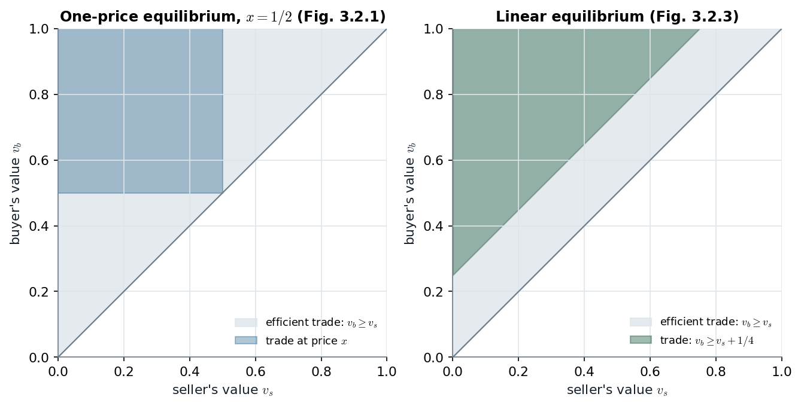

# 12.3 · Adverse selection: a single price buys the bottom of the pool, and trade unravels

> **Claim.** When the seller knows the quality and the buyer does not, **any one price attracts
> exactly the sellers whose quality is below it**, so the buyer pays for an average that falls as
> the good types withdraw. In Tadelis's example every unit is worth 4 more to the buyer than to the
> seller, yet **only the lowest quality can trade in any BNE**. The same logic closes insurance
> markets (M&R, Cabral), and with **two-sided** private information no equilibrium of a double
> auction trades exactly when trade is efficient (Gibbons).
>
> Prev: [[L07-04-threshold-strategies-purification]] · Next: [[L07-06-second-price-english]] · Map: [[L07-00-map]]

---

## 1 · U — what perfect information was doing for markets (p. 258)

The competitive argument: if a good is held by someone who values it less than someone else, market
pressure raises its price until the owner sells. With perfect information and no transaction costs,
the **Coase theorem** says ownership ends up with whoever values the good most, whatever the
initial allocation ([[../L04/L04-00-map|Lecture 4]] for bargaining). Akerlof (1970) asked what is left
of this when the seller knows more than the buyer.

---

## 2 · C — the orange grove (pp. 258–259)

**Types.** Player 1 owns a grove of quality $\theta_1\in\{L,M,H\}$, each with probability $\tfrac13$;
only he knows it. **Values:**

| Quality | Seller's value $v_1(\theta_1)$ | Buyer's value $v_2(\theta_1)$ | Gain from trade |
|---|---|---|---|
| $L$ | 10 | 14 | 4 |
| $M$ | 20 | 24 | 4 |
| $H$ | 30 | 34 | 4 |

**Game (Fig. 12.5).** Player 2 (a soybean grower) makes a take-it-or-leave-it offer $p\ge0$; player 1
accepts ($A$) or rejects ($R$). A strategy for player 2 is a price; a pure strategy for player 1 is a
map $s_1:[0,\infty)\times\Theta_1\to\{A,R\}$. Payoffs on acceptance: $p-v_1(\theta_1)$ to the seller,
$v_2(\theta_1)-p$ to the buyer; zero otherwise.

**Efficiency says every grove should change hands** — the buyer values every quality more.
**Under complete information it would:** with quality known to be $L$, the ultimatum-game SPE has
the buyer offer 10 and the seller accept, and any price in $[10,14]$ is a Nash equilibrium (p. 259,
footnote 5).

---

## 3 · C — unravelling, step by step (pp. 259–260)

**Naive candidate.** On average the land is worth $\tfrac13(14+24+34)=24$ to the buyer and
$\tfrac13(10+20+30)=20$ to the seller. Offer $p=20$?

| Step | Price range | Who accepts | Buyer's value of the accepting pool | Buyer's payoff |
|---|---|---|---|---|
| 1 | $p\in[20,30)$ | $L$, $M$ (each $\tfrac12$ given a sale, footnote 6) | $\tfrac12\cdot14+\tfrac12\cdot24=19$ | $19-p<0$ |
| 2 | $p\ge30$ | $L,M,H$ | $24$ | $24-p\le-6<0$ |
| 3 | $p\in[10,20)$ | $L$ only | $14$ | $14-p\ge0$ iff $p\le14$ |
| 4 | $p<10$ | nobody | — | $0$ |

The Bayes step in row 1: conditional on a sale, the grove is $L$ or $M$ with prior weights
$\tfrac13,\tfrac13$, renormalized to $\tfrac12,\tfrac12$.

> **Proposition 12.1** (p. 260). Trade can occur in a Bayesian Nash equilibrium only if it involves
> the lowest type of player 1 trading. Furthermore, any price $p^*\in[10,14]$ can be supported as a
> Bayesian Nash equilibrium.

**The supporting strategies** (p. 260): player 2 offers $p^*$; player 1 of type $L$ accepts iff
$p\ge p^*$, type $M$ iff $p\ge20$, type $H$ iff $p\ge30$. **Check player 2:** at $p^*$ he gets
$\tfrac13(14-p^*)\ge0$; a lower price is refused (0); a price in $(p^*,20)$ buys the same $L$ for more;
$[20,30)$ gives $\tfrac23(19-p)<0$; $p\ge30$ gives $24-p<0$. So $p^*$ is a best response iff
$p^*\le14$. **Check player 1:** at $p^*\in[10,14]$, type $L$ gains $p^*-10\ge0$ by accepting, and
$M,H$ would lose by accepting.

> **Adverse selection** (p. 260): when the buyer offers his *average* value, the sellers willing to
> sell at that price are *below* average — the best types select themselves out — and in the
> example the traded quality falls all the way to the bottom.

**Two things make it bite** (pp. 260–261):

1. **Common values.** The seller's type enters the **buyer's** payoff ($v_2$ depends on $\theta_1$).
   With private values the buyer would not care who accepts.
2. **Talk is cheap.** "My soil is of high quality" is worthless: every type would say it. A
   **credible** revelation of type changes the outcome — that is signaling,
   [[../L08/L08-00-map|Lecture 8]] (Tadelis Ch. 16).

---

## 4 · Worked — how much premium does trade need?

Generalize the grove: $K$ equally likely qualities with seller values $v_k=v_1+(k-1)s$ and buyer
values $v_k+\Delta$. Qualities $1,\dots,k$ can trade iff the buyer does not lose on that pool at the
price $v_k$ that brings in the $k$-th:

$$\underbrace{v_1+\tfrac{(k-1)s}{2}}_{\text{mean seller value of }1..k}+\Delta\;\ge\;\underbrace{v_1+(k-1)s}_{v_k}
\iff\boxed{\;\Delta\ge\frac{(k-1)s}{2}\;}$$

| Tadelis ($s=10$, $K=3$) | $k=1$ ($L$) | $k=2$ ($L,M$) | $k=3$ (all) |
|---|---|---|---|
| premium needed | 0 | 5 | 10 |
| at $\Delta=4$ | trades | out | out |

- **The level $v_1$ drops out**: only the **spread of quality the seller knows about**, relative to
  the gain from trade, matters.
- **Gains lost.** Full information: every grove trades, expected gain $\Delta=4$. Best BNE: only $L$,
  expected gain $\tfrac13\cdot4=\tfrac43$ — **two thirds of the surplus destroyed**.
- **The buyer's preferred equilibrium.** Offering $v_k$ yields him $\tfrac kK\big(\Delta-\tfrac{(k-1)s}{2}\big)$;
  at $\Delta=4$ only $k=1$ is positive: offer 10, expected surplus $\tfrac13\cdot4=\tfrac43$.

> **Interactive companion.** [The Lemons Ladder](companions/companion-lemons.html) — move the
> premium $\Delta$ and the spread $s$ and watch the highest tradable quality jump at
> $\Delta=s(k-1)/2$; move $v_1$ and see the prices shift while the trade set stays put.

*Figure — trade is possible where what a price buys (the step) is at least the price (the 45° line). Left: Tadelis pp. 258–260, the pools are worth 14, 19, 24 at prices 10, 20, 30. Right: MWG Example 13.B.1, p. 442, with $\alpha=0.75$ and $0.4$ illustrative.*

Every jump of the step comes **too late**: when the price reaches 20 the pool improves to 19, one
short of the price that bought the improvement; at 30 it improves to 24, six short. The continuous
version on the right is the same picture with a continuum of qualities (§8).

---

## 5 · C — insurance: the buyer is the informed side (M&R pp. 149–152)

**Why insurance.** The people who buy a policy are not a random sample: they know something about
their expected claims (M&R's maternity-coverage example, p. 149). Here the **buyer** has the private
information, and the bad types are the **high-cost** ones.

**M&R's model.** Expected claims $x\sim U[0,\bar x]$, private. A buyer also values the risk reduction
at $v$, so she buys at price $P$ iff $P\le v+x$, i.e. iff $x\ge P-v$. The insurer pays $1+c$ per
dollar of claims ($c$ = administration cost). If the marginal buyer is $x$, the pool's average claim
is $(x+\bar x)/2$:

$$P_s(x)=\tfrac12(x+\bar x)(1+c)\quad\text{(insurer breaks even)}\tag{5.1}$$
$$P_b(x)=x+v\quad\text{(buyer }x\text{ is just willing)}\tag{5.2}$$

**When does a market exist?** Need some $x$ with $P_b(x)\ge P_s(x)$. The gap
$$P_b(x)-P_s(x)=\frac{1-c}{2}x+v-\frac{1+c}{2}\bar x$$
rises with $x$ (for $c<1$), so it is largest at $x=\bar x$, where it equals $v-c\bar x$:

$$\boxed{\;\text{market breaks down}\iff c\,\bar x>v\;}\qquad\text{(p. 152)}$$

The highest-claim customer must be worth serving on her own. **Mandatory coverage** (everyone in) has
average benefit $v+\bar x/2$ and average cost $(1+c)\bar x/2$: worthwhile iff $v>c\bar x/2$. Hence the
band
$$c\,\bar x>v>\tfrac{c\,\bar x}{2}:\quad\text{insurance is desirable, but no private individual market survives}$$
— the case for **group** (employer) insurance, a private-sector fix (p. 152).

*Illustration ($\bar x=100$, $c=0.1$, illustrative): the market exists iff $v\ge10$; mandatory coverage
pays iff $v>5$; at $v=8$ insurance is efficient and the market is closed.*

**Credit rationing** (M&R p. 153). Safe borrowers A repay 1.1M for sure; risky B's projects pay 0.9M or
1.3M. Raising the loan rate to just over 10% drives out A (they would pay more than they earn) and
keeps B (expected profit $\tfrac12(1.3-1.1)=0.1$M), so the bank's pool worsens and its return falls.
**The price the lender charges changes the quality of its customers** — Stiglitz–Weiss rationing.

---

## 6 · Worked — Cabral's insurer (§7.4, pp. 174–176)

10% of patients are high risk. Values of a year's insurance: 20 (high), 3 (low); costs to the
insurer: 30 (high), 1 (low), in \$000. Averages: value $0.1\cdot20+0.9\cdot3=4.7$, cost
$0.1\cdot30+0.9\cdot1=3.9$. The insurer considers $p=4.5$ (between the averages) and $p=30$.

| Price | High risk ($\tfrac1{10}$) | Low risk ($\tfrac9{10}$) | Insurer's expected profit |
|---|---|---|---|
| 4.5 | buys ($20\ge4.5$): insurer $4.5-30=-25.5$ | does not buy ($3<4.5$) | $0.1(-25.5)=-2.55$ |
| 30 | does not buy | does not buy | $0$ |

The insurer sets $p=30$ and **nobody is insured** (Cabral prints $-2.5$, rounding $-2.55$). Reverse
the information — the patient does not know his own risk either (Cabral's Fig. 7.12) — and $p=4.5$
is accepted by the "average" patient ($4.7\ge4.5$), earning $4.5-3.9=0.6>0$. **Same numbers; only
who knows what, and when, changed** (p. 176).

---

## 7 · C — two-sided private information: the double auction (Gibbons §3.2.C, pp. 158–163)

### 7.1 · The game

A seller (value $v_s$) and a buyer (value $v_b$), **each privately informed**, $v_s,v_b\sim U[0,1]$
independent. Simultaneously the seller names an ask $p_s$ and the buyer an offer $p_b$. If $p_b\ge p_s$
they trade at $p=(p_b+p_s)/2$; otherwise no trade. Payoffs: buyer $v_b-p$, seller $p-v_s$ on trade,
0 otherwise. Strategies are functions $p_b(v_b)$, $p_s(v_s)$. Efficient trade: iff $v_b\ge v_s$.

### 7.2 · Many equilibria: the one-price family (p. 159–160)

For any $x\in[0,1]$: the buyer offers $x$ if $v_b\ge x$ (else 0); the seller asks $x$ if $v_s\le x$ (else 1).
Given the other's strategy, each side's choice is just "trade at $x$ or not", and exactly the types
who prefer trading at $x$ do so. **Trade iff $v_s\le x\le v_b$.** Expected gains:
$$\int_0^x\!\!\int_x^1(v_b-v_s)\,dv_b\,dv_s=x(1-x)\Big[\tfrac{1+x}{2}-\tfrac x2\Big]=\frac{x(1-x)}{2},\quad\text{max }\tfrac18\text{ at }x=\tfrac12 .$$

### 7.3 · The linear equilibrium, derived (pp. 160–161)

**Buyer's best reply to a linear seller**, $p_s=a_s+c_sv_s$, so $p_s\sim U[a_s,a_s+c_s]$: given trade,
the expected ask is $E[p_s\mid p_s\le p_b]=(a_s+p_b)/2$ and $\Pr\{p_s\le p_b\}=(p_b-a_s)/c_s$. The buyer
solves
$$\max_{p_b}\Big[v_b-\tfrac12\Big(p_b+\tfrac{a_s+p_b}{2}\Big)\Big]\frac{p_b-a_s}{c_s}
=\Big[v_b-\frac{3p_b+a_s}{4}\Big]\frac{p_b-a_s}{c_s}.$$
FOC: $-\tfrac34(p_b-a_s)+v_b-\tfrac{3p_b+a_s}{4}=0\Rightarrow4v_b=6p_b-2a_s$:
$$p_b=\tfrac23v_b+\tfrac13a_s.\tag{3.2.5}$$

**Seller's best reply to a linear buyer**, $p_b=a_b+c_bv_b\sim U[a_b,a_b+c_b]$; write $A=a_b+c_b$:
$$\max_{p_s}\Big[\tfrac12\Big(p_s+\tfrac{p_s+A}{2}\Big)-v_s\Big]\frac{A-p_s}{c_b}
\;\Rightarrow\;\tfrac34(A-p_s)-\Big(\tfrac{3p_s+A}{4}-v_s\Big)=0\;\Rightarrow\;
p_s=\tfrac23v_s+\tfrac13(a_b+c_b).\tag{3.2.6}$$

**Fixed point.** (3.2.5): $c_b=\tfrac23$, $a_b=a_s/3$. (3.2.6): $c_s=\tfrac23$, $a_s=(a_b+c_b)/3$. Then
$a_s=\tfrac13\big(\tfrac{a_s}3+\tfrac23\big)\Rightarrow\tfrac89a_s=\tfrac29\Rightarrow a_s=\tfrac14$, $a_b=\tfrac1{12}$:

$$\boxed{\;p_b(v_b)=\tfrac23v_b+\tfrac1{12},\qquad p_s(v_s)=\tfrac23v_s+\tfrac14\;}\tag{3.2.7–3.2.8}$$

**When do they trade?** $p_b\ge p_s\iff\tfrac23(v_b-v_s)\ge\tfrac14-\tfrac1{12}=\tfrac16\iff$

$$\boxed{\;v_b\ge v_s+\tfrac14\;}$$

Seller types above $\tfrac34$ ask more than the highest offer $p_b(1)=\tfrac34$; buyer types below
$\tfrac14$ offer less than the lowest ask $p_s(0)=\tfrac14$ (p. 161).

### 7.4 · How much is lost

| Equilibrium | Trade iff | Expected gains | Share of efficient |
|---|---|---|---|
| Efficient benchmark | $v_b\ge v_s$ | $\int_0^1\!\int_{v_s}^1(v_b-v_s)=\tfrac16\approx0.1667$ | 100% |
| Linear | $v_b\ge v_s+\tfrac14$ | $\tfrac{9}{64}\approx0.1406$ | 84.4% |
| One-price, $x=\tfrac12$ | $v_s\le\tfrac12\le v_b$ | $\tfrac18=0.125$ | 75% |

The linear figure: for fixed $v_s\le\tfrac34$, $\int_{v_s+1/4}^1(v_b-v_s)\,dv_b=\tfrac12\big[(1-v_s)^2-\tfrac1{16}\big]$;
with $u=1-v_s$, $\int_{1/4}^1\tfrac12(u^2-\tfrac1{16})\,du=\big[\tfrac{u^3}6-\tfrac u{32}\big]_{1/4}^1=\tfrac{52}{384}+\tfrac{2}{384}=\tfrac9{64}$.

*Figure — trade regions inside the efficient triangle $v_b\ge v_s$: the one-price equilibrium misses valuable trades and makes some worth almost nothing; the linear one misses only trades worth less than $\tfrac14$. Source: Gibbons Figs. 3.2.1 and 3.2.3, pp. 160–163.*

> **Myerson–Satterthwaite (named only).** Among all BNE of the double auction, the linear one gives
> the highest expected gains; and **no** bargaining game the two would willingly play trades if and
> only if $v_b\ge v_s$ (Gibbons pp. 162–163). Proving it uses the revelation principle — mechanism
> design, outside this course's scope.

---

## 8 · G — the competitive version (MWG §13.B, pp. 437–447)

Workers of productivity $\theta$ (private) earn $r(\theta)$ at home; firms pay one wage $w$ to all.

- **Definition 13.B.1** (p. 439): a competitive equilibrium is $(w^*,\Theta^*)$ with
  $\Theta^*=\{\theta:r(\theta)\le w^*\}$ and $w^*=E[\theta\mid\theta\in\Theta^*]$; hence (13.B.6),
  p. 441: $w^*=E[\theta\mid r(\theta)\le w^*]$.
- **Example 13.B.1** (p. 442): $\theta\sim U[0,2]$, $r(\theta)=\alpha\theta$, $\alpha<1$ (every worker belongs
  in a firm). Applicants at wage $w$ are $\theta\le w/\alpha$, average $w/(2\alpha)$ while $w\le2\alpha$.
  For $\alpha>\tfrac12$, $w/(2\alpha)<w$ for all $w>0$: **the only equilibrium is $w^*=0$** — complete
  unravelling (figure above, right panel, $\alpha=0.75$).
- Multiple equilibria can be Pareto-ranked (Fig. 13.B.3, p. 442); **Prop. 13.B.1** (p. 443): with wage-
  setting firms, the SPNE picks the highest-wage competitive equilibrium; **Prop. 13.B.2** (p. 447):
  that equilibrium is a **constrained** Pareto optimum — a planner who cannot see $\theta$ cannot
  improve on it. Named, not examinable.

---

## Links

- Prev: [[L07-04-threshold-strategies-purification]] · Next: auctions,
  [[L07-06-second-price-english]].
- The same conditioning in auctions and votes: [[L07-09-common-values-curses]].
- Signaling and screening as the market's answer: [[../L08/L08-00-map|Lecture 8]].
- Rules pack: [[../../rules/07_selecao_adversa|Topic 7]] (adverse selection; its lemons section is
  still a placeholder that this note can fill).
- Code: [[L07-12-python]] §5–6 (`lemons_trade`, `mr_market_exists`, `insurer_payoff`,
  `mwg_wages`, `linear_double_auction`).
- **Exercises (number + page only):** Tadelis 12.5, 12.6 (pp. 267–268); Gibbons 3.8 (p. 171);
  MWG 13.B.1–13.B.5 (p. 473); M&R Questions 5.3–5.5 (pp. 164–165); Cabral 7.9 (p. 180), 7.10
  (p. 181).
