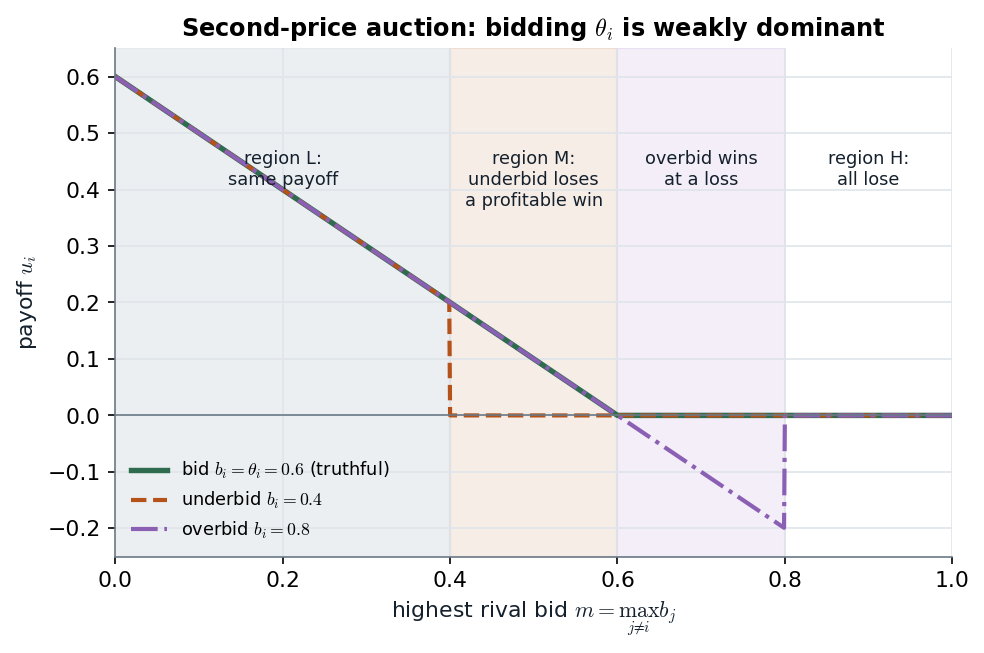

# 13.1.1–13.1.2 · Second-price and English auctions: bid your value, whatever the others do

> **Claim.** In the second-price sealed-bid auction **bidding one's value is weakly dominant** — a
> Bayesian Nash equilibrium that needs no beliefs at all — and the English (button) auction has the
> same outcome: the highest-value bidder wins and pays the second-highest value. Lecture 1 met the
> dominance argument as a complete-information game; here it becomes a **strategy**
> $s_i(\theta_i)=\theta_i$, a map from types to bids.
>
> Prev: [[L07-05-adverse-selection-lemons]] · Next: [[L07-07-first-price-dutch]] · Map: [[L07-00-map]]

---

## 1 · C — four auctions, one Bayesian game (pp. 270–272)

| | **Open** (price evolves in view) | **Sealed bid** (simultaneous) |
|---|---|---|
| **Pay the second-highest price** | **English**: price rises until one bidder is left; he pays where the last rival quit | **Second-price (Vickrey)**: highest bid wins, pays the highest losing bid |
| **Pay your own price** | **Dutch**: price falls until someone shouts "buy" and pays that price | **First-price**: highest bid wins, pays his bid |

The table's rows are the two strategic equivalences this note and the next establish (English ≈
second-price; Dutch ≡ first-price). **An auction is a Bayesian game** (p. 271): players are bidders,
actions are bids, payoffs depend on winning and paying, and nobody knows the others' valuations.

**The independent private values (IPV) setting** (p. 272). Bidder $i$'s value is his type
$\theta_i\in[\underline\theta_i,\overline\theta_i]$, drawn from $F_i$, **independently** across
bidders. Winning at price $p$ pays $\theta_i-p$; losing pays 0. Private values: $i$'s payoff depends on
his own type only (the filet mignon that must be eaten within the hour, p. 272). The seller is not a
player: once he fixes the rules, he has no further move.

---

## 2 · C — the second-price sealed-bid auction (pp. 272–274)

**Payoff** (p. 273), with $b_j^*\equiv\max_{j\ne i}b_j$:
$$u_i(b_i,b_{-i};\theta_i)=\begin{cases}\theta_i-b_j^*&\text{if }b_i>b_j\ \forall j\ne i\\0&\text{if }b_i\le b_j\text{ for some }j\ne i\end{cases}$$
(Tadelis's baseline tie rule: tied top bidders get nothing; the Remark on p. 274 replaces it with a
random winner paying his own bid, and nothing below changes.)

**Strategy:** a function $s_i:[\underline\theta_i,\overline\theta_i]\to\mathbb R_+$.

> **Proposition 13.1** (p. 273). In the second-price sealed-bid auction, each player has a weakly
> dominant strategy, which is to bid his true valuation: $s_i(\theta_i)=\theta_i$ for all $i\in I$ is a
> Bayesian Nash equilibrium in weakly dominant strategies.

### 2.1 · Proof, the three cases (pp. 273–274, Fig. 13.1)

Fix $\theta_i$ and an underbid $b_i<\theta_i$. Let $b_j^*$ be the highest rival bid. Split the line into
region L ($b_j^*<b_i$), region M ($b_i<b_j^*<\theta_i$), region H ($b_j^*>\theta_i$).

| Case | Highest rival bid | Bid $b_i<\theta_i$ | Bid $\theta_i$ | Verdict |
|---|---|---|---|---|
| 1 | region L | wins, pays $b_j^*$ | wins, pays $b_j^*$ — **same price** | equal |
| 2 | region H | loses, 0 | loses, 0 | equal |
| 3 | region M | loses, 0 | wins, $\theta_i-b_j^*>0$ | **truthful strictly better** |

Never worse, sometimes strictly better: $\theta_i$ weakly dominates every lower bid. An overbid
$b_i>\theta_i$ is the mirror image — it changes the outcome only when $\theta_i<b_j^*<b_i$, where it wins
at a price above the value (Tadelis leaves the write-up as exercise 13.1, p. 285).

> **Why it works: your bid decides *whether* you win, never *what you pay*.** The price is set by
> someone else's bid, so the only question your bid answers is "do I want the object at the price
> the others set?" — and bidding $\theta_i$ answers "yes" exactly when $\theta_i$ exceeds that price.

*Figure — the three regions of Tadelis's Fig. 13.1 as payoff curves: underbidding forfeits region M, overbidding buys losses between $\theta_i$ and $b_i$, elsewhere all bids tie. Source: Prop. 13.1, pp. 273–274; $\theta_i=0.6$, $b_i=0.4$, $b_i'=0.8$ illustrative.*

The truthful curve is the upper envelope of the other two everywhere: that is weak dominance read
off a picture. At $m=0.5$ (region M) truthful earns $0.1$ and the underbid earns $0$.

### 2.2 · What the dominance buys (p. 274)

1. **No beliefs needed.** The bidder need not know $F_j$ or the others' strategies: the common-prior
   assumption can be dropped.
2. **Robust to correlation.** With correlated but still *private* values, truth-telling stays weakly
   dominant.
3. **Efficiency.** The highest-value bidder wins: the outcome is Pareto optimal.

### 2.3 · Worked — three bidders

Values $0.9,\;0.6,\;0.3$; everyone bids his value. Bidder 1 wins and pays $0.6$; payoffs
$(0.3,0,0)$; seller's revenue $0.6$ = the **second-highest value**. Could bidder 2 do better by bidding
$0.95$? He would win and pay $0.9>0.6$: payoff $-0.3$. Could bidder 1 gain by bidding $0.7$ or $2$? He
still wins at $0.6$: no change.

**Dominance is not uniqueness.** Weak dominance singles out this equilibrium; it does not rule out
others built on weakly dominated bids (whether they exist under complete information is Tadelis
exercise 13.2, p. 285; [[../L01/L01-00-map|Lecture 1]] showed that IESDS alone says nothing in this
auction).

---

## 3 · C — the English auction as a button auction (pp. 275–276)

An open ascending auction has no best response with continuous increments (any jump could be
smaller), as in Bertrand with unequal costs ([[../L02/L02-00-map|Lecture 2]]). Milgrom and Weber's
**button auction** fixes this: the price rises continuously from 0; each bidder holds a button and
**quits for good** by releasing it; the last bidder holding wins and pays the price at which the
second-to-last let go. A strategy maps a type to a quitting price.

> **Proposition 13.2** (p. 275). In the button-auction model it is a weakly dominant strategy for
> each player to keep his button pressed as long as $p<\theta_i$ and to release it once $p=\theta_i$.
> This is outcome-equivalent to the second-price sealed-bid auction.

**Proof sketch (p. 276).** While $p<\theta_i$, staying in can only lead to winning at a price below
$\theta_i$; quitting forgoes that. At $p=\theta_i$, staying could only win at a price above value. The
winner is the highest-value bidder and pays the price at which the second-highest quit — **his
value**. Same allocation, same price as §2.

| | Second-price sealed | English (button) |
|---|---|---|
| Weakly dominant strategy | bid $\theta_i$ | quit at $p=\theta_i$ |
| Winner | highest $\theta$ | highest $\theta$ |
| Price | second-highest $\theta$ | second-highest $\theta$ |

**eBay** (p. 276) runs proxy bidding: your "maximum bid" is a button you hold for you, and eBay's own
advice, "enter the maximum amount you are willing to pay", is the weakly dominant strategy.

---

## 4 · U — why sell by auction at all (Cabral §6.4, pp. 140–142)

Two buyers whose values are **both** 100 or **both** 150, equally likely; the buyers know, the seller
does not.

| Selling method | Revenue |
|---|---|
| Posted price 100 | 100 for sure |
| Posted price 150 | $\tfrac12\cdot150+\tfrac12\cdot0=75$ |
| Ascending auction | stops at 100 if values are 100, at 150 if 150: $\tfrac12\cdot100+\tfrac12\cdot150=125$ |

> **An auction is price discrimination by self-selection**: it makes the price track the buyers'
> valuations without the seller knowing them (p. 141). Cabral's bidding-strategy remark (p. 141) is
> the first-price trade-off of the next note: a higher bid wins more often but earns less when it wins,
> *"just like monopoly pricing"*.

---

## Links

- Prev: [[L07-05-adverse-selection-lemons]] · Next: the format where you pay your bid,
  [[L07-07-first-price-dutch]].
- **Lecture 1 already proved the dominance** with a reserve price on a bid grid:
  [[../L01/L01-00-map|Lecture 1]] · `Listas/lista-lecture-01.tex` Q1 b) and its check
  `Listas/lista-lecture-01-check.py::spa_payoff` · `Listas/pratica-lecture-01.md` items 17
  (Tadelis 4.3, p. 76), 23 (MWG 8.B.3, p. 262) and 24, with solutions in
  `Listas/pratica-lecture-01-solutions/item23.tex`, `item24.tex` · quiz
  `Simulados/quiz-lecture01-2-dominance-pareto-2026-10-13.md` (section *auction*).
- Revenue of the format: [[L07-08-revenue-equivalence]]. With common values truth-telling fails:
  [[L07-09-common-values-curses]].
- **Interactive companion.** [The Bid Shading Desk](companions/companion-auction-bidding.html) — press
  "b = θ" and read the second-price payoff tile at its optimum; move b either way and the loss tile
  turns positive.
- Code: [[L07-12-python]] §7 (`spa_payoff`, the three cases).
- **Exercises (number + page only):** Tadelis 13.1, 13.2 (p. 285), 13.3 (pp. 285–286), 13.4 (p. 286);
  Muñoz-Garcia Ch. 8 Ex. 4 (p. 362).
